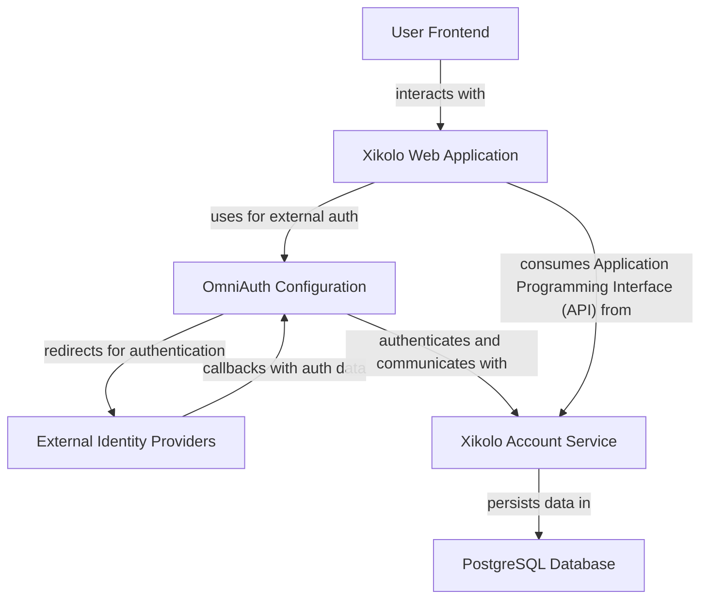
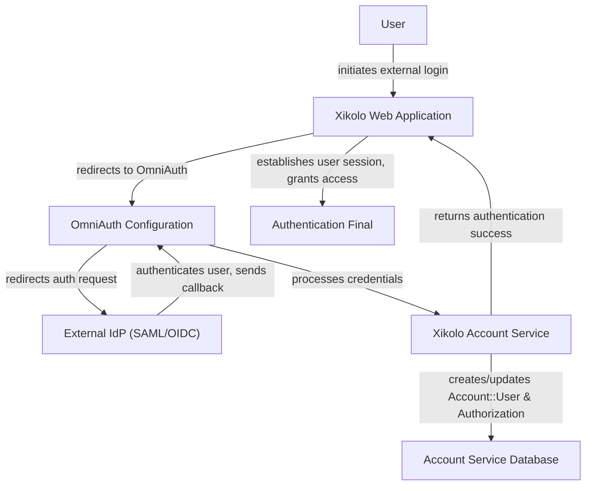
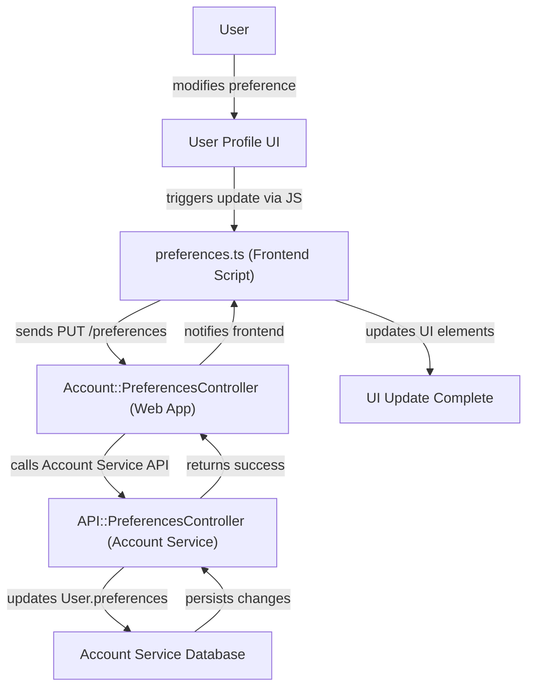

# User Account Management, Authentication, Authorization, and Profiles - Technical Documentation

*Generated on 9/18/2025 | Xikolo Knowledge Base*

---

## 📋 Executive Summary

This report provides a standardized overview of Xikolo cluster 01_CORE_UserAuthentication, focusing on user account management, authentication, authorization, and profile features. The cluster is central to how users interact with the Xikolo platform, encompassing registration, login, personal data management, and permissions-based access. Key components include the OmniAuth Configuration for external identity provider integration, the dedicated Xikolo Account Service for core user and authorization logic, and robust systems for Custom Fields Management, Consent Management, and User Preferences. The primary purpose is to detail the architectural components and technical workflows that facilitate secure and personalized user experiences across the platform, relying on a distributed architecture with a strong emphasis on data persistence and inter-service communication.

---

## 🏗️ Architecture Overview

The Xikolo User Authentication and Profile cluster is built upon a hybrid architecture involving the main Xikolo Web Application and a specialized Xikolo Account Service microservice. User interactions originate from the User Frontend, which communicates with the Xikolo Web Application. For external authentication, the Web Application leverages OmniAuth Configuration to interact with various External Identity Providers (IdPs) like SAML and OpenID Connect. Upon successful authentication, user and authorization records are managed and persisted by the Xikolo Account Service, which acts as the authoritative source for user data. This microservice also interacts with a PostgreSQL Database for all data persistence and relies on an internal Permissions Manager to enforce access control. The overall design ensures a clear separation of concerns, with the Account Service handling the complexities of user identity, authorization, and profile data, while the Web Application provides the user interface and orchestrates higher-level workflows.

### Architecture Diagrams

#### Main Architecture

### 🔄 Component Interactions

Key interactions between components in this cluster:

- **OmniAuth Configuration:** Integrates with various external Identity Providers (IdPs) like SAML and OpenID Connect. [Source: config/initializers/omniauth.rb]
- **OmniAuth Configuration:** Provides authentication callbacks to the main application. [Source: config/initializers/omniauth.rb]
- **Custom Fields Management:** Users interact with their profile page to input data. [Source: services/account/app/models/user.rb, app/controllers/account/profile_controller.rb]
- **Custom Fields Management:** Administrators configure fields via Rails console. [Source: services/account/app/models/custom_field.rb]
- **Consent Management:** Users manage consents on their profile page. [Source: services/account/app/models/consent.rb, services/account/app/models/treatment.rb]
- **Consent Management:** The system enforces required consents. [Source: services/account/app/models/consent.rb]
- **Xikolo Account Service:** Exposes API endpoints for user operations. [Source: services/account/config/routes.rb]
- **Xikolo Account Service:** Interacts with the main application for authentication flows and profile data display. [Source: services/account/app/controllers/api/]
- **Authorization System:** Roles are assigned to groups. [Source: services/account/lib/tasks/permissions/account.yml]
- **Authorization System:** Groups are granted specific permissions within a context. [Source: services/account/lib/tasks/permissions/account.yml]
- **Portal API Authentication:** Clients send requests with Bearer Tokens.
- **Portal API Authentication:** The API validates tokens.
- **Xikolo::Account Service:** Interacts with the Xikolo::Web application for user authentication and authorization requests [Source: services/account/app/controllers/api/, services/account/config/routes.rb].
- **Xikolo::Account Service:** Manages persistence of permissions, roles, groups, and grants in a PostgreSQL database [Source: services/account/app/models/role.rb, services/account/app/models/group.rb, services/account/app/models/grant.rb].
- **Permission (Concept):** Bundled into Roles [Source: services/account/lib/tasks/permissions/*.yml].
- **Permission (Concept):** Defined in YAML files within the Xikolo::Account service [Source: services/account/lib/tasks/permissions/account.yml, services/account/lib/tasks/permissions/course.yml].
- **Role (Concept):** Comprises multiple Permissions [Source: services/account/lib/tasks/permissions/account.yml, services/account/app/models/role.rb].
- **Role (Concept):** Granted to Groups within a specific context [Source: services/account/app/models/grant.rb, services/account/lib/tasks/permissions/account.yml].
- **Group (Concept):** Receives Grants of Roles [Source: services/account/app/models/group.rb, services/account/app/models/grant.rb].
- **Group (Concept):** Global groups are defined in `lib/tasks/permissions/*.yml` in `xi-account` and `global_permission_groups` in `xi-web` [Source: services/account/lib/tasks/permissions/account.yml].
- **permissions:load Rake Task:** Reads permission definitions from YAML files [Source: services/account/lib/tasks/permissions/account.yml, services/account/lib/tasks/load_permissions.rake].
- **permissions:load Rake Task:** Updates the database with new or modified permissions, roles, and grants [Source: services/account/lib/tasks/load_permissions.rake].
- **Account::User:** Has many Account::Authorization records for external authentication details.
- **Account::User:** Has many Account::Email records, including a primary email.
- **Account::Authorization:** Belongs to Account::User.
- **Account::Session:** Belongs to Account::User.
- **Account::Email:** Belongs to Account::User.
- **Account::Consent:** Belongs to Account::User.
- **Account::Consent:** Belongs to Account::Treatment.
- **Account::Treatment:** Has many Account::Consent records.
- **Account::Treatment:** Finds associated Account::Group records based on its name.
- **OmniAuth::Builder:** Reads authentication provider configurations from `config/omniauth.yml`.
- **OmniAuth::Builder:** Interacts with external Identity Providers (IdPs).
- **account-profile.js:** Utilizes the `bootstrap-editable` jQuery plugin for inline editing UI.
- **account-profile.js:** Interacts with `I18n` for internationalization of messages and date formats.
- **bootstrap-editable:** Integrated and configured by `account-profile.js`.
- **bootstrap-editable:** Renders editable UI components and triggers update events.
- **I18n (JS):** Used by `account-profile.js` to retrieve localized strings for error messages, placeholders, and date formatting.
- **Account Service:** Interacts with PostgreSQL for data persistence. [Source: services/account/config/database.yml]
- **Account Service:** Communicates with other services (e.g., Course Service) via RabbitMQ. [Source: services/account/config/rabbitmq.yml, services/account/config/services.yml]
- **Permissions Manager:** Stores permission, role, and group definitions and assignments in the database. [Source: services/account/app/models/role.rb, services/account/app/models/grant.rb]
- **Permissions Manager:** Provides mechanisms (Rake tasks) to load and update permission configurations. [Source: services/account/lib/tasks/load_permissions.rake]
- **Custom Profile Fields Manager:** Stores custom field definitions and user-provided values in the database. [Source: services/account/app/models/custom_field.rb]
- **Custom Profile Fields Manager:** Affects user profile pages and potentially reporting/analytics features by collecting structured user data. [Source: app/controllers/account/profile_controller.rb]
- **User Management API:** Exposed by the Account Service for consumption by the main `web` application and other authorized internal services. [Source: services/account/config/routes.rb]
- **User Management API:** Interacts directly with the underlying database to perform CRUD operations on user data. [Source: services/account/app/controllers/api/users_controller.rb]
- **preferences.ts:** Sends PUT requests to `/preferences` endpoint on the `web` application.
- **preferences.ts:** Reads and updates DOM elements related to preference switches and notification preference visibility.
- **Account::PreferencesController:** Fetches user preferences via `Xikolo::Account::Preferences` (ACFS client).
- **Account::PreferencesController:** Uses `Account::PreferencesPresenter` to prepare data for views.
- **Account::PreferencesPresenter:** Receives `Xikolo::Account::Preferences` object during initialization.
- **Account::PreferencesPresenter:** Provides methods to check global notification status and retrieve specific preference values.
- **Account::PreferencesPresenter::PreferencePresenter:** Receives a preference key and options, and the `Xikolo::Account::Preferences` object.
- **Account::PreferencesPresenter::PreferencePresenter:** Uses `ActionView::Base` helpers to generate HTML for labels and checkboxes.
- **Account::PreferencesPresenter::NotificationPresenter:** Receives a notification name and options, and the `Xikolo::Account::Preferences` object.
- **Account::PreferencesPresenter::NotificationPresenter:** Overrides `value` and `render_switch` to support platform-specific notification keys.
- **Xikolo::Account::Preferences:** Communicates with the `account` service at `/users/:user_id/preferences` via HTTP (Representational State Transfer (REST)).
- **Xikolo::Account::Preferences:** Provides `get`, `get_bool`, `get_int`, `set`, and `update` methods to manipulate preference properties.
- **API::PreferencesController:** Retrieves `User` objects from the database.
- **API::PreferencesController:** Updates the `preferences` attribute of the `User` model.
- **PreferencesDecorator:** Decorates `User` model instances to expose `user_id` and `properties` (the preferences hash).
- **User:** Stores and retrieves user preferences in its `preferences` attribute.
- **User:** Interacted with by `API::PreferencesController` for preference updates.

---

## ⚙️ Technical Workflows

### 1. User Authentication via External Identity Provider (IdP)
This workflow details the process a user follows to authenticate with the Xikolo platform using an external Identity Provider, such as a SAML or OpenID Connect service. The process begins with the user initiating a login request through the Xikolo Web Application. The application, configured with OmniAuth, redirects the user's browser to the chosen external IdP. The IdP then handles the user's credentials securely and, upon successful authentication, redirects the user back to OmniAuth with authentication data. OmniAuth processes this callback, extracts user information, and communicates with the Xikolo Account Service. The Account Service is responsible for either creating a new `Account::User` and an associated `Account::Authorization` record in the PostgreSQL database or updating existing ones. Finally, the Account Service provides authentication success to the Web Application, which then establishes a user session, granting the user access to the platform. This flow is critical for integrating with institutional or corporate identity systems.

### 2. User Profile Preferences Update
This workflow describes how a user modifies their personal preferences or settings within their profile. The user initiates the process by interacting with the User Profile UI in the Xikolo Web Application. Changes made in the UI are captured by the `preferences.ts` frontend script, which is responsible for client-side logic and sending updates to the backend. The script dispatches an AJAX `PUT` request to the `/preferences` endpoint handled by the `Account::PreferencesController` in the Xikolo Web Application. This controller acts as an intermediary, utilizing the `Xikolo::Account::Preferences` (an ACFS client resource) to communicate with the Account Service. The ACFS client sends an HTTP request to the `API::PreferencesController` within the Xikolo Account Service. The Account Service's `API::PreferencesController` retrieves the relevant `User` object from its database, updates the `preferences` attribute of that user, and persists the changes to the Account Service Database. Upon successful database update, the Account Service returns a success response to the Web Application, which then uses the `preferences.ts` script to visually update the UI, confirming the preference change to the user. This ensures consistent data management and a responsive user experience for personal settings.

### Workflow Diagrams

#### User Authentication via External IdP

#### User Profile Preferences Update

### 🔀 Process Workflows

Detailed workflow processes for this cluster:

- **Xikolo Account Service Process:** Interacts with the main application for authentication flows and profile data display.
  *Source: Xikolo Account Service*
- **Account Service Process:** Utilizes Redis for caching and Sidekiq background job processing.
  *Source: Account Service*

---

## 🔧 Implementation Details

Technical considerations within the 01_CORE_UserAuthentication cluster highlight several key aspects and areas for potential improvement. For instance, the `OmniAuth Configuration` in `config/initializers/omniauth.rb` currently allows both `GET` and `POST` requests for callbacks, a technical debt item recommended to be restricted to `POST` requests for enhanced security. Similarly, `Portal API Authentication` relies on OAuth 2.0 Bearer Tokens but lacks token exchange endpoints, necessitating manual shared secret distribution. The `Custom Fields Management` feature's configuration is exclusively performed via the Rails console, suggesting a lack of a user interface for administrative ease and scalability. On the frontend, the `account-profile.js` script employs a legacy architecture, including `async: false` for AJAX calls, which can negatively impact user experience by blocking the main thread; refactoring to asynchronous patterns is recommended. Additionally, the `Account::PreferencesController` fetches an entire preferences object, modifies a single key, and saves it, which could be optimized by implementing a `PATCH` update mechanism at the service level.

Dependencies and integrations are extensive. The `Xikolo Account Service` is a critical microservice that integrates with PostgreSQL for data persistence, RabbitMQ for inter-service communication (e.g., with Course Service), Redis for caching, and Sidekiq for background job processing. It also integrates with S3 for avatar and upload storage. `OmniAuth Configuration` directly integrates with various external Identity Providers (IdPs) such as SAML and OpenID Connect, reading configurations from `config/omniauth.yml`. `Consent Management` supports custom integrations for external consent managers, requiring tailored logic for each type. The `Xikolo::Account Service` interacts closely with the `Xikolo::Web` application for authentication and authorization requests, consuming configuration parameters from `Xikolo::Web`'s `app/xikolo.yml` for specific permissions.

Configuration requirements are primarily driven by external service integrations and permission definitions. `OmniAuth::Builder` reads authentication provider configurations from `config/omniauth.yml`. The `Authorization System` and `Permissions Manager` rely heavily on permission definitions specified in YAML files within the `Xikolo::Account service` (`lib/tasks/permissions/*.yml`). Global groups for authorization are also defined in these YAML files and can be referenced in `global_permission_groups` within `xi-web`. `Account Service`'s operational parameters are configured in `services/account/config/database.yml` for database access, `rabbitmq.yml` for message queuing, and `services.yml` for service discovery, though specific runtime configuration values are not specified in the cluster data beyond these file paths.

### 📚 Technical Sources & References

Key technical documentation and source references:

- OmniAuth Configuration: config/initializers/omniauth.rb- OmniAuth Configuration: RAG: config/omniauth.yml- Custom Fields Management: RAG: docs/app/features/profile/custom_fields.md- Consent Management: RAG: docs/app/features/profile/consents.md- Xikolo Account Service: RAG: services/account/README.md- Xikolo Account Service: RAG: services/account/lib/tasks/permissions/account.yml- Authorization System: RAG: services/account/lib/tasks/permissions/account.yml- Portal API Authentication: RAG: docs/portalapi/docs/authentication.md- Xikolo::Account Service: foundational_context- Xikolo::Account Service: services/account/config/services.yml- Permission (Concept): docs/app/features/permissions/index.md- Permission (Concept): services/account/lib/tasks/permissions/account.yml- Role (Concept): docs/app/features/permissions/index.md- Role (Concept): services/account/lib/tasks/permissions/account.yml- Group (Concept): docs/app/features/permissions/index.md- Group (Concept): services/account/lib/tasks/permissions/account.yml- permissions:load Rake Task: docs/app/features/permissions/index.md- permissions:load Rake Task: services/account/lib/tasks/permissions/account.yml- Account::User: app/models/account/user.rb- Account::Authorization: app/models/account/authorization.rb- Account::Session: app/models/account/session.rb- Account::Email: app/models/account/email.rb- Account::Consent: app/models/account/consent.rb- Account::Consent: RAG: docs/app/features/profile/consents.md- Account::Treatment: app/models/account/treatment.rb- Account::Treatment: RAG: docs/app/features/profile/consents.md- OmniAuth::Builder: config/initializers/omniauth.rb- OmniAuth::Builder: RAG: config/omniauth.yml- account-profile.js: app/assets/legacy/account-profile.js- bootstrap-editable: app/assets/legacy/account-profile.js- I18n (JS): app/assets/legacy/account-profile.js- Account Service: docker/compose.account.yml- Account Service: docker/config/xikolo/account.yml- Permissions Manager: docs/app/features/permissions/index.md- Permissions Manager: services/account/lib/tasks/permissions/account.yml- Custom Profile Fields Manager: docs/app/features/profile/custom_fields.md- User Management API: services/account/lib/tasks/permissions/account.yml- User Management API: config/routes.rb- preferences.ts: app/assets/user/settings/preferences.ts- Account::PreferencesController: app/controllers/account/preferences_controller.rb- Account::PreferencesPresenter: app/presenters/account/preferences_presenter.rb- Account::PreferencesPresenter::PreferencePresenter: app/presenters/account/preferences_presenter.rb- Account::PreferencesPresenter::NotificationPresenter: app/presenters/account/preferences_presenter.rb- Xikolo::Account::Preferences: clients/xikolo-account/lib/xikolo/account/preferences.rb- API::PreferencesController: services/account/app/controllers/api/preferences_controller.rb- PreferencesDecorator: services/account/app/decorators/preferences_decorator.rb- User: services/account/app/models/user.rb- Configuration: config/application.rb, Gemfile, config/database.yml- Process Management: Procfile, Procfile.web- Build & Deploy: Rakefile, package.json

---

*This documentation is automatically generated from cluster analysis and should be validated against the actual codebase.*
