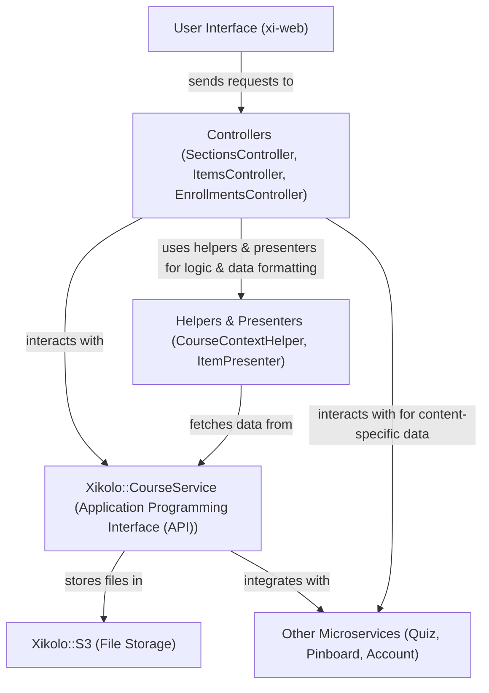
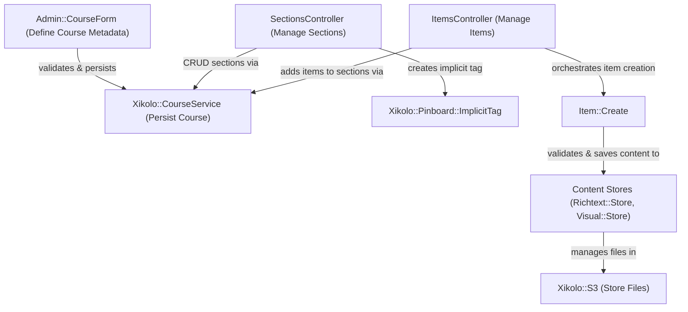
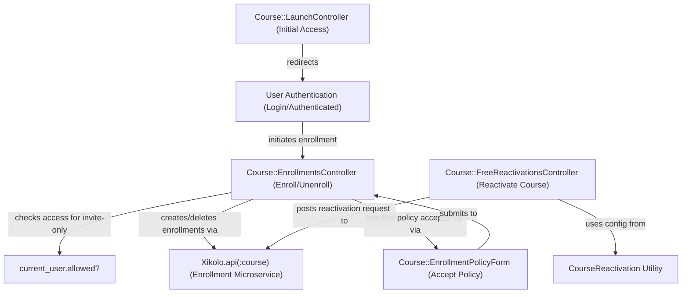
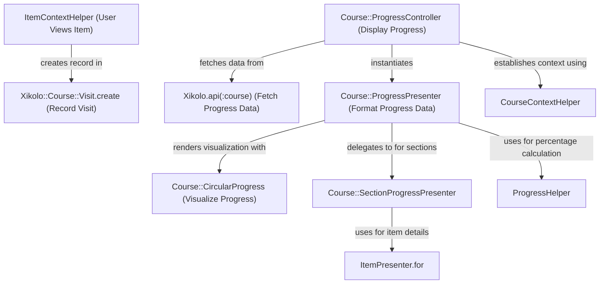

# Course Creation, Structure, Content Items (Rich Text, Documents), Enrollment, and Progress Tracking - Technical Documentation

*Generated on 9/18/2025 | Xikolo Knowledge Base*

---

## 📋 Executive Summary

This report provides a standardized overview of the Xikolo 02_CORE_CourseContent cluster, which encompasses core functionalities for Course Management, Enrollment, and Learner Progress. The system enables comprehensive course definition, robust content management including rich text, videos, quizzes, and documents, and sophisticated tracking of user enrollment and progress. Key components such as `Admin::CourseForm`, `SectionsController`, `ItemsController`, `Course::EnrollmentsController`, and various `Xikolo::CourseService` microservice clients work in concert to deliver a seamless learning experience, from course creation to certificate achievement. The scope covers administrative course setup, content delivery, user lifecycle within courses, and detailed progress visualization.

---

## 🏗️ Architecture Overview

The Xikolo 02_CORE_CourseContent cluster operates on a hybrid architecture, leveraging a Ruby on Rails frontend (`xi-web`) that interacts with various microservices for core data persistence and business logic. The `Admin::CourseForm` acts as an entry point for administrative course definition, interacting with the underlying Course microservice. User-facing content and enrollment flows are managed by specialized controllers like `SectionsController`, `ItemsController`, and `Course::EnrollmentsController`, all relying heavily on `Xikolo::CourseService` for data. Helper modules such as `CourseContextHelper` and `ItemContextHelper` ensure consistent context and access control across the application. Frontend components and scripts like `handleRichTextType` and `sections.js` enhance user interaction by dynamically adjusting UIs and managing client-side states. Storage for static and dynamic content, including media, is primarily handled through `Xikolo::S3` integration, facilitated by operations like `Course::Visual::Store` and `Course::Richtext::Store`. Presenters like `ItemPresenter` and `Course::ProgressPresenter` transform data from microservices for efficient display, ensuring a clear separation of concerns.

### Architecture Diagrams

#### Main Architecture Overview

### 🔄 Component Interactions

Key interactions between components in this cluster:

- **Admin::CourseForm:** Interacts with the underlying Course model (via microservice) for persistence.
- **Admin::CourseForm:** Uses `ChannelHelper` for image dimension constants.
- **SectionsController:** Uses `CourseContextHelper` for course context and eligibility checks.
- **SectionsController:** Interacts with `Xikolo::Course::Section` microservice client for section data.
- **ItemsController:** Uses `CourseContextHelper` and `ItemContextHelper` for context and eligibility.
- **ItemsController:** Interacts with `Xikolo::Course::Item` microservice client for item data.
- **Course::DocumentsController:** Uses `CourseContextHelper` for course context.
- **Course::DocumentsController:** Uses `DocumentHelper` for document-related actions and helpers.
- **Course::EnrollmentsController:** Communicates with `Xikolo.api(:course)` (specifically `Xikolo::CourseService`) for enrollment creation, retrieval, and deletion.
- **Course::EnrollmentsController:** Checks `current_user.allowed?('course.content.access')` for invite-only courses.
- **Course::LaunchController:** Fetches course details from `Xikolo.api(:course)`.
- **Course::LaunchController:** Redirects to `create_enrollment_path` if authenticated.
- **Course::FreeReactivationsController:** Communicates with `Xikolo.api(:course)` to fetch prerequisite status and post reactivation requests.
- **Course::FreeReactivationsController:** Uses `CourseReactivation.config('period')` to determine the duration of the reactivation period.
- **Course::ProgressController:** Uses `CourseContextHelper` to establish the course context.
- **Course::ProgressController:** Fetches user details from `Xikolo::Account::User` if an admin is viewing another user's progress.
- **Course::SyllabusController:** Uses `CourseContextHelper` for course context.
- **Course::SyllabusController:** Loads section navigation (`load_section_nav`).
- **CourseContextHelper:** Defines `inside_course` which calls `layout` and `before_action :check_course_eligibility`.
- **CourseContextHelper:** The `check_course_eligibility` method checks user permissions, course availability, and enrollment status.
- **ItemContextHelper:** Defines `inside_item` which calls `layout`, `before_action :load_section_nav`, `before_action :create_position_presenter!`, `before_action :create_item_presenter!`, and `before_action :check_course_path`.
- **ItemContextHelper:** Creates `Course::PositionPresenter` and `ItemPresenter` instances.
- **DocumentHelper:** Interacts with `Xikolo.api(:course)` (CourseService) for document and localization CRUD operations.
- **DocumentHelper:** Uses `FileUpload` for S3 uploads of document files.
- **ProgressHelper:** Used by views or other components to display calculated progress percentages.
- **Course::Metadata::Store:** Interacts with `Xikolo::S3::SingleFileUpload` to manage uploaded files.
- **Course::Metadata::Store:** Parses and validates JSON data from uploaded files against a schema.
- **Course::Richtext::Store:** Uses `Xikolo::S3::TextWithUploadsProcessor` to parse and manage text with embedded uploads.
- **Course::Richtext::Store:** Interacts with `S3FileDeletionJob` for asynchronous deletion of obsolete S3 files.
- **Course::Visual::Store:** Interacts with `Xikolo::S3::SingleFileUpload` and `Xikolo::S3::UploadByUri` for S3 file management.
- **Course::Visual::Store:** Persists visual data to `Course::Visual` and video data to `Video::Video`.
- **Item::Create:** Validates and saves the content resource (`@content`).
- **Item::Create:** Sets `content_id` and `section_id` on the item.
- **Home::CourseCard:** Receives `course`, `enrollment`, `user`, and `type` as initialization parameters.
- **Home::CourseCard:** Renders actions and conditional buttons based on user features (e.g., `course_reactivation`).
- **Navigation::CoursesMenu:** Fetches course data from `Catalog::Course` (released, for global list, for guests).
- **Navigation::CoursesMenu:** Caches course lists for 30 minutes.
- **BasicCoursePresenter:** Wraps a course hash (`@course`).
- **BasicCoursePresenter:** Checks for `Certificate::Template` and `Certificate::OpenBadgeTemplate` existence for certificate availability.
- **CourseInfoPresenter:** Delegates attributes to the `@course` object (Restify resource).
- **CourseInfoPresenter:** Renders markdown for abstract and description.
- **CourseLargePreviewPresenter:** Initializes a `VideoPresenter` if a teaser video exists.
- **CourseLargePreviewPresenter:** Determines `unenrollment_enabled?` based on `invite_only` and `external_registration_url`.
- **CourseNav:** Uses `MenuWithPermissions` for permission-based item visibility.
- **CourseNav:** Checks `course.pinboard_enabled` and `Xikolo.config.beta_features['documents']` for item visibility.
- **CoursePresenter:** Delegates attributes to the `@course` object.
- **CoursePresenter:** Fetches item and section collections from `Course::Course`.
- **CourseTeacherNav:** Uses `MenuWithPermissions` for permission-based item visibility.
- **CourseTeacherNav:** Checks `user.allowed?` for various course-related permissions (e.g., `course.dashboard.view`, `course.content.edit`).
- **DocumentsListPresenter:** Wraps a collection of document resources.
- **DocumentsListPresenter:** Extracts unique languages from document localizations.
- **DocumentsListPresenter::DocumentPresenter:** Wraps a document resource and a collection of courses.
- **DocumentsListPresenter::DocumentPresenter:** Maps course IDs to course titles.
- **DocumentsPresenter:** Fetches course details via `course_api` and wraps them in `BasicCoursePresenter`.
- **DocumentsPresenter:** Finds `Certificate::Template` and `Certificate::OpenBadgeTemplate` based on course and certificate type.
- **FeaturedItemPresenter:** Builds `FeaturedVideoItem` for video content types.
- **FeaturedItemPresenter:** Raises an error for unsupported content types.
- **ItemPresenter:** Delegates attributes to the `@item` and `@course` objects.
- **ItemPresenter:** Determines `partial_name` and `layout` based on content type.
- **RichTextItemPresenter:** Extends `ItemPresenter`.
- **RichTextItemPresenter:** Finds the associated `Course::Richtext` content.
- **SectionPresenter:** Delegates attributes to the `@section` object.
- **SectionPresenter:** Fetches items for the section from `Xikolo.api(:course)`.
- **StageItemPresenter:** Uses `MarkdownHelper` to render statements.
- **StageItemPresenter:** Parses the statement string to extract `quote_by`.
- **UnsupportedItemPresenter:** Extends `ItemPresenter`.
- **UnsupportedItemPresenter:** Sets `partial_name` to `items/show_unsupported_item`.
- **handleRichTextType:** Modifies DOM elements using `setVisibility`, `hidePublicDescription`, and `hideAndUncheckSwitch` helpers.
- **handleRichTextType:** Called when the content type selection changes to 'rich text'.
- **sections.js:** Uses `toggleUuids` to show/hide section UUIDs.
- **sections.js:** Attaches event listeners to 'new item' and 'delete section' buttons.
- **Xikolo::Course::Course:** Used by `Course::CoursesController`, `CourseContextHelper`, `CourseInfoPresenter`, `CoursePresenter`, `Home::CourseCard` and others to fetch course data.
- **Xikolo::Course::Course:** Provides methods for checking course availability (`was_available?`, `published?`).
- **Xikolo::Course::Section:** Used by `SectionsController` for CRUD operations on sections.
- **Xikolo::Course::Section:** Used by `CourseContextHelper` to fetch the current section.
- **Xikolo::Course::Item:** Used by `ItemsController` for CRUD operations on items.
- **Xikolo::Course::Item:** Used by `CourseContextHelper` to fetch the current item.
- **Xikolo::Course::Visit:** Created by `ItemContextHelper#create_visit!` when a user views an item.
- **Xikolo::Quiz::Quiz:** Used by `ItemsController` when creating or editing quiz items.
- **Xikolo::Quiz::Quiz:** Provides attributes like `allowed_attempts`, `time_limit_seconds`, `instructions`.
- **Lti::Exercise:** Used by `ItemsController` when creating or editing LTI exercise items.
- **Lti::Exercise:** Interacts with `Lti::Exercise::Store` for persistence.
- **Video::Video:** Used by `ItemsController` when creating or editing video items.
- **Video::Video:** Used by `Course::Visual::Store` for managing teaser videos.
- **Course::Richtext:** Used by `ItemsController` when creating or editing rich text items.
- **Course::Richtext:** Interacts with `Course::Richtext::Store` for persistence and file management.
- **Course::CircularProgress:** Rendered by other views or components (e.g., `ItemPresenter` or `Course::SectionProgressPresenter`) to visualize user progress.
- **Course::EnrollmentPolicyForm:** Interacts with `Course::Course` model to fetch course details using `by_identifier`.
- **Course::EnrollmentPolicyForm:** Submits enrollment data to `Course::EnrollmentsController#create` via `enrollments_path`.
- **Course::EnrollmentStatistics:** Interacts with `Course::Course` to get course details and `Course::EnrollmentsStatistics` to retrieve enrollment counts.
- **Course::EnrollmentStatistics:** Checks `user.allowed?('course.enrollment_counter.view')` for permission to display the count.
- **Dashboard::IcalFeed:** Checks `user.feature?('ical_feed')` to determine if it should render.
- **Dashboard::IcalFeed:** Uses `IcalHelper#ical_url` to generate the iCal feed URL.
- **Admin::PollOptionsController:** Interacts with `Poll::Poll` model to find polls and add/delete options.
- **Admin::PollOptionsController:** Renders the `admin/polls/options_form` partial to update the options list.
- **Admin::PollsController:** Interacts with `Poll::Poll` model for all CRUD operations.
- **Admin::PollsController:** Uses `add_flash_message` for user feedback on operations.
- **CourseSubscriptionsController:** Uses `CourseContextHelper` to get the course context.
- **CourseSubscriptionsController:** Communicates with `Xikolo.api(:pinboard)` to create or delete course subscriptions.
- **DashboardController:** Redirects `index` action to `dashboard`.
- **DashboardController:** Fetches `Xikolo::Account::Authorization` if an authorization parameter is present (e.g., after SSO signup).
- **IcalController:** Requires the 'ical_feed' feature to be enabled.
- **IcalController:** Uses `IcalHelper` for generating the authentication hash and URL.
- **PollsController:** Interacts with `Poll::Poll` model to retrieve polls, check for upcoming polls, and record votes.
- **PollsController:** Uses `PollArchivePresenter` for formatting archived polls.
- **User::SubscriptionsController:** Finds `Xikolo::Pinboard::Subscription` based on `user_id` and `question_id`.
- **User::SubscriptionsController:** Deletes the found subscription.
- **IcalHelper:** Interacts with `Xikolo::Account::Token` to create a security token for the user.
- **IcalHelper:** Uses `Digest::SHA256` for hashing user ID and token.
- **CourseReactivation:** Reads configuration from `Xikolo.config.course_reactivation` and `Xikolo.config.voucher`.
- **CourseReactivation:** Used by `Course::FreeReactivationsController` to determine the reactivation period.
- **Course::Enrollment:** Belongs to `Course`.
- **Course::Enrollment:** Provides a scope `active` to filter non-deleted enrollments.
- **Course::EnrollmentsStatistics:** Initialized with a `Course::Course` object.
- **Course::EnrollmentsStatistics:** Queries `course.enrollments` and uses `course.enrollment_delta` for calculations.
- **Admin::SubscriptionListPresenter:** Wraps a collection of subscriptions (likely `Xikolo::Pinboard::Subscription` resources).
- **Admin::SubscriptionListPresenter:** Uses `RestifyPaginationCollection` for pagination.
- **Course::DashboardPresenter:** Provides data transformation logic for charting.
- **Course::DashboardPresenter:** Uses `I18n` for localized labels.
- **Course::DeadlinesPresenter:** Communicates with `Xikolo.api(:course).rel(:next_dates)` to fetch deadline data.
- **Course::DeadlinesPresenter:** Uses `ActionView::Helpers::DateHelper` for time formatting.
- **Course::ProgressPresenter:** Fetches `Xikolo::Course::Progress` records for the user and course.
- **Course::ProgressPresenter:** Uses `Acfs.on` for concurrent data fetching.
- **Course::SectionProgressPresenter:** Wraps a section object (likely a `Xikolo::Course::Section` resource).
- **Course::SectionProgressPresenter:** Iterates through `section.items` and uses `ItemPresenter.for` to present each item.

---

## ⚙️ Technical Workflows

### 1. Course Content Creation Workflow

The course content creation workflow begins with administrative setup and proceeds through structuring and populating courses with diverse learning materials. An administrator initializes course metadata using `Admin::CourseForm`, validating essential details such as `status`, `code`, `title`, and language. This form interacts directly with the Course microservice for persistence, and leverages `ChannelHelper` for image dimension constants for course visuals. Once the course framework is established, `SectionsController` allows content editors to define and organize course sections, communicating with the `Xikolo::Course::Section` microservice client for data management. Saving a section also triggers the creation of `Xikolo::Pinboard::ImplicitTag` for integration with discussion features. Subsequently, `ItemsController` is used to add various content items like videos, rich text, quizzes, or LTI exercises within these sections. The `Item::Create` operation orchestrates the storage of these items and their associated content resources (e.g., `Video::Video`, `Course::Richtext`, `Xikolo::Quiz::Quiz`) by interacting with respective content stores (`Video::Store`, `Course::Richtext::Store`). Frontend scripts like `handleRichTextType` dynamically adapt the UI based on the chosen content type, ensuring a tailored editing experience.

### 2. User Enrollment and Access Workflow

User enrollment and access follow a defined lifecycle, from initial course launch to potential reactivation. The journey typically starts with `Course::LaunchController`, which directs unauthenticated users to a login page or authenticated users to an enrollment path, preserving the intended course location. For invite-only courses, `Course::EnrollmentsController` verifies `current_user.allowed?('course.content.access')`. This controller is central to the enrollment process, communicating with `Xikolo.api(:course)` to create, retrieve, or delete enrollments. It robustly handles `Restify::UnprocessableEntity` exceptions for scenarios like access restrictions or unfulfilled prerequisites, redirecting users accordingly. In cases where users need to re-access a course after its official duration, `Course::FreeReactivationsController` enables this functionality by interacting with `Xikolo.api(:course)` to check prerequisite statuses and process reactivation requests. The `CourseReactivation` utility module, informed by `Xikolo.config.course_reactivation` and `Xikolo.config.voucher`, dictates the eligibility and duration of such reactivations. The `Course::EnrollmentPolicyForm` component ensures that users accept necessary policies before finalizing their enrollment, interacting with the `Course::Course` model and submitting data to `Course::EnrollmentsController`.

### 3. Learner Progress Tracking and Visualization Workflow

Learner progress within courses is meticulously tracked and visually presented to users and administrators. When a user views a course item, `ItemContextHelper#create_visit!` records this activity by creating a `Xikolo::Course::Visit` entry, excluding quizzes or masquerading sessions, which is crucial for building a complete progress history. The `Course::ProgressController` is responsible for fetching and displaying a user's overall progress. It establishes the course context using `CourseContextHelper` and retrieves user-specific progress data from `Xikolo.api(:course).rel(:progresses)`. If an administrator is reviewing another user's progress, the controller also fetches details from `Xikolo::Account::User`. Progress presentation is enhanced by `ProgressHelper#calc_progress`, which computes percentage values, and `Course::CircularProgress`, a UI component that visualizes this data. The `Course::SyllabusController` provides an overview of content and progress, utilizing `Course::ProgressPresenter` to build detailed progress data, often delegating to `Course::SectionProgressPresenter` for section-level insights. This presenter in turn uses `ItemPresenter.for` to display individual item statuses (locked, visited, active), thereby creating a comprehensive and granular view of learner engagement and completion.

### Workflow Diagrams

#### Course Content Creation Workflow

#### User Enrollment Workflow

#### Learner Progress Tracking Workflow

### 🔀 Process Workflows

Detailed workflow processes for this cluster:

- **Course::EnrollmentsController Process:** Handles `Restify::UnprocessableEntity` exceptions for various enrollment restrictions (e.g., access restricted, prerequisites unfulfilled).
  *Source: Course::EnrollmentsController*
- **Course::FreeReactivationsController Process:** Handles `Restify::UnprocessableEntity` for failed reactivation attempts.
  *Source: Course::FreeReactivationsController*
- **Course::Richtext::Store Process:** Uses `Xikolo::S3::TextWithUploadsProcessor` to parse and manage text with embedded uploads.
  *Source: Course::Richtext::Store*
- **Course::DashboardPresenter Process:** Processes `Course` objects to determine start/end dates for historic lines.
  *Source: Course::DashboardPresenter*

---

## 🔧 Implementation Details

### Technical Considerations

The Xikolo 02_CORE_CourseContent cluster is built upon a Ruby on Rails application (`xi-web`) that serves as a frontend facade, orchestrating interactions with several backend microservices. Key microservices include `Xikolo::CourseService` for all core course, section, item, and enrollment data; `Xikolo::QuizService` for quiz-specific content; and `Xikolo::S3` for robust file storage of visuals, documents, and rich text assets. The application employs `Acfs.run` for efficient, concurrent fetching of data from multiple microservice endpoints, optimizing response times. Frontend interactivity is achieved through JavaScript and TypeScript, with components like `handleRichTextType` and `sections.js` directly manipulating the DOM to provide dynamic user experiences, such as toggling UUID visibility or adapting form fields based on content type selections. Presenters (`BasicCoursePresenter`, `ItemPresenter`, `DocumentsPresenter`) are heavily utilized to decouple data fetching and business logic from view rendering, ensuring clean separation and reusability. Markdown rendering is consistently applied for descriptions and rich text content via `MarkdownHelper`. Error handling is implemented with `Restify::UnprocessableEntity` for user-facing enrollment restrictions and `Mnemosyne`/`Sentry` for operational error capture, as seen in `Course::Metadata::Store` and `Course::Visual::Store`.

### Dependencies and Integrations

Dependencies and integrations are crucial for the comprehensive functionality of the CourseContent cluster. Core interactions revolve around the `course_api` (an instance of `Xikolo::CourseService`), which is frequently accessed by controllers (`SectionsController`, `ItemsController`, `Course::DocumentsController`, `Course::EnrollmentsController`, `Course::ProgressController`, `Course::SyllabusController`, `Course::LaunchController`, `Course::FreeReactivationsController`, `DashboardController`, `IcalController`) and helpers/presenters (`DocumentHelper`, `CourseContextHelper`, `SectionPresenter`, `DocumentsPresenter`, `Course::DeadlinesPresenter`).

File uploads, central to course content, integrate with `FileUpload` for S3 uploads (`DocumentHelper`) and specific S3 modules like `Xikolo::S3::SingleFileUpload`, `Xikolo::S3::UploadByUri`, and `Xikolo::S3::TextWithUploadsProcessor` for various content types (`Course::Metadata::Store`, `Course::Richtext::Store`, `Course::Visual::Store`). Asynchronous deletion of obsolete S3 files is handled by `S3FileDeletionJob`. Certificates leverage `Certificate::Template` and `Certificate::OpenBadgeTemplate`, and require `Proctoring::SmowlAdapter` for proctoring checks. User authentication and token management integrate with `Xikolo::Account::User` and `Xikolo::Account::Token` for functionalities like progress tracking and iCal feed generation. The iCal feed generation specifically uses the `Icalendar` gem and `TZInfo` for calendar construction. Poll management components (`Admin::PollOptionsController`, `Admin::PollsController`, `PollsController`) interact with a `Poll::Poll` model (likely a service beyond core course content but integrated for user engagement).

### Configuration Requirements

The system's behavior is influenced by several configuration settings, primarily managed through `Xikolo.config`. The visibility of certain features is controlled by feature flags, for example:
*   `Xikolo.config.beta_features['documents']` determines if the documents feature is visible to users (`CourseNav`).
*   `Xikolo.config.beta_features['teaching_team_pinboard_activity']` impacts navigation visibility for teachers (`CourseTeacherNav`).
*   `Xikolo.config.course_reactivation` and `Xikolo.config.voucher` control the course reactivation functionality, including the reactivation period and the enablement of voucher-based reactivations (`CourseReactivation`, `Course::FreeReactivationsController`).
*   `user.feature?('course_list')` is checked by `Navigation::CoursesMenu` to determine if the course list should be rendered.
*   `user.feature?('ical_feed')` enables or disables the iCal feed functionality for a user (`Dashboard::IcalFeed`, `IcalController`).

Other configurations, such as `Xikolo.base_url` for URL construction (`IcalHelper`) and various permissions (`user.allowed?('course.content.access')`, `user.allowed?('course.dashboard.view')`) are vital for security and functionality. Specific thresholds like `MIN_ENROLLMENTS` (e.g., 500 in `Course::EnrollmentStatistics`) can dictate when certain aggregated data is displayed.

### 📚 Technical Sources & References

Key technical documentation and source references:

- Admin::CourseForm: app/forms/admin/course_form.rb- Admin::CourseForm: app/helpers/channel_helper.rb- SectionsController: app/controllers/sections_controller.rb- SectionsController: app/helpers/course_context_helper.rb- ItemsController: app/controllers/items_controller.rb- ItemsController: app/helpers/course_context_helper.rb- Course::DocumentsController: app/controllers/course/documents_controller.rb- Course::DocumentsController: app/helpers/course_context_helper.rb- Course::EnrollmentsController: app/controllers/course/enrollments_controller.rb- Course::LaunchController: app/controllers/course/launch_controller.rb- Course::FreeReactivationsController: app/controllers/course/free_reactivations_controller.rb- Course::ProgressController: app/controllers/course/progress_controller.rb- Course::SyllabusController: app/controllers/course/syllabus_controller.rb- Course::SyllabusController: app/helpers/course_context_helper.rb- CourseContextHelper: app/helpers/course_context_helper.rb- CourseContextHelper: docs/app/development/implementation/helper_inside_course.md- ItemContextHelper: app/helpers/item_context_helper.rb- ItemContextHelper: docs/app/development/implementation/helper_inside_course.md- DocumentHelper: app/helpers/document_helper.rb- ProgressHelper: app/helpers/progress_helper.rb- Course::Metadata::Store: app/operations/course/metadata/store.rb- Course::Richtext::Store: app/operations/course/richtext/store.rb- Course::Visual::Store: app/operations/course/visual/store.rb- Item::Create: app/operations/item/create.rb- Home::CourseCard: app/components/home/course_card.rb- Navigation::CoursesMenu: app/components/navigation/courses_menu.rb- BasicCoursePresenter: app/presenters/basic_course_presenter.rb- CourseInfoPresenter: app/presenters/course_info_presenter.rb- CourseLargePreviewPresenter: app/presenters/course_large_preview_presenter.rb- CourseNav: app/presenters/course_nav.rb- CoursePresenter: app/presenters/course_presenter.rb- CourseTeacherNav: app/presenters/course_teacher_nav.rb- DocumentsListPresenter: app/presenters/documents_list_presenter.rb- DocumentsListPresenter::DocumentPresenter: app/presenters/documents_list_presenter.rb- DocumentsPresenter: app/presenters/documents_presenter.rb- FeaturedItemPresenter: app/presenters/featured_item_presenter.rb- ItemPresenter: app/presenters/item_presenter.rb- RichTextItemPresenter: app/presenters/rich_text_item_presenter.rb- SectionPresenter: app/presenters/section_presenter.rb- StageItemPresenter: app/presenters/stage_item_presenter.rb- UnsupportedItemPresenter: app/presenters/unsupported_item_presenter.rb- handleRichTextType: app/assets/teacher/items/rich-text.ts- handleRichTextType: docs/app/development/implementation/course_items_form.md- sections.js: app/assets/teacher/sections/sections.js- Xikolo::Course::Course: app/controllers/course/courses_controller.rb- Xikolo::Course::Course: app/helpers/course_context_helper.rb- Xikolo::Course::Section: app/controllers/sections_controller.rb- Xikolo::Course::Section: app/helpers/course_context_helper.rb- Xikolo::Course::Item: app/controllers/items_controller.rb- Xikolo::Course::Item: app/helpers/course_context_helper.rb- Xikolo::Course::Visit: app/helpers/item_context_helper.rb- Xikolo::Quiz::Quiz: app/controllers/items_controller.rb- Lti::Exercise: app/controllers/items_controller.rb- Video::Video: app/controllers/items_controller.rb- Video::Video: app/operations/course/visual/store.rb- Course::Richtext: app/controllers/items_controller.rb- Course::Richtext: app/operations/course/richtext/store.rb- Course::CircularProgress: app/components/course/circular_progress.rb- Course::CircularProgress: app/components/course/circular_progress.html.slim- Course::EnrollmentPolicyForm: app/components/course/enrollment_policy_form.rb- Course::EnrollmentPolicyForm: app/components/course/enrollment_policy_form.html.slim- Course::EnrollmentStatistics: app/components/course/enrollment_statistics.rb- Course::EnrollmentStatistics: app/components/course/enrollment_statistics.html.slim- Dashboard::IcalFeed: app/components/dashboard/ical_feed.rb- Dashboard::IcalFeed: app/components/dashboard/ical_feed.html.slim- Admin::PollOptionsController: app/controllers/admin/poll_options_controller.rb- Admin::PollsController: app/controllers/admin/polls_controller.rb- CourseSubscriptionsController: app/controllers/course_subscriptions_controller.rb- DashboardController: app/controllers/dashboard_controller.rb- DashboardController: app/views/dashboard/dashboard.html.slim- IcalController: app/controllers/ical_controller.rb- PollsController: app/controllers/polls_controller.rb- User::SubscriptionsController: app/controllers/user/subscriptions_controller.rb- IcalHelper: app/helpers/ical_helper.rb- CourseReactivation: app/lib/course_reactivation.rb- CourseReactivation: RAG: docs/app/features/reactivation.md- Course::Enrollment: app/models/course/enrollment.rb- Course::EnrollmentsStatistics: app/models/course/enrollments_statistics.rb- Admin::SubscriptionListPresenter: app/presenters/admin/subscription_list_presenter.rb- Course::DashboardPresenter: app/presenters/course/dashboard_presenter.rb- Course::DeadlinesPresenter: app/presenters/course/deadlines_presenter.rb- Course::DeadlinesPresenter: RAG: docs/app/features/courses/deadlines.md- Course::ProgressPresenter: app/presenters/course/progress_presenter.rb- Course::SectionProgressPresenter: app/presenters/course/section_progress_presenter.rb- Configuration: config/application.rb, Gemfile, config/database.yml- Process Management: Procfile, Procfile.web- Build & Deploy: Rakefile, package.json

---

*This documentation is automatically generated from cluster analysis and should be validated against the actual codebase.*
