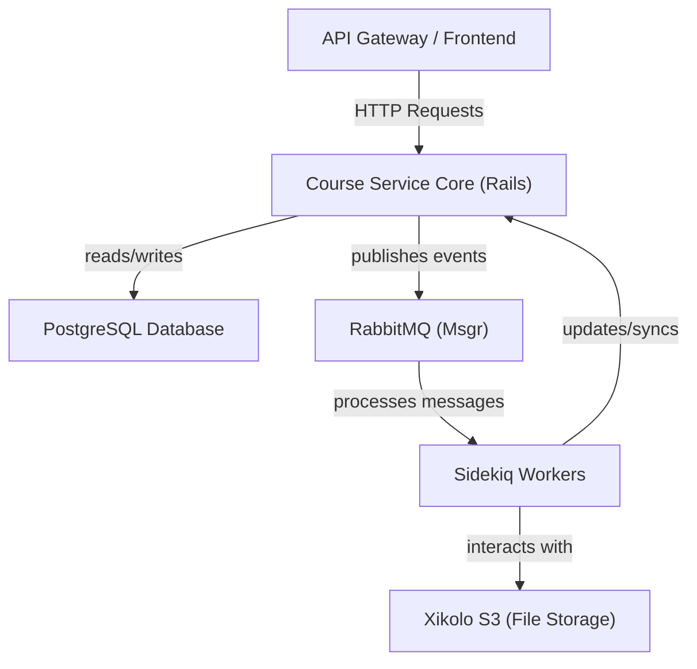
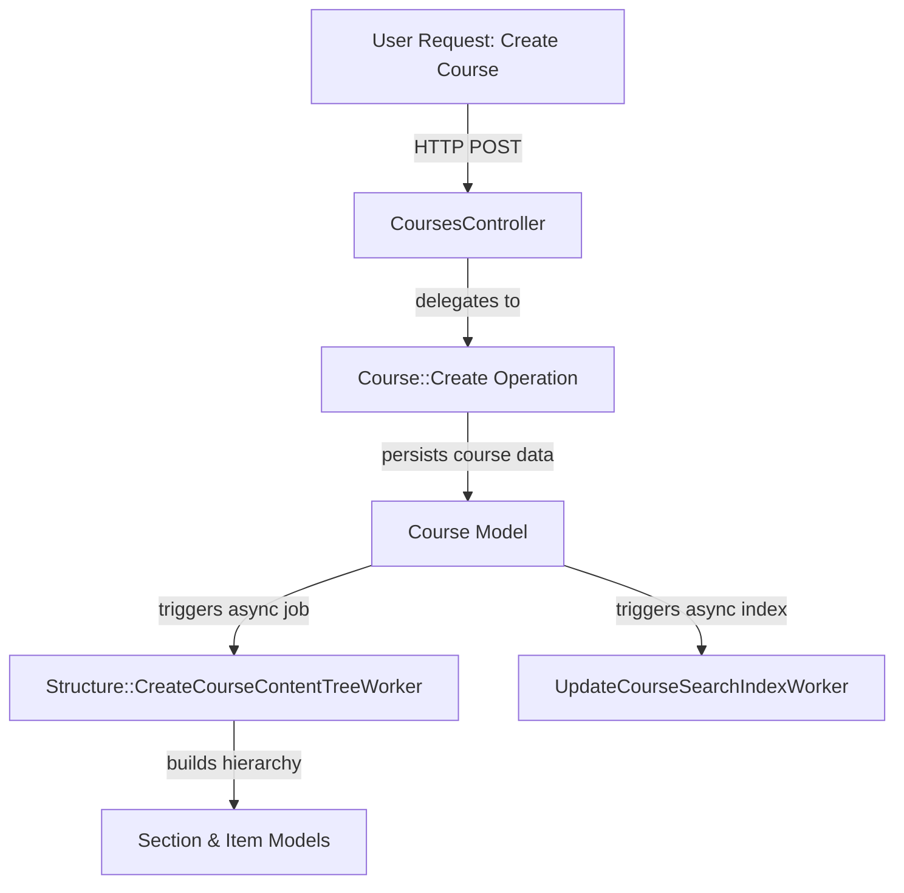
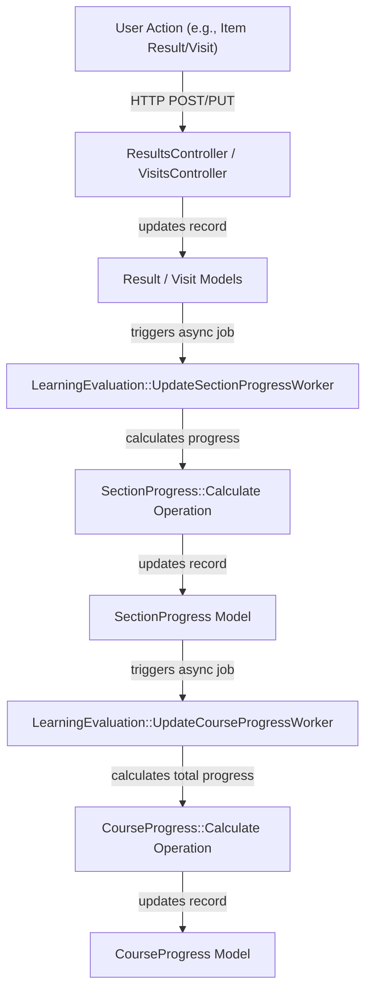

# Core Course Management, Enrollments, and Structure Microservice - Technical Documentation

*Generated on 9/18/2025 | Xikolo Knowledge Base*

---

## 📋 Executive Summary

The Xikolo 03_CORE_CourseService cluster represents a unified and robust microservice environment designed for comprehensive course management, student enrollment tracking, and sophisticated learning evaluation. This system orchestrates the entire lifecycle of educational content, from creation and structured delivery to in-depth performance analytics. It integrates foundational course management capabilities, including the definition of courses, sections, and individual learning items, with advanced features for monitoring student progress, calculating grades, and generating insightful statistics. The service leverages a modern technical stack centered on Ruby on Rails, PostgreSQL for data persistence, RabbitMQ for event-driven inter-service communication, and Sidekiq for asynchronous background processing. Its primary objective is to provide a holistic platform that supports educators in designing effective courses and offers learners a structured and engaging educational experience, all while enabling data-driven pedagogical improvements.

---

## 🏗️ Architecture Overview

The Xikolo 03_CORE_CourseService architecture is built upon a modular and event-driven design, ensuring scalability, resilience, and maintainability. At its core, the system utilizes Ruby on Rails for Application Programming Interface (API) endpoints, interacting with a PostgreSQL database for persistent storage. Asynchronous operations and inter-service communication are critical components, handled by Sidekiq for background jobs and RabbitMQ for message passing. Key controllers manage public API interactions for courses, enrollments, and learning items, while models define the data structures and business logic. Workers perform resource-intensive tasks such as search indexing and data synchronization, preventing bottlenecks in the main request-response cycle. This setup facilitates a responsive user experience and allows for complex computations and integrations to occur without impacting real-time performance.

**Component Descriptions:**

*   **CoursesController:** The primary interface for managing `Course` resources, handling CRUD operations and offering extensive filtering capabilities to retrieve courses based on various criteria like status, language, and user enrollment. It delegates complex operations like course creation and updates to dedicated service objects.
*   **EnrollmentsController:** Manages user `Enrollment` in courses, allowing for creation, updates, and deletion. It supports filtering enrollments by course, user, and learning evaluation status, and interacts with `Course` and `LearningEvaluation` for data retrieval.
*   **Item:** Represents an individual learning content unit within a `Section`. This model includes attributes for title, content type, availability, and exercise specifics, and tracks user `Result`s and `Visit`s. It supports `paper_trail` for versioning and publishes events via `Msgr`.
*   **Course:** The central model defining an educational course. It manages structural relationships with `Section`s and `Item`s, categorizations via `Channel`s and `Classifier`s, and enrollment relationships. It also integrates with a `Structure::Root` node for content tree management and publishes critical lifecycle events.
*   **UpdateCourseSearchIndexWorker:** A Sidekiq background job responsible for asynchronously updating the full-text search index for `Course` entities. This ensures that course search results are consistently up-to-date without blocking real-time operations.
*   **PostgreSQL Database:** The primary data store for all persistent data within the Course Service, including course definitions, user enrollments, learning progress, and metadata.

### Architecture Diagrams


#### Main Architecture




### 🔄 Component Interactions

Key interactions between components in this cluster:

- **CourseConsumer:** Processes `clone` messages from RabbitMQ. [Source: services/course/app/consumers/course_consumer.rb]
- **CourseConsumer:** Delegates course cloning logic to `Course::Clone`. [Source: services/course/app/consumers/course_consumer.rb]
- **AchievementsController:** Responds to `GET /achievements` to list achievements for a given course and user. [Source: services/course/app/controllers/achievements_controller.rb]
- **AchievementsController:** Sets locale based on `http_accept_language`. [Source: services/course/app/controllers/achievements_controller.rb]
- **ChannelsController:** Manages CRUD operations for `Channel` models. [Source: services/course/app/controllers/channels_controller.rb]
- **ChannelsController:** Uses `UUID4` for generating new channel IDs. [Source: services/course/app/controllers/channels_controller.rb]
- **ClassifiersController:** Retrieves `Classifier` records based on various filters. [Source: services/course/app/controllers/classifiers_controller.rb]
- **CoursesController:** Manages CRUD operations for `Course` models. [Source: services/course/app/controllers/courses_controller.rb]
- **CoursesController:** Filters courses by `cat_id` (classifier), `user_id` (enrollment status), `status`, `lang`, `course_code`, `channel_id`, `document_id`, `upcoming`, `current`, `finished`, `public`, `hidden`, `only_hidden`, `exclude_external`, `latest_first`, `alphabetic`, `promoted_for`, `not_enrolled`, `autocomplete`, `active_after`, and `sort` parameters. [Source: services/course/app/controllers/courses_controller.rb]
- **EnrollmentsController:** Manages CRUD operations for `Enrollment` models. [Source: services/course/app/controllers/enrollments_controller.rb]
- **EnrollmentsController:** Filters enrollments by `course_id`, `user_id`, `learning_evaluation`, `deleted`, `current_course`, and `proctored`. [Source: services/course/app/controllers/enrollments_controller.rb]
- **ItemsController:** Manages CRUD operations for `Item` models. [Source: services/course/app/controllers/items_controller.rb]
- **ItemsController:** Filters items by `content_type`, `exercise_type`, `section_id`, `content_id`, `id`, `available`, `all_available`, `was_available`, `published`, `course_id`, `featured`, `open_mode`, `required_items`, `state_for`, `proctored`, `user_id`, and `new_for`. [Source: services/course/app/controllers/items_controller.rb]
- **NextDatesController:** Retrieves `NextDate` records, filtering by `user_id`, `course_id`, `resource_type`, and `type`. [Source: services/course/app/controllers/next_dates_controller.rb]
- **NextDatesController:** Interacts with `Enrollment` and `Course` to determine the course filter for a user. [Source: services/course/app/controllers/next_dates_controller.rb]
- **PrerequisiteStatusController:** Responds to `GET /prerequisite_status` with the fulfillment status. [Source: services/course/app/controllers/prerequisite_status_controller.rb]
- **PrerequisiteStatusController:** Interacts with `Course` to retrieve prerequisites. [Source: services/course/app/controllers/prerequisite_status_controller.rb]
- **ProgressesController:** Responds to `GET /progresses` with detailed progress information. [Source: services/course/app/controllers/progresses_controller.rb]
- **ProgressesController:** Interacts with `Course`, `Section`, `Item`, `Result`, and `SectionChoice` models. [Source: services/course/app/controllers/progresses_controller.rb]
- **ReactivationsController:** Responds to `POST /reactivations` to reactivate an enrollment. [Source: services/course/app/controllers/reactivations_controller.rb]
- **ReactivationsController:** Interacts with `Enrollment` to find the target enrollment. [Source: services/course/app/controllers/reactivations_controller.rb]
- **RepetitionSuggestionsController:** Responds to `GET /repetition_suggestions` with a list of suggested items. [Source: services/course/app/controllers/repetition_suggestions_controller.rb]
- **RepetitionSuggestionsController:** Queries `Result` and `Item` models to identify repetition candidates. [Source: services/course/app/controllers/repetition_suggestions_controller.rb]
- **SectionChoicesController:** Responds to `GET /section_choices` to list choices for a user/section. [Source: services/course/app/controllers/section_choices_controller.rb]
- **SectionChoicesController:** Responds to `POST /section_choices` to create or update a user's section choice. [Source: services/course/app/controllers/section_choices_controller.rb]
- **SectionsController:** Manages CRUD operations for `Section` models. [Source: services/course/app/controllers/sections_controller.rb]
- **SectionsController:** Filters sections by `course_id`, `published`, `available`, `id`, `position`, `parent_id`, and `include_alternatives`. [Source: services/course/app/controllers/sections_controller.rb]
- **TeachersController:** Manages CRUD operations for `Teacher` models. [Source: services/course/app/controllers/teachers_controller.rb]
- **TeachersController:** Filters teachers by `course`, `user_id`, and `query`. [Source: services/course/app/controllers/teachers_controller.rb]
- **AlternativeSectionProgress:** Interacts with `SectionProgress` to find and update progress records. [Source: services/course/app/models/alternative_section_progress.rb]
- **AlternativeSectionProgress:** Interacts with `Section` to get children and their goals. [Source: services/course/app/models/alternative_section_progress.rb]
- **Branch:** Belongs to `Duplicated::Group` and `Fork`. [Source: services/course/app/models/branch.rb]
- **Branch:** Has one `Structure::Branch` node, which is destroyed on deletion. [Source: services/course/app/models/branch.rb]
- **Channel:** Has many `Course`s. [Source: services/course/app/models/channel.rb]
- **Channel:** Uses `FileReference` concern for S3 integration. [Source: services/course/app/models/channel.rb]
- **Classifier:** Has and belongs to many `Course`s. [Source: services/course/app/models/classifier.rb]
- **Classifier:** Belongs to `Cluster`. [Source: services/course/app/models/classifier.rb]
- **Cluster:** Has many `Classifier`s. [Source: services/course/app/models/cluster.rb]
- **ContentTest:** Belongs to `Course`. [Source: services/course/app/models/content_test.rb]
- **ContentTest:** Has many `Fork`s. [Source: services/course/app/models/content_test.rb]
- **Course:** Has one `Structure::Root` node (for content tree). [Source: services/course/app/models/course.rb]
- **Course:** Has many `Section`s and `Item`s (through sections). [Source: services/course/app/models/course.rb]
- **CourseGoals:** Interacts with `Course`, `Section`, and `Item` models to aggregate data. [Source: services/course/app/models/course_goals.rb]
- **CourseProgress:** Belongs to Course.
- **CourseProgress:** Has one FixedLearningEvaluation.
- **CourseProvider:** Triggers `CourseProviderWorker` to perform synchronization for enabled providers. [Source: services/course/app/models/course_provider.rb]
- **CourseSet:** Has many `CourseSetEntry`s and `Course`s (through entries). [Source: services/course/app/models/course_set.rb]
- **CourseSet:** Has many `CourseSetRelation`s (as source sets) and `linked_sets` (as target sets). [Source: services/course/app/models/course_set.rb]
- **CourseSetEntry:** Belongs to `Course` and `CourseSet`. [Source: services/course/app/models/course_set_entry.rb]
- **CourseSetRelation:** Belongs to `source_set` and `target_set` (both `CourseSet`s). [Source: services/course/app/models/course_set_relation.rb]
- **CourseSetRelation:** Has many `target_courses` through the target set. [Source: services/course/app/models/course_set_relation.rb]
- **Enrollment:** Belongs to Course.
- **Enrollment:** Has one FixedLearningEvaluation and CourseProgress.
- **Fork:** Belongs to `ContentTest` and `Section`. [Source: services/course/app/models/fork.rb]
- **Fork:** Has many `Branch`es. [Source: services/course/app/models/fork.rb]
- **Item:** Belongs to `Section`. [Source: services/course/app/models/item.rb]
- **Item:** Has one `Structure::Item` node. [Source: services/course/app/models/item.rb]
- **NextDate:** Belongs to `Course`. [Source: services/course/app/models/next_date.rb]
- **Prerequisites:** Interacts with `CourseSetRelation` to retrieve prerequisite relations. [Source: services/course/app/models/prerequisites.rb]
- **Prerequisites:** Uses nested `UserStatus`, `CopStatus`, and `RoaStatus` classes to evaluate fulfillment. [Source: services/course/app/models/prerequisites.rb]
- **Progress:** Initialized with a resource (Course or Section), items, and results. [Source: services/course/app/models/progress.rb]
- **Relation:** Inherits from `CourseSetRelation`. [Source: services/course/app/models/relation.rb]
- **Section:** Belongs to `Course`. [Source: services/course/app/models/section.rb]
- **Section:** Has one `Structure::Section` node. [Source: services/course/app/models/section.rb]
- **SectionChoice:** Belongs to `Section`. [Source: services/course/app/models/section_choice.rb]
- **SectionGoals:** Interacts with `Section` and `Item` models. [Source: services/course/app/models/section_goals.rb]
- **SectionGoals:** Uses `Structure::UserItemsSelector` for courses with content trees. [Source: services/course/app/models/section_goals.rb]
- **Teacher:** Has many `Course`s (via `teacher_ids` array column on Course). [Source: services/course/app/models/teacher.rb]
- **Teacher:** Interacts with `Xikolo::S3` for picture uploads and `FileDeletionWorker` for cleanup. [Source: services/course/app/models/teacher.rb]
- **CourseProgress::Calculate:** Interacts with CourseProgress model.
- **Section::Destroy:** Recursively calls itself to destroy child sections if the target section is a parent. [Source: services/course/app/operations/section/destroy.rb]
- **Section::Destroy:** Calls `destroy` on the `Section` instance within a transaction. [Source: services/course/app/operations/section/destroy.rb]
- **CourseProviderWorker:** Finds the `Course` by ID. [Source: services/course/app/workers/course_provider_worker.rb]
- **CourseProviderWorker:** Instantiates and calls `sync` on a `#{type}::Adapter` (e.g., `Lti::Adapter`). [Source: services/course/app/workers/course_provider_worker.rb]
- **EnrollmentCompletionWorker:** Finds the `Course` and relevant `Enrollment`s. [Source: services/course/app/workers/enrollment_completion_worker.rb]
- **EnrollmentCompletionWorker:** Uses `Enrollment.with_learning_evaluation` to get completion data. [Source: services/course/app/workers/enrollment_completion_worker.rb]
- **EnrollmentGroupWorker:** Finds the `Enrollment` by course and user ID. [Source: services/course/app/workers/enrollment_group_worker.rb]
- **EnrollmentGroupWorker:** Calls `create_membership!` on the enrollment, which interacts with the `account` service. [Source: services/course/app/workers/enrollment_group_worker.rb]
- **PersistRankingWorker:** Updates `Enrollment` records, clearing previous quantiles. [Source: services/course/app/workers/persist_ranking_worker.rb]
- **PersistRankingWorker:** Uses `Enrollment.with_learning_evaluation` to get current scores. [Source: services/course/app/workers/persist_ranking_worker.rb]
- **Structure::CreateCourseContentTreeWorker:** Finds the `Course` by identifier. [Source: services/course/app/workers/structure/create_course_content_tree_worker.rb]
- **Structure::CreateCourseContentTreeWorker:** Creates `Structure::Root` node for the course. [Source: services/course/app/workers/structure/create_course_content_tree_worker.rb]
- **UpdateCourseSearchIndexWorker:** Finds the `Course` by ID. [Source: services/course/app/workers/update_course_search_index_worker.rb]
- **UpdateCourseSearchIndexWorker:** Calls `update_search_index` on the `Course` instance. [Source: services/course/app/workers/update_course_search_index_worker.rb]
- **ItemGradeController:** Interacts with Item model to find the item.
- **ItemGradeController:** Calls Item#user_grade to retrieve the grade.
- **ItemResultsController:** Interacts with Item model to find the item.
- **ItemResultsController:** Queries Result model for item results, supporting 'best_per_user' scope.
- **ItemStatisticsController:** Interacts with Item model to find the item.
- **ItemStatisticsController:** Calls Item#stats to retrieve statistics.
- **LastVisitsController:** Interacts with Enrollment model to find the enrollment.
- **LastVisitsController:** Calls Enrollment#last_visit to get the visit.
- **LearningEvaluation::RecalculationsController:** Interacts with Course model.
- **LearningEvaluation::RecalculationsController:** Enqueues LearningEvaluation::PersistForCourseWorker for background processing.
- **PersistRankingTasksController:** Interacts with Course model.
- **PersistRankingTasksController:** Enqueues PersistRankingWorker for background processing.
- **ResultsController:** Interacts with Result model.
- **ResultsController:** Uses PointsProcessor concern for point parsing.
- **StatisticsController:** Interacts with Course and Enrollment models.
- **StatisticsController:** Uses rfc6570_params for enrollment_stats method.
- **StatsController:** Interacts with Stat service object.
- **StatsController:** Uses Rails.cache for caching statistics.
- **VisitsController:** Interacts with Visit model.
- **VisitsController:** Triggers Msgr events and various Sidekiq workers (EnrollmentCompletionWorker, LearningEvaluation::UpdateSectionProgressWorker) via Visit model callbacks.
- **FixedLearningEvaluation:** Belongs to Course.
- **ItemStatistics:** Initializes with an Item.
- **ItemStatistics:** Queries Result records associated with the item.
- **LearningEvaluation (Module):** Uses Xikolo.config for configuration.
- **LearningEvaluation (Module):** SoftLaunch uses Scientist gem for A/B testing/comparison of implementations.
- **Result:** Belongs to Item.
- **Result:** Publishes Msgr events.
- **SectionProgress:** Belongs to Section.
- **SectionProgress:** Triggers LearningEvaluation::UpdateCourseProgressWorker on destroy.
- **Stat:** Initializes with attributes including course_id and key.
- **Stat:** Queries Course, Enrollment, Visit, Result, FixedLearningEvaluation models.
- **Visit:** Belongs to Item.
- **Visit:** Publishes Msgr events on touch/create.
- **SectionProgress::Calculate:** Interacts with SectionProgress model.
- **SectionProgress::Calculate:** Triggers LearningEvaluation::UpdateCourseProgressWorker.
- **learning_evaluation.rake:compare:** Uses Enrollment model.
- **learning_evaluation.rake:compare:** Uses LearningEvaluation module (Dynamic and Persisted implementations).
- **stats.rake:no_shows:** Queries Course, Enrollment, and Visit models.

---

## ⚙️ Technical Workflows

### 1. Course Creation and Content Tree Management

This workflow outlines the process of creating a new course, structuring its content with sections and items, and establishing its content tree. When a new course is initiated via the `CoursesController`, the system delegates the creation process to an operation. Following successful creation, background workers are immediately engaged to build the hierarchical content structure and update the search index, ensuring the course is discoverable and properly organized for learners.

### 2. User Enrollment and Prerequisite Validation

The enrollment workflow covers how users register for courses, including a crucial step for checking prerequisites. When an `Enrollment` request is submitted via the `EnrollmentsController`, the system first attempts to create the enrollment. Subsequently, it queries the `Prerequisites` service to determine if the user meets all necessary conditions from linked courses. If these conditions are satisfied, a background job is triggered to establish the user's membership in associated groups, facilitating access control and further course progression.

### 3. Learning Progress and Evaluation Recalculation

This workflow describes how a user's learning progress and evaluations are computed and kept up-to-date. Actions such as submitting an item's result or recording a visit trigger a series of asynchronous tasks. These tasks update individual section progress, which in turn informs the overall course progress. The entire evaluation can also be manually triggered for recalculation for a given course, ensuring all aggregated metrics are current for reporting and user display.

### Workflow Diagrams


#### Course Creation and Content Tree Management Workflow



#### User Enrollment and Prerequisite Validation Workflow

```mermaid
graph TD
  userInitiatesEnrollment["User Initiates Enrollment"] -->|"HTTP POST"| enrollmentsController["EnrollmentsController"]
  enrollmentsController -->|"delegates to"| enrollmentCreateOperation["Enrollment::Create Operation"]
  enrollmentCreateOperation -->|"creates record"| enrollmentModel["Enrollment Model"]
  enrollmentModel -->|"triggers prerequisite check"| prerequisitesService["Prerequisites Service"]
  prerequisitesService -->|"evaluates status"| courseSetRelation["CourseSetRelation"]
  prerequisitesService --|"if fulfilled"|--> enrollmentGroupWorker["EnrollmentGroupWorker"]
  enrollmentGroupWorker -->|"creates membership"| accountServiceAPI["Account Service (API)"]
```

#### Learning Progress Recalculation Workflow




### 🔀 Process Workflows

Detailed workflow processes for this cluster:

- **CourseConsumer Process:** Processes `clone` messages from RabbitMQ.
  *Source: CourseConsumer*
- **LearningEvaluation::RecalculationsController Process:** Enqueues LearningEvaluation::PersistForCourseWorker for background processing.
  *Source: LearningEvaluation::RecalculationsController*
- **PersistRankingTasksController Process:** Enqueues PersistRankingWorker for background processing.
  *Source: PersistRankingTasksController*
- **ResultsController Process:** Uses PointsProcessor concern for point parsing.
  *Source: ResultsController*

---

## 🔧 Implementation Details

The Xikolo 03_CORE_CourseService is implemented using Ruby on Rails 7.2.0, running on Ruby 3.4.0, which provides a robust framework for its API-driven functionality. PostgreSQL serves as the primary relational database, ensuring reliable data persistence for all course-related information, enrollments, and learning evaluations. Inter-service communication is primarily handled by RabbitMQ, facilitated by the `Msgr` gem, enabling asynchronous and event-driven interactions. This is critical for propagating course and enrollment lifecycle events to other services. Sidekiq is extensively used for background job processing, offloading computationally intensive or time-consuming tasks such as `UpdateCourseSearchIndexWorker`, `EnrollmentCompletionWorker`, and `CourseProviderWorker`, which synchronize external course data or calculate complex metrics. This approach ensures that user-facing API responses remain fast and responsive.

Technical considerations include the significant complexity of filtering logic within controllers like `CoursesController` and `ItemsController`, which could benefit from refactoring into more modular query objects, as indicated by technical debt comments. Operations such as `CourseProgress::Calculate` and `SectionProgress::Calculate` include retry mechanisms to handle `ActiveRecord::RecordNotUnique` errors, mitigating race conditions during concurrent record creation. The presence of `rubocop:disable Rails/SkipsModelValidations` comments, particularly in models like `Course`, `Item`, and `Section` for `mark_for_recalculation!`, points to performance optimizations where validations are intentionally bypassed, requiring careful management to avoid data inconsistencies. Furthermore, the `legacy?` method on the `Course` model signals the presence of older course structures that predate the content tree (`Structure::Root`) implementation, representing an area of technical debt that may require migration or careful compatibility maintenance. `Xikolo::S3` is integrated for handling file uploads for components like `Teacher` profiles and `Channel` assets, with `FileDeletionWorker` for cleanup. The service also interacts with the `account` service via `Xikolo.api(:account)` to create user group memberships, as seen in `EnrollmentGroupWorker`. IDs for new channels are generated using `UUID4` for uniqueness, as indicated in `ChannelsController`.

Specific configuration requirements are not explicitly detailed within the provided cluster data. However, given the use of `Xikolo.config` by components like `LearningEvaluation` and `AchievementsController` (for locales), it is evident that system-wide configuration is managed through a central configuration object, likely external to the service for environment-specific settings. Database connection strings, RabbitMQ endpoint details, and Sidekiq concurrency settings would be externalized configurations typical for this architecture, though not specified here. Similarly, `Xikolo::S3` integration would require AWS credentials and bucket names, which are not provided in this specific data chunk.

### 📚 Technical Sources & References

Key technical documentation and source references:

- CourseConsumer: services/course/app/consumers/course_consumer.rb- AchievementsController: services/course/app/controllers/achievements_controller.rb- ChannelsController: services/course/app/controllers/channels_controller.rb- ClassifiersController: services/course/app/controllers/classifiers_controller.rb- CoursesController: services/course/app/controllers/courses_controller.rb- CoursesController: docs/app/features/courses/classifiers.md- EnrollmentsController: services/course/app/controllers/enrollments_controller.rb- ItemsController: services/course/app/controllers/items_controller.rb- ItemsController: docs/app/features/courses/open_mode.md- NextDatesController: services/course/app/controllers/next_dates_controller.rb- PrerequisiteStatusController: services/course/app/controllers/prerequisite_status_controller.rb- PrerequisiteStatusController: docs/app/features/courses/relations.md- ProgressesController: services/course/app/controllers/progresses_controller.rb- ReactivationsController: services/course/app/controllers/reactivations_controller.rb- ReactivationsController: docs/app/features/reactivation.md- RepetitionSuggestionsController: services/course/app/controllers/repetition_suggestions_controller.rb- SectionChoicesController: services/course/app/controllers/section_choices_controller.rb- SectionsController: services/course/app/controllers/sections_controller.rb- TeachersController: services/course/app/controllers/teachers_controller.rb- AlternativeSectionProgress: services/course/app/models/alternative_section_progress.rb- Branch: services/course/app/models/branch.rb- Channel: services/course/app/models/channel.rb- Classifier: services/course/app/models/classifier.rb- Classifier: docs/app/features/courses/classifiers.md- Cluster: services/course/app/models/cluster.rb- Cluster: docs/app/features/courses/classifiers.md- ContentTest: services/course/app/models/content_test.rb- Course: services/course/app/models/course.rb- Course: services/course/README.md- CourseGoals: services/course/app/models/course_goals.rb- CourseProgress: services/course/app/models/course_progress.rb- CourseProvider: services/course/app/models/course_provider.rb- CourseSet: services/course/app/models/course_set.rb- CourseSet: docs/app/features/courses/relations.md- CourseSetEntry: services/course/app/models/course_set_entry.rb- CourseSetRelation: services/course/app/models/course_set_relation.rb- CourseSetRelation: docs/app/features/courses/relations.md- Enrollment: services/course/app/models/enrollment.rb- Enrollment: services/course/README.md- Fork: services/course/app/models/fork.rb- Item: services/course/app/models/item.rb- Item: docs/app/features/courses/open_mode.md- NextDate: services/course/app/models/next_date.rb- Prerequisites: services/course/app/models/prerequisites.rb- Prerequisites: docs/app/features/courses/relations.md- Progress: services/course/app/models/progress.rb- Relation: services/course/app/models/relation.rb- Relation: docs/app/features/courses/relations.md- Section: services/course/app/models/section.rb- SectionChoice: services/course/app/models/section_choice.rb- SectionGoals: services/course/app/models/section_goals.rb- Teacher: services/course/app/models/teacher.rb- CourseProgress::Calculate: services/course/app/operations/course_progress/calculate.rb- Section::Destroy: services/course/app/operations/section/destroy.rb- CourseProviderWorker: services/course/app/workers/course_provider_worker.rb- EnrollmentCompletionWorker: services/course/app/workers/enrollment_completion_worker.rb- EnrollmentGroupWorker: services/course/app/workers/enrollment_group_worker.rb- PersistRankingWorker: services/course/app/workers/persist_ranking_worker.rb- Structure::CreateCourseContentTreeWorker: services/course/app/workers/structure/create_course_content_tree_worker.rb- UpdateCourseSearchIndexWorker: services/course/app/workers/update_course_search_index_worker.rb- ItemGradeController: services/course/app/controllers/item_grade_controller.rb- ItemResultsController: services/course/app/controllers/item_results_controller.rb- ItemStatisticsController: services/course/app/controllers/item_statistics_controller.rb- LastVisitsController: services/course/app/controllers/last_visits_controller.rb- LearningEvaluation::RecalculationsController: services/course/app/controllers/learning_evaluation/recalculations_controller.rb- PersistRankingTasksController: services/course/app/controllers/persist_ranking_tasks_controller.rb- ResultsController: services/course/app/controllers/results_controller.rb- StatisticsController: services/course/app/controllers/statistics_controller.rb- StatsController: services/course/app/controllers/stats_controller.rb- VisitsController: services/course/app/controllers/visits_controller.rb- FixedLearningEvaluation: services/course/app/models/fixed_learning_evaluation.rb- ItemStatistics: services/course/app/models/item_statistics.rb- LearningEvaluation (Module): services/course/app/models/learning_evaluation.rb- Result: services/course/app/models/result.rb- SectionProgress: services/course/app/models/section_progress.rb- Stat: services/course/app/models/stat.rb- Visit: services/course/app/models/visit.rb- SectionProgress::Calculate: services/course/app/operations/section_progress/calculate.rb- learning_evaluation.rake:compare: services/course/lib/tasks/learning_evaluation.rake- stats.rake:no_shows: services/course/lib/tasks/stats.rake- Configuration: config/application.rb, Gemfile, config/database.yml- Process Management: Procfile, Procfile.web- Build & Deploy: Rakefile, package.json

---

*This documentation is automatically generated from cluster analysis and should be validated against the actual codebase.*
