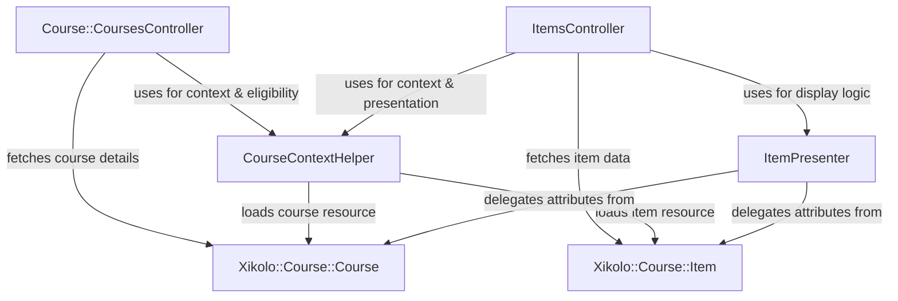
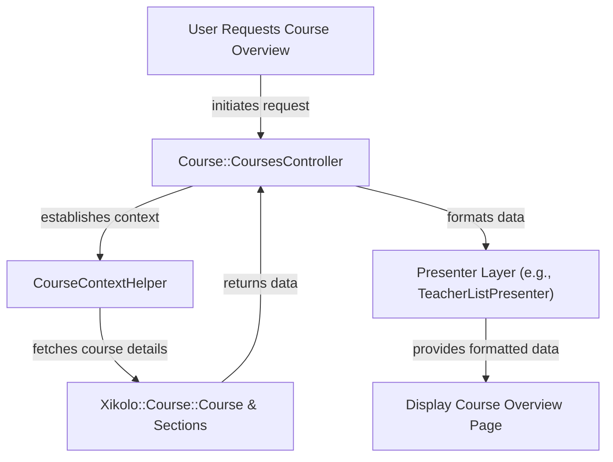
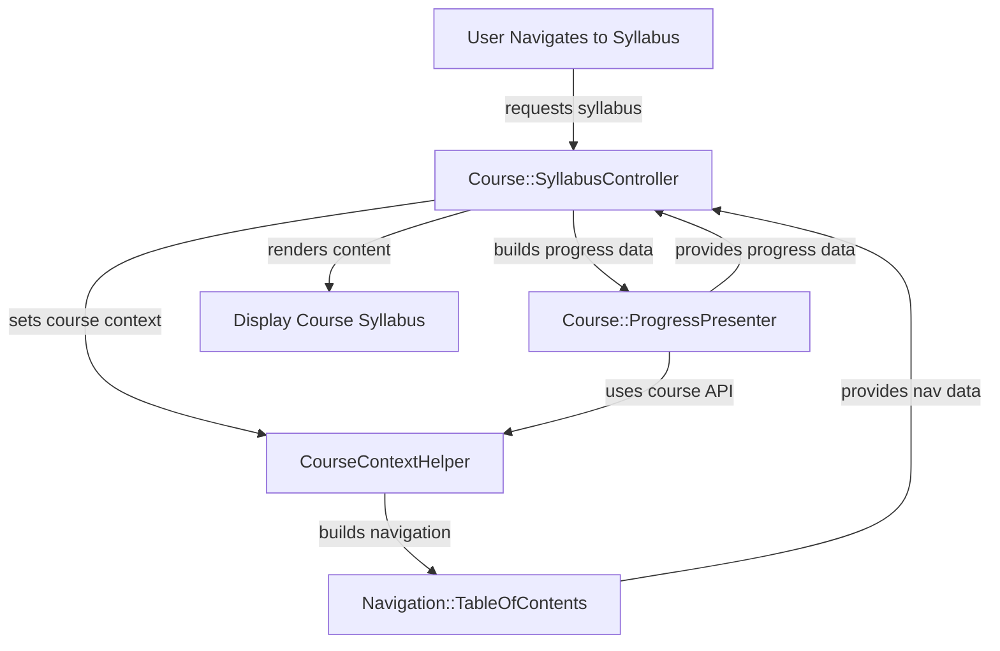
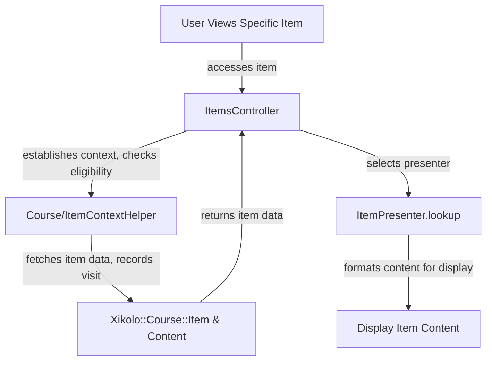
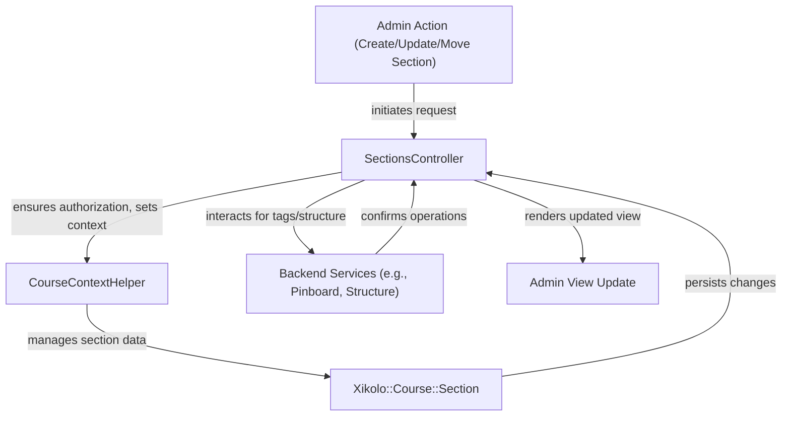
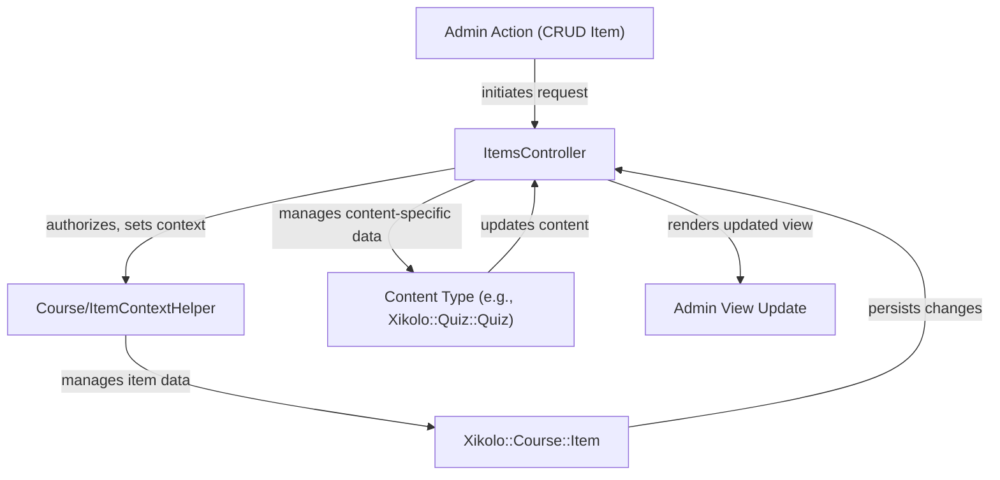
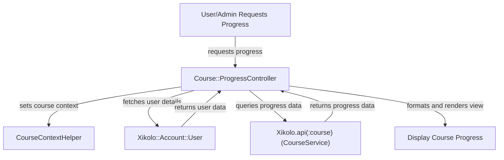

# Frontend Display and Navigation for Courses, Sections, and Items - Technical Documentation

*Generated on 9/18/2025 | Xikolo Knowledge Base*

---

## 📋 Executive Summary

This report details the Xikolo 04_CORE_CourseNavigation cluster, which centrally manages the frontend display and navigation for courses, their constituent sections, and individual learning items. The system employs a sophisticated presenter-based architecture and relies heavily on data fetched from the `Xikolo::CourseService` microservice via an Asynchronous Client-side Fetching System (ACFS). Its primary purpose is to deliver an intuitive and accessible user experience for learners, facilitating seamless interaction with course content, while simultaneously providing robust content management functionalities for administrators and content editors. Key operational components include dedicated controllers for managing course, section, and item views, supported by crucial context helpers and various presenters that efficiently format and structure data for the user interface, alongside enforcing detailed access control and eligibility checks.

---

## 🏗️ Architecture Overview

The architecture for the Xikolo 04_CORE_CourseNavigation cluster is designed around a decoupled microservice approach, with the frontend components serving as orchestrators for data retrieved primarily from the `Xikolo::CourseService`. This design ensures scalability and maintainability, separating UI logic from core data management. Controllers initiate requests, helpers establish context and perform validations, and presenters transform raw data into display-ready formats, minimizing direct view-model interaction.

### Core Architecture Diagram

### Component Descriptions
1.  **Course::CoursesController**: This controller is the gateway for users accessing the main course overview. It is responsible for orchestrating the fetching of course-level data, including detailed course information, teacher profiles, all associated sections, and specially marked featured items. It employs several `before_action` filters to ensure access control, such as validating user eligibility and handling redirects, thus enforcing the course's publication status and user permissions. It also utilizes a suite of presenters like `Course::TeacherListPresenter` and `FeaturedItemPresenter` to structure the data for frontend rendering.
2.  **ItemsController**: This controller manages all aspects of individual learning items within a course. Its core function is to display item content, but it also provides a comprehensive interface for content editors to perform creation, editing, updating, moving, and deletion of items. It dynamically selects the appropriate `ItemPresenter` based on the item's `content_type` (e.g., video, rich text, quiz, LTI exercise), handles item prerequisites, records user visits, and integrates with various specialized microservices for content management.
3.  **CourseContextHelper**: A foundational helper module included in relevant controllers, providing macros like `inside_course` to standardize the process of establishing the current course, section, and item context. It performs critical `check_course_eligibility` assessments, lazy-loads resources from `Xikolo::CourseService`, and is responsible for building the `Navigation::TableOfContents` component to facilitate course-wide navigation.
4.  **ItemPresenter**: This is an abstract base presenter class that serves as the blueprint for all item types. It streamlines the formatting of item data and encapsulates complex display logic. Key responsibilities include delegating attributes from underlying `Xikolo::Course::Item` and `Xikolo::Course::Course` resources, looking up content-type-specific presenters (e.g., `VideoItemPresenter`), and determining access statuses such as `unlocked?` or `locked?` based on dates, publication status, and user permissions. It also manages item prerequisites via `Course::RequiredItemPresenter`.
5.  **Xikolo::Course::Course**: An ACFS resource representing a course, primarily sourced from the `Xikolo::CourseService` microservice. It is a central data entity providing essential course attributes such as `id`, `course_code`, `title`, and `published` status, along with references to its sections and items. This resource is fundamental for nearly all course-related operations and displays.
6.  **Xikolo::Course::Item**: An ACFS resource embodying an individual learning item (e.g., a lecture, quiz, or assignment) within a course section. Also fetched from `Xikolo::CourseService`, it carries specific attributes like `content_id`, `content_type`, `title`, `max_points`, `position`, `section_id`, and `required_item_ids`. These attributes are crucial for both rendering the item's content and enforcing learning progression rules.

### Integration Points and Actual Component Interactions
The `04_CORE_CourseNavigation` cluster tightly integrates various components to deliver a fluid user experience. `Course::CoursesController`, `ItemsController`, `SectionsController`, `Course::SyllabusController`, and `Course::ProgressController` interact extensively with `CourseContextHelper` to establish context and `check_course_eligibility`. `ItemContextHelper` further refines item-specific context, creating `Xikolo::Course::Visit` records and `Course::PositionPresenter` instances. Presenters like `ItemPresenter` and `SectionPresenter` delegate attributes from core ACFS resources such as `Xikolo::Course::Course`, `Xikolo::Course::Section`, and `Xikolo::Course::Item`, all fetched via `Xikolo.Application Programming Interface (API)(:course)` (the `Xikolo::CourseService`). For content-specific interactions, `ItemsController` is the primary hub, communicating with `Xikolo::Quiz::Quiz` (and its `Xikolo::Quiz::Question`, `Xikolo::Quiz::Answer`), `Lti::Exercise` (and `Lti::Provider`), `Video::Video` (and `Video::Store`), and `Course::Richtext` (and `Course::Richtext::Store`). Section management by `SectionsController` includes creating `Xikolo::Pinboard::ImplicitTag` and `Xikolo::Course::SectionChoice` resources, and using `Course::Structure::Node` for structural changes.

### Architecture Diagrams

#### Main Architecture Overview

### 🔄 Component Interactions

Key interactions between components in this cluster:

- **Course::CoursesController:** Interacts with Xikolo::Course::Course to fetch course details [Source: app/controllers/course/courses_controller.rb]
- **Course::CoursesController:** Uses Course::TeacherListPresenter to format teacher data [Source: app/controllers/course/courses_controller.rb]
- **Course::SyllabusController:** Uses Course::ProgressPresenter to build user progress data [Source: app/controllers/course/syllabus_controller.rb]
- **Course::SyllabusController:** Leverages CourseContextHelper for course context and eligibility checks [Source: app/controllers/course/syllabus_controller.rb]
- **Course::ProgressController:** Fetches user data from Xikolo::Account::User [Source: app/controllers/course/progress_controller.rb]
- **Course::ProgressController:** Uses Course::DocumentsPresenter to display course documents related to progress [Source: app/controllers/course/progress_controller.rb]
- **ItemsController:** Uses ItemContextHelper for item-specific context and presentation [Source: app/controllers/items_controller.rb]
- **ItemsController:** Interacts with Xikolo::Course::Item for item data [Source: app/controllers/items_controller.rb]
- **SectionsController:** Uses CourseContextHelper for course context [Source: app/controllers/sections_controller.rb]
- **SectionsController:** Uses CoursePresenter to create course presentation data [Source: app/controllers/sections_controller.rb]
- **CourseContextHelper:** Defines `inside_course` macro for controllers [Source: app/helpers/course_context_helper.rb]
- **CourseContextHelper:** Loads `the_course`, `the_section`, `the_item` from Xikolo::Course::Course, Xikolo.api(:course) [Source: app/helpers/course_context_helper.rb]
- **ItemContextHelper:** Defines `inside_item` macro for controllers [Source: app/helpers/item_context_helper.rb]
- **ItemContextHelper:** Ensures item belongs to the course [Source: app/helpers/item_context_helper.rb]
- **ItemPresenter:** Delegates attributes from `@item` (Xikolo::Course::Item resource) and `@course` (Xikolo::Course::Course resource) [Source: app/presenters/item_presenter.rb]
- **ItemPresenter:** Looks up specific presenters based on `content_type` (e.g., `VideoItemPresenter`, `QuizItemPresenter`) [Source: app/presenters/item_presenter.rb]
- **SectionPresenter:** Delegates attributes from `@section` (Xikolo::Course::Section resource) [Source: app/presenters/section_presenter.rb]
- **SectionPresenter:** Fetches `items` for the section from Xikolo.api(:course) [Source: app/presenters/section_presenter.rb]
- **Navigation::TableOfContents:** Receives course, sections, current_section, and current_item as input [Source: app/helpers/course_context_helper.rb]
- **Navigation::TableOfContents:** Used by `CourseContextHelper#load_section_nav` [Source: app/helpers/course_context_helper.rb]
- **Xikolo::Course::Course:** Fetched by `Course::CoursesController`, `ItemsController`, `SectionsController`, `CourseContextHelper` [Source: app/controllers/course/courses_controller.rb, app/controllers/items_controller.rb, app/controllers/sections_controller.rb, app/helpers/course_context_helper.rb]
- **Xikolo::Course::Course:** Provides attributes like `id`, `course_code`, `title`, `sections`, `items`, `published`, `context_id`, `pinboard_enabled`, `forum_is_locked`, `lang`, `legacy?`, `node` [Source: app/controllers/course/courses_controller.rb, app/controllers/items_controller.rb, app/controllers/sections_controller.rb, app/presenters/item_presenter.rb, app/helpers/course_context_helper.rb]
- **Xikolo::Course::Section:** Fetched by `Course::CoursesController`, `ItemsController`, `SectionsController`, `CourseContextHelper` [Source: app/controllers/course/courses_controller.rb, app/controllers/items_controller.rb, app/controllers/sections_controller.rb, app/helpers/course_context_helper.rb]
- **Xikolo::Course::Section:** Created and updated by `SectionsController` [Source: app/controllers/sections_controller.rb]
- **Xikolo::Course::Item:** Fetched by `Course::CoursesController`, `ItemsController`, `CourseContextHelper` [Source: app/controllers/course/courses_controller.rb, app/controllers/items_controller.rb, app/helpers/course_context_helper.rb]
- **Xikolo::Course::Item:** Created and updated by `ItemsController` [Source: app/controllers/items_controller.rb]
- **Xikolo::Course::Visit:** Created by `ItemContextHelper#create_visit!` [Source: app/helpers/item_context_helper.rb]
- **Xikolo::Course::SectionChoice:** Created by `SectionsController#choose_alternative_section` [Source: app/controllers/sections_controller.rb]
- **Xikolo::Course::SectionChoice:** Fetched by `SectionPresenter#fetch_section_choices` [Source: app/presenters/section_presenter.rb]
- **Xikolo::Pinboard::ImplicitTag:** Created by `SectionsController#create` upon section creation [Source: app/controllers/sections_controller.rb]
- **Xikolo::Pinboard::ImplicitTag:** Fetched by `SectionPresenter#enqueue_implicit_tags` [Source: app/presenters/section_presenter.rb]
- **Xikolo::Quiz::Quiz:** Created, updated, and fetched by `ItemsController` for quiz content [Source: app/controllers/items_controller.rb]
- **Xikolo::Quiz::Quiz:** Interacts with `Xikolo::Quiz::Question` and `Xikolo::Quiz::Answer` for quiz details [Source: app/controllers/items_controller.rb]
- **Lti::Exercise:** Created, updated, and fetched by `ItemsController` for LTI exercise content [Source: app/controllers/items_controller.rb]
- **Lti::Exercise:** Interacts with `Lti::Provider` for LTI provider details [Source: app/controllers/items_controller.rb]
- **Video::Video:** Created, updated, and fetched by `ItemsController` for video content [Source: app/controllers/items_controller.rb]
- **Video::Video:** Interacts with `Video::Store` for video storage operations [Source: app/controllers/items_controller.rb]
- **Course::Richtext:** Created, updated, and fetched by `ItemsController` for rich text content [Source: app/controllers/items_controller.rb]
- **Course::Richtext:** Interacts with `Course::Richtext::Store` for rich text storage operations [Source: app/controllers/items_controller.rb]

---

## ⚙️ Technical Workflows

The Xikolo course navigation system handles several key workflows to manage and display course content, catering to both learners and content editors. Each workflow involves specific controllers, helpers, and data models working in concert to achieve its objective.

### 1. Course Overview Display
This workflow describes how a user views the main page for a course, which consolidates general course information, teacher details, and a summary of sections and featured items. The process begins with a user request for a course page, which is intercepted by the `Course::CoursesController`. This controller, leveraging `CourseContextHelper`, establishes the necessary course context and performs eligibility checks to ensure the user has appropriate access. It then fetches `Xikolo::Course::Course` details and associated `Xikolo::Course::Section` and `Xikolo::Course::Item` (specifically featured items) data from the `Xikolo::CourseService`. Various presenters, such as `Course::TeacherListPresenter`, `FeaturedItemPresenter`, `CourseLargePreviewPresenter`, and `Course::CourseDetailsPresenter`, are employed to format this raw data into a structured and user-friendly display. Finally, the prepared data is rendered to the user as the course overview page.

### 2. Course Syllabus Navigation
This workflow details a user's action to view the course syllabus, which provides a comprehensive overview of all course content and the user's progress within it. The journey starts with the user navigating to the syllabus page, triggering the `Course::SyllabusController`. This controller utilizes `CourseContextHelper` to establish the correct course context and conduct eligibility checks, especially considering "open mode" access for un-enrolled users if configured. It then interacts with `Xikolo.api(:course)` to fetch relevant course items, especially previewable ones. The `Course::ProgressPresenter` is crucial at this stage, building user-specific progress data that informs the syllabus display. Additionally, the `Navigation::TableOfContents` component is constructed by `CourseContextHelper` to provide a hierarchical navigation structure. The controller then aggregates this progress and navigation data, which is formatted and presented to the user as the course syllabus.

### 3. Item Content Display
This workflow describes the process when a user views a specific learning item, such as a video, quiz, or rich text, within a course. Upon a user's request to access an item, the `ItemsController` takes charge. It first employs `CourseContextHelper` and `ItemContextHelper` to validate the course and item context, ensuring the item belongs to the specified course and that prerequisites are met. `ItemContextHelper` also initiates the creation of a `Xikolo::Course::Visit` record to track user engagement, unless specific conditions (like being a quiz or a masquerading user) are met. The `ItemsController` then uses `ItemPresenter.lookup` to select the appropriate presenter based on the item's `content_type` (e.g., `VideoItemPresenter` for videos). This specialized presenter fetches the actual content data from the relevant microservice or model (`Video::Video`, `Course::Richtext`, `Xikolo::Quiz::Quiz`, `Lti::Exercise`) and formats it for display. Finally, the fully prepared item content, including meta tags and navigation elements (`Course::PositionPresenter`), is rendered to the user.

### 4. Section Management (Admin)
This workflow outlines the administrative actions performed by a content editor to manage sections within a course, including creation, updating, movement, and deletion. An administrator initiates an action (e.g., 'create new section') through the administrative interface. The request is processed by the `SectionsController`, which first ensures the user has `ensure_content_editor` authorization. `CourseContextHelper` is then used to establish the course context for the operation. For new sections or updates, the controller interacts directly with the `Xikolo::Course::Section` resource to persist changes. If the course is not a legacy structure, `Course::Structure::Node` is utilized for managing the hierarchical structure of sections and items. Notably, section creation can trigger the creation of a `Xikolo::Pinboard::ImplicitTag` in the `Xikolo::PinboardService` to integrate sections with the course's pinboard. After the operation, the `CoursePresenter` is used to re-render the updated course view, confirming the changes to the administrator.

### 5. Item Management (Admin)
This workflow describes how a content editor performs CRUD (Create, Read, Update, Delete) operations on individual learning items within a course section. The process begins with an administrator selecting an action (e.g., 'edit quiz') in the content management interface. The `ItemsController` receives this request and, after `ensure_content_editor` authorization and context establishment via `CourseContextHelper` and `ItemContextHelper`, proceeds with the requested operation. For item creation or updates, the `ItemsController` directly interacts with the `Xikolo::Course::Item` resource and, crucially, with the content-specific services or models like `Video::Video` (via `Video::Store`), `Course::Richtext` (via `Course::Richtext::Store`), `Xikolo::Quiz::Quiz` (with `Xikolo::Quiz::Question` and `Xikolo::Quiz::Answer`), or `Lti::Exercise` (with `Lti::Provider` and `Lti::Exercise::Store`). It also handles `FileUpload` for video content. Item movement involves interaction with `Course::Structure::Node`. Upon deletion, associated content is removed from its respective service. Error handling is noted to be inconsistent across content types during creation/update. Once the operation is complete, the `ItemsController` renders an updated view, confirming the changes to the administrator.

### 6. Course Progress Tracking
This workflow details how a user or an authorized administrator can view the progress of a learner within a specific course. The workflow starts when a user or administrator requests to view course progress, triggering the `Course::ProgressController`. This controller uses `CourseContextHelper` to establish the course context. It determines the user for whom progress is to be displayed—either the `current_user` or a specified `user_id` if the `current_user` possesses `course.course.teaching` permission (for administrative oversight). Subsequently, `Course::ProgressController` fetches user data from `Xikolo::Account::User` and leverages `Course::DocumentsPresenter` to include any course documents relevant to progress. The controller then directly queries the `course_api` (part of `Xikolo.api(:course)`) to retrieve the comprehensive progress data, including item completion statuses and scores. This data is then formatted for presentation, with item styling distinct for various content types to indicate completion, warnings, or critical states based on submission and score percentages, before being displayed to the requesting user or administrator.

### Workflow Diagrams

#### Workflow: Course Overview Display

#### Workflow: Course Syllabus Navigation

#### Workflow: Item Content Display

#### Workflow: Section Management (Admin)

#### Workflow: Item Management (Admin)

#### Workflow: Course Progress Tracking

### 🔀 Process Workflows

Detailed workflow processes for this cluster:

- **Core frontend display and navigation for courses, sections, and items operations**
- **Data processing and validation workflows**
- **Component interaction and integration processes**

---

## 🔧 Implementation Details

The Xikolo course navigation system is engineered with a modular approach, primarily leveraging a microservice architecture and a presenter-based frontend design to manage and display course content. This structure ensures a clean separation between data fetching, business logic, and presentation concerns, facilitating maintainability and scalability across the platform.

**Technical Considerations:**
At its core, the system relies on ACFS (Asynchronous Client-side Fetching System) to retrieve data for `Xikolo::Course::Course`, `Xikolo::Course::Section`, and `Xikolo::Course::Item` resources from the `Xikolo::CourseService` microservice. Controllers, such as `Course::CoursesController` and `SectionsController`, integrate `before_action` filters to enforce critical functionalities like establishing canonical URLs, setting appropriate cache headers, and performing `check_course_eligibility`. Access to course content is tightly controlled; unpublished courses are only accessible to users with `course.content.access` permission, and unauthenticated users are redirected. For content editors, `ensure_content_editor` authorization is mandatory for all CRUD operations on sections and items. A key feature is item prerequisite enforcement: users must complete `required_items` (e.g., visiting previous content or achieving a 50% score on assessments) before accessing subsequent items. However, survey quizzes are explicitly noted as unsuitable for prerequisites. User engagement is tracked by creating `Xikolo::Course::Visit` records when an item is viewed, although this logging is bypassed for quizzes or if the user is masquerading or unauthenticated. Presenters like `ItemPresenter` and `SectionPresenter` abstract complex UI logic, handling item `unlocked?` status based on `effective_start_date`, `effective_end_date`, and `published` states, as well as managing `alternative_state` logic for sections. Automatic deadline management for course content is also handled by background jobs interacting with `NextDate` resources.

**Dependencies and Integrations:**
This cluster extensively integrates with various internal and microservice components:
*   **Xikolo::CourseService**: The primary backend for core course entities (`Xikolo::Course::Course`, `Xikolo::Course::Section`, `Xikolo::Course::Item`), providing fundamental data through `Xikolo.api(:course)`.
*   **Xikolo::PinboardService**: `SectionsController` interacts with this service to create `Xikolo::Pinboard::ImplicitTag` instances upon section creation, linking course sections to the platform's pinboard functionality.
*   **Xikolo::QuizService**: `ItemsController` manages `Xikolo::Quiz::Quiz` content, including interactions with `Xikolo::Quiz::Question` and `Xikolo::Quiz::Answer` for detailed quiz setup and deletion.
*   **Lti::Provider**: Utilized by `ItemsController` for the management and display of `Lti::Exercise` content, facilitating integrations with external Learning Tools Interoperability providers.
*   **Video::Store**: `ItemsController` interacts with `Video::Store` for all storage and retrieval operations related to `Video::Video` content items.
*   **Course::Richtext::Store**: Similarly, `ItemsController` uses `Course::Richtext::Store` for managing `Course::Richtext` content.
*   **Xikolo::Account::User**: `Course::ProgressController` queries this service to retrieve user profile data for display in the progress reports.
*   **Xikolo::Account::Preferences**: `ItemsController` loads user preferences from this service to tailor the item viewing experience.
*   **Course::Structure::Node**: This component is critical for dynamic manipulation of course structure, especially for moving sections and items in non-legacy courses.
*   **FileUpload**: A helper component used by `ItemsController` to manage video file uploads, with a noted technical debt item to improve the reuse of upload IDs.

**Configuration Requirements:**
Specific configurations dictate certain behaviors within the course navigation cluster:
*   **`Xikolo.config.open_mode['enabled']`**: This global configuration flag enables or disables the 'open mode' feature. When enabled and the course is not invite-only or hidden and has previewable items, `Course::SyllabusController` allows un-enrolled users to access the syllabus for preview purposes.
*   **`current_user.feature?('alternative_sections.create')`**: This feature flag controls whether the `current_user` is authorized to create alternative sections with an `alternative_state: 'child'`. This permission check is performed as a `before_action` in `SectionsController` during section creation.

### 📚 Technical Sources & References

Key technical documentation and source references:

- Course::CoursesController: app/controllers/course/courses_controller.rb- Course::CoursesController: app/helpers/course_context_helper.rb- Course::SyllabusController: app/controllers/course/syllabus_controller.rb- Course::SyllabusController: app/helpers/course_context_helper.rb- Course::ProgressController: app/controllers/course/progress_controller.rb- ItemsController: app/controllers/items_controller.rb- ItemsController: app/helpers/item_context_helper.rb- SectionsController: app/controllers/sections_controller.rb- SectionsController: app/helpers/course_context_helper.rb- CourseContextHelper: app/helpers/course_context_helper.rb- ItemContextHelper: app/helpers/item_context_helper.rb- ItemPresenter: app/presenters/item_presenter.rb- ItemPresenter: RAG: docs/app/features/courses/items.md- SectionPresenter: app/presenters/section_presenter.rb- SectionPresenter: RAG: docs/app/features/courses/deadlines.md- Navigation::TableOfContents: app/helpers/course_context_helper.rb- Xikolo::Course::Course: app/controllers/course/courses_controller.rb- Xikolo::Course::Course: app/controllers/items_controller.rb- Xikolo::Course::Section: app/controllers/course/courses_controller.rb- Xikolo::Course::Section: app/controllers/items_controller.rb- Xikolo::Course::Item: app/controllers/course/courses_controller.rb- Xikolo::Course::Item: app/controllers/items_controller.rb- Xikolo::Course::Visit: app/helpers/item_context_helper.rb- Xikolo::Course::SectionChoice: app/controllers/sections_controller.rb- Xikolo::Course::SectionChoice: app/presenters/section_presenter.rb- Xikolo::Pinboard::ImplicitTag: app/controllers/sections_controller.rb- Xikolo::Pinboard::ImplicitTag: app/presenters/section_presenter.rb- Xikolo::Quiz::Quiz: app/controllers/items_controller.rb- Lti::Exercise: app/controllers/items_controller.rb- Video::Video: app/controllers/items_controller.rb- Course::Richtext: app/controllers/items_controller.rb- Configuration: config/application.rb, Gemfile, config/database.yml- Process Management: Procfile, Procfile.web- Build & Deploy: Rakefile, package.json

---

*This documentation is automatically generated from cluster analysis and should be validated against the actual codebase.*
