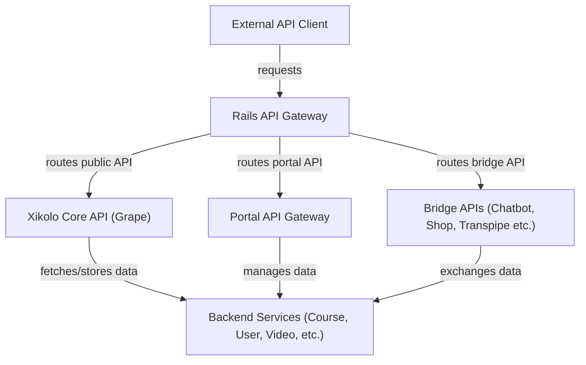
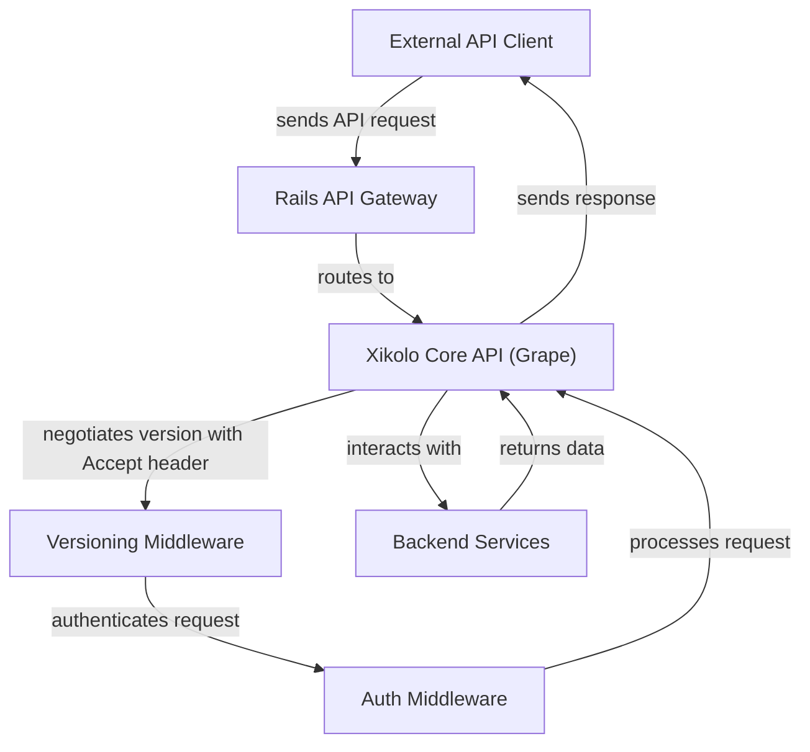
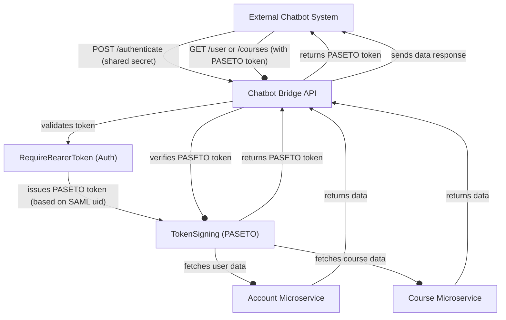
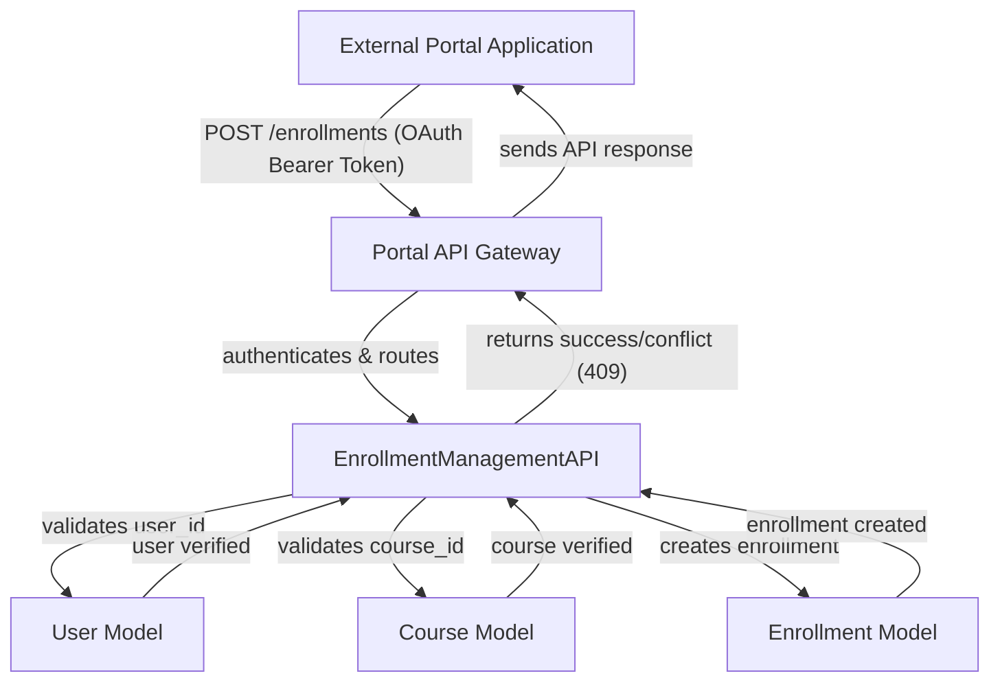

# Main Application Application Programming Interface (API) Gateway and Grape API - Technical Documentation

*Generated on 9/18/2025 | Xikolo Knowledge Base*

---

## 📋 Executive Summary

The Xikolo API cluster serves as the central API gateway for all platform interactions, facilitating communication for mobile applications, external customer portals, and various external service integrations. It is designed around modern API principles, emphasizing JSON-API and Representational State Transfer (REST) compliance, robust versioning, and a declarative endpoint structure. Key components include the `Xikolo::API` for core public access, specialized Bridge APIs (`Chatbot`, `Shop`, `TransPipe`, `MOOChub`, `Lanalytics`) for external integrations, and a `Portal API Gateway` for external application management. This architecture ensures secure, scalable, and version-controlled data exchange across a diverse ecosystem of clients and services.

---

## 🏗️ Architecture Overview

The Xikolo API architecture is composed of a central API Gateway that directs incoming requests to specific API implementations based on their purpose. The `Rails API Gateway` acts as the initial entry point, routing traffic to either the core `Xikolo Core API (Grape)`, the `Portal API Gateway`, or one of the specialized `Bridge APIs`. This modular approach allows for tailored authentication, versioning, and resource exposure for different client types. Backend services, represented by a generic `Backend Services` layer, provide the fundamental data and business logic that all API layers consume and interact with to fulfill requests. Versioning and authentication middlewares are integral to `Xikolo Core API`, ensuring secure and backward-compatible communication for mobile clients. The Portal API and Bridge APIs each have their own specific security and routing contexts, interacting directly with underlying data models or microservices.

### Architecture Diagrams

#### Main API Gateway Architecture

### 🔄 Component Interactions

Key interactions between components in this cluster:

- **Xikolo::API:** Uses `Xikolo::Versioning::Middleware` for API version negotiation.
- **Xikolo::API:** Uses `Auth::Middleware::LegacyToken` and `Auth::Middleware::Session` for authentication.
- **Xikolo::Endpoint::CollectionEndpoint:** Extended by specific API endpoint classes (e.g., `Users` in documentation example) to define resource-specific logic.
- **Xikolo::Endpoint::CollectionEndpoint:** Utilized by the `Xikolo::API` to process incoming requests and generate responses.
- **API Gateway (Rails Routes):** Receives all incoming API requests to the main application.
- **API Gateway (Rails Routes):** Routes requests to the `Xikolo::API` for general mobile app consumption.
- **Portal API:** Consumed by external customer portal applications.
- **Portal API:** Interacts with underlying services to manage course, user, and enrollment data.
- **Transpipe Bridge API:** Used by internal services requiring video and subtitle manipulation.
- **Transpipe Bridge API:** Interacts with video storage and processing components.
- **Lanalytics Bridge API:** Consumed by internal analytics and reporting tools.
- **Lanalytics Bridge API:** Aggregates and exposes statistical data from various learning components.
- **Moochub Bridge API:** Interacts with external MOOC hub platforms or internal components related to MOOCs.
- **Moochub Bridge API:** Provides course listings.
- **Chatbot Bridge API:** Authenticates external chatbot systems using a shared secret (Bearer token) for initial access to the authentication endpoint. [Source: app/controllers/bridges/chatbot/authentications_controller.rb, app/controllers/bridges/chatbot/base_controller.rb]
- **Chatbot Bridge API:** Issues user-specific authentication tokens based on a provided SAML `uid` (NameID). [Source: app/controllers/bridges/chatbot/authentications_controller.rb]
- **Shop Bridge API:** Authenticates external shop systems using a shared secret provided as a Bearer token. [Source: app/controllers/bridges/shop/base_controller.rb]
- **Shop Bridge API:** Allows for the bulk creation of vouchers with specified quantities, product types, countries, and tags via a POST request to `/vouchers`. [Source: app/controllers/bridges/shop/vouchers_controller.rb]
- **API Changelog:** Informs API consumers (e.g., mobile app developers, internal service developers) about changes to the API. [Source: API versioning documentation]
- **API Changelog:** Supports the API versioning strategy by documenting specific changes per version. [Source: API versioning documentation]
- **PortalApi:** Provides `index`, `show` for `courses`, `update`, `destroy` for `users`, and `index`, `create` for `enrollments`. [Source: config/routes.rb]
- **PortalApi:** Requires bearer token authentication. [Source: app/controllers/portal_api/, config/routes.rb]
- **Bridges:** `Transpipe`: Manages courses and video subtitles. [Source: config/routes.rb]
- **Bridges:** `Lanalytics`: Provides course and video statistics. [Source: config/routes.rb]
- **Xi::Controllers::RequireBearerToken:** Included in Bridge API controllers to secure endpoints requiring bearer token authentication.
- **Rails.application.routes:** Directs incoming HTTP requests to the appropriate controllers. [Source: config/routes.rb]
- **Rails.application.routes:** Mounts the `Xikolo::API` Grape application. [Source: config/routes.rb]
- **TokenSigning:** Used by Chatbot API controllers to issue and validate user-specific Paseto tokens.
- **TokenSigning:** Utilizes application secrets for private key and configuration for public keys.
- **Abstract::BridgeAPIController:** Inherited by concrete Bridge API controllers (e.g., Chatbot, Shop, TransPipe controllers).
- **ChatbotBridgeAPI:** Receives authentication requests via `POST /authenticate` (shared secret).
- **ChatbotBridgeAPI:** Provides user data via `GET /user`.
- **ShopBridgeAPI:** Receives requests to create vouchers via `POST /vouchers`.
- **ShopBridgeAPI:** Responds to requests for listing vouchers via `GET /vouchers`.
- **MoochubBridgeAPI:** Exposes course data via `/bridges/moochub/courses`.
- **TransPipeBridgeAPI:** Provides lists of courses via `GET /courses`.
- **TransPipeBridgeAPI:** Provides detailed course information via `GET /courses/{id}`.
- **LanalyticsBridgeAPI:** Expected to expose data relevant for analytics consumption.
- **PortalApiBeta:** Routes requests to CourseCatalogAPI for course information.
- **PortalApiBeta:** Routes requests to UserManagementAPI for user profile operations.
- **CourseCatalogAPI:** Exposes GET /courses to retrieve a list of courses.
- **CourseCatalogAPI:** Exposes GET /courses/{id} to retrieve a single course.
- **UserManagementAPI:** Exposes PATCH /users/{id} for updating user attributes.
- **UserManagementAPI:** Exposes DELETE /users/{id} for deleting user accounts.
- **EnrollmentManagementAPI:** Exposes GET /enrollments to retrieve user enrollments.
- **EnrollmentManagementAPI:** Exposes POST /enrollments to create new enrollments.
- **Course:** Provides data to CourseCatalogAPI for course retrieval.
- **Course:** Referenced by Enrollment for linking users to courses.
- **User:** Data is updated and deleted via UserManagementAPI.
- **User:** Referenced by Enrollment to associate enrollments with specific users.
- **Enrollment:** Data is retrieved and created via EnrollmentManagementAPI.
- **Enrollment:** Links a User to a Course.
- **Versioning::Version:** Instantiated and managed by `Xikolo::API` for version tracking.
- **Xikolo::Versioning::Middleware:** Used by `Xikolo::API` to process incoming requests.
- **Xikolo::Versioning::Middleware:** Interacts with API clients by interpreting `Accept` headers and potentially adding `Sunset` headers to responses.
- **Auth::Helpers:** Included as helpers within `Xikolo::API` and its mounted endpoints.
- **Model::Helpers:** Included as helpers within `Xikolo::API` and its mounted endpoints.
- **Auth::Middleware::LegacyToken:** Used by `Xikolo::API` to authenticate incoming requests.
- **Auth::Middleware::LegacyToken:** Interacts with API clients by processing `Authorization` headers.
- **Auth::Middleware::Session:** Used by `Xikolo::API` to authenticate incoming requests.
- **Auth::Middleware::Session:** Interacts with API clients by processing session information.
- **Error::Base:** Inherited by specific API error classes.
- **Error::Base:** Caught by `Xikolo::API`'s `rescue_from` block to generate standardized error responses.
- **V2::Base:** Mounted by `Xikolo::API` to make its endpoints accessible.
- **V2::Base:** Used by `Xikolo::Docs::Generator` for documentation generation.
- **Xikolo::Docs::Generator:** Called by `Xikolo::API.make_docs!` to generate documentation for `V2::Base`.
- **Format::PrettyJSON:** Used by `Xikolo::API` as the formatter for `json` content type.
- **Grape::Parser::Json:** Used by `Xikolo::API` as the parser for `json_api` content type.
- **Transpipe::URL:** Reads configuration settings from `Xikolo.config.transpipe` to retrieve URL templates. [Source: app/lib/transpipe.rb]
- **Transpipe::URL:** Generates fully qualified URLs for courses and video content, intended for use by the TransPipe service. [Source: app/lib/transpipe.rb]
- **MOOChub Bridge API:** Exposes course data via the `/bridges/moochub/courses` endpoint. [Source: app/controllers/bridges/moochub/courses_controller.rb]
- **MOOChub Bridge API:** Interacts with MOOChub for data exchange, aggregating course information. [Source: app/controllers/bridges/moochub/courses_controller.rb]
- **TransPipe Bridge API:** Authenticates external systems using a Bearer token. [Source: app/controllers/bridges/transpipe/base_controller.rb]
- **TransPipe Bridge API:** Provides paginated lists of courses and detailed course information, including sections, videos within sections, and teacher details. [Source: app/controllers/bridges/transpipe/courses_controller.rb, app/controllers/bridges/transpipe/videos_controller.rb]
- **Chatbot API (Controller/Service Layer):** Interacts with `TokenSigning` for issuing and verifying user-specific Paseto tokens. [Source: app/controllers/bridges/chatbot/authentications_controller.rb]
- **Chatbot API (Controller/Service Layer):** Interacts with the 'Account' microservice for user data and 'Course' microservice for course and enrollment data. [Source: app/controllers/bridges/chatbot/my_courses_controller.rb, app/controllers/bridges/chatbot/users_controller.rb]
- **MOOChub API (Controller/Service Layer):** Interacts with the 'Course' microservice for course data. [Source: app/controllers/bridges/moochub/courses_controller.rb]
- **MOOChub API (Controller/Service Layer):** Communicates with external MOOChub systems. [Source: app/controllers/bridges/moochub/courses_controller.rb]
- **Shop API (Controller/Service Layer):** Interacts with a 'Voucher' domain within the application to manage voucher lifecycle. [Source: app/controllers/bridges/shop/vouchers_controller.rb]
- **Shop API (Controller/Service Layer):** Communicates with external shop systems. [Source: app/controllers/bridges/shop/base_controller.rb]
- **TransPipe API (Controller/Service Layer):** Interacts with 'Course' and 'Video' models/services to fetch and update data. [Source: app/controllers/bridges/transpipe/courses_controller.rb, app/controllers/bridges/transpipe/videos_controller.rb]
- **TransPipe API (Controller/Service Layer):** Communicates with external translation pipeline systems. [Source: app/controllers/bridges/transpipe/subtitles_controller.rb]
- **Portal API Gateway:** Receives authenticated HTTP requests from external applications using OAuth 2.0 Bearer Tokens. [Source: app/controllers/portal_api/, config/routes.rb]
- **Portal API Gateway:** Responds with JSON data, adhering to the HTTP Problem Details specification for errors. [Source: app/controllers/portal_api/]
- **Courses API Resource:** Exposes `GET /courses` to retrieve a paginated list of courses. [Source: app/controllers/portal_api/courses_controller.rb]
- **Courses API Resource:** Exposes `GET /courses/{id}` to retrieve a single course by its unique identifier. [Source: app/controllers/portal_api/courses_controller.rb]
- **Users API Resource:** Exposes `PATCH /users/{id}` to update user attributes such as email, full_name, display_name, born_at, language, and avatar. [Source: app/controllers/portal_api/users_controller.rb]
- **Users API Resource:** Exposes `DELETE /users/{id}` to remove a user account. [Source: app/controllers/portal_api/users_controller.rb]
- **Enrollments API Resource:** Exposes `GET /enrollments` to retrieve all enrollments for a given user, with optional filtering by `course_id`. [Source: app/controllers/portal_api/enrollments_controller.rb]
- **Enrollments API Resource:** Exposes `POST /enrollments` to create a new enrollment for a user in a specified course, requiring `user_id` and `course_id`. [Source: app/controllers/portal_api/enrollments_controller.rb]

---

## ⚙️ Technical Workflows

### 1. Core API Request Processing Workflow
When an external API client, such as a mobile application, initiates a request, it first hits the `Rails API Gateway`. This gateway, defined by `Rails.application.routes`, is responsible for directing the request to the appropriate primary API. For general mobile app consumption, requests are routed to the `Xikolo Core API (Grape)`. Upon reception, the `Xikolo Core API` first passes the request through the `Versioning Middleware`, which inspects the `Accept` header to determine the client's requested API version. Concurrently or subsequently, the `Auth Middleware` (`Auth::Middleware::LegacyToken` or `Auth::Middleware::Session`) authenticates the client using `Authorization` headers or session information. If both version negotiation and authentication succeed, the request proceeds to a specific `Collection Endpoint` (e.g., `Xikolo::Endpoint::CollectionEndpoint` extended for users or courses). This endpoint then interacts with `Backend Services` to fetch or store the requested data, before formatting the response (e.g., using `Format::PrettyJSON`) and returning it to the client.

### 2. Chatbot API User Authentication and Data Retrieval Workflow
An `External Chatbot System` begins its interaction by authenticating with the `Chatbot Bridge API`. This authentication typically involves sending a `POST /authenticate` request with a shared secret as a Bearer token. The `Chatbot Bridge API` leverages `Xi::Controllers::RequireBearerToken` to validate this initial shared secret. Upon successful validation, the API uses `TokenSigning` to issue a user-specific PASETO token based on a provided SAML `uid`. This PASETO token is then returned to the `External Chatbot System`. For subsequent data retrieval requests (e.g., `GET /user` or `GET /courses`), the chatbot includes this user-specific PASETO token in the `Authorization` header. The `Chatbot Bridge API` verifies this token using `TokenSigning` and then interacts with either the `Account Microservice` for user data or the `Course Microservice` for course listings and enrollments, before returning the requested information to the chatbot.

### 3. Portal API Enrollment Creation Workflow
An `External Portal Application` aims to create a new user enrollment. The request is sent to the `Portal API Gateway` (specifically `/portalapi-beta`), which acts as the entry point for external applications. The `Portal API Gateway` handles authentication using OAuth 2.0 Bearer Tokens and performs content negotiation based on the `Accept` header for versioning. Once authenticated and version-negotiated, the request is routed to the `EnrollmentManagementAPI`. This API endpoint, upon receiving a `POST /enrollments` request with `user_id` and `course_id`, interacts with the `User Model` to verify the user and the `Course Model` to validate the course. If both are valid and an enrollment doesn't already exist (otherwise a `409 Conflict` is returned), the `EnrollmentManagementAPI` then creates a new record in the `Enrollment Model`, linking the specified user and course. A success response is then returned to the `External Portal Application`.

### Workflow Diagrams

#### Core API Request Processing Workflow

#### Chatbot API Authentication and Data Retrieval

#### Portal API Enrollment Creation Workflow

### 🔀 Process Workflows

Detailed workflow processes for this cluster:

- **Xikolo::Endpoint::CollectionEndpoint Process:** Utilized by the `Xikolo::API` to process incoming requests and generate responses.
  *Source: Xikolo::Endpoint::CollectionEndpoint*
- **Transpipe Bridge API Process:** Interacts with video storage and processing components.
  *Source: Transpipe Bridge API*
- **Chatbot Bridge API Process:** Authenticates external chatbot systems using a shared secret (Bearer token) for initial access to the authentication endpoint.
  *Source: Chatbot Bridge API*
- **Chatbot Bridge API Process:** Issues user-specific authentication tokens based on a provided SAML `uid` (NameID).
  *Source: Chatbot Bridge API*
- **Xikolo::Versioning::Middleware Process:** Used by `Xikolo::API` to process incoming requests.
  *Source: Xikolo::Versioning::Middleware*
- **Auth::Middleware::LegacyToken Process:** Interacts with API clients by processing `Authorization` headers.
  *Source: Auth::Middleware::LegacyToken*
- **Auth::Middleware::Session Process:** Interacts with API clients by processing session information.
  *Source: Auth::Middleware::Session*

---

## 🔧 Implementation Details

The `05_CORE_APIGateway` cluster relies on a Ruby on Rails application for its foundational routing and API infrastructure. The primary API, `Xikolo::API`, is built using the Grape framework, enabling a declarative approach to endpoint definition via `Xikolo::Endpoint::CollectionEndpoint`. This allows for explicit definition of representation structures, attributes, relationships, and supported HTTP methods. 

**Technical Considerations:**
*   **Versioning:** API versioning is managed by `Xikolo::Versioning::Middleware` and `Versioning::Version` objects, primarily through the `Accept` header, with `Sunset` headers used for deprecated versions. This helps ensure backward compatibility for mobile clients. 
*   **Authentication:** The main `Xikolo::API` utilizes `Auth::Middleware::LegacyToken` and `Auth::Middleware::Session`. Bridge APIs, such as `ChatbotBridgeAPI` and `ShopBridgeAPI`, typically employ `Xi::Controllers::RequireBearerToken` for shared secret authentication. The Chatbot API specifically uses `TokenSigning` for generating and validating user-specific PASETO tokens, configured with application secrets for private keys and public keys for verification.
*   **Error Handling:** `Xikolo::API` centralizes error handling by rescuing from `Error::Base` exceptions to provide standardized `application/problem+json` error responses, as indicated for the `Portal API Gateway` as well.
*   **Documentation Generation:** `Xikolo::Docs::Generator` is used to produce API documentation from the `V2::Base` API definitions, aiding API consumers.
*   **URL Generation:** `Transpipe::URL` generates fully qualified URLs for courses and videos for the TransPipe service, reading templates from `Xikolo.config.transpipe`.

**Dependencies and Integrations:**
*   **Rails.application.routes:** Acts as the central routing hub, mounting `Xikolo::API` and defining routes for `PortalApi` and various `Bridges` modules.
*   **Grape:** The core framework used for building `Xikolo::API` and other API endpoint groups.
*   **Backend Services:** All API layers interact with underlying `Course`, `User`, and `Enrollment` models/services, and implicitly other backend microservices (e.g., Account, Video, Analytics services) to fetch and store data.
*   **Abstract::BridgeAPIController:** Serves as the base class for all concrete Bridge API controllers, promoting consistent structure and behavior.
*   **Auth::Helpers and Model::Helpers:** Provide common utility methods across API endpoints.

**Configuration Requirements:**
*   **Token Signing:** Requires `chatbot_bridge_private_key` from application secrets for signing, and `chatbot['bridge_public_keys']` from application configuration for token verification by `TokenSigning` as used by `ChatbotBridgeAPI`.
*   **Transpipe::URL:** Requires URL templates to be configured under `Xikolo.config.transpipe` for dynamic URL generation.
*   Other specific configuration details for various bridge APIs (e.g., shared secrets for `ShopBridgeAPI` authentication) are managed as application secrets or environment variables, though precise keys are not specified in the cluster data beyond `chatbot_bridge_private_key`.

**Missing Information:**
*   Specific database schema details for `Course`, `User`, and `Enrollment` models are not specified in cluster data, beyond their conceptual role as models.
*   Detailed configurations for `LanalyticsBridgeAPI` are not specified in cluster data.
*   Specific implementation details (direct code for controllers and services) for `Chatbot API (Controller/Service Layer)`, `MOOChub API (Controller/Service Layer)`, `Shop API (Controller/Service Layer)`, and `TransPipe API (Controller/Service Layer)` are not provided in cluster data; functionality is inferred from OpenAPI specifications.

### 📚 Technical Sources & References

Key technical documentation and source references:

- Xikolo::API: api/xikolo/api.rb- Xikolo::API: api/README.md- Xikolo::Endpoint::CollectionEndpoint: api/xikolo/endpoint/collection_endpoint.rb, api/README.md- API Gateway (Rails Routes): config/routes.rb- Portal API: config/routes.rb- Transpipe Bridge API: config/routes.rb- Lanalytics Bridge API: config/routes.rb- Moochub Bridge API: config/routes.rb- Chatbot Bridge API: app/controllers/bridges/chatbot/- Chatbot API Controllers: app/controllers/bridges/chatbot/authentications_controller.rb, app/controllers/bridges/chatbot/courses_controller.rb- Shop Bridge API: app/controllers/bridges/shop/- Shop API Controllers: app/controllers/bridges/shop/vouchers_controller.rb, app/controllers/bridges/shop/base_controller.rb- API Changelog: api/CHANGELOG.md- PortalApi: config/routes.rb- PortalApi Controllers: app/controllers/portal_api/- Bridges: config/routes.rb- Xi::Controllers::RequireBearerToken: app/controllers/concerns/- Rails.application.routes: config/routes.rb- TokenSigning: config/initializers/chatbot.rb- Abstract::BridgeAPIController: app/controllers/abstract/bridge_api_controller.rb- ChatbotBridgeAPI: RAG: docs/bridges/chatbot/reference/chatbot-api.v1.yaml- ChatbotBridgeAPI: config/initializers/chatbot.rb- ShopBridgeAPI: RAG: docs/bridges/shop/reference/shop-api.v1.yaml- ShopBridgeAPI: config/routes.rb- MoochubBridgeAPI: RAG: docs/bridges/moochub/docs/moochub-api.md- MoochubBridgeAPI: config/routes.rb- TransPipeBridgeAPI: RAG: docs/bridges/transpipe/reference/transpipe-api.v1.yaml- TransPipeBridgeAPI: config/routes.rb- LanalyticsBridgeAPI: config/routes.rb- PortalApiBeta: RAG: docs/portalapi/reference/portalapi-beta.v1.yaml- PortalApiBeta: config/routes.rb- CourseCatalogAPI: RAG: docs/portalapi/reference/portalapi-beta.v1.yaml- UserManagementAPI: RAG: docs/portalapi/reference/portalapi-beta.v1.yaml- EnrollmentManagementAPI: RAG: docs/portalapi/reference/portalapi-beta.v1.yaml- Course: RAG: docs/portalapi/reference/portalapi-beta.v1.yaml- Course: db/schema.rb- User: RAG: docs/portalapi/reference/portalapi-beta.v1.yaml- User: db/schema.rb- Enrollment: RAG: docs/portalapi/reference/portalapi-beta.v1.yaml- Enrollment: db/schema.rb- Versioning::Version: api/xikolo/api.rb- Versioning::Version: api/VERSIONING.md- Xikolo::Versioning::Middleware: api/xikolo/api.rb- Xikolo::Versioning::Middleware: api/VERSIONING.md- Auth::Helpers: api/xikolo/api.rb- Model::Helpers: api/xikolo/api.rb- Auth::Middleware::LegacyToken: api/xikolo/api.rb- Auth::Middleware::LegacyToken: docs/portalapi/docs/authentication.md- Auth::Middleware::Session: api/xikolo/api.rb- Auth::Middleware::Session: docs/portalapi/docs/authentication.md- Error::Base: api/xikolo/api.rb- Error::Base: docs/portalapi/docs/errors.md- V2::Base: api/xikolo/api.rb- Xikolo::Docs::Generator: api/xikolo/api.rb- Xikolo::Docs::Generator: api/README.md- Format::PrettyJSON: api/xikolo/api.rb- Grape::Parser::Json: api/xikolo/api.rb- Transpipe::URL: app/lib/transpipe.rb- MOOChub Bridge API: app/controllers/bridges/moochub/courses_controller.rb- MOOChub Bridge API: config/routes.rb- TransPipe Bridge API: app/controllers/bridges/transpipe/- TransPipe API Controllers: app/controllers/bridges/transpipe/courses_controller.rb, app/controllers/bridges/transpipe/videos_controller.rb, app/controllers/bridges/transpipe/subtitles_controller.rb- TransPipe Bridge API: config/routes.rb- Chatbot API (Controller/Service Layer): app/controllers/bridges/chatbot/authentications_controller.rb- Chatbot API Components: app/controllers/bridges/chatbot/my_courses_controller.rb, app/controllers/bridges/chatbot/users_controller.rb- MOOChub API (Controller/Service Layer): app/controllers/bridges/moochub/courses_controller.rb- Shop API (Controller/Service Layer): app/controllers/bridges/shop/vouchers_controller.rb- TransPipe API (Controller/Service Layer): app/controllers/bridges/transpipe/courses_controller.rb, app/controllers/bridges/transpipe/videos_controller.rb- Portal API Gateway: app/controllers/portal_api/, config/routes.rb- Portal API Components: app/controllers/portal_api/courses_controller.rb, app/controllers/portal_api/users_controller.rb, app/controllers/portal_api/enrollments_controller.rb- Courses API Resource: app/controllers/portal_api/courses_controller.rb- Users API Resource: app/controllers/portal_api/users_controller.rb- Enrollments API Resource: app/controllers/portal_api/enrollments_controller.rb- Configuration: config/application.rb, Gemfile, config/database.yml- Process Management: Procfile, Procfile.web- Build & Deploy: Rakefile, package.json

---

*This documentation is automatically generated from cluster analysis and should be validated against the actual codebase.*
