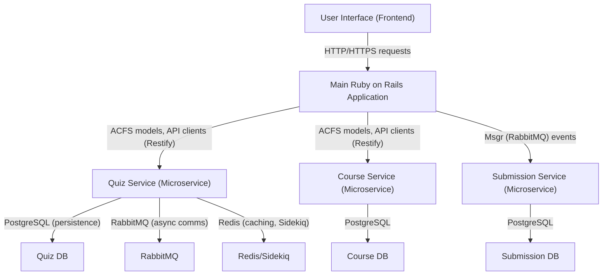
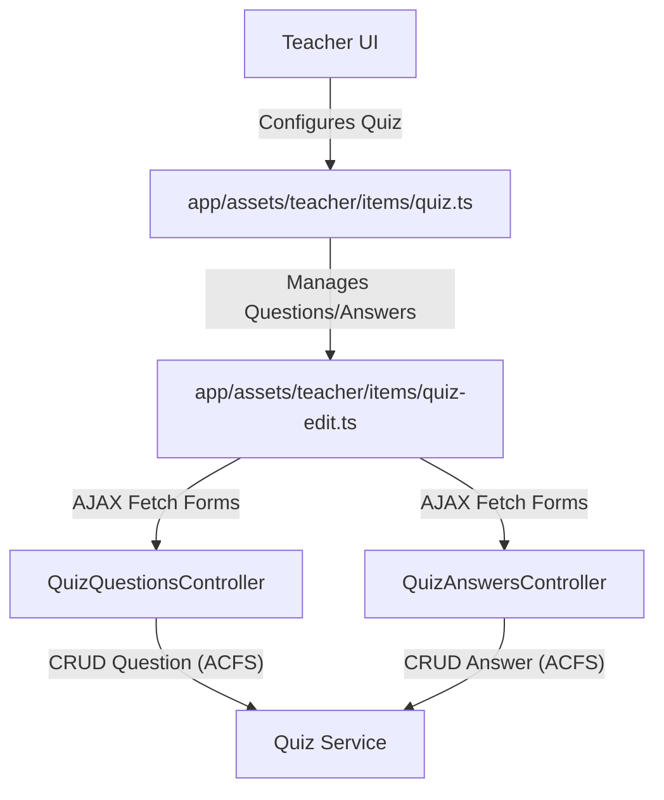
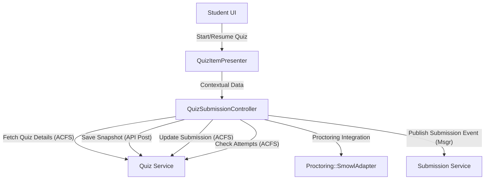
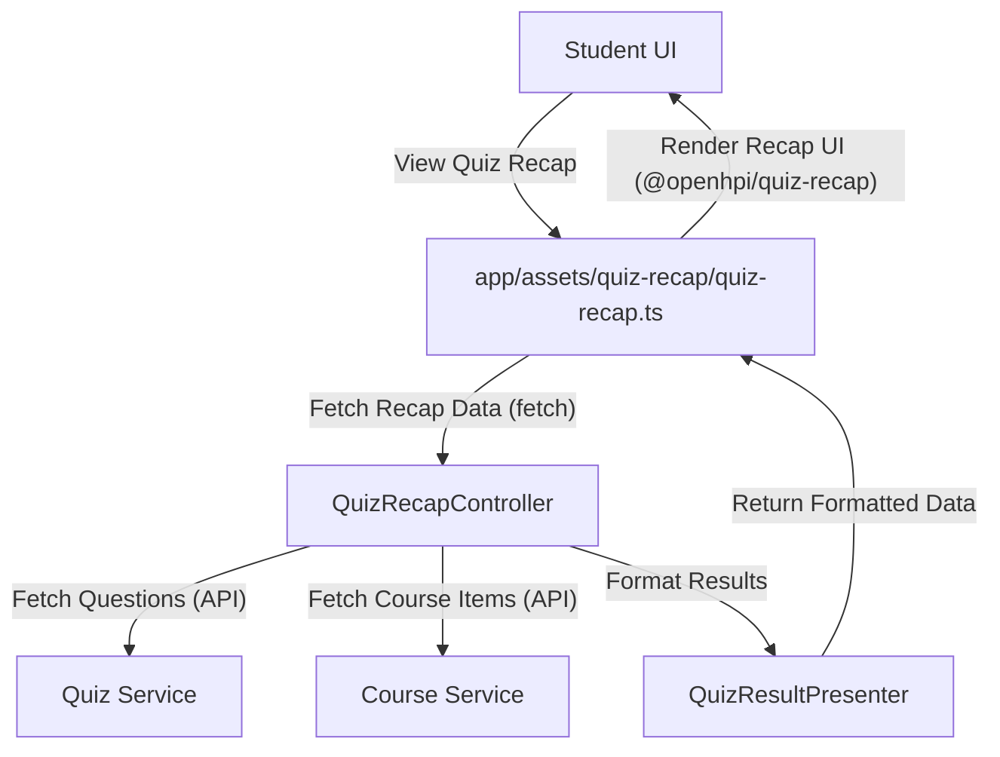

# Quiz Creation, Question Management, User Submissions, and Grading - Technical Documentation

*Generated on 9/18/2025 | Xikolo Knowledge Base*

---

## 📋 Executive Summary

This report details the Xikolo Quiz Management and Assessment System, a critical feature cluster for enabling comprehensive online learning assessments. It encompasses functionalities for instructors to create, manage, and grade quizzes, alongside a robust platform for students to submit and review their attempts. The system leverages a microservice architecture, distributing core logic across the main Ruby on Rails application and dedicated services like the Quiz, Course, and Submission Services. Key components facilitate everything from dynamic form rendering for question editing to real-time submission processing and detailed result presentation, including integration with external proctoring services. The primary purpose is to provide a standardized, scalable, and reliable framework for educational assessments within the Xikolo platform.

---

## 🏗️ Architecture Overview

The Xikolo Quiz Management and Assessment System operates within a distributed microservice architecture, with the Main Ruby on Rails Application serving as the primary interface and orchestrator for user interactions. This application hosts frontend assets, controllers, models, and presenters, interacting with several backend microservices for specialized functionalities. The `Quiz Service` is central, managing core quiz entities like `Quiz`, `Question`, `Answer`, and `QuizSubmission`. It communicates with PostgreSQL for data persistence, RabbitMQ for asynchronous communication, and Redis for caching. The `Course Service` provides essential course-related data, including item and section details, and is crucial for linking quizzes within the broader course structure. The `Submission Service` is responsible for processing and storing submission-related events, particularly receiving notifications about new quiz submissions. This modular design ensures scalability, maintainability, and clear separation of concerns, allowing different parts of the system to evolve independently while interacting through well-defined APIs and message queues. ACFS client models and Restify instances abstract these microservice interactions for the main application, streamlining data fetching and manipulation.

### Architecture Diagrams

#### Main Architecture Overview

### 🔄 Component Interactions

Key interactions between components in this cluster:

- **QuizAnswersController:** Interacts with `Xikolo::Quiz::Question` and `Xikolo::Quiz::Answer` ACFS models to fetch and persist data from the `quiz` microservice.
- **QuizAnswersController:** Uses `Acfs.run` to execute asynchronous data fetching requests.
- **QuizQuestionsController:** Interacts with `Xikolo::Course::Item` and `Xikolo::Quiz::Quiz` ACFS models to retrieve course and quiz context.
- **QuizQuestionsController:** Interacts with various `Xikolo::Quiz::Question` ACFS models to fetch and persist question data from the `quiz` microservice.
- **QuizSubmissionController:** Includes `CourseContextHelper` and `ItemContextHelper` for contextual data.
- **QuizSubmissionController:** Authenticates users via `ensure_logged_in`.
- **QuizSubmissionSnapshotController:** Authenticates users via `ensure_logged_in`.
- **QuizSubmissionSnapshotController:** Posts snapshot data to the `quiz` microservice via `Xikolo.api(:quiz)`.
- **QuizRecapController:** Authenticates users via `ensure_logged_in`.
- **QuizRecapController:** Fetches questions from the `quiz` microservice using `Xikolo.api(:quiz)`.
- **Quiz::Submission:** Initializes with a hash of submission attributes, typically from a Restify response or ACFS client object [Source: app/models/quiz/submission.rb]
- **Quiz::Submission:** Delegates proctoring-related logic to `Quiz::Submission::Proctoring` [Source: app/models/quiz/submission.rb]
- **Quiz::Submission::Proctoring:** Initializes with a quiz submission hash [Source: app/models/quiz/submission/proctoring.rb]
- **Quiz::Submission::Proctoring:** Utilizes `Proctoring::SmowlAdapter` to process `vendor_data` and retrieve proctoring results [Source: app/models/quiz/submission/proctoring.rb]
- **QuizItemPresenter:** Delegates properties to `@quiz` (Xikolo::Quiz::Quiz) and `@attempts` (Xikolo::Submission::UserQuizAttempts) ACFS models.
- **QuizItemPresenter:** Interacts with `Xikolo::Course::Enrollment`, `Xikolo::Submission::QuizSubmission` ACFS models.
- **QuizResultPresenter:** Receives `quiz`, `submission`, and `all_submissions` data as input.
- **QuizResultPresenter:** Uses `ProgressHelper` for percentage calculation.
- **QuizSubmissionProctoringPresenter:** Receives a `Quiz::Submission::Proctoring` object in its constructor.
- **app/assets/course/items/quiz.ts:** Interacts with the DOM to attach an event listener to a select element.
- **app/assets/course/items/quiz.ts:** Triggers a browser redirect (`window.location.replace`) based on user selection.
- **app/assets/quiz-recap/quiz-recap.ts:** Fetches quiz question data from the `/app/quiz-recap` endpoint using `fetch`.
- **app/assets/quiz-recap/quiz-recap.ts:** Uses `I18n` for internationalization.
- **app/assets/teacher/items/quiz-edit.ts:** Fetches HTML content for question/answer forms from specified URLs using `fetch` [Source: app/assets/teacher/items/quiz-edit.ts]
- **app/assets/teacher/items/quiz-edit.ts:** Initializes markdown editors (`initMarkdownEditorOnSelector`) and markdown upload dropzones (`mdupload.scan`) on the loaded content [Source: app/assets/teacher/items/quiz-edit.ts]
- **app/assets/teacher/items/quiz-item.ts:** Handles changes to quiz exercise type to adjust visibility and default values of instructions, time limits, and allowed attempts [Source: app/assets/teacher/items/quiz-item.ts]
- **app/assets/teacher/items/quiz-item.ts:** Manages 'unlimited-time-switch' and 'unlimited-attempts-switch' to toggle visibility of corresponding input fields [Source: app/assets/teacher/items/quiz-item.ts]
- **app/assets/teacher/items/quiz-questions.ts:** Dynamically appends the appropriate question form (multiple choice, multiple answer, free text, essay) to the UI based on a selector's value [Source: app/assets/teacher/items/quiz-questions.ts]
- **app/assets/teacher/items/quiz-questions.ts:** Initializes markdown editors (`initMarkdownEditorOnSelector`), upload dropzones (`upload.scan`, `mdupload.scan`), and dropdowns (`initDropdownsOnSelector`) within the question forms [Source: app/assets/teacher/items/quiz-questions.ts]
- **app/assets/teacher/items/quiz.ts:** Calls `handleQuizExerciseTypes` and `setTimeAndAttemptsSwitches` from `quiz-item.ts` to configure quiz properties [Source: app/assets/teacher/items/quiz.ts]
- **app/assets/teacher/items/quiz.ts:** Calls `setQuizQuestions` from `quiz-questions.ts` to manage question forms [Source: app/assets/teacher/items/quiz.ts]
- **Xikolo::Quiz::Quiz:** Used by `QuizQuestionsController` to find the associated quiz for question management [Source: app/controllers/quiz_questions_controller.rb]
- **Xikolo::Quiz::Quiz:** Used by `QuizSubmissionController` to retrieve quiz details, questions, and answers for submissions [Source: app/controllers/quiz_submission_controller.rb]
- **Xikolo::Quiz::Question:** Used by `QuizAnswersController` to find the question for which answers are being managed [Source: app/controllers/quiz_answers_controller.rb]
- **Xikolo::Quiz::Question:** Used by `QuizQuestionsController` for finding, creating, updating, and moving questions [Source: app/controllers/quiz_questions_controller.rb]
- **Xikolo::Quiz::Answer:** Used by `QuizAnswersController` for finding, creating, updating, moving, and deleting answers [Source: app/controllers/quiz_answers_controller.rb]
- **Xikolo::Quiz::Answer:** Used by `QuizSubmissionController` to retrieve answers for quiz questions during submission [Source: app/controllers/quiz_submission_controller.rb]
- **Xikolo::Submission::QuizSubmission:** Used by `QuizSubmissionController` for finding, creating, and updating quiz submissions [Source: app/controllers/quiz_submission_controller.rb]
- **Xikolo::Submission::QuizSubmission:** Used by `QuizItemPresenter` to determine the user's submission status and redirect logic [Source: app/presenters/quiz_item_presenter.rb]
- **Xikolo::Submission::QuizSubmissionSnapshot:** Used by `QuizSubmissionController` to find and load submission snapshots [Source: app/controllers/quiz_submission_controller.rb]
- **Xikolo::Submission::UserQuizAttempts:** Used by `QuizSubmissionController` to check remaining attempts before allowing a new submission [Source: app/controllers/quiz_submission_controller.rb]
- **Xikolo::Submission::UserQuizAttempts:** Used by `QuizItemPresenter` to determine if further attempts are allowed [Source: app/presenters/quiz_item_presenter.rb]
- **Quiz Service:** Communicates with PostgreSQL for data persistence.
- **Quiz Service:** Uses RabbitMQ for asynchronous inter-service communication.
- **Course Service:** Provides API endpoints consumed by `QuizSubmissionController` to retrieve item and section details [Source: app/controllers/quiz_submission_controller.rb]
- **Course Service:** Provides API endpoints consumed by `QuizRecapController` to find course items for generating reference links [Source: app/controllers/quiz_recap_controller.rb]
- **Submission Service:** Receives `xikolo.submission.submission.create` events via Msgr from `QuizSubmissionController` [Source: app/controllers/quiz_submission_controller.rb]
- **Regrading Rake Tasks:** Directly manipulates internal data models of the Quiz Service (e.g., questions, answers, submissions). [Source: RAG: docs/app/features/courses/regrading.md]
- **Regrading Rake Tasks:** Triggers updates to course results, likely through an interaction with the Course Service, via the `regrading:just_update_course` task. [Source: RAG: docs/app/features/courses/regrading.md]
- **QuizSubmissionNavigator:** Interacts with the DOM to find the submission selection element.
- **QuizSubmissionNavigator:** Modifies `window.location.replace` to navigate the user.
- **ACFS Client Models (e.g., Xikolo::Quiz::Question):** Perform `find`, `where`, `new`, `save!`, `update_attributes`, `delete!` operations, which translate into API calls to the respective microservices.
- **ACFS Client Models (e.g., Xikolo::Quiz::Question):** Enqueue further ACFS requests for associated resources (e.g., questions enqueue answers) to facilitate concurrent data fetching.
- **Microservice API Clients (Xikolo.api(:quiz), Xikolo.api(:course)):** Send HTTP requests to the `quiz` and `course` microservices for data retrieval and manipulation.
- **Msgr:** Publishes `xikolo.submission.submission.create` events to the RabbitMQ message queue.
- **Proctoring::ItemContext:** Receives `course`, `item`, and `enrollment` objects to establish proctoring context.
- **Proctoring::ItemContext:** Interacts with `Proctoring::SmowlAdapter` to check service availability.
- **Quiz:** Contains multiple 'Question' entities.
- **Quiz:** Associated with 'QuizSubmission' entities for user attempts.
- **Question:** Belongs to a 'Quiz'.
- **Question:** Contains multiple 'Answer' entities.
- **Answer:** Belongs to a 'Question'.
- **QuizSubmission:** Associated with a 'Quiz'.
- **QuizSubmission:** Associated with a 'User' (from Account Service).
- **QuizImporter:** Reads and validates XML data.
- **QuizImporter:** Creates/updates 'Quiz' entities.

---

## ⚙️ Technical Workflows

### 1. Quiz Creation and Management Workflow
This workflow outlines how instructors create and manage quizzes, questions, and answers within the Xikolo platform. The process begins with the teacher interacting with the frontend components to set up a quiz item. The `app/assets/teacher/items/quiz.ts` module orchestrates the overall quiz item configuration, including general properties and proctoring settings. It delegates to `app/assets/teacher/items/quiz-item.ts` for managing specific quiz properties like exercise type, time limits, and allowed attempts, which dynamically adjust the UI. When managing questions, `app/assets/teacher/items/quiz-questions.ts` dynamically loads the appropriate form based on the selected question type (e.g., multiple choice, essay) and initializes markdown editors and upload dropzones for content creation. For editing existing questions or answers, `app/assets/teacher/items/quiz-edit.ts` uses AJAX to fetch HTML content. These frontend interactions trigger requests handled by `QuizQuestionsController` and `QuizAnswersController` in the main Rails application. These controllers enforce content editor permissions via `ensure_content_editor` and interact with the `Quiz Service` using ACFS client models such as `Xikolo::Quiz::Question` and `Xikolo::Quiz::Answer`, and direct API calls via `Xikolo.api(:quiz)` for CRUD operations and position management. The `Quiz Service` then persists these changes to its PostgreSQL database. This comprehensive flow ensures instructors have granular control over quiz content and structure.

### 2. User Quiz Submission Workflow
The User Quiz Submission workflow details the student's journey from starting an attempt to final submission and snapshot saving. A student initiates a quiz attempt through the `studentUI`. The `QuizItemPresenter` prepares the data for the quiz's introductory page, determining eligibility, attempts remaining, and handling redirects based on quiz state, deadlines, and proctoring status. When a student begins or resumes a quiz, `QuizSubmissionController` in the main Rails application takes over, authenticating the user via `ensure_logged_in` and incorporating contextual data using `CourseContextHelper` and `ItemContextHelper`. This controller interacts with multiple ACFS models: `Xikolo::Quiz::Quiz` for quiz details, `Xikolo::Submission::QuizSubmission` for managing the submission itself, `Xikolo::Submission::UserQuizAttempts` to track remaining attempts, and `Xikolo::Submission::QuizSubmissionSnapshot` for loading or saving progress. Partial submissions are handled by `QuizSubmissionSnapshotController`, which posts snapshot data directly to the `quiz` microservice via `Xikolo.api(:quiz)`. Upon final submission, the `QuizSubmissionController` processes the answers, potentially interacts with `Proctoring::ItemContext` for proctoring checks, and publishes an `xikolo.submission.submission.create` event to RabbitMQ via `Msgr`, which is then received by the `Submission Service`. This ensures a robust and trackable submission process, including auto-saving capabilities.

### 3. Quiz Result and Recap Display Workflow
This workflow describes how students review their quiz results and a comprehensive recap of questions and answers. After a quiz submission, or when navigating to review previous attempts, the `studentUI` triggers the `QuizSubmissionNavigator` (implemented in `app/assets/course/items/quiz.ts`) to select a specific submission for display. For a detailed review, `app/assets/quiz-recap/quiz-recap.ts` fetches quiz question and answer data from the `/app/quiz-recap` endpoint using `fetch`. This request is handled by the `QuizRecapController` in the main Rails application, which authenticates the user and fetches questions from the `quiz` microservice via `Xikolo.api(:quiz)`. To enrich the recap with contextual information, the `QuizRecapController` also fetches course items from the `course` microservice via `Xikolo.api(:course)` to generate `referenceLink`s for questions. Once the data is retrieved, `QuizResultPresenter` formats the submission data, calculating percentages and preparing historical submission graphs, while `QuizSubmissionProctoringPresenter` translates any raw proctoring results into user-friendly callout messages. Finally, `app/assets/quiz-recap/quiz-recap.ts` renders the comprehensive quiz recap UI utilizing the `@openhpi/quiz-recap` library. This workflow provides students with a detailed, localized, and context-rich review of their performance and the quiz content.

### Workflow Diagrams

#### Quiz Creation Workflow

#### Quiz Submission Workflow

#### Quiz Recap Workflow

### 🔀 Process Workflows

Detailed workflow processes for this cluster:

- **Quiz::Submission::Proctoring Process:** Utilizes `Proctoring::SmowlAdapter` to process `vendor_data` and retrieve proctoring results
  *Source: Quiz::Submission::Proctoring*

---

## 🔧 Implementation Details

The Xikolo Quiz Management and Assessment System is built upon a Ruby on Rails application interacting with several microservices through specific technical mechanisms. ACFS Client Models, such as `Xikolo::Quiz::Question` and `Xikolo::Submission::QuizSubmission`, are fundamental. These models provide an ActiveRecord-like interface for the main application, abstracting HTTP/REST API calls to the `Quiz Service` and `Submission Service`. They perform operations like `find`, `where`, `new`, `save!`, and `delete!`, and are designed to enqueue further ACFS requests for associated resources, enabling concurrent data fetching using `Acfs.run`. Direct microservice API clients (`Xikolo.api(:quiz)`, `Xikolo.api(:course)`) are used for more granular, low-level HTTP requests (GET, POST, PATCH, DELETE) to specific relations within the microservices. This duality allows for both high-level ORM-like interaction and precise API control where needed. Frontend components are primarily TypeScript modules, leveraging `fetch` for AJAX calls, `I18n` for internationalization, and integrating external libraries like `@openhpi/quiz-recap`. Markdown editors and upload dropzones are initialized using `initMarkdownEditorOnSelector` and `mdupload.scan` to enhance content creation. Asynchronous communication for critical events, such as a new quiz submission, is handled via `Msgr` (RabbitMQ), which publishes `xikolo.submission.submission.create` events to the `Submission Service`. The `Quiz Service` itself relies on PostgreSQL for data persistence, RabbitMQ for inter-service communication, and Redis for caching and Sidekiq job queuing. Configuration requirements include standard database connections for PostgreSQL, message queue setup for RabbitMQ, and Redis instances for caching. The system also integrates with external proctoring services via `Proctoring::SmowlAdapter` and `Proctoring::ItemContext`, although the status notes indicate proctoring is currently unavailable for new quizzes and includes deprecated code. Regrading is managed through `rake` tasks executed directly on the `Quiz Service` (xi-quiz), which directly manipulates internal data models and requires a separate task, `regrading:just_update_course`, to update overall course results in the Course Service. This highlights a blend of modern microservice interactions with some legacy or administrative tooling. Specific file paths like `app/controllers/quiz_answers_controller.rb` and `app/assets/teacher/items/quiz.ts` underpin these interactions, with identified technical debt items such as `Quiz::Submission` needing to become a real ActiveRecord model and misplaced redirect logic in `QuizItemPresenter#submission!`, indicating ongoing refinement of the system's architecture and component responsibilities.

### 📚 Technical Sources & References

Key technical documentation and source references:

- QuizAnswersController: app/controllers/quiz_answers_controller.rb- QuizQuestionsController: app/controllers/quiz_questions_controller.rb- QuizSubmissionController: app/controllers/quiz_submission_controller.rb- QuizSubmissionSnapshotController: app/controllers/quiz_submission_snapshot_controller.rb- QuizSubmissionSnapshotController: spec/controllers/quiz_submission_snapshot_controller_spec.rb- QuizRecapController: app/controllers/quiz_recap_controller.rb- QuizRecapController: spec/requests/app/quiz-recap/show_spec.rb- Quiz::Submission: app/models/quiz/submission.rb- Quiz::Submission::Proctoring: app/models/quiz/submission/proctoring.rb- QuizItemPresenter: app/presenters/quiz_item_presenter.rb- QuizResultPresenter: app/presenters/quiz_result_presenter.rb- QuizSubmissionProctoringPresenter: app/presenters/quiz_submission_proctoring_presenter.rb- app/assets/course/items/quiz.ts: app/assets/course/items/quiz.ts- app/assets/quiz-recap/quiz-recap.ts: app/assets/quiz-recap/quiz-recap.ts- app/assets/teacher/items/quiz-edit.ts: app/assets/teacher/items/quiz-edit.ts- app/assets/teacher/items/quiz-item.ts: app/assets/teacher/items/quiz-item.ts- app/assets/teacher/items/quiz-questions.ts: app/assets/teacher/items/quiz-questions.ts- app/assets/teacher/items/quiz.ts: app/assets/teacher/items/quiz.ts- Xikolo::Quiz::Quiz: app/controllers/quiz_questions_controller.rb- Xikolo::Quiz::Quiz: app/controllers/quiz_submission_controller.rb- Xikolo::Quiz::Question: app/controllers/quiz_answers_controller.rb- Xikolo::Quiz::Question: app/controllers/quiz_questions_controller.rb- Xikolo::Quiz::Answer: app/controllers/quiz_answers_controller.rb- Xikolo::Quiz::Answer: app/controllers/quiz_submission_controller.rb- Xikolo::Submission::QuizSubmission: app/controllers/quiz_submission_controller.rb- Xikolo::Submission::QuizSubmission: app/presenters/quiz_item_presenter.rb- Xikolo::Submission::QuizSubmissionSnapshot: app/controllers/quiz_submission_controller.rb- Xikolo::Submission::UserQuizAttempts: app/controllers/quiz_submission_controller.rb- Xikolo::Submission::UserQuizAttempts: app/presenters/quiz_item_presenter.rb- Quiz Service: RAG: services/quiz/README.md- Quiz Service: RAG: docker/compose.quiz.yml- Course Service: app/controllers/quiz_submission_controller.rb- Course Service: app/controllers/quiz_recap_controller.rb- Submission Service: app/controllers/quiz_submission_controller.rb- Course::QuizRecap: app/components/course/quiz_recap.rb- Regrading Rake Tasks: RAG: docs/app/features/courses/regrading.md- QuizSubmissionNavigator: app/assets/course/items/quiz.ts- ACFS Client Models (e.g., Xikolo::Quiz::Question): app/controllers/quiz_answers_controller.rb- ACFS Client Models (e.g., Xikolo::Quiz::Question): app/controllers/quiz_questions_controller.rb- Microservice API Clients (Xikolo.api(:quiz), Xikolo.api(:course)): app/controllers/quiz_answers_controller.rb- Microservice API Clients (Xikolo.api(:quiz), Xikolo.api(:course)): app/controllers/quiz_questions_controller.rb- Msgr: app/controllers/quiz_submission_controller.rb- Proctoring::ItemContext: app/controllers/quiz_submission_controller.rb- Proctoring::ItemContext: app/presenters/quiz_item_presenter.rb- Quiz: RAG: services/quiz/app/assets/quiz_import_schema.xml- Question: RAG: services/quiz/app/assets/quiz_import_schema.xml- Answer: RAG: services/quiz/app/assets/quiz_import_schema.xml- QuizSubmission: RAG: services/quiz/README.md- QuizSubmission: RAG: services/quiz/config/services.yml- QuizImporter: RAG: services/quiz/app/assets/quiz_import_schema.xml- Configuration: config/application.rb, Gemfile, config/database.yml- Process Management: Procfile, Procfile.web- Build & Deploy: Rakefile, package.json

---

*This documentation is automatically generated from cluster analysis and should be validated against the actual codebase.*
