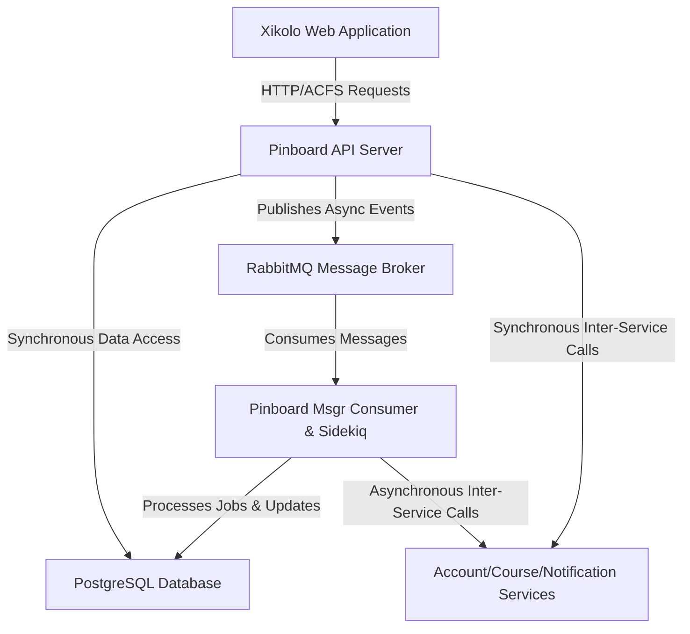
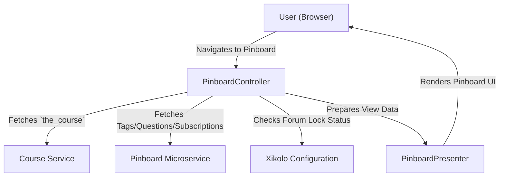
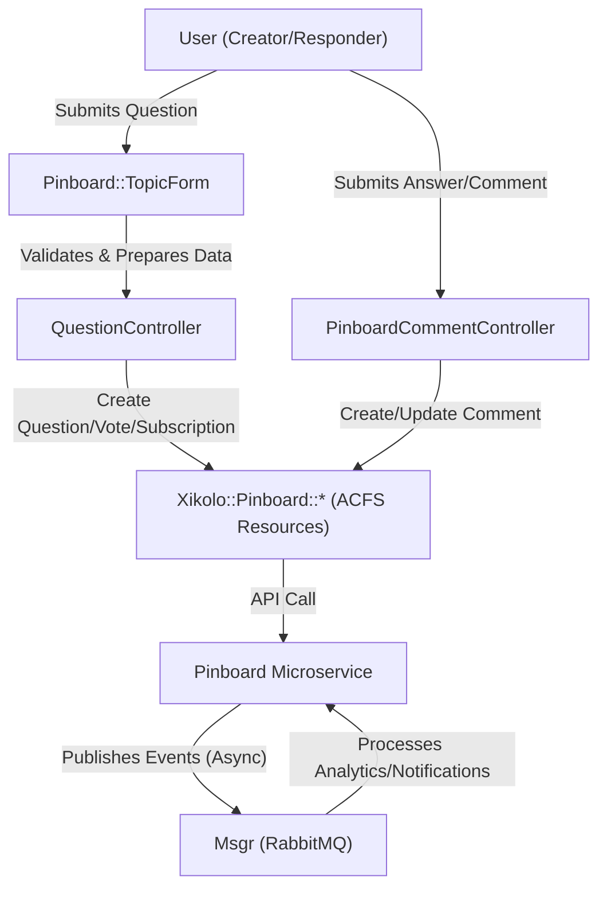
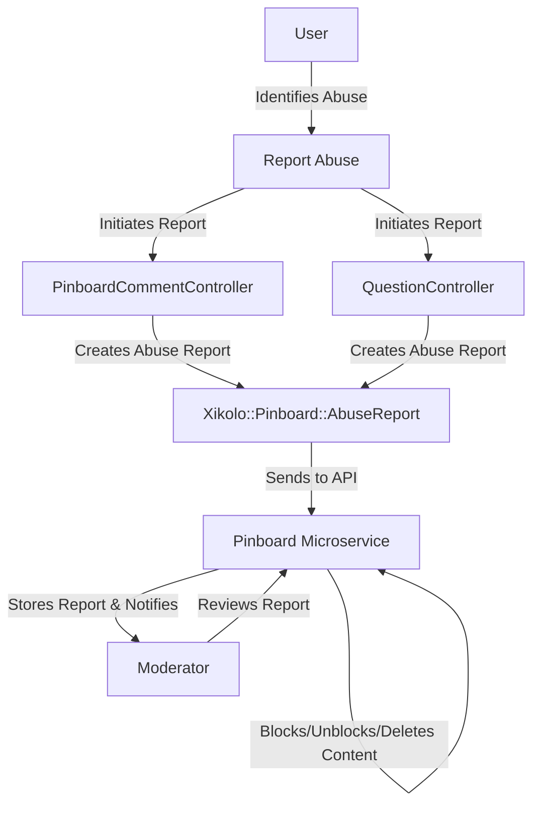
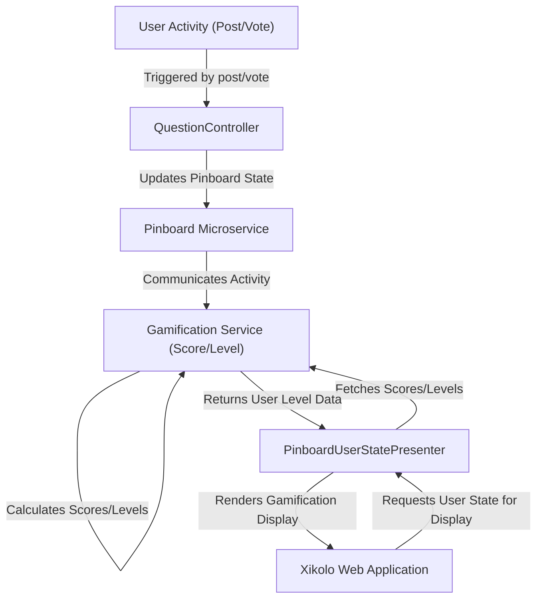

# Course Discussion Forum, Questions, Answers, Comments, and Subscriptions - Technical Documentation

*Generated on 9/18/2025 | Xikolo Knowledge Base*

---

## 📋 Executive Summary

This documentation report details the Course Discussion Forum, also known as the 'Pinboard,' a comprehensive feature cluster integrated within courses. This report details the architecture, workflows, and implementation aspects of the Pinboard, a discussion forum facilitating questions, answers, comments, and subscriptions within courses. It operates as a robust microservice-based system, integrating the main Rails web frontend with a dedicated `PinboardService` that handles core discussion logic, supported by API serving, message queuing, background processing, and sentiment analysis. The primary purpose is to foster course-related discussions, providing a structured environment for user interaction and knowledge exchange.

---

## 🏗️ Architecture Overview

The Pinboard system employs a microservice architecture, distinctly separating the user-facing frontend from the backend discussion logic. The `Xikolo::Web::Application` acts as the primary client, orchestrating user interactions and views. It communicates with the `PinboardService` microservice, which is the authoritative source for all discussion-related data and operations. This interaction primarily occurs via ACFS (Asynchronous Client-side Fetching Service) resources, acting as local proxies for `PinboardService` domain models such as `Xikolo::Pinboard::Question` and `Xikolo::Pinboard::Comment`. The `PinboardService` itself comprises several internal components, including an API Server for synchronous communication, an Msgr Consumer for asynchronous event processing via RabbitMQ, and a Sidekiq Worker for background jobs. Data persistence is managed through PostgreSQL, with Redis supporting Sidekiq and S3 used for file storage. Additionally, the `PinboardService` integrates with `AccountService`, `CourseService`, and `NotificationService` for user data, course context, and notifications, respectively. A specialized `Sentiment Analysis Module` is also part of the `PinboardService`, processing discussion text content. This distributed design enhances scalability, resilience, and maintainability across the platform.

### Architecture Diagrams

#### Main Architecture

### 🔄 Component Interactions

Key interactions between components in this cluster:

- **PinboardCommentController:** Creates, updates, and deletes comments via `Xikolo::Pinboard::Comment` [Source: app/controllers/pinboard_comment_controller.rb].
- **PinboardCommentController:** Finds comments and answers via `Xikolo::Pinboard::Comment.find` and `Xikolo::Pinboard::Answer.find` [Source: app/controllers/pinboard_comment_controller.rb].
- **PinboardController:** Fetches course details via `the_course` [Source: app/controllers/pinboard_controller.rb].
- **PinboardController:** Fetches course subscriptions via `Xikolo.api(:pinboard).rel(:course_subscriptions)` [Source: app/controllers/pinboard_controller.rb].
- **QuestionController:** Fetches, creates, updates, and deletes questions via `Xikolo::Pinboard::Question` [Source: app/controllers/question_controller.rb].
- **QuestionController:** Fetches and creates votes via `Xikolo::Pinboard::Vote` [Source: app/controllers/question_controller.rb].
- **PinboardRoutesHelper:** Included in `PinboardCommentController`, `PinboardController`, `QuestionController` [Source: app/helpers/pinboard_routes_helper.rb].
- **PinboardRoutesHelper:** Uses `params[:section_id]` to determine context [Source: app/helpers/pinboard_routes_helper.rb].
- **PinboardHelper:** Used by views and potentially controllers [Source: app/helpers/pinboard_helper.rb].
- **Pinboard::TopicForm:** Used by controllers (likely `QuestionController`) to handle form submissions [Source: app/forms/pinboard/topic_form.rb].
- **Pinboard::TopicForm:** Transforms `text` into `first_post` and `video_timestamp` into `meta` for the backend service [Source: app/forms/pinboard/topic_form.rb].
- **PinboardBreadcrumbsPresenter:** Used by `PinboardPresenter` [Source: app/presenters/pinboard_breadcrumbs_presenter.rb].
- **PinboardPresenter:** Receives `course`, `section`, `technical_issues`, and `filters` as input [Source: app/presenters/pinboard_presenter.rb].
- **PinboardPresenter:** Delegates breadcrumb generation to `PinboardBreadcrumbsPresenter` [Source: app/presenters/pinboard_presenter.rb].
- **PinboardUserStatePresenter:** Receives `question` and `user` as input [Source: app/presenters/pinboard_user_state_presenter.rb].
- **PinboardUserStatePresenter:** Checks `user.feature?('gamification')` [Source: app/presenters/pinboard_user_state_presenter.rb].
- **QuestionPresenter:** Receives `question`, `course`, `section_id` as input [Source: app/presenters/question_presenter.rb].
- **QuestionPresenter:** Delegates to `question` for core attributes [Source: app/presenters/question_presenter.rb].
- **Xikolo::Pinboard::Comment:** Interacts with the `PinboardService` microservice via the ACFS framework.
- **Xikolo::Pinboard::Comment:** Used by `PinboardCommentController` and `QuestionController`.
- **Xikolo::Pinboard::Question:** Interacts with the `PinboardService` microservice via the ACFS framework.
- **Xikolo::Pinboard::Question:** Used by `PinboardController`, `QuestionController`, and `QuestionPresenter`.
- **Xikolo::Pinboard::Answer:** Interacts with the `PinboardService` microservice via the ACFS framework.
- **Xikolo::Pinboard::Answer:** Used by `PinboardCommentController` and `QuestionController`.
- **Xikolo::Pinboard::Vote:** Interacts with the `PinboardService` microservice via the ACFS framework.
- **Xikolo::Pinboard::Vote:** Used by `QuestionController` for upvoting questions.
- **Xikolo::Pinboard::Subscription:** Interacts with the `PinboardService` microservice via the ACFS framework.
- **Xikolo::Pinboard::Subscription:** Used by `QuestionController` to load user subscriptions.
- **Xikolo::Pinboard::AbuseReport:** Interacts with the `PinboardService` microservice via the ACFS framework.
- **Xikolo::Pinboard::AbuseReport:** Used by `PinboardCommentController` and `QuestionController` for reporting abuse.
- **Xikolo::Pinboard::ExplicitTag:** Interacts with the `PinboardService` microservice via the ACFS framework.
- **Xikolo::Pinboard::ExplicitTag:** Used by `PinboardController` and `QuestionController` for tag management and display.
- **Xikolo::Pinboard::ImplicitTag:** Interacts with the `PinboardService` microservice via the ACFS framework.
- **Xikolo::Pinboard::ImplicitTag:** Used by `PinboardController` and `QuestionController` for managing section-based tags.
- **Xikolo::Pinboard::CourseSubscription:** Interacts with the `PinboardService` microservice via the ACFS framework.
- **Xikolo::Pinboard::CourseSubscription:** Used by `PinboardController` to determine course-level subscription status.
- **PinboardService:** Communicates with AccountService to retrieve user-related data [Source: RAG: services/pinboard/config/services.yml].
- **PinboardService:** Interacts with CourseService to link pinboard content to specific courses or learning contexts [Source: RAG: services/pinboard/config/services.yml].
- **Pinboard Microservice:** Communicates with PostgreSQL for data persistence. [Source: RAG: services/pinboard/config/database.yml]
- **Pinboard Microservice:** Exposes an HTTP API for client-side and internal service interactions. [Source: RAG: docker/compose.pinboard.yml]
- **Pinboard API Server:** Receives HTTP requests from the main `web` application or other services. [Source: foundational_context: config/routes.rb]
- **Pinboard API Server:** Interacts with the PostgreSQL database via ActiveRecord. [Source: RAG: services/pinboard/config/database.yml]
- **Pinboard Msgr Consumer:** Connects to RabbitMQ to subscribe to and process messages. [Source: RAG: services/pinboard/config/rabbitmq.yml]
- **Pinboard Msgr Consumer:** May interact with the PostgreSQL database based on message content. [Source: RAG: services/pinboard/config/database.yml]
- **Pinboard Sidekiq Worker:** Pulls jobs from Redis-backed Sidekiq queues. [Source: RAG: docker/compose.pinboard.yml]
- **Pinboard Sidekiq Worker:** Interacts with the PostgreSQL database. [Source: RAG: services/pinboard/config/database.yml]
- **Sentiment Analysis Module:** Processes text content from discussion posts (questions, answers, comments). [Source: RAG: services/pinboard/lib/assets/sentiment_dictionaries/**/*]
- **Sentiment Analysis Module:** May store sentiment results in the PostgreSQL database. [Source: RAG: services/pinboard/config/database.yml]

---

## ⚙️ Technical Workflows

### 1. Course Discussion Management
This workflow encompasses the user's journey through the Pinboard's main interface, allowing them to browse, filter, and initiate new discussions. The `PinboardController` is central, fetching course-specific details (`the_course`), user subscriptions (`Xikolo.api(:pinboard).rel(:course_subscriptions)`), and various tags (`Xikolo::Pinboard::ImplicitTag`, `Xikolo::Pinboard::ExplicitTag`). It also retrieves course sections via `Xikolo::Course::Section` to enable discussion filtering. Filters can be applied by section ID, including a dedicated 'Technical Issues' section, or by explicit tags. The `PinboardPresenter` then takes these filtered results along with course and section contexts to orchestrate the display logic, including breadcrumbs and determining if new posts are allowed based on `course.forum_is_locked` or `section['pinboard_closed']`. The `PinboardRoutesHelper` ensures that URLs are dynamically generated based on the current course or section context, maintaining navigation consistency. Authorization checks are performed to ensure users have the necessary permissions to access and interact with the content. This workflow provides a comprehensive and context-aware discussion browsing experience, allowing users to quickly find relevant topics.

### 2. Question/Answer/Comment Lifecycle
This core workflow manages the complete lifecycle of discussion content, from creation to deletion. When a user creates a new question, the `Pinboard::TopicForm` validates and transforms the submitted data, including `title`, `text` (into `first_post`), and `video_timestamp` (into `meta`). The `QuestionController` then orchestrates the creation of the `Xikolo::Pinboard::Question` via the ACFS framework, communicating with the `PinboardService` microservice. Similarly, `PinboardCommentController` handles the creation, updating, and deletion of comments (`Xikolo::Pinboard::Comment`) on both questions and answers. The `QuestionController` also manages answers (`Xikolo::Pinboard::Answer`), votes (`Xikolo::Pinboard::Vote`), and user subscriptions (`Xikolo::Pinboard::Subscription`). Crucially, asynchronous API calls are managed using `Acfs.run`, which includes a documented workaround involving a double call for reliability. Events like `xikolo.pinboard.answer.accept` and `xikolo.pinboard.read_question` are published to RabbitMQ via `Msgr.publish` for analytics and downstream processing. Authorization checks using `authorize!` and `current_user.allowed?` ensure that users have appropriate permissions for all actions, maintaining system integrity.

### 3. Pinboard Moderation & Reporting
This workflow addresses the crucial aspect of maintaining content quality and safety within the discussion forum. Users are empowered to report any inappropriate content, including questions, answers, or comments. The `PinboardCommentController` and `QuestionController` both provide functionality to create abuse reports via `Xikolo::Pinboard::AbuseReport.new`. These reports are then processed by the `PinboardService` microservice, which interacts with the underlying PostgreSQL database to store the report data. Authorized moderators, interacting directly or indirectly with the `PinboardService`, can review these reports. Based on their assessment, moderators can take action such as blocking or unblocking reported entities, or initiating the deletion of questions and comments. Furthermore, questions can be explicitly closed and reopened by authorized personnel, allowing for administrative control over discussion threads. This structured reporting and moderation process ensures that the Pinboard remains a constructive and safe environment for learning and discussion, with clear roles for both users and administrators in upholding content standards.

### 4. User Interaction & Gamification
The Pinboard heavily integrates with the platform's gamification system to enhance user engagement and recognize contributions. Anytime a user interacts within the pinboard, such as posting a new question, providing an answer, or commenting on existing content, their activity is tracked. This activity contributes to their overall gamification scores, managed by external `Gamification::Score` and `Gamification::Level` components. The `PinboardUserStatePresenter` is the key component responsible for retrieving and displaying these gamification states. It receives a `question` and the `user` as input, checks if the user has the 'gamification' feature enabled (`user.feature?('gamification')`), and then fetches the relevant scores and levels. This allows the system to present visual cues, such as level icons, directly alongside user posts. This integration encourages active participation by providing tangible recognition for users' contributions, fostering a more dynamic and rewarding discussion environment. The Presenter leverages `ActionController::Base.helpers` for rendering asset paths and image tags to visually represent the user's gamified status.

### Workflow Diagrams

#### Course Discussion Management Flow

#### Question, Answer, Comment Lifecycle Flow

#### Pinboard Moderation and Reporting Flow

#### User Interaction & Gamification Flow

### 🔀 Process Workflows

Detailed workflow processes for this cluster:

- **Pinboard API Server Process:** May publish messages to RabbitMQ for asynchronous processing.
  *Source: Pinboard API Server*
- **Pinboard Msgr Consumer Process:** Connects to RabbitMQ to subscribe to and process messages.
  *Source: Pinboard Msgr Consumer*
- **Pinboard Msgr Consumer Process:** May trigger Sidekiq jobs for further background processing.
  *Source: Pinboard Msgr Consumer*
- **Sentiment Analysis Module Process:** Processes text content from discussion posts (questions, answers, comments).
  *Source: Sentiment Analysis Module*
- **Sentiment Analysis Module Process:** Likely integrated into background jobs (Sidekiq) for asynchronous processing.
  *Source: Sentiment Analysis Module*

---

## 🔧 Implementation Details

#### Technical Considerations
The Pinboard cluster exhibits several technical considerations and areas of technical debt.
*   Ambiguity in ID handling: 'both these id reference the QUESTION, I have no idea why...' in `create` and `notification_params` methods [Source: app/controllers/pinboard_comment_controller.rb].
*   Ambiguous ID referencing in `create` and `notification_params` methods: "both these id reference the QUESTION, I have no idea why..." [Source: app/controllers/pinboard_comment_controller.rb].
*   ACFS callback issue: 'the double Acfs.run call is not a mistake - acfs seems to have some problems sometimes executing all callbacks...' in `show` method [Source: app/controllers/question_controller.rb].
*   A double `Acfs.run` call is used as a workaround for ACFS callback reliability issues.
*   Course ID assignment: 'TODO: solve better' for `p[:course_id] = the_course.id` in `question_params` [Source: app/controllers/question_controller.rb].
*   The assignment of `course_id` in `question_params` has a TODO for a better solution.
*   Dynamic Route Generation Complexity: While `PinboardRoutesHelper` provides powerful dynamic routing, its reliance on `send` for method calls can make the code less explicit and potentially harder to debug or refactor in the long term.
*   Fragile module inclusion: 'for some reason some other module seems to want to include this return unless base_controller.respond_to? :helper_method' in `self.included` [Source: app/helpers/pinboard_routes_helper.rb].
*   Hardcoded value: 'TODO: adjust this number as needed' for `questions_per_page` [Source: app/helpers/pinboard_helper.rb].
*   `questions_per_page` is hardcoded with a TODO to adjust it.
*   Lack of detailed code for analysis prevents identification of specific internal technical debt. General architectural debt might include tight coupling if direct HTTP calls are overused instead of asynchronous messaging for certain interactions [Source: foundational_context, RAG: services/pinboard/config/services.yml].
*   The presence of `rubocop:enable all` suggests this file might contain complex logic or style deviations that required temporary disabling of Rubocop rules [Source: app/helpers/pinboard_routes_helper.rb].
*   Relies on `send` for dynamic method calls, which can reduce code clarity and make debugging more challenging.
*   Rubocop disablement: `rubocop:enable all` at the end of the file, implying linting was disabled [Source: app/controllers/question_controller.rb].
*   Rubocop disablement: `rubocop:enable all` at the end of the file, implying linting was disabled [Source: app/helpers/pinboard_routes_helper.rb].
*   The `response_count` logic has a TODO (referencing XI-853) indicating ongoing discussion/potential refactor.
*   The `response_count` method has a TODO (referencing XI-853) indicating an ongoing discussion or potential refactor.
*   The `services/pinboard/README.md` is empty, indicating a lack of specific service-level documentation. [Source: RAG: services/pinboard/README.md]
*   Temporary notification URL: 'TODO: remove question_path once all consumer are rolled out' in `notification_params` [Source: app/controllers/pinboard_comment_controller.rb].
*   Unresolved design decision: 'TODO: Oh really? See XI-853. :P' in `response_count` method [Source: app/presenters/question_presenter.rb].

#### Dependencies and Integrations
The Xikolo Pinboard cluster is highly integrated across multiple services and components:
*   **`Xikolo::Web::Application`** serves as the primary frontend client, heavily relying on ACFS (Asynchronous Client-side Fetching Service) resources. These ACFS resources, such as `Xikolo::Pinboard::Comment`, `Xikolo::Pinboard::Question`, `Xikolo::Pinboard::Answer`, `Xikolo::Pinboard::Vote`, `Xikolo::Pinboard::Subscription`, `Xikolo::Pinboard::AbuseReport`, `Xikolo::Pinboard::ExplicitTag`, `Xikolo::Pinboard::ImplicitTag`, and `Xikolo::Pinboard::CourseSubscription`, act as proxies, abstracting direct API calls to the `PinboardService` microservice.
*   The **`PinboardService` microservice** is a core backend component. It explicitly depends on and interacts with other microservices:
    *   **`AccountService`**: For retrieving user-related data, as specified in `services/pinboard/config/services.yml`.
    *   **`CourseService`**: To link pinboard content with specific courses or learning contexts, also configured in `services/pinboard/config/services.yml`.
    *   **`NotificationService`**: For triggering notifications based on pinboard activities like new posts or replies, configured in `services/pinboard/config/services.yml`.
*   Internally, the **`Pinboard Microservice`** component relies on several foundational technologies:
    *   **PostgreSQL**: For all data persistence, as configured in `services/pinboard/config/database.yml`.
    *   **RabbitMQ**: Used by `msgr` for asynchronous operations and inter-service communication, detailed in `services/pinboard/config/rabbitmq.yml`.
    *   **Redis**: Backs Sidekiq queues for background job management, indicated in `docker/compose.pinboard.yml`.
    *   **S3**: Potentially used for file storage related to pinboard content, as referenced in `docker/config/xikolo/pinboard.yml`.
*   The **`PinboardUserStatePresenter`** integrates with external Gamification components, fetching data from `Gamification::Score` and `Gamification::Level` to display user states.
*   **`Pinboard::TopicForm`** leverages `XUI::Form` as its base and includes a custom `FirstPostAndMetaData` processor for API data transformation.

#### Configuration Requirements
Key configuration aspects for the Pinboard cluster, as evident from the data:
*   **Course Context Disablement**: The `PinboardController` checks `Xikolo.config['disable_technical_issues_section']` to control the visibility and functionality of specific sections, indicating a configurable feature flag.
*   **File Upload Limits**: `PinboardHelper` references `Rails.configuration.max_document_size`, which is a global Rails configuration setting that governs the maximum allowed size for uploaded files within pinboard content.
*   **External Service Endpoints**: Connections to `AccountService`, `CourseService`, and `NotificationService` are configured within `services/pinboard/config/services.yml`, defining the endpoints and other parameters for inter-service communication.
*   **Database Connection**: PostgreSQL database connection details are specified in `services/pinboard/config/database.yml` for the `Pinboard Microservice`.
*   **Message Queue Settings**: RabbitMQ connection parameters and queue definitions for `msgr` are found in `services/pinboard/config/rabbitmq.yml`.
*   **S3 Storage Configuration**: Configuration for S3 interactions, likely for attachment storage, is indicated in `docker/config/xikolo/pinboard.yml`.
*   **Questions Per Page**: The `PinboardHelper` contains a hardcoded `questions_per_page` value of 25, noted with a `TODO` for future adjustment, suggesting this is a configuration that may become dynamic.

### 📚 Technical Sources & References

Key technical documentation and source references:

- PinboardCommentController: app/controllers/pinboard_comment_controller.rb- PinboardCommentController: spec/controllers/pinboard_comment_controller_spec.rb- PinboardController: app/controllers/pinboard_controller.rb- PinboardController: spec/controllers/pinboard_controller_spec.rb- QuestionController: app/controllers/question_controller.rb- QuestionController: spec/controllers/question_controller_spec.rb- PinboardRoutesHelper: app/helpers/pinboard_routes_helper.rb- PinboardHelper: app/helpers/pinboard_helper.rb- Pinboard::TopicForm: app/forms/pinboard/topic_form.rb- PinboardBreadcrumbsPresenter: app/presenters/pinboard_breadcrumbs_presenter.rb- PinboardPresenter: app/presenters/pinboard_presenter.rb- PinboardPresenter: spec/presenters/pinboard_presenter_spec.rb- PinboardUserStatePresenter: app/presenters/pinboard_user_state_presenter.rb- QuestionPresenter: app/presenters/question_presenter.rb- QuestionPresenter: spec/presenters/question_presenter_spec.rb- Xikolo::Pinboard::Comment: app/controllers/pinboard_comment_controller.rb- Xikolo::Pinboard::Comment: app/controllers/question_controller.rb- Xikolo::Pinboard::Question: app/controllers/pinboard_controller.rb- Xikolo::Pinboard::Question: app/controllers/question_controller.rb- Xikolo::Pinboard::Answer: app/controllers/pinboard_comment_controller.rb- Xikolo::Pinboard::Answer: app/controllers/question_controller.rb- Xikolo::Pinboard::Vote: app/controllers/question_controller.rb- Xikolo::Pinboard::Subscription: app/controllers/question_controller.rb- Xikolo::Pinboard::AbuseReport: app/controllers/pinboard_comment_controller.rb- Xikolo::Pinboard::AbuseReport: app/controllers/question_controller.rb- Xikolo::Pinboard::ExplicitTag: app/controllers/pinboard_controller.rb- Xikolo::Pinboard::ExplicitTag: app/controllers/question_controller.rb- Xikolo::Pinboard::ImplicitTag: app/controllers/pinboard_controller.rb- Xikolo::Pinboard::ImplicitTag: app/controllers/question_controller.rb- Xikolo::Pinboard::CourseSubscription: app/controllers/pinboard_controller.rb- PinboardService: foundational_context- PinboardService: RAG: services/pinboard/README.md- Pinboard Microservice: foundational_context- Pinboard Microservice: RAG: docker/compose.pinboard.yml- Pinboard API Server: foundational_context: config/routes.rb- Pinboard API Server: RAG: docker/compose.pinboard.yml- Pinboard Msgr Consumer: foundational_context: Gemfile- Pinboard Msgr Consumer: RAG: docker/compose.pinboard.yml- Pinboard Sidekiq Worker: foundational_context: Gemfile- Pinboard Sidekiq Worker: RAG: docker/compose.pinboard.yml- Sentiment Analysis Module: RAG: services/pinboard/lib/assets/sentiment_dictionaries/**/*- Configuration: config/application.rb, Gemfile, config/database.yml- Process Management: Procfile, Procfile.web- Build & Deploy: Rakefile, package.json

---

*This documentation is automatically generated from cluster analysis and should be validated against the actual codebase.*
