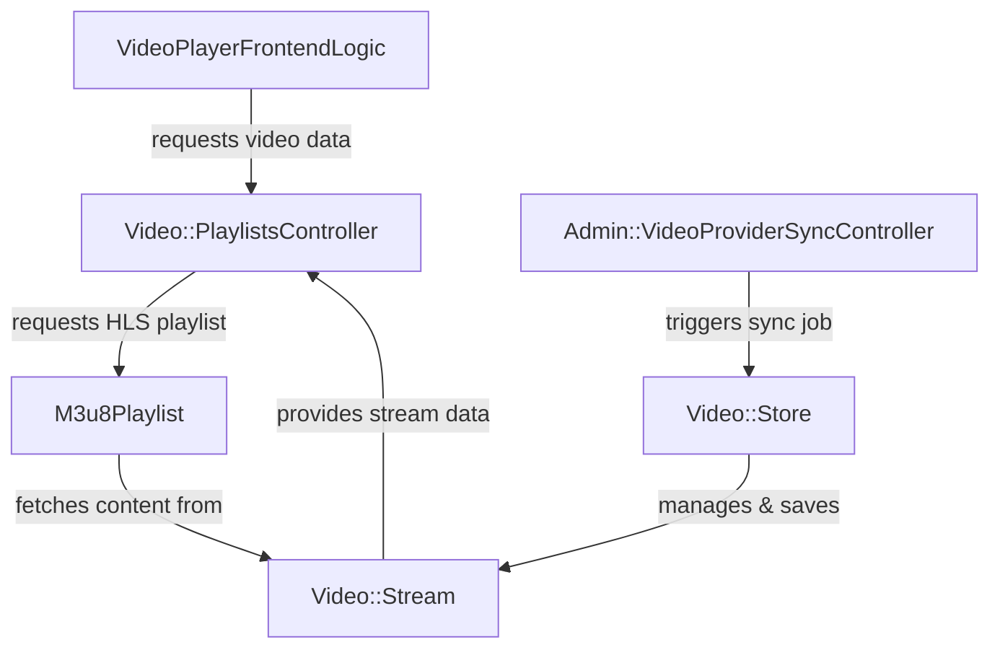
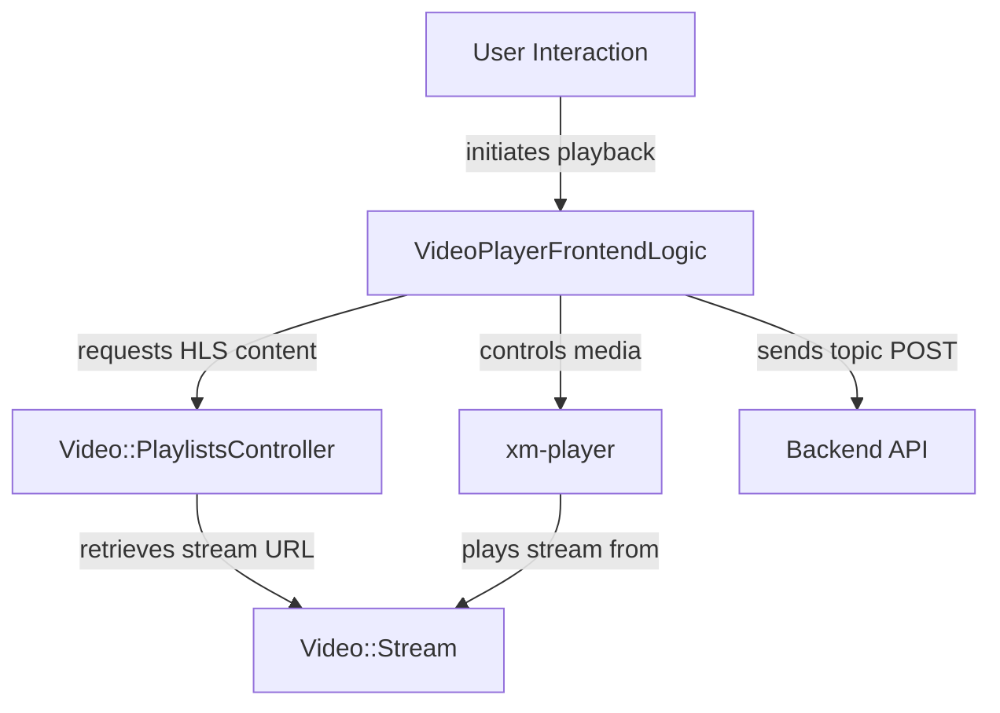
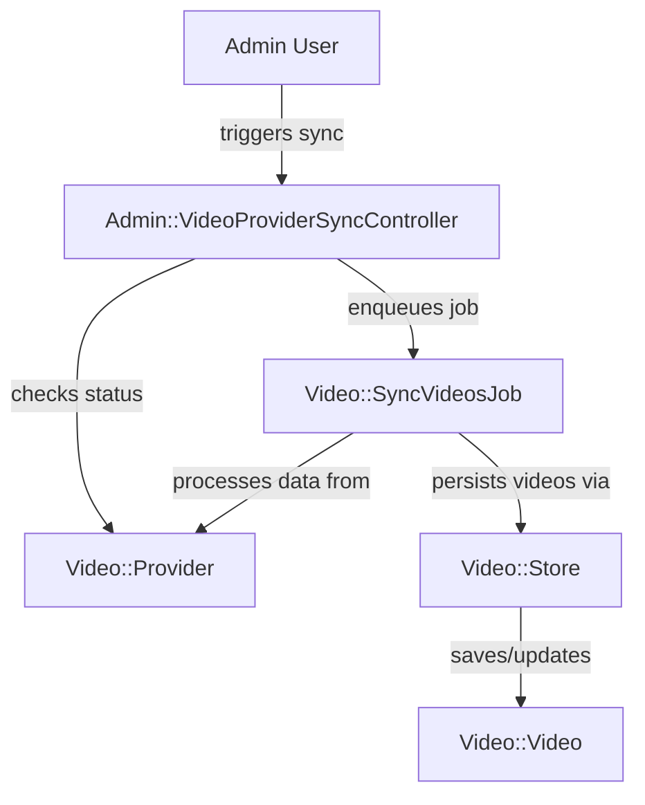

# Video Management, Streaming, and Subtitles - Technical Documentation

*Generated on 9/18/2025 | Xikolo Knowledge Base*

---

## 📋 Executive Summary

This report outlines the Xikolo cluster 12_LEARN_VideoStreaming, a comprehensive system for managing, streaming, and delivering video content and associated subtitles. It integrates frontend capabilities for enhanced user playback and interaction, with robust backend services for administering video providers, orchestrating content synchronization, and ensuring proper storage and delivery. Key components include client-side video player logic, administrative controllers for video providers and streams, a central video storage operation, and specialized services for HLS playlist generation and subtitle management. The primary purpose is to provide a seamless and fully managed video experience, from content ingestion and processing to dynamic streaming and interactive playback, while offering administrators granular control over video assets and their sources. The scope covers user-facing video display, backend content administration, and critical integrations with S3 and external video services.

---

## 🏗️ Architecture Overview

The video streaming architecture within Xikolo cluster 12_LEARN_VideoStreaming is designed to handle content ingestion, storage, administration, and dynamic delivery to users. At its core, frontend interactions are managed by `VideoPlayerFrontendLogic`, which leverages the `xm-player` web component for a rich playback experience. Content delivery is facilitated by `Video::PlaylistsController`, which dynamically generates HLS playlists using `M3u8Playlist`. Backend administration, particularly for synchronizing external video content, is handled by `Admin::VideoProviderSyncController`, dispatching jobs that ultimately utilize `Video::Store` for persistence. All video metadata and stream references are managed through models like `Video::Video` and `Video::Stream`.

**Key Component Descriptions:**
*   **`VideoPlayerFrontendLogic`**: This client-side JavaScript logic enhances the user's video playback experience. It integrates with `xm-player` for direct control over video playback, seeking, and progress retrieval. It also enables users to create discussion topics directly linked to video timestamps and handles keyboard shortcuts.
*   **`Admin::VideoProviderSyncController`**: A Ruby on Rails controller responsible for initiating the synchronization of videos from configured external video providers. It orchestrates the background execution of `Video::SyncVideosJob` and performs checks against the `Video::Provider` model to prevent redundant sync operations.
*   **`Video::Store`**: This crucial Ruby operation centralizes the persistence of video data and its associated attachments, including rich text descriptions, reading materials, slides, transcripts, and subtitles. It interfaces extensively with S3-related services like `Xikolo::S3::TextWithUploadsProcessor`, `Xikolo::S3::SingleFileUpload`, and `Xikolo::S3::UploadByUri` for robust file management.
*   **`M3u8Playlist`**: A specialized Ruby class that wraps the `M3u8` gem for reading, manipulating, and generating HLS (HTTP Live Streaming) playlists. It can transform master playlists by rewriting URIs, embedding Xikolo's custom subtitles, and ensuring streams are sorted optimally for iOS playback. It uses `Restify` to fetch external HLS data.
*   **`SubtitlesController`**: This Rails controller manages requests for `Video::Subtitle` records, rendering subtitle content as `text/vtt`. It sets a broad `Access-Control-Allow-Origin: *` header to ensure compatibility with various web-based video players, including Google Cast.
*   **`Video::VideoPlayer`**: An external, JavaScript-based component (`@openhpi/xikolo-video-player` npm package) that handles the actual rendering and control of video playback. It is initialized by `VideoPresenter` and consumes HLS playlists and VTT subtitle files provided by the system controllers.

### Architecture Diagrams

#### Main Architecture Overview

### 🔄 Component Interactions

Key interactions between components in this cluster:

- **VideoPlayerFrontendLogic:** Interacts with `xm-player` (custom web component) to control video playback and retrieve progress. [Source: app/assets/course/items/video.js]
- **VideoPlayerFrontendLogic:** Sends POST requests to the backend API for creating new discussion topics. [Source: app/assets/course/items/video.js]
- **VideoStreamAutocompletion:** Makes an AJAX GET request to `/admin/streams` to fetch stream data. [Source: app/assets/teacher/items/video-streams.ts]
- **VideoStreamAutocompletion:** Updates `TomInput` select elements for lecturer and slides streams. [Source: app/assets/teacher/items/video-streams.ts]
- **VideoItemFormHandler:** Calls `setVisibility` and `hideAndUncheckSwitch` from `form-helpers` to manage UI elements. [Source: app/assets/teacher/items/video.ts]
- **VideoItemFormHandler:** Invokes `videoStreamsAutocompletion` to enable stream auto-selection. [Source: app/assets/teacher/items/video.ts]
- **Admin::VideoProviderSyncController:** Dispatches `Video::SyncVideosJob` to perform synchronization asynchronously. [Source: app/controllers/admin/video_provider_sync_controller.rb]
- **Admin::VideoProviderSyncController:** Interacts with `Video::Provider` to check sync status. [Source: app/controllers/admin/video_provider_sync_controller.rb]
- **Admin::VideoProvidersController:** Interacts with `Video::Provider` model for data persistence. [Source: app/controllers/admin/video_providers_controller.rb]
- **Admin::VideoProvidersController:** Uses `Video::Provider.new(provider_type: type).type` to determine credential attributes for different provider types. [Source: app/controllers/admin/video_providers_controller.rb]
- **Admin::VideosController:** Queries `Video::Stream` for listing and deletion. [Source: app/controllers/admin/videos_controller.rb]
- **Admin::VideosController:** Authorizes actions using `authorize! 'video.video.manage'`. [Source: app/controllers/admin/videos_controller.rb]
- **ChromecastController:** Reads configuration from the `Chromecast` module to determine styling parameters.
- **ChromecastController:** Renders a CSS stylesheet dynamically based on configured values.
- **SubtitlesController:** Interacts with the `Video::Subtitle` model to find and render subtitle content.
- **SubtitlesController:** Sets `Access-Control-Allow-Origin: *` header to support Google Cast and other web-based video players.
- **M3u8Playlist:** Fetches external HLS content using `Restify`.
- **M3u8Playlist:** Generates internal URLs for playlists and subtitles using `Xikolo::V2::URL`.
- **Transpipe:** Reads configuration from `Xikolo.config` to determine if the service is enabled and to retrieve URL templates.
- **Transpipe:** Uses `Transpipe::URL` to construct specific URLs.
- **Video::Store:** Interacts with `Video::Video` model to assign attributes and save. [Source: app/operations/video/store.rb]
- **Video::Store:** Uses `Xikolo::S3::TextWithUploadsProcessor` for rich text description processing. [Source: app/operations/video/store.rb]
- **Video::SyncVideosJob:** Triggered by `Admin::VideoProviderSyncController`. [Source: app/controllers/admin/video_provider_sync_controller.rb]
- **Video::SyncVideosJob:** Processes video data from a `Video::Provider`. [Source: app/controllers/admin/video_provider_sync_controller.rb]
- **Video::Provider:** Managed by `Admin::VideoProvidersController`. [Source: app/controllers/admin/video_providers_controller.rb]
- **Video::Provider:** Used by `Admin::VideoProviderSyncController` to initiate syncs. [Source: app/controllers/admin/video_provider_sync_controller.rb]
- **Video::Stream:** Accessed by `Video::PlaylistsController` to retrieve the HLS URL for playlist processing.
- **Video::Stream:** Accessed by `M3u8Playlist` to fetch external HLS content.
- **Video::Subtitle:** Accessed by `SubtitlesController` for serving VTT files.
- **Video::Subtitle:** Accessed by `M3u8Playlist` to embed Xikolo's subtitles into HLS master playlists or generate standalone subtitle playlists.
- **xm-player:** Used by `VideoPlayerFrontendLogic` for video control and progress retrieval. [Source: app/assets/course/items/video.js]
- **xm-player:** Receives keyboard events forwarded from the document body. [Source: app/assets/course/items/video.js]
- **Xikolo::S3::TextWithUploadsProcessor:** Used by `Video::Store` to handle video descriptions. [Source: app/operations/video/store.rb]
- **Xikolo::S3::SingleFileUpload:** Used by `Video::Store` for processing reading material, slides, transcripts, and subtitles uploads. [Source: app/operations/video/store.rb]
- **Xikolo::S3::UploadByUri:** Used by `Video::Store` for processing attachments uploaded via URI. [Source: app/operations/video/store.rb]
- **S3FileDeletionJob:** Enqueued by `Video::Store` to delete replaced attachment files. [Source: app/operations/video/store.rb]
- **Stream::DownloadsController:** Interacts with `Video::Download` service to obtain download links. [Source: app/controllers/stream/downloads_controller.rb]
- **Stream::DownloadsController:** Handles various exceptions related to video download availability and quality. [Source: app/controllers/stream/downloads_controller.rb]
- **Stream::SyncsController:** Finds `Video::Stream` by ID and calls its `sync` method. [Source: app/controllers/stream/syncs_controller.rb]
- **Stream::SyncsController:** Authorizes actions using `authorize! 'video.video.index'`. [Source: app/controllers/stream/syncs_controller.rb]
- **Video::PlaylistsController:** Interacts with `Video::Stream` and `Video::Video` models to retrieve stream and video data.
- **Video::PlaylistsController:** Utilizes `M3u8Playlist` to fetch, parse, and transform HLS playlists.
- **Transpipe::URL:** Used by the `Transpipe` module to generate external service URLs.
- **VideoItemPresenter:** Delegates video-specific presentation to `VideoPresenter`.
- **VideoItemPresenter:** Interacts with `Course::Section` to check pinboard status.
- **VideoItemTopicPresenter:** Uses `HtmlTruncator` and `MarkdownHelper` for content formatting.
- **VideoItemTopicPresenter:** Uses `Rails.application.routes.url_helpers` to generate topic URLs.
- **VideoPresenter:** Interacts with `Video::Video` model to retrieve video details and stream URLs.
- **VideoPresenter:** Initializes the `Video::VideoPlayer` component.
- **app/assets/course/items/video.js:** Interacts with the `xm-player` custom element for seeking and getting progress. [Source: app/assets/course/items/video.js]
- **app/assets/course/items/video.js:** Sends AJAX requests to create new topics. [Source: app/assets/course/items/video.js]
- **app/assets/teacher/items/video-streams.ts:** Listens for 'change' events on the PIP stream selector (`#video_pip_stream_id`). [Source: app/assets/teacher/items/video-streams.ts]
- **app/assets/teacher/items/video-streams.ts:** Fetches stream data from `/admin/streams?q=...` API endpoint. [Source: app/assets/teacher/items/video-streams.ts]
- **app/assets/teacher/items/video.ts:** Calls `videoStreamsAutocompletion` to initialize stream matching. [Source: app/assets/teacher/items/video.ts]
- **app/assets/teacher/items/video.ts:** Manipulates visibility of form elements based on checkbox states. [Source: app/assets/teacher/items/video.ts]
- **Chromecast:** Used by `ChromecastController` to access styling configurations.
- **Video::VideoPlayer:** Initialized by `VideoPresenter` with video, user, and thumbnail loading options.
- **Video::VideoPlayer:** Likely consumes HLS playlists and VTT subtitle files provided by `Video::PlaylistsController` and `SubtitlesController`.
- **Video::Video:** Accessed by `VideoItemPresenter` and `VideoPresenter` for UI display.
- **Video::Video:** Used by `Video::PlaylistsController` and `M3u8Playlist` to retrieve video-specific information for playlist generation.
- **Restify:** Used by `M3u8Playlist` to fetch external HLS playlist content from upstream providers.
- **Xikolo::V2::URL:** Used by `M3u8Playlist` to construct internal URLs for transformed HLS playlists and subtitle tracks.

---

## ⚙️ Technical Workflows

### 1. Video Playback and Interaction Workflow
This workflow details the journey from a user initiating video playback to engaging with interactive features like discussion topic creation.

Initially, a user navigates to a video item within the course. The `VideoPlayerFrontendLogic` component, a JavaScript module, detects user interaction and initiates the video playback process. It communicates directly with the `xm-player` custom web component, which serves as the actual video player on the client side. The `VideoPlayerFrontendLogic` sends commands to `xm-player` to control playback, such as playing, pausing, or seeking to specific timestamps. For video content, the `VideoPlayerFrontendLogic` also sends requests to the `Video::PlaylistsController` on the backend to retrieve the HLS playlist. This controller, in turn, interacts with `Video::Stream` and `M3u8Playlist` to generate a dynamic HLS stream URL, which `xm-player` then consumes for streaming. As the video plays, `xm-player` provides progress updates back to `VideoPlayerFrontendLogic`. If a user wishes to create a discussion topic linked to a specific video timestamp, `VideoPlayerFrontendLogic` retrieves the current playback progress from `xm-player` and sends an AJAX POST request to the backend API, effectively linking the discussion to a moment in the video. Keyboard events from the document body are also forwarded to `xm-player` for a richer user experience.

### 2. Admin Video Provider Synchronization Workflow
This workflow describes how administrators trigger and manage the synchronization of video content from external video providers.

The process begins when an `Admin User` accesses the administrative interface and initiates a synchronization action via the `Admin::VideoProviderSyncController`. Before enqueuing a new job, the `Admin::VideoProviderSyncController` interacts with the `Video::Provider` model to check for any recently triggered or ongoing synchronization tasks for the specific provider, preventing redundant operations. Upon successful validation, the controller dispatches an asynchronous `Video::SyncVideosJob` for execution in the background. This background job then proceeds to retrieve and process video data from the designated `Video::Provider` using its configured credentials and API. The `Video::SyncVideosJob` then utilizes the `Video::Store` operation to persist or update the video records within the application's database, including metadata, stream references, and associated attachments. During this storage process, `Video::Store` may also dispatch `S3FileDeletionJob` to remove any replaced or obsolete attachment files from S3, ensuring storage efficiency. Finally, the newly synced or updated video data is reflected in the `Video::Video` model, making it available for streaming and other functionalities within the application.

### Workflow Diagrams

#### Video Playback and Interaction Workflow

#### Admin Video Provider Synchronization Workflow

### 🔀 Process Workflows

Detailed workflow processes for this cluster:

- **Video::Store Process:** Uses `Xikolo::S3::TextWithUploadsProcessor` for rich text description processing.
  *Source: Video::Store*
- **Video::SyncVideosJob Process:** Processes video data from a `Video::Provider`.
  *Source: Video::SyncVideosJob*
- **Video::Stream Process:** Accessed by `Video::PlaylistsController` to retrieve the HLS URL for playlist processing.
  *Source: Video::Stream*
- **Xikolo::S3::SingleFileUpload Process:** Used by `Video::Store` for processing reading material, slides, transcripts, and subtitles uploads.
  *Source: Xikolo::S3::SingleFileUpload*
- **Xikolo::S3::UploadByUri Process:** Used by `Video::Store` for processing attachments uploaded via URI.
  *Source: Xikolo::S3::UploadByUri*

---

## 🔧 Implementation Details

**Technical Considerations:**
*   **HLS Playlist Generation and Transformation:** The system actively manipulates HLS playlists via `M3u8Playlist`. This component is designed to fetch external HLS content using `Restify` and then rewrite stream URIs to point to internal application controllers. It also embeds Xikolo's own `Video::Subtitle` tracks directly into master playlists or generates standalone subtitle playlists. A critical aspect for optimal iOS playback is the explicit sorting of stream playlist items by bandwidth in descending order, addressing the non-deterministic order often received from providers like Vimeo.
*   **Subtitle Serving with CORS:** The `SubtitlesController` serves WebVTT (`.vtt`) formatted subtitle files by interacting with the `Video::Subtitle` model. To ensure compatibility with various web-based video players, especially for Google Cast, it explicitly sets the `Access-Control-Allow-Origin: *` HTTP header. While enabling broad access, this wildcard usage is noted as a potential security concern in the cluster data, suggesting a future refinement to more restrictive domains.
*   **S3-backed Content and Attachment Storage:** `Video::Store` is central to persisting all video-related data and attachments. It employs a suite of `Xikolo::S3` shared libraries: `Xikolo::S3::TextWithUploadsProcessor` for handling rich text descriptions that might contain embedded file uploads, `Xikolo::S3::SingleFileUpload` for direct file uploads (e.g., reading material, slides, transcripts, subtitles), and `Xikolo::S3::UploadByUri` for attachments provided via external URIs. The process ensures atomicity by enqueueing `S3FileDeletionJob` to remove replaced or unreferenced files, maintaining a clean S3 bucket.
*   **Asynchronous Processing for Heavy Operations:** Time-consuming tasks such as synchronizing videos from external providers are handled asynchronously. `Admin::VideoProviderSyncController` dispatches `Video::SyncVideosJob`, and `Video::Store` enqueues `S3FileDeletionJob`, preventing UI blocking and improving system responsiveness. Error handling for `Video::SyncVideosJob` discards on `Video::Provider::AuthenticationFailed` or `Video::Provider::AccountInactive`, considering them configuration errors rather than transient issues for retry.
*   **Frontend Stream Auto-completion:** The teacher interface benefits from `VideoStreamAutocompletion`, which makes AJAX GET requests to `/admin/streams` to fetch stream data dynamically. This data is then used to update `TomInput` select elements, enabling efficient auto-selection of lecturer and slides streams based on a chosen Picture-in-Picture (PIP) stream.

**Dependencies and Integrations:**
*   **`xm-player`**: A custom web component that serves as the primary video player. `VideoPlayerFrontendLogic` directly interacts with this component for playback control and progress feedback.
*   **`Restify`**: An HTTP client utility leveraged by `M3u8Playlist` to fetch external HLS playlist content from upstream video providers.
*   **`Xikolo::V2::URL`**: An internal URL helper component used by `M3u8Playlist` to construct canonical internal URLs for transformed HLS playlists and subtitle tracks.
*   **`Transpipe`**: An optional integration configured via `Xikolo.config`, which provides utility methods and `Transpipe::URL` to generate external URLs to the Transpipe service for courses and videos.
*   **`Chromecast` Module**: Used by `ChromecastController` to retrieve configurable styling parameters (background, logo, progress color) from `Xikolo.config` for dynamically rendering Chromecast Styled Media Receiver (SMR) CSS.
*   **`I18n`**: Utilized by `VideoPlayerFrontendLogic` and `VideoPresenter` for internationalization of displayed texts, such as timestamp labels and download button captions.
*   **`HtmlTruncator` and `MarkdownHelper`**: Employed by `VideoItemTopicPresenter` for formatting and truncating discussion topic content, ensuring consistent display.
*   **Rails Routes Helpers**: `Rails.application.routes.url_helpers` is used across various presenter and controller components (`VideoItemPresenter`, `VideoItemTopicPresenter`, `VideoPresenter`) to generate application-specific URLs, including download paths and topic links.

**Configuration Requirements:**
*   **Chromecast Configuration**: Stylistic parameters for the Chromecast Styled Media Receiver (SMR), including `background_url`, `logo_url`, and `progress_color`, must be defined within `Xikolo.config.chromecast` to enable custom branding.
*   **Transpipe Service Enablement**: The `transpipe.enabled` setting within `Xikolo.config` controls the activation of the Transpipe integration. URL templates (`course_url_template`, `course_video_url_template`) are also configured here for generating links to the external service.
*   **Video Download Permissions**: The `enable_video_download` setting at the course level determines the availability of video and audio download options, with explicit licensing restrictions displayed via tooltips when disabled.
*   **Authorization Permissions**: Specific administrative actions require explicit permissions:
    *   `video.provider.manage`: For managing `Video::Provider` records (e.g., in `Admin::VideoProvidersController`).
    *   `video.video.manage`: For controlling `Video::Stream` records (e.g., in `Admin::VideosController`, `Admin::VideoProviderSyncController`).
    *   `video.subtitle.manage`: For managing `Video::Subtitle` records (e.g., in `SubtitlesController`).

### 📚 Technical Sources & References

Key technical documentation and source references:

- VideoPlayerFrontendLogic: app/assets/course/items/video.js- VideoPlayerFrontendLogic: RAG: docs/app/development/frontend/video-player.md- VideoStreamAutocompletion: app/assets/teacher/items/video-streams.ts- VideoItemFormHandler: app/assets/teacher/items/video.ts- Admin::VideoProviderSyncController: app/controllers/admin/video_provider_sync_controller.rb- Admin::VideoProvidersController: app/controllers/admin/video_providers_controller.rb- Admin::VideosController: app/controllers/admin/videos_controller.rb- ChromecastController: app/controllers/chromecast_controller.rb- SubtitlesController: app/controllers/subtitles_controller.rb- M3u8Playlist: app/lib/m3u8_playlist.rb- Transpipe: app/lib/transpipe.rb- Video::Store: app/operations/video/store.rb- Video::SyncVideosJob: app/controllers/admin/video_provider_sync_controller.rb- Video::Provider: app/controllers/admin/video_providers_controller.rb- Video::Provider: app/controllers/admin/video_provider_sync_controller.rb- Video::Stream: app/controllers/video/playlists_controller.rb- Video::Stream: app/lib/m3u8_playlist.rb- Video::Subtitle: app/controllers/subtitles_controller.rb- Video::Subtitle: app/lib/m3u8_playlist.rb- xm-player: app/assets/course/items/video.js- xm-player: RAG: docs/app/development/frontend/video-player.md- Xikolo::S3::TextWithUploadsProcessor: app/operations/video/store.rb- Xikolo::S3::SingleFileUpload: app/operations/video/store.rb- Xikolo::S3::UploadByUri: app/operations/video/store.rb- S3FileDeletionJob: app/operations/video/store.rb- S3FileDeletionJob: spec/operations/video/store_spec.rb- Stream::DownloadsController: app/controllers/stream/downloads_controller.rb- Stream::SyncsController: app/controllers/stream/syncs_controller.rb- Video::PlaylistsController: app/controllers/video/playlists_controller.rb- Transpipe::URL: app/lib/transpipe.rb- VideoItemPresenter: app/presenters/video_item_presenter.rb- VideoItemTopicPresenter: app/presenters/video_item_topic_presenter.rb- VideoPresenter: app/presenters/video_presenter.rb- app/assets/course/items/video.js: app/assets/course/items/video.js- app/assets/teacher/items/video-streams.ts: app/assets/teacher/items/video-streams.ts- app/assets/teacher/items/video.ts: app/assets/teacher/items/video.ts- Chromecast: app/lib/chromecast.rb- Video::VideoPlayer: app/presenters/video_presenter.rb- Video::VideoPlayer: RAG: docs/app/development/frontend/video-player.md- Video::Video: app/presenters/video_item_presenter.rb- Video::Video: app/presenters/video_presenter.rb- Restify: app/lib/m3u8_playlist.rb- Restify: Foundational Context- Xikolo::V2::URL: app/lib/m3u8_playlist.rb- Configuration: config/application.rb, Gemfile, config/database.yml- Process Management: Procfile, Procfile.web- Build & Deploy: Rakefile, package.json

---

*This documentation is automatically generated from cluster analysis and should be validated against the actual codebase.*
