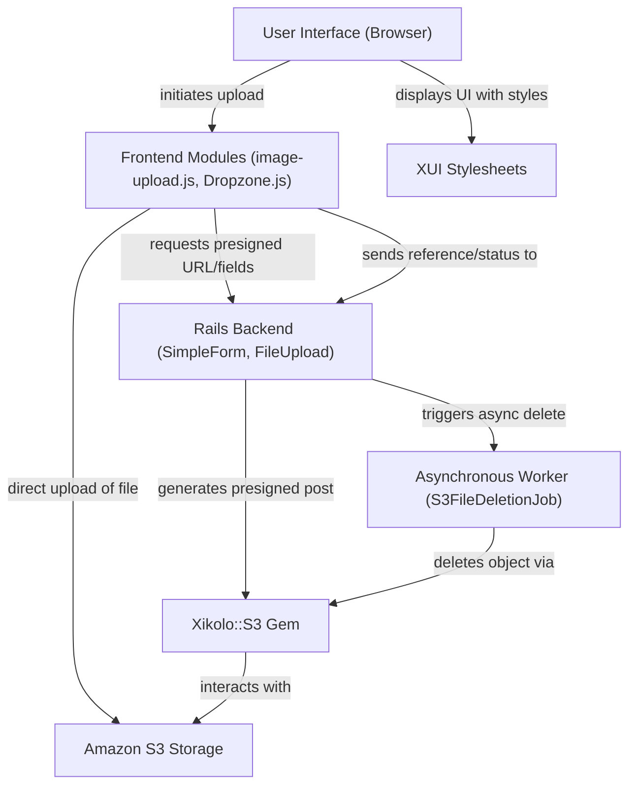
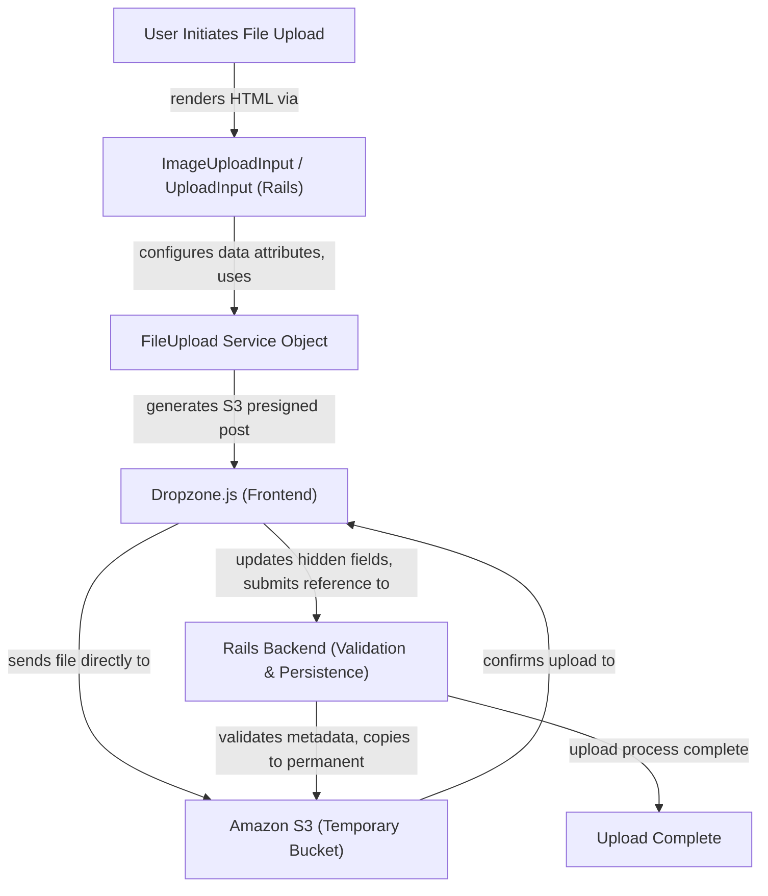
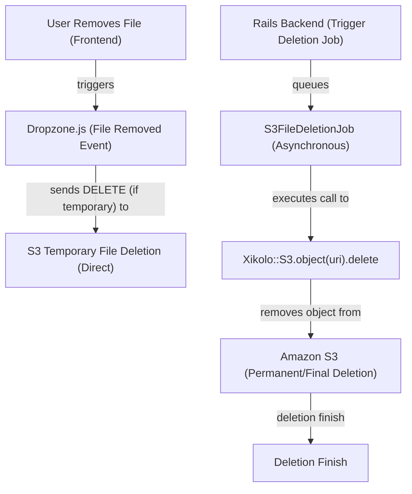

# File Uploads and S3 Integration - Technical Documentation

*Generated on 9/18/2025 | Xikolo Knowledge Base*

---

## 📋 Executive Summary

This report details the comprehensive file upload and management system within the Xikolo cluster, focusing on the `13_LEARN_FileManagement` component. The system is engineered for scalability and efficiency, utilizing direct file uploads to Amazon S3 via pre-signed URLs, thereby offloading significant traffic from application servers. Key components include client-side `Dropzone.js` for user interaction, Ruby on Rails `SimpleForm` inputs for backend integration, and the `xikolo-s3` gem for robust S3 interaction. The primary purpose is to standardize and secure file handling across various services, ensuring each service independently manages its files, including organization, tracking, metadata, and lifecycle.

---

## 🏗️ Architecture Overview

The file management architecture is built upon a robust client-server interaction model, where the frontend initiates direct file transfers to S3, minimizing backend load. The system leverages `SimpleForm` inputs for rendering file upload UI components, which are then enhanced by JavaScript modules and the `Dropzone.js` library for interactive user experiences. Server-side processing, validation, and asynchronous deletion are managed by dedicated Rails components and jobs, all interacting with S3 through the `xikolo-s3` gem. This design ensures modularity, scalability, and adherence to security best practices by utilizing S3's capabilities for direct uploads and metadata-driven validation.

### Architecture Diagrams

#### Main Architecture Overview

### 🔄 Component Interactions

Key interactions between components in this cluster:

- **ImageUploadInput:** Renders HTML for the image upload `Dropzone` and associated hidden fields (`upload_id`, `uri`, `deletion`).
- **ImageUploadInput:** Populates `data` attributes (`imageupload`, `upload_id`, `s3`, `max-filesize`, `error-size`, `error-type`) for `image-upload.js`.
- **UploadInput:** Renders HTML for the general file upload `Dropzone` and a hidden field (`attribute_name_upload_id`).
- **UploadInput:** Populates `data` attributes (`upload`, `s3`, `max-filesize`, `error-size`, `error-type`) for `upload.js`.
- **image-upload.js:** Initializes `Dropzone.js` on elements with `data-imageupload`.
- **image-upload.js:** Reads S3 configuration (URL, key, content type, image dimensions) from HTML `data` attributes.
- **upload.js:** Initializes `Dropzone.js` on elements with `data-upload`.
- **upload.js:** Reads S3 configuration from HTML `data` attributes.
- **S3FileDeletionJob:** Receives an S3 URI as an argument. [Source: app/jobs/s3_file_deletion_job.rb]
- **S3FileDeletionJob:** Calls `Xikolo::S3.object(uri).delete` to remove the file from S3. [Source: app/jobs/s3_file_deletion_job.rb]
- **Xikolo::S3:** Provides `bucket_for(:uploads)` method used by `FileUpload` to get an S3 bucket instance.
- **Xikolo::S3:** Defines the `xikolo-purpose` and `xikolo-state` metadata fields, which are set by `FileUpload` during presigning and used by backend services for validation. [Source: RAG: gems/xikolo-s3/README.md]
- **FileUpload:** Initialized by `ImageUploadInput` and `UploadInput` with upload-specific parameters.
- **FileUpload:** Interacts with `Xikolo::S3.bucket_for(:uploads)` to obtain an S3 bucket instance.
- **Dropzone.js:** Initialized by `image-upload.js`, `mdupload.js`, and `upload.js` to attach file upload behavior to HTML elements.
- **Dropzone.js:** Sends files directly to S3 using presigned URLs and fields provided by the backend.
- **mdupload.js:** Initializes `Dropzone.js` on elements with `data-mdupload`.
- **mdupload.js:** Reads S3 configuration from HTML `data` attributes.
- **xui/imageupload.scss:** Applies visual styles to the HTML elements rendered by `ImageUploadInput` and manipulated by `image-upload.js`.
- **xui/mdupload.scss:** Applies visual styles to the HTML elements rendered for markdown uploads and managed by `mdupload.js`.
- **xui/upload.scss:** Applies visual styles to the HTML elements rendered by `UploadInput` and manipulated by `upload.js`.

---

## ⚙️ Technical Workflows

### 1. File Upload Workflow
This workflow outlines the process from a user initiating a file upload to the file being stored permanently in S3. It emphasizes direct client-to-S3 transfers, reducing the load on application servers. The frontend components, driven by `Dropzone.js` and specific JavaScript modules, gather file metadata and interact with the backend to secure pre-signed URLs for direct S3 interaction. Upon successful direct upload, a file reference is passed back to the Rails application for validation and final commit to a permanent storage location.

### 2. File Deletion Workflow
File deletion is handled asynchronously to ensure non-blocking operations and system responsiveness. When a file is removed, either from the frontend UI or triggered by a backend process, a dedicated job is queued to perform the actual deletion from S3. This asynchronous approach prevents delays in the user interface and ensures that file removal is gracefully handled, even under varying S3 service conditions. Error reporting is integrated to monitor and address any issues during the deletion process.

### 3. Backend File Validation and Finalization Workflow
After a file is directly uploaded to a temporary S3 location by the client, the backend takes over for validation and permanent storage. This workflow ensures that files conform to application-specific policies before being moved to their final, designated S3 location. Metadata such as `xikolo-state` and `xikolo-purpose` are critical for this validation, preventing misuse and ensuring proper file categorization. The `xikolo-s3` gem provides the necessary abstractions for these S3 operations, enabling secure and structured file management.

### Workflow Diagrams

#### File Upload Workflow

#### File Deletion Workflow

### 🔀 Process Workflows

Detailed workflow processes for this cluster:

- **Upload Workflow::** Upload Workflow: Files are initially uploaded to a temporary S3 bucket. The frontend passes a reference (either an upload ID or a file URI) to the backend service. The service then validates the uploa...
  *Source: documentation*

---

## 🔧 Implementation Details

### Technical Considerations
The system prioritizes direct S3 uploads to enhance performance and scalability, ensuring that application servers are not burdened with large file transfers. Client-side, `Dropzone.js` provides a rich user experience for drag-and-drop uploads, while specific JavaScript modules like `image-upload.js` and `upload.js` tailor its behavior for different file types and implement client-side validations, such as image dimensions. Backend integration relies on Rails `SimpleForm` inputs (`ImageUploadInput`, `UploadInput`) which are responsible for rendering the necessary HTML and `data` attributes, and for leveraging the `FileUpload` service object to generate S3 pre-signed URLs. File references are communicated to the backend via hidden form fields, with a noted technical debt regarding the coexistence of `_upload_id` and `_uri` suffixes for backward compatibility. The asynchronous `S3FileDeletionJob` ensures efficient cleanup of S3 objects, reporting errors to Mnemosyne and Sentry for observability.

### Dependencies and Integrations
The core dependencies include `Dropzone.js` for frontend file handling and the `xikolo-s3` Ruby gem for abstracting AWS S3 interactions. `Xikolo::S3` provides crucial methods like `bucket_for(:uploads)` and `object(uri)` which are used by `FileUpload` and `S3FileDeletionJob`, respectively. The system integrates with standard Rails components, including `ApplicationJob` for asynchronous tasks and `SimpleForm` for view rendering. For error monitoring and tracing, `Mnemosyne` and `Sentry` are integrated into the `S3FileDeletionJob`. Stylesheets, such as `xui/imageupload.scss`, `xui/mdupload.scss`, and `xui/upload.scss`, provide the visual styling for the Dropzone components, ensuring a consistent user interface across different upload contexts.

### Configuration Requirements
Crucial S3 configuration is managed through the `xikolo-s3` gem, specifically `Xikolo.config.s3['buckets']` to define S3 bucket names. The `FileUpload` service configures `Aws::S3::PresignedPost` parameters, including `key_starts_with`, `acl`, `signature_expiration`, and essential S3 metadata headers: `xikolo-purpose` (e.g., `service_identifier/resource_name/field_name`) and `xikolo-state` (must be `accepted`). These metadata fields are vital for backend validation and preventing unauthorized file usage. Frontend components (`image-upload.js`, `upload.js`) read client-side validation parameters like `max-filesize`, `error-size`, and `error-type` directly from HTML `data` attributes provided by the `SimpleForm` inputs. Image-specific uploads also specify `image-target-height/width` metadata for image processing. No further specific configuration requirements beyond these are specified in the cluster data.

### 📚 Technical Sources & References

Key technical documentation and source references:

- ImageUploadInput: app/inputs/image_upload_input.rb- UploadInput: app/inputs/upload_input.rb- image-upload.js: app/assets/util/forms/image-upload.js- image-upload.js: app/assets/stylesheets/xui/imageupload.scss- upload.js: app/assets/util/forms/upload.js- upload.js: app/assets/stylesheets/xui/upload.scss- S3FileDeletionJob: app/jobs/s3_file_deletion_job.rb- Xikolo::S3: RAG: gems/xikolo-s3/README.md- FileUpload: lib/file_upload.rb- FileUpload: RAG: gems/xikolo-s3/README.md- Dropzone.js: app/assets/util/forms/image-upload.js- Dropzone.js: app/assets/util/forms/mdupload.js- mdupload.js: app/assets/util/forms/mdupload.js- mdupload.js: app/assets/stylesheets/xui/mdupload.scss- xui/imageupload.scss: app/assets/stylesheets/xui/imageupload.scss- xui/mdupload.scss: app/assets/stylesheets/xui/mdupload.scss- xui/upload.scss: app/assets/stylesheets/xui/upload.scss- Configuration: config/application.rb, Gemfile, config/database.yml- Process Management: Procfile, Procfile.web- Build & Deploy: Rakefile, package.json

---

*This documentation is automatically generated from cluster analysis and should be validated against the actual codebase.*
