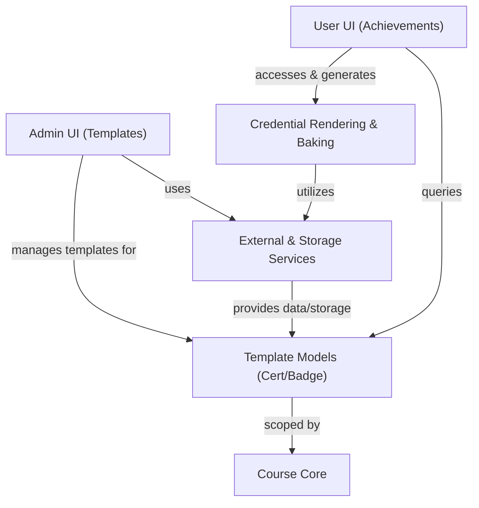
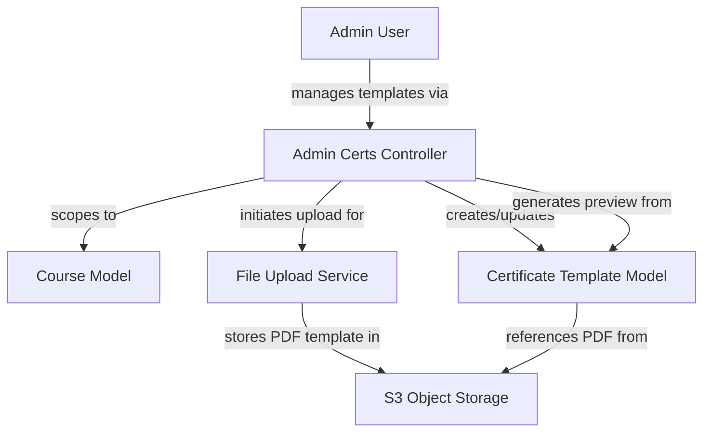
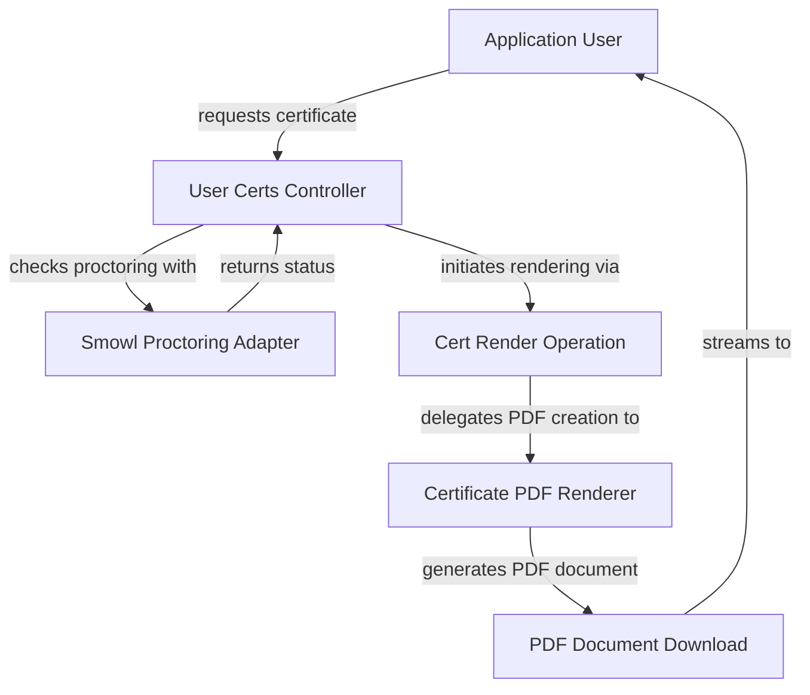
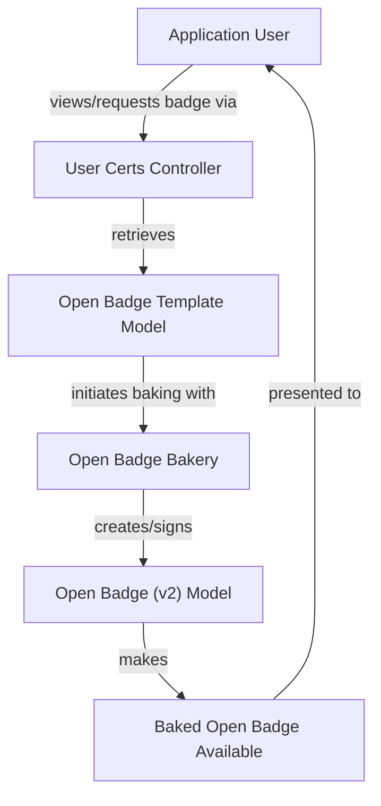

# Digital Certificates, Open Badges, and Credential Issuance - Technical Documentation

*Generated on 9/18/2025 | Xikolo Knowledge Base*

---

## 📋 Executive Summary

This report details the 'Digital Certificates, Open Badges, and Credential Issuance' feature cluster within the Xikolo platform, focusing on the management, generation, and verification of digital credentials. Key components facilitate administrative control over certificate and Open Badge templates, user-facing credential display and download, and background processing for related assets. The main purpose is to provide a comprehensive system for issuing verifiable digital achievements, including PDF certificates and Open Badges, while integrating with external services like proctoring and achievement tracking. The scope covers template definition, user access, rendering, baking, and verification processes within the Xikolo learning environment.

---

## 🏗️ Architecture Overview

The achievements feature is central to Xikolo's credentialing capabilities, enabling the issuance of digital certificates and Open Badges. At its core, administrators manage templates for both credential types, while end-users interact with a dedicated controller to view, download, or verify their earned achievements. Rendering of PDF certificates is handled by a specialized library that integrates with PDF generation tools, and Open Badges are 'baked' using a separate utility. File uploads for templates and images are managed by a generic service, with interactions occurring within the course context and with external systems for proctoring and achievement data retrieval.

### Key Components
*   **User Certificates Controller (`Course::CertificatesController`):** This controller serves as the primary interface for users to view, download, and verify their digital certificates and Open Badges. It orchestrates interactions with various services, including external achievement APIs via `Restify` and proctoring checks through `Proctoring::SmowlAdapter`.
*   **Certificate PDF Renderer (`Certificate::RecordRenderer`):** A specialized library that utilizes `Prawn::Document` and `Prawn::QRCode` to construct PDF certificates. It incorporates dynamic content, QR codes, proctoring images, and a transcript of records table, drawing configurations from `Xikolo.config`.
*   **Open Badge Bakery (`OpenBadgeBakery`):** This component is responsible for embedding digital assertions into Open Badge images, a process known as 'baking'. It takes an assertion, image URL, and a private key, fetching the image and using `ChunkyPNG` to manipulate PNG chunks for embedding the signed assertion.
*   **Certificate Template Model (`Certificate::Template`):** Represents the customizable blueprint for PDF certificates. It stores design parameters such as dynamic SVG content, QR code positioning, and a reference to the PDF background file. This model is managed via the admin interface.
*   **File Upload Service (`FileUpload`):** A generic utility for managing temporary file uploads. It facilitates the secure upload of PDF templates for certificates and PNG images for Open Badges, likely interfacing with `Xikolo::S3` for storage as indicated in cluster data.
*   **Proctoring Image Upload Job (`Proctoring::UploadCertificateImageJob`):** A background job intended to fetch a user's proctoring image from the `Proctoring::SmowlAdapter` and upload it to `S3` for eventual inclusion in issued certificates. As indicated in cluster data, its `perform` method is currently empty.

### Architecture Diagram

### Architecture Diagrams

#### Main Architecture Overview

### 🔄 Component Interactions

Key interactions between components in this cluster:

- **Course::Admin::CertificateTemplatesController:** Interacts with `Course::Course` to identify the current course. [Source: app/controllers/course/admin/certificate_templates_controller.rb]
- **Course::Admin::CertificateTemplatesController:** Interacts with `Certificate::Template` model for persistence and data retrieval. [Source: app/controllers/course/admin/certificate_templates_controller.rb]
- **Course::Admin::OpenBadgeTemplatesController:** Interacts with `Course::Course` to identify the current course. [Source: app/controllers/course/admin/open_badge_templates_controller.rb]
- **Course::Admin::OpenBadgeTemplatesController:** Interacts with `Certificate::OpenBadgeTemplate` model for persistence and data retrieval. [Source: app/controllers/course/admin/open_badge_templates_controller.rb]
- **Course::CertificatesController:** Interacts with Course::Course and Course::Enrollment [Source: app/controllers/course/certificates_controller.rb]
- **Course::CertificatesController:** Retrieves Certificate::Template and Certificate::Record objects (inferred) [Source: app/controllers/course/certificates_controller.rb]
- **Certificate::RecordRenderer:** Uses `Prawn::Document` for PDF generation. [Source: app/lib/certificate/record_renderer.rb]
- **Certificate::RecordRenderer:** Uses `Prawn::QRCode` for embedding QR codes. [Source: app/lib/certificate/record_renderer.rb]
- **Certificate::Record::Render:** Initializes with a `record` object (e.g., `Certificate::RecordOfAchievement`). [Source: app/operations/certificate/record/render.rb]
- **Certificate::Record::Render:** Calls `@record.render_data` to obtain the necessary data for rendering. [Source: app/operations/certificate/record/render.rb]
- **Proctoring::UploadCertificateImageJob:** (Intended) Interacts with Proctoring::SmowlAdapter to fetch images (inferred from description) [Source: app/jobs/proctoring/upload_certificate_image_job.rb]
- **Proctoring::UploadCertificateImageJob:** (Intended) Interacts with S3 for image storage (inferred from description) [Source: app/jobs/proctoring/upload_certificate_image_job.rb]
- **Certificate::Template:** Managed by `Course::Admin::CertificateTemplatesController`. [Source: app/controllers/course/admin/certificate_templates_controller.rb]
- **Certificate::Template:** Processes file uploads via `process_upload!`. [Source: app/controllers/course/admin/certificate_templates_controller.rb]
- **Certificate::OpenBadgeTemplate:** Managed by `Course::Admin::OpenBadgeTemplatesController`. [Source: app/controllers/course/admin/open_badge_templates_controller.rb]
- **Certificate::OpenBadgeTemplate:** Processes file uploads via `process_upload!`. [Source: app/controllers/course/admin/open_badge_templates_controller.rb]
- **Certificate::Record:** Associated with Certificate::Template, Course::Course, and User (inferred) [Source: app/controllers/course/certificates_controller.rb]
- **Certificate::Record:** Provides a class method for verification (verify) (inferred) [Source: app/controllers/course/certificates_controller.rb]
- **OpenBadgeBakery:** Takes an assertion (hash), image URL, and private key as input. [Source: spec/lib/open_badge_bakery_spec.rb]
- **OpenBadgeBakery:** Fetches the badge image from the provided `image_url`. [Source: spec/lib/open_badge_bakery_spec.rb]
- **Certificate::RecordOfAchievement:** Linked to `Certificate::Template`. [Source: RAG: db/seeds/development/30_certificate.rb]
- **Certificate::RecordOfAchievement:** Can be rendered into a PDF via `Certificate::Record::Render`. [Source: app/operations/certificate/record/render.rb]
- **Certificate::V2::OpenBadge:** Linked to `Certificate::RecordOfAchievement` and `Certificate::OpenBadgeTemplate`. [Source: RAG: db/seeds/development/30_certificate.rb]
- **FileUpload:** Used by `Course::Admin::CertificateTemplatesController` for PDF uploads. [Source: app/controllers/course/admin/certificate_templates_controller.rb]
- **FileUpload:** Used by `Course::Admin::OpenBadgeTemplatesController` for PNG uploads. [Source: app/controllers/course/admin/open_badge_templates_controller.rb]
- **Course::Course:** Accessed by `Course::Admin::CertificateTemplatesController` to scope templates. [Source: app/controllers/course/admin/certificate_templates_controller.rb]
- **Course::Course:** Accessed by `Course::Admin::OpenBadgeTemplatesController` to scope templates. [Source: app/controllers/course/admin/open_badge_templates_controller.rb]
- **Certificate::RenderDataPresenter:** Provides data to `Certificate::RecordRenderer`. [Source: spec/lib/certificate/record_renderer_spec.rb]
- **Certificate::RenderDataPresenter:** Likely instantiated by a `Certificate::Record` object via a `render_data` method. [Source: app/operations/certificate/record/render.rb]
- **Course::CertificateTemplatePresenter:** Instantiated by `Course::Admin::CertificateTemplatesController` for each `Certificate::Template` in the index action. [Source: app/controllers/course/admin/certificate_templates_controller.rb]

---

## ⚙️ Technical Workflows

The Xikolo Achievements cluster supports several critical technical workflows, from administrative template management to user-facing credential issuance and background processing. These workflows are designed to ensure a seamless and verifiable credentialing experience within the platform.

### 1. Certificate Template Management Workflow
Administrators initiate this workflow to define and maintain the visual and dynamic content for PDF certificate templates. The `Course::Admin::CertificateTemplatesController` provides the interface for creating, updating, or deleting these templates. When a new template is created or an existing one updated, an administrator uploads a PDF file (e.g., for the background design) and defines dynamic elements like SVG content and QR code positioning. The `FileUpload` service handles the secure transfer of this PDF to storage, typically `Xikolo::S3`. Each `Certificate::Template` is associated with a specific `Course::Course` to ensure proper scoping. Preview functionality is also available, leveraging the `Certificate::Record::Render` operation to show how a certificate would appear with the current template settings. Deletion of a template is strictly prevented if `Certificate::Record` instances are already associated with it, preserving data integrity. This workflow ensures that certificate designs are centrally managed and easily updateable by authorized personnel.

### 2. User PDF Certificate Generation and Download Workflow
This workflow describes how a user requests and obtains a PDF certificate for an achieved course credential. Triggered by a user's request through the `Course::CertificatesController`, the system first performs crucial checks, especially for proctored courses. The `ensure_proctoring_passed!` check interacts with the `Proctoring::SmowlAdapter` to verify the user's proctoring status. If proctoring requirements are not met, a `CertificateNotAllowed` exception is raised, preventing download. If cleared, the request proceeds to the `Certificate::Record::Render` operation, which acts as an orchestrator. This operation retrieves the necessary data, including dynamic content and QR code positions, from a `Certificate::Record` object, often presented by `Certificate::RenderDataPresenter`. It then delegates the actual PDF creation to `Certificate::RecordRenderer`. The `Certificate::RecordRenderer` uses `Prawn` and `Prawn::QRCode` to compile the PDF, embedding dynamic content, a unique QR code for verification, and potentially a proctoring image. Once rendered, the PDF is streamed for download to the user, providing them with their official achievement credential.

### 3. Open Badge Issuance Workflow
The Open Badge issuance workflow enables users to receive digitally verifiable Open Badges for their achievements. This process is often initiated by the `Course::CertificatesController` when a user views their achievements or explicitly requests an Open Badge. The controller identifies the relevant `Certificate::OpenBadgeTemplate` for the course, which holds metadata and a reference to the badge image. The core of this workflow is the 'baking' process, facilitated by the `OpenBadgeBakery` component. The `OpenBadgeBakery` takes an assertion (a JSON object containing recipient, badge, and verification details), the badge image's URL (fetched from `FileUpload` or `S3`), and a private key for signing. It fetches the base badge image and then uses the `ChunkyPNG` library to embed the cryptographically signed assertion as an iTXt chunk within the PNG image. This results in a 'baked' `Certificate::V2::OpenBadge` instance, which is a tamper-evident digital credential. The baked badge is then made available to the user, often through a public URL for sharing and verification.

### Workflow Diagrams

#### Certificate Template Management Workflow

#### User PDF Certificate Generation and Download Workflow

#### Open Badge Issuance Workflow

### 🔀 Process Workflows

Detailed workflow processes for this cluster:

- **Course::Admin::CertificateTemplatesController Process:** Calls `Certificate::Template#process_upload!` to associate uploaded files.
  *Source: Course::Admin::CertificateTemplatesController*
- **Course::Admin::OpenBadgeTemplatesController Process:** Calls `Certificate::OpenBadgeTemplate#process_upload!` to associate uploaded files.
  *Source: Course::Admin::OpenBadgeTemplatesController*
- **Certificate::Template Process:** Processes file uploads via `process_upload!`.
  *Source: Certificate::Template*
- **Certificate::OpenBadgeTemplate Process:** Processes file uploads via `process_upload!`.
  *Source: Certificate::OpenBadgeTemplate*

---

## 🔧 Implementation Details

The implementation of the Xikolo Achievements cluster relies on a modular architecture, integrating several Ruby gems and internal services to manage digital certificates and Open Badges. Specific technical considerations, dependencies, and configuration requirements are detailed below based on the provided cluster data.

### Technical Considerations
As indicated in the cluster data, several technical observations impact the system's robustness and flexibility:
*   **Proctoring Check Inconsistency:** The `ensure_proctoring_passed!` check is exclusively applied to `CERT` type certificates by `Course::CertificatesController`, but not to `ROA` (Record of Achievement) types. This could lead to an inconsistent security posture if all official credentials are expected to require proctoring for download. This warrants re-evaluation for consistency as noted in the technical debt.
*   **Incomplete Proctoring Image Upload:** The `Proctoring::UploadCertificateImageJob`'s `perform` method is currently empty, indicating that the intended functionality to fetch user proctoring images from `Proctoring::SmowlAdapter` and upload them to `S3` for certificate inclusion is not yet implemented or functional. This is a critical gap for proctored certificate generation.
*   **Hardcoded Image Positioning:** `Certificate::RecordRenderer` uses fixed coordinates for placing the proctoring image on PDFs (`at: [16.1, 754]`, `width: 77.2`). This rigid positioning can lead to layout issues if certificate templates vary significantly in design or if image dimensions change, requiring manual adjustments for each template variant.
*   **Font Handling Workarounds:** The `RecordRenderer` includes specific workarounds for `Prawn`'s font handling, such as disabling subsetting (`subset: false`) and setting custom font identifiers. This suggests underlying complexities or limitations with the PDF generation library that necessitated explicit mitigation, potentially affecting PDF file sizes or rendering consistency across environments.
*   **Asynchronous Data Fetching Strategy:** `Course::CertificatesController` makes multiple `Acfs.run` calls within single actions. While `Acfs` is an asynchronous framework, repeated calls in one action may indicate a suboptimal data fetching strategy that could be consolidated for efficiency if not managed to prevent redundant processing.

### Dependencies and Integrations
The cluster components integrate with several internal and external systems and rely on specific Ruby gems:
*   **PDF Generation:** `Prawn` and `Prawn::QRCode` gems are fundamental dependencies for `Certificate::RecordRenderer` to create and embed QR codes into PDF certificates.
*   **Open Badge Processing:** `ChunkyPNG` is used by `OpenBadgeBakery` for low-level manipulation of PNG image chunks, enabling the embedding of assertions. The `JWT` gem handles the signing of Open Badge assertions using the `RS256` algorithm, ensuring their verifiability.
*   **Proctoring Service:** `Proctoring::SmowlAdapter` is integrated with `Course::CertificatesController` for real-time proctoring status checks and is the intended source for proctoring images via `Proctoring::UploadCertificateImageJob`.
*   **External Achievement Data:** `Restify` is utilized by `Course::CertificatesController` to communicate with external services for retrieving user achievements, enabling the display of comprehensive credential information.
*   **File Storage:** `FileUpload` acts as an intermediary for handling PDF template and PNG image uploads, with an inferred integration with `Xikolo::S3` for persistent storage of these assets.
*   **Core Application Context:** `Course::Course` provides the essential context for scoping certificate and Open Badge templates, ensuring they are correctly associated with specific learning programs.

### Configuration Requirements
Based on the cluster data, the following configuration aspects are evident:
*   **`Xikolo.config`:** This configuration source is used by `Certificate::RecordRenderer` to retrieve settings such as font paths and parameters for the transcript of records table. For Open Badges, `Xikolo.config.open_badges` is referenced to obtain the `public_key` used for assertion verification (specifically mentioned in tests).
*   **`Rails.application.secrets`:** `OpenBadgeBakery` reads the `open_badge_private_key` from `Rails.application.secrets` for signing Open Badge assertions, a critical security measure for credential issuance.
*   **File System Access:** `Certificate::RecordRenderer` accesses the file system directly to load font files and PDF templates, indicating that these assets must be present at specified paths for correct rendering.
*   Other configuration requirements such as database connection strings, environment variables for external service endpoints, or logging configurations are not specified in cluster data.

### 📚 Technical Sources & References

Key technical documentation and source references:

- Course::Admin::CertificateTemplatesController: app/controllers/course/admin/certificate_templates_controller.rb- Course::Admin::CertificateTemplatesController: RAG: services/account/lib/tasks/permissions/certificate.yml- Course::Admin::OpenBadgeTemplatesController: app/controllers/course/admin/open_badge_templates_controller.rb- Course::Admin::OpenBadgeTemplatesController: RAG: services/account/lib/tasks/permissions/certificate.yml- Course::CertificatesController: app/controllers/course/certificates_controller.rb- Certificate::RecordRenderer: app/lib/certificate/record_renderer.rb- Certificate::RecordRenderer: spec/lib/certificate/record_renderer_spec.rb- Certificate::Record::Render: app/operations/certificate/record/render.rb- Proctoring::UploadCertificateImageJob: app/jobs/proctoring/upload_certificate_image_job.rb- Certificate::Template: app/controllers/course/admin/certificate_templates_controller.rb- Certificate::Template: RAG: db/seeds/development/30_certificate.rb- Certificate::OpenBadgeTemplate: app/controllers/course/admin/open_badge_templates_controller.rb- Certificate::OpenBadgeTemplate: RAG: db/seeds/development/30_certificate.rb- Certificate::Record: app/controllers/course/certificates_controller.rb- Certificate::Record: app/operations/certificate/record/render.rb- OpenBadgeBakery: spec/lib/open_badge_bakery_spec.rb- OpenBadgeBakery: spec/support/badge_support.rb- Certificate::RecordOfAchievement: RAG: db/seeds/development/30_certificate.rb- Certificate::V2::OpenBadge: RAG: db/seeds/development/30_certificate.rb- FileUpload: app/controllers/course/admin/certificate_templates_controller.rb- FileUpload: app/controllers/course/admin/open_badge_templates_controller.rb- Course::Course: app/controllers/course/admin/certificate_templates_controller.rb- Course::Course: app/controllers/course/admin/open_badge_templates_controller.rb- Certificate::RenderDataPresenter: spec/lib/certificate/record_renderer_spec.rb- Certificate::RenderDataPresenter: app/operations/certificate/record/render.rb- Course::CertificateTemplatePresenter: app/controllers/course/admin/certificate_templates_controller.rb- Configuration: config/application.rb, Gemfile, config/database.yml- Process Management: Procfile, Procfile.web- Build & Deploy: Rakefile, package.json

---

*This documentation is automatically generated from cluster analysis and should be validated against the actual codebase.*
