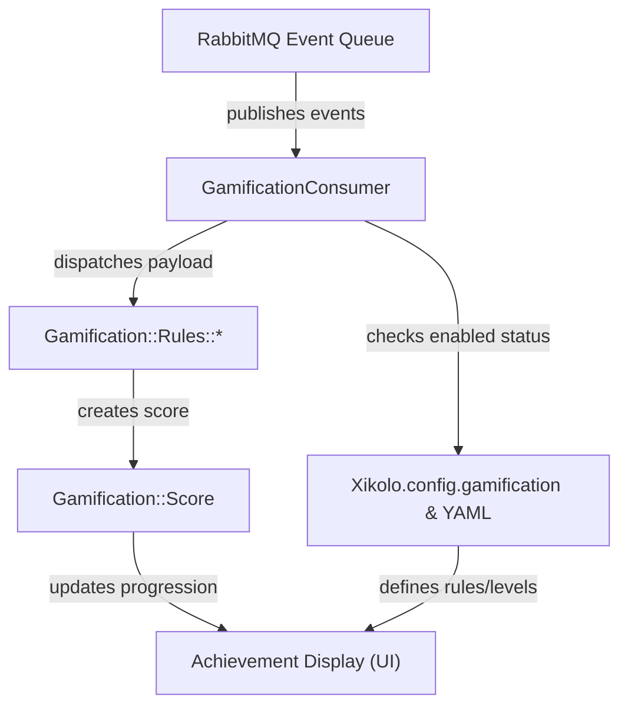
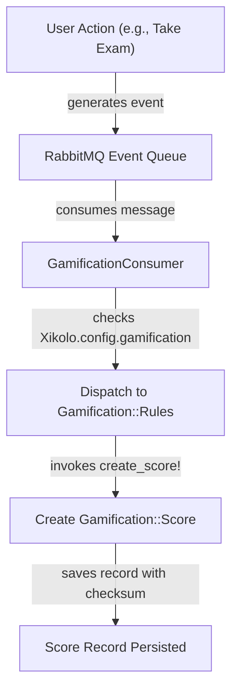
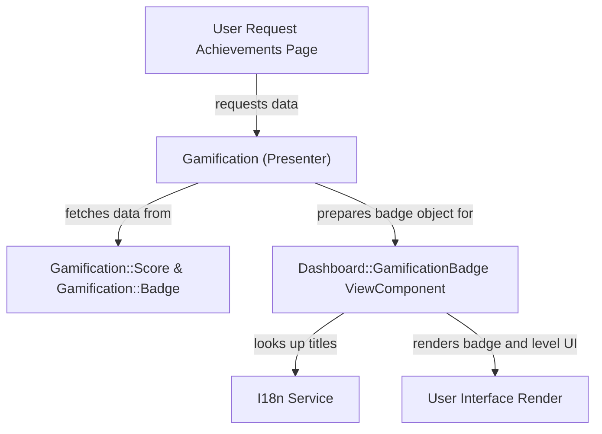

# Gamification System (Badges, Levels, Scores) - Technical Documentation

*Generated on 9/18/2025 | Xikolo Knowledge Base*

---

## 📋 Executive Summary

The Xikolo Gamification System (cluster 15_LEARN_Gamification) is a pivotal component designed to significantly boost user engagement and motivation across the platform. Operating on an event-driven architecture, it meticulously rewards user activities through a sophisticated points-based scoring system, achievement badges, and a progressive user leveling structure. Key components include a dedicated consumer for real-time event processing, rule-based logic for dynamic score generation, and specialized view components for the intuitive display of user achievements. The system's primary purpose is to recognize user contributions, foster continuous platform interaction, and provide visual feedback on individual progression, ensuring a rewarding and interactive user experience by integrating seamlessly with core platform services.

---

## 🏗️ Architecture Overview

The Gamification System's architecture is rooted in an event-driven paradigm, ensuring responsive processing of user actions. At its core, the system consumes various events from a message queue, applying a set of predefined rules to calculate and store user scores, which in turn drive badge and level progression. The user's achievements are then presented through a dedicated display layer, which integrates with the core platform UI.

### Key Components:

1.  **GamificationConsumer**: This `Msgr` consumer serves as the primary entry point for all gamification-related events. It actively listens to RabbitMQ for diverse event types, such as `xikolo.course.result.create` or `xikolo.pinboard.vote.create`. Before processing, it checks the global `Xikolo.config.gamification['enabled']` flag. If active, it dispatches event payloads to specific `Gamification::Rules` classes.

2.  **Gamification::Rules::***: These are a family of service classes (e.g., `Gamification::Rules::Course::TakeExam`) instantiated by the `GamificationConsumer`. Each class encapsulates specific logic to calculate points for an event and subsequently persists a `Gamification::Score` record. They implement the `create_score!` method, applying gamification logic based on the event payload.

3.  **Gamification::Score**: This model represents an individual score earned by a user for a specific action. It records `user_id`, `course_id`, the `rule` applied, `points` awarded, and event-specific `data`. A `checksum` mechanism is integral to prevent the creation of duplicate scores for identical events. These scores are foundational for calculating user levels and badge progression.

4.  **Gamification::Badge**: This model or entity represents an awarded digital badge, storing its `name` and `level`. It is passed as an object to the `Dashboard::GamificationBadge` ViewComponent for rendering, where its attributes (name, level, persisted?) determine the display logic.

5.  **Dashboard::GamificationBadge**: A `ViewComponent` responsible for rendering individual `Gamification::Badge` objects within the user interface. It dynamically generates image paths (e.g., `communicator_1.png` or `communicator_not_gained.png`) based on the badge's status and name. It also interacts with `I18n` for localized badge level titles.

6.  **Gamification Configuration (YAML) & Xikolo.config.gamification**: These encompass several YAML files like `app/models/gamification/badge_types.yml` (defining badge progression and rules) and `app/models/gamification/user_levels.yml` (defining user level thresholds and metadata). `Xikolo.config.gamification` is a global feature flag that controls the overall enablement of the gamification system, checked by `GamificationConsumer` prior to event processing.

### Architecture Diagrams

#### Main Gamification Architecture

### 🔄 Component Interactions

Key interactions between components in this cluster:

- **GamificationConsumer:** Consumes messages from RabbitMQ via the `Msgr` gem.
- **GamificationConsumer:** Checks `Xikolo.config.gamification['enabled']` to determine if gamification processing should occur.
- **Gamification::Rules::*:** Instantiated by `GamificationConsumer` with an event `payload`.
- **Gamification::Rules::*:** Executes the `create_score!` method to apply gamification logic and persist scores.
- **Gamification::Score:** Created by `Gamification::Rules::*` classes [Inferred from app/consumers/gamification_consumer.rb]
- **Gamification::Score:** Used in calculations for user levels and badge progression [Inferred from RAG: app/models/gamification/badge_types.yml, RAG: app/models/gamification/user_levels.yml]
- **Gamification::Badge:** Passed as a parameter to `Dashboard::GamificationBadge` for rendering.
- **Gamification::Badge:** Its attributes (`name`, `level`, `persisted?`) are accessed by the ViewComponent to determine display logic.
- **Dashboard::GamificationBadge:** Receives a `Gamification::Badge` object during initialization.
- **Dashboard::GamificationBadge:** Uses `helpers.image_tag` to render the badge image, constructing the path based on badge name and level/gained status.
- **Gamification Configuration (YAML):** Defines the rules for `Gamification::Badge` progression [Source: RAG: app/models/gamification/badge_types.yml]
- **Gamification Configuration (YAML):** Defines the thresholds and metadata for user levels [Source: RAG: app/models/gamification/user_levels.yml]
- **Xikolo.config.gamification:** Checked by `GamificationConsumer` to determine if event processing should occur [Source: app/consumers/gamification_consumer.rb]
- **Xikolo.config.gamification:** Configured in test environments to enable/disable gamification for specific tests [Source: spec/events/xikolo.course.result.create_spec.rb]
- **Open Badges Configuration:** Enables/disables Open Badges functionality [Source: RAG: spec/fixtures/files/badge_config.yml]
- **Open Badges Configuration:** Provides cryptographic keys for badge signing [Source: RAG: spec/fixtures/files/badge_config.yml, RAG: spec/support/files/certificate/badge_config.yml]
- **Gamification::Badge (Implied Model):** Provided as an input to `Dashboard::GamificationBadge`.
- **Gamification::Badge (Implied Model):** Its attributes (`name`, `level`, `persisted?`) are accessed by `Dashboard::GamificationBadge`.
- **Gamification::Configuration:** Checked by `GamificationConsumer` before processing events.
- **Gamification::Configuration:** Manipulated by integration tests to enable/disable the feature.
- **Gamification::BadgeTypes (YAML):** Defines the structure and requirements for `Gamification::Badge` instances.
- **Gamification::UserLevels (YAML):** Defines the progression and display properties for user levels based on accumulated XP.
- **Gamification Badge Configuration:** Informs the gamification system about the criteria for awarding and leveling up badges.
- **Gamification Badge Configuration:** Implicitly guides the implementation of `Gamification::Rules` by listing contributing events.
- **Gamification User Level Configuration:** Used by the gamification system to determine a user's current level based on their accumulated XP.
- **Gamification User Level Configuration:** Establishes naming conventions for user level image assets.
- **Gamification (Presenter/Decorator):** Provides collections of `badges` and `scores` to the `achievements.html.slim` view.
- **Gamification (Presenter/Decorator):** Encapsulates logic for retrieving and structuring gamification data relevant to a user.
- **State::Empty:** Rendered conditionally in `achievements.html.slim` when `@gamification.scores` is empty.

---

## ⚙️ Technical Workflows

The Xikolo Gamification System processes user interactions through distinct workflows, from event ingestion to achievement display.

### 1. Event Processing and Score Generation Workflow
This workflow is the backbone of the gamification system, translating user actions into tangible scores. It begins when a user performs a tracked action, which publishes an event to a centralized message queue (RabbitMQ). The `GamificationConsumer` continuously monitors this queue. Upon receiving an event, the consumer first performs a critical check on `Xikolo.config.gamification['enabled']` to ensure the gamification system is active. If the feature is enabled, the consumer then intelligently dispatches the event payload to a specialized `Gamification::Rules` class. For example, a `xikolo.course.result.create` event with an 'exam' exercise type would be handled by `Gamification::Rules::Course::TakeExam`. This rule class processes the payload, applies its specific gamification logic, and then creates and persists a new `Gamification::Score` record. A checksum embedded within the score record prevents duplicate entries for the same event, ensuring data integrity. This score then becomes a basis for badge and user level calculations, triggering subsequent updates within the system.

### 2. Badge and User Level Display Workflow
This workflow focuses on presenting accumulated achievements to the user. When a user navigates to their dashboard or an achievements page, a `Gamification (Presenter/Decorator)` component is invoked. This presenter is responsible for aggregating relevant gamification data, including the user's `Gamification::Score` records and `Gamification::Badge` instances. It structures this information for optimal display within the `achievements.html.slim` view. For each badge, the `Dashboard::GamificationBadge` ViewComponent is initialized with a `Gamification::Badge` object. This component then renders the badge's visual representation. It dynamically determines the correct image source based on the badge's `name` and `level`, distinguishing between earned (`communicator_1.png`) and unearned (`communicator_not_gained.png`) states, drawing from paths like `app/assets/images/gamification/badges/`. Localization for badge level titles is handled through `I18n`. Concurrently, the user's overall progression, represented by user levels, is calculated based on their total experience points (XP) against thresholds defined in `app/models/gamification/user_levels.yml`, with corresponding images displayed in the UI. If a user has no scores, a `State::Empty` component is conditionally rendered.

### 3. Open Badges Integration Workflow
This workflow outlines the foundational capability for integrating with the Open Badges standard, allowing for external verification and recognition of user achievements. The system's ability to support Open Badges is primarily driven by specific configuration files, namely `spec/fixtures/files/badge_config.yml` and `spec/support/files/certificate/badge_config.yml`. These YAML configurations are critical, as they not only contain feature flags to enable or disable Open Badges functionality but also store essential cryptographic assets, such as public and private RSA keys. The presence of these keys indicates the system's preparedness to digitally sign verifiable digital badges, making them compliant with the Open Badges standard. While the explicit steps for *triggering* the issuance of an Open Badge are not fully detailed in the provided cluster data, the existence of these cryptographic elements and their configuration demonstrates a robust capability for generating secure, externally verifiable achievement credentials. This allows for a potential future expansion where users could export their achievements to external Open Badge platforms.

### Workflow Diagrams

#### Event Processing and Score Generation Workflow

#### Badge and User Level Display Workflow

### 🔀 Process Workflows

Detailed workflow processes for this cluster:

- **GamificationConsumer Process:** Checks `Xikolo.config.gamification['enabled']` to determine if gamification processing should occur.
  *Source: GamificationConsumer*
- **Xikolo.config.gamification Process:** Checked by `GamificationConsumer` to determine if event processing should occur
  *Source: Xikolo.config.gamification*
- **Gamification::Configuration Process:** Checked by `GamificationConsumer` before processing events.
  *Source: Gamification::Configuration*

---

## 🔧 Implementation Details

The Gamification System leverages an event-driven architecture with several key implementation details and dependencies. The core event processing is handled by the `Msgr` gem, which facilitates communication with RabbitMQ, serving as the message broker for various gamification-related events. Each specific gamification rule is encapsulated within a `Gamification::Rules::*` class, designed to be independently invoked by the `GamificationConsumer` based on the event type. A `checksum` field on the `Gamification::Score` model is a critical technical consideration, implemented to ensure that only unique scores are persisted for any given event, thereby preventing data duplication and maintaining score accuracy.

**Dependencies and Integrations:**
- **Message Queue**: The system depends on RabbitMQ (via the `Msgr` gem) for asynchronous event consumption. Events such as `xikolo.course.result.create` and `xikolo.pinboard.vote.create` are ingested from this queue.
- **Configuration Management**: `Xikolo.config.gamification` (an `ActiveSupport::Configurable` object) is a primary dependency for enabling/disabling the entire system. `YAML` is heavily used for static configurations, including `app/models/gamification/badge_types.yml` and `app/models/gamification/user_levels.yml`.
- **Internationalization**: The `Dashboard::GamificationBadge` component explicitly uses `I18n` for localizing badge level titles, though a `TODO` exists to move more title logic to locale files.
- **View Components**: `Dashboard::GamificationBadge` and `State::Empty` are `ApplicationComponent` subclasses, integrating with the Rails view layer to render dynamic UI elements.

**Configuration Requirements:**
- **Feature Toggle**: The system's operation is contingent on `Xikolo.config.gamification['enabled']` being set to `true`. This flag is checked by the `GamificationConsumer` before any event processing occurs and can be manipulated in test environments.
- **Badge Definitions**: `app/models/gamification/badge_types.yml` is mandatory for defining all badges, their contributing rules, and the score thresholds for various levels (e.g., bronze, silver, gold). This file also implies image paths for badges in `app/assets/images/gamification/badges/`.
- **User Level Definitions**: `app/models/gamification/user_levels.yml` defines the progression of user levels, specifying `min_xp` requirements, `title`s, and `image` paths (e.g., `kyu02yellow.png`). These images are expected in `app/assets/images/gamification/userstates/`.
- **Open Badges**: Configuration for Open Badges, including `open_badges` settings and cryptographic keys (public and private RSA keys), is located in `spec/fixtures/files/badge_config.yml` and `spec/support/files/certificate/badge_config.yml`. This configuration dictates the system's ability to issue verifiable digital badges.
- **Rule Deactivation**: Individual gamification rules can be deactivated by setting their awarded points to zero in configuration. However, removing or commenting out rules in the config requires careful consideration due to potential side effects on dependent rules or badge calculations, as explicitly noted in `app/consumers/gamification_consumer.rb`. This suggests a need for robust dependency management, which is not specified in cluster data beyond the warning.

**Missing Information**: Specific database schema details for `Gamification::Score` and `Gamification::Badge` beyond the mentioned attributes (e.g., exact column types, indices, `on_delete` constraints) are not specified in cluster data.

### 📚 Technical Sources & References

Key technical documentation and source references:

- GamificationConsumer: app/consumers/gamification_consumer.rb- Gamification::Rules::*: app/consumers/gamification_consumer.rb- Gamification::Score: spec/factories/gamification.rb- Gamification::Score: spec/events/xikolo.course.result.create_spec.rb- Gamification::Badge: app/components/dashboard/gamification_badge.rb- Gamification::Badge: RAG: app/models/gamification/badge_types.yml- Dashboard::GamificationBadge: app/components/dashboard/gamification_badge.rb- Dashboard::GamificationBadge: RAG: app/models/gamification/badge_types.yml- Gamification Configuration (YAML): RAG: app/models/gamification/badge_types.yml- Gamification Configuration (YAML): RAG: app/models/gamification/user_levels.yml- Xikolo.config.gamification: app/consumers/gamification_consumer.rb- Xikolo.config.gamification: spec/events/xikolo.course.result.create_spec.rb- Open Badges Configuration: RAG: spec/fixtures/files/badge_config.yml- Open Badges Configuration: RAG: spec/support/files/certificate/badge_config.yml- Gamification::Badge (Implied Model): app/components/dashboard/gamification_badge.rb- Gamification::Badge (Implied Model): RAG: app/models/gamification/badge_types.yml- Gamification::Configuration: app/consumers/gamification_consumer.rb- Gamification::Configuration: integration/features/steps/gamification/user_score.rb- Gamification::BadgeTypes (YAML): RAG: app/models/gamification/badge_types.yml- Gamification::UserLevels (YAML): RAG: app/models/gamification/user_levels.yml- Gamification Badge Configuration: RAG: app/models/gamification/badge_types.yml- Gamification User Level Configuration: RAG: app/models/gamification/user_levels.yml- Gamification (Presenter/Decorator): app/views/dashboard/achievements.html.slim- State::Empty: app/views/dashboard/achievements.html.slim- Configuration: config/application.rb, Gemfile, config/database.yml- Process Management: Procfile, Procfile.web- Build & Deploy: Rakefile, package.json

---

*This documentation is automatically generated from cluster analysis and should be validated against the actual codebase.*
