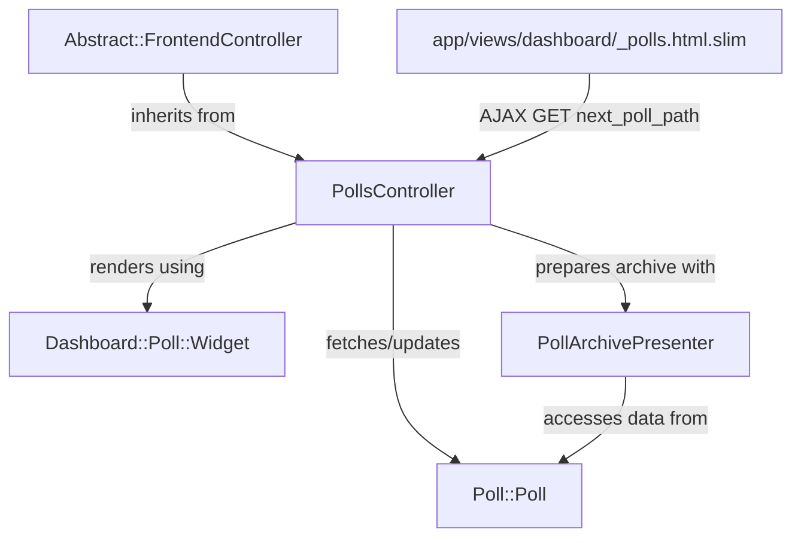
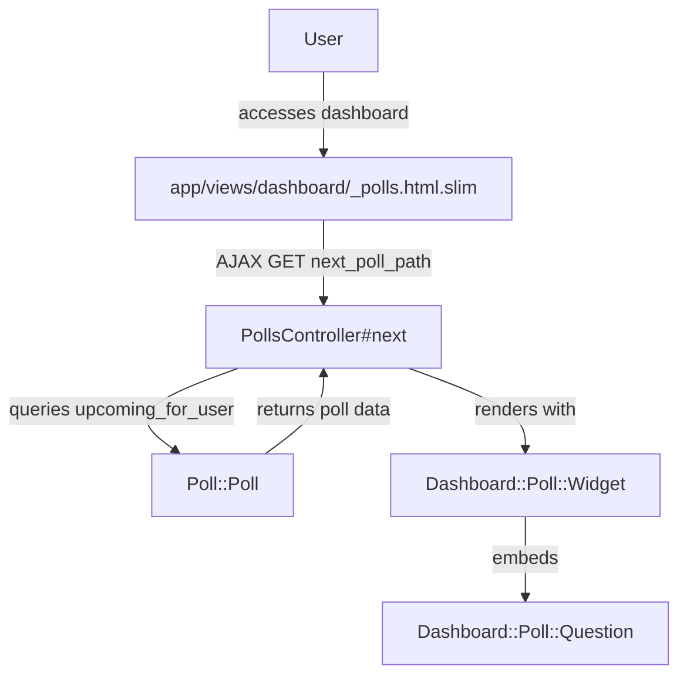
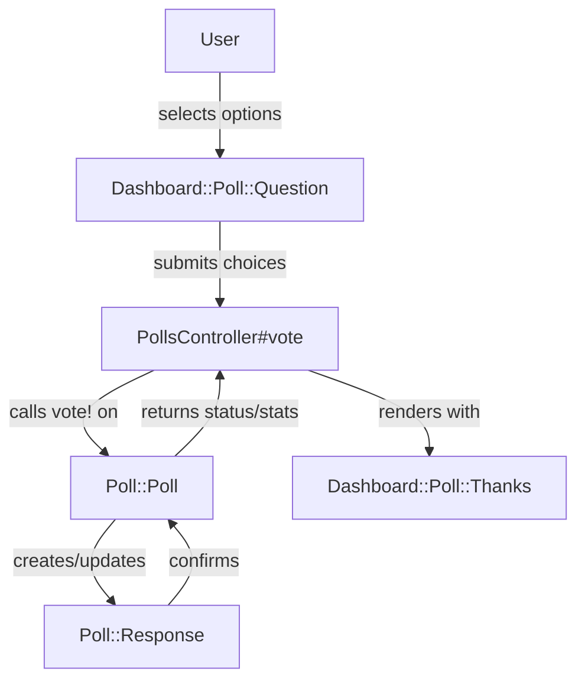
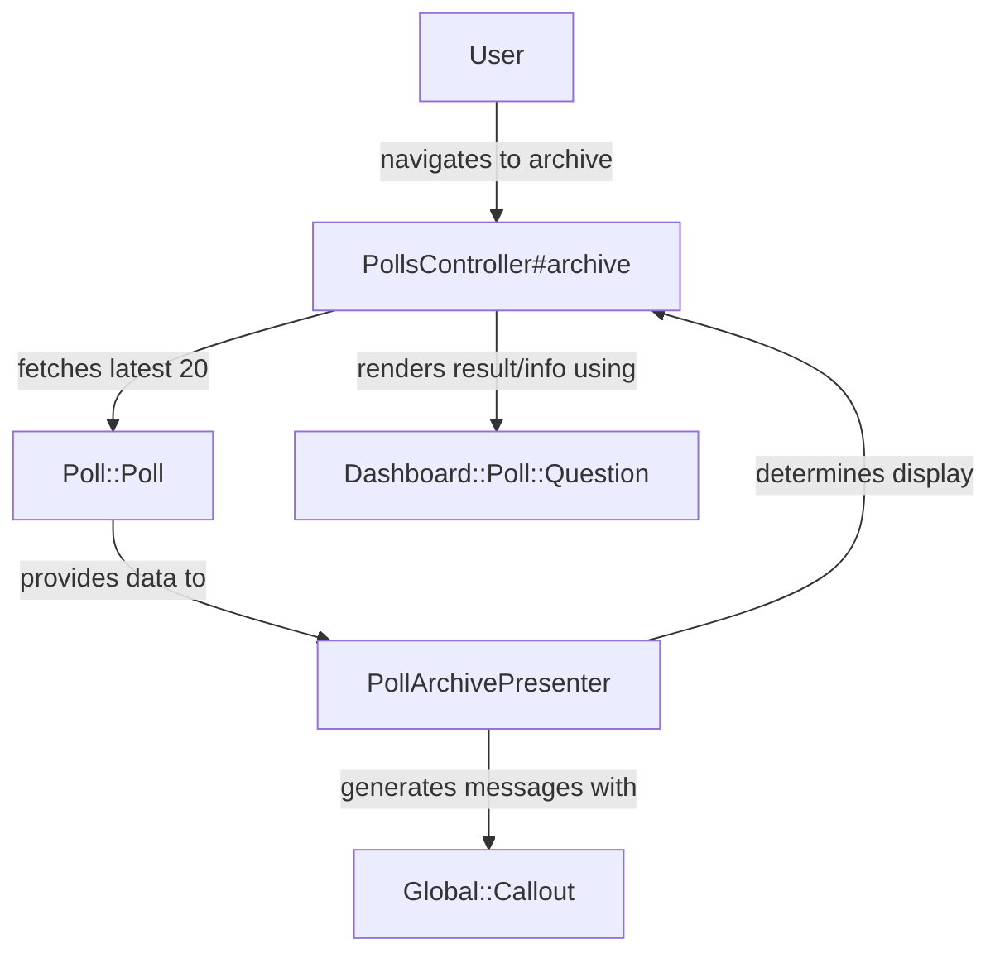
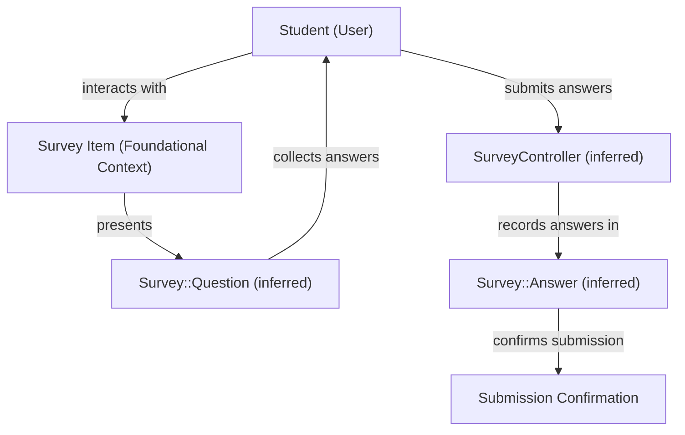

# Poll and Survey Creation and Response - Technical Documentation

*Generated on 9/18/2025 | Xikolo Knowledge Base*

---

## 📋 Executive Summary

This report details the architecture and operational workflows of the Xikolo 16_LEARN_PollsSurveys cluster, which governs the creation, display, and response mechanisms for polls and surveys. The system enables users to view upcoming polls, submit votes, and review historical poll data, including results. Key components include the `PollsController` orchestrating interactions with core data models like `Poll::Poll` and several `Dashboard::Poll` ViewComponents for rendering the user interface. The primary objective is to facilitate seamless user engagement with interactive learning elements by providing a robust and responsive polling infrastructure.

---

## 🏗️ Architecture Overview

The architecture of the 16_LEARN_PollsSurveys cluster is designed for a responsive user experience, primarily centered around a Ruby on Rails backend interacting with a client-side frontend. The `PollsController` acts as the central orchestrator for all poll-related requests, inheriting core functionalities from `Abstract::FrontendController` to ensure user authentication and cache control. Frontend integration is handled by the `app/views/dashboard/_polls.html.slim` partial, which initiates AJAX requests to dynamically load poll content. The system leverages `Poll::Poll`, `Poll::Option`, and `Poll::Response` as ActiveRecord models to manage poll data, choices, and user submissions respectively. For presentation, a suite of ViewComponents, including `Dashboard::Poll::Widget`, `Dashboard::Poll::Question`, and `Dashboard::Poll::Thanks`, are utilized to render various stages of the poll lifecycle, from voting interfaces to post-submission confirmations and results. The `PollArchivePresenter` plays a crucial role in preparing aggregated poll data for display in the archive, determining result visibility and generating contextual messages often using `Global::Callout`.

**Component Descriptions:**
*   **PollsController:** This Rails controller is responsible for handling all HTTP requests related to polls. It fetches polls, processes user votes via `poll.vote!`, and manages the display of poll archives, interacting extensively with `Poll::Poll` and rendering various `Dashboard::Poll` ViewComponents.
*   **Poll::Poll:** As the central ActiveRecord model, `Poll::Poll` defines the core structure of a poll, including its question, options, and associated responses. It encapsulates business logic for finding upcoming polls (`upcoming_for_user`), managing vote submissions (`vote!`), and determining when results should be revealed (`reveal_results?`). It `has many Poll::Option`s and `Poll::Response`s.
*   **app/views/dashboard/_polls.html.slim:** This Slim partial serves as the initial entry point for dynamic poll loading on the dashboard. It issues an AJAX `GET` request to `next_poll_path` and subsequently updates the `#polls` HTML element with the server's response.
*   **Dashboard::Poll::Widget:** A ViewComponent acting as the primary container for displaying poll content. It receives a `Poll::Poll` object and utilizes its `with_content` method to embed other ViewComponents, such as `Dashboard::Poll::Question` or `Dashboard::Poll::Thanks`.
*   **PollArchivePresenter:** This presenter class is specialized in preparing and formatting data for the poll archive view. It initializes with a `Poll::Poll` object and the `current_user`, delegating basic attributes to the poll and accessing methods like `ended?`, `reveal_results?`, and `response_for` to determine display logic. It also employs `Global::Callout` for informational messages.
*   **Abstract::FrontendController:** This is the base class from which `PollsController` inherits. It provides essential cross-cutting concerns for frontend controllers, such as `ensure_logged_in` to enforce user authentication and `set_no_cache_headers` for appropriate caching behavior. This ensures a consistent security and performance baseline for all user-facing interactions.

**Integration Points and Interactions:**
-   `PollsController` inherits from `Abstract::FrontendController` to leverage common frontend functionalities.
-   `app/views/dashboard/_polls.html.slim` initiates interaction by making an AJAX `GET` request to `PollsController#next`.
-   `PollsController` interacts extensively with `Poll::Poll` to fetch poll data, process votes, and determine poll status.
-   `Poll::Poll` is associated with `Poll::Option` (has many) and `Poll::Response` (has many), forming the core data structure.
-   `PollsController` renders `Dashboard::Poll::Widget` which in turn orchestrates `Dashboard::Poll::Question` (for voting/results) or `Dashboard::Poll::Thanks` (for post-vote). 
-   `PollArchivePresenter` initializes with a `Poll::Poll` object and `current_user`, accessing various methods of the `@poll` object and using `Global::Callout` to present relevant messages within the archive view.

### Architecture Diagrams

#### Main Architecture Diagram - Polls and Surveys

### 🔄 Component Interactions

Key interactions between components in this cluster:

- **PollsController:** Inherits from `Abstract::FrontendController`.
- **PollsController:** Interacts with `Poll::Poll` model to fetch, find, and process votes.
- **PollArchivePresenter:** Initializes with a `Poll::Poll` object and `current_user`.
- **PollArchivePresenter:** Delegates `id` and `question` to the `@poll` object.
- **app/views/dashboard/_polls.html.slim:** Makes an AJAX `GET` request to `next_poll_path`.
- **app/views/dashboard/_polls.html.slim:** Updates the `#polls` HTML element with the data received from the server.
- **Poll::Poll:** Has many `Poll::Option`s.
- **Poll::Poll:** Has many `Poll::Response`s.
- **Poll::Option:** Belongs to `Poll::Poll`.
- **Poll::Response:** Belongs to `Poll::Poll`.
- **Poll::Response:** Belongs to `User` (implicitly via `user_id`).
- **Dashboard::Poll::Widget:** Receives a `Poll::Poll` object.
- **Dashboard::Poll::Widget:** Uses `with_content` to embed other ViewComponents like `Dashboard::Poll::Question` or `Dashboard::Poll::Thanks`.
- **Dashboard::Poll::Question:** Receives a `Poll::Poll` object.
- **Dashboard::Poll::Question:** Can receive `stats` and `choices` parameters when displaying results.
- **Dashboard::Poll::Thanks:** Receives a `Poll::Poll` object.
- **Dashboard::Poll::Thanks:** Receives `choices` (user's selections), `stats` (if results are revealed), and `next_poll` status.
- **Abstract::FrontendController:** Parent class for `PollsController`.
- **Abstract::FrontendController:** Provides `ensure_logged_in` and `set_no_cache_headers` before actions.
- **Global::Callout:** Used by `PollArchivePresenter` to display messages regarding poll status or voting requirements.

---

## ⚙️ Technical Workflows

### 1. View Next Available Poll
When a user accesses the dashboard, the system initiates an asynchronous request to retrieve and display the most relevant, unvoted, and active poll. This process begins with client-side JavaScript triggering a GET request to a specific endpoint. Upon receipt, the backend controller queries the `Poll::Poll` model to identify an eligible poll for the `current_user`. If a poll is found, the controller marshals the poll data and renders it using a structured `ViewComponent` hierarchy. This typically involves a wrapper component that then embeds a question component to present the poll to the user. Should no upcoming poll be available, the system responds with a 'no content' status, ensuring a graceful handling of empty states without rendering superfluous UI.

### 2. Vote on a Poll
The voting workflow encompasses a user's interaction with an active poll and the system's subsequent processing of their selection. After a poll is displayed, the user selects their desired options. This selection is then submitted via an HTTP POST request to the `PollsController`. The controller receives these choices along with the poll's identifier and the `current_user.id`. It then invokes the `vote!` method on the corresponding `Poll::Poll` object, which in turn creates or updates a `Poll::Response` record, linking the user's choices to the specific poll. Following the successful recording of the vote, the system determines if there's another poll available and whether the results of the just-voted poll should be revealed immediately. Finally, a `Dashboard::Poll::Thanks` ViewComponent is rendered, providing confirmation of the vote and potentially displaying immediate results or a prompt for the next poll.

### 3. View Poll Archive and Results
Users wishing to review past polls and their outcomes access a dedicated archive. This action is handled by the `PollsController#archive`, which retrieves a predefined number (e.g., 20 latest started) of `Poll::Poll` records, including their associated `Poll::Option`s. Each retrieved poll is then passed to a `PollArchivePresenter`. This presenter is crucial for encapsulating the logic to determine how each poll should be displayed within the archive. It evaluates several factors, such as whether the poll has `ended?`, if the `current_user` has `voted?`, and if `poll.reveal_results?`. Based on these conditions, the presenter decides whether to render actual results using `Dashboard::Poll::Question.results` or to display informative messages, often through a `Global::Callout` component, indicating reasons such as the poll not having ended, or results not being available due to insufficient participants.

### 4. Take a Survey (Conceptual)
While the provided cluster data primarily details poll functionality, the conceptual workflow for taking a survey, as indicated in the broader RAG context, describes a similar interaction pattern. A student encounters a 'survey item' within a course, which is likely a distinct 'Item' in the platform's foundational context, possibly with an associated `Survey` model. This item would present questions, possibly managed by an inferred `Question` model, and corresponding answer choices. The student would select their answers and submit them. This submission would then be processed, likely by an inferred `SurveyController`, to record the responses, perhaps in an `Answer` model. The workflow suggests a shared high-level user experience flow with polls, despite utilizing separate underlying models and components specific to the survey domain, and respecting item-specific attributes such as deadlines.

### Workflow Diagrams

#### Workflow: View Next Available Poll

#### Workflow: Vote on a Poll

#### Workflow: View Poll Archive and Results

#### Workflow: Take a Survey (Conceptual)

### 🔀 Process Workflows

Detailed workflow processes for this cluster:

- **PollsController Process:** Interacts with `Poll::Poll` model to fetch, find, and process votes.
  *Source: PollsController*
- **The `take_survey.feature` documentation [Source: RAG: integration/features/xikolo/content/quiz/take_survey.feature] describes a similar user interaction pattern for surveys, involving selecting answers and submitting. While the provided code specifically implements `Poll` functionality, the conceptual workflow of taking a survey (as an 'item' with a deadline) suggests that polls and surveys might share underlying architectural patterns or user experience flows, even if implemented with distinct models (e.g., `Survey` vs. `Poll::Poll`). The RAG context mentions a 'survey item with questions and answers' and 'item deadline', indicating that surveys are likely integrated into the broader `Item` concept within the Xikolo platform, similar to how quizzes are handled.:** The `take_survey.feature` documentation  describes a similar user interaction pattern for surveys, involving selecting answers and submitting. While the provided code specifically implements `Poll` fu...
  *Source: documentation*

---

## 🔧 Implementation Details

**Technical Considerations:**
*   **Frontend Data Loading:** The `app/views/dashboard/_polls.html.slim` partial employs direct jQuery `$.get` for AJAX requests and straightforward DOM manipulation (`$('#polls').html(data)`) to load poll content. As indicated in the cluster data, this approach, while functional, contrasts with modern frontend practices like using dedicated `ViewComponent`s or React, which are also leveraged elsewhere in the project. This suggests a potential area for refactoring to enhance maintainability and consistency with the overall frontend architecture.
*   **Model-View-Controller Separation:** The `PollsController` effectively separates concerns by delegating business logic to the `Poll::Poll` model (e.g., `upcoming_for_user`, `vote!`) and presentation logic to `ViewComponent`s and `PollArchivePresenter`. This adheres to the MVC pattern by keeping the controller focused on request handling and response generation.
*   **Presenter Pattern Usage:** The `PollArchivePresenter` exemplifies the presenter pattern by encapsulating complex display logic for archive polls. It abstracts away conditional rendering of results, voting status, and localized messages from the view, promoting cleaner, more testable code in `PollsController` and the views.

**Dependencies and Integrations:**
*   **`PollsController` with `Abstract::FrontendController`:** `PollsController` explicitly `inherits from Abstract::FrontendController`. This integration provides foundational functionalities such as `before_action :ensure_logged_in` and `before_action :set_no_cache_headers`, ensuring consistent user authentication and HTTP caching strategies across frontend-facing controllers. This reduces boilerplate and centralizes security/performance best practices.
*   **`Poll::Poll` Model Associations:** The `Poll::Poll` model `has many Poll::Option`s and `has many Poll::Response`s. This ActiveRecord association defines the core relationships within the poll data structure, allowing a poll to comprise multiple selectable options and record multiple user responses.
*   **ViewComponent Integration:** `PollsController` directly renders `Dashboard::Poll::Widget`, which then uses `with_content` to embed `Dashboard::Poll::Question` (for voting/results) or `Dashboard::Poll::Thanks` (for post-vote confirmation). This compositional approach with ViewComponents promotes reusability and modularity in the UI layer.
*   **`PollArchivePresenter` with `Global::Callout`:** `PollArchivePresenter` utilizes `Global::Callout` to display dynamic informational messages to the user within the poll archive. This integration allows for standardized, visually consistent alerts or status updates without reimplementing the UI element each time.
*   **`Poll::Response` with `User`:** `Poll::Response` `belongs to User` (implicitly via `user_id`), and validates `user_id` uniqueness per poll. This interaction ensures that each user can submit only one response per poll, and responses are correctly attributed to the responding user.

**Configuration Requirements:**
*   Configuration requirements are not explicitly specified in the cluster data, however, the reliance on `I18n.t` within `PollArchivePresenter` and `Dashboard::Poll::Thanks` suggests that localization files (`.yml` files for `polls.archive` and `polls.widget`) are required for internationalization and proper message display. The database schema for `Poll::Poll`, `Poll::Option`, and `Poll::Response` models, as well as the `User` model, must also be correctly configured and migrated to support the defined attributes and associations (e.g., `question`, `start_at`, `end_at`, `text`, `position`, `choices`, `user_id`, `poll_id`).

### 📚 Technical Sources & References

Key technical documentation and source references:

- PollsController: app/controllers/polls_controller.rb- PollArchivePresenter: app/presenters/poll_archive_presenter.rb- app/views/dashboard/_polls.html.slim: app/views/dashboard/_polls.html.slim- Poll::Poll: app/controllers/polls_controller.rb- Poll::Poll: app/presenters/poll_archive_presenter.rb- Poll::Option: app/controllers/polls_controller.rb- Poll::Response: app/controllers/polls_controller.rb- Poll::Response: app/presenters/poll_archive_presenter.rb- Dashboard::Poll::Widget: app/controllers/polls_controller.rb- Dashboard::Poll::Question: app/controllers/polls_controller.rb- Dashboard::Poll::Question: app/presenters/poll_archive_presenter.rb- Dashboard::Poll::Thanks: app/controllers/polls_controller.rb- Abstract::FrontendController: app/controllers/polls_controller.rb- Global::Callout: app/presenters/poll_archive_presenter.rb- Configuration: config/application.rb, Gemfile, config/database.yml- Process Management: Procfile, Procfile.web- Build & Deploy: Rakefile, package.json

---

*This documentation is automatically generated from cluster analysis and should be validated against the actual codebase.*
