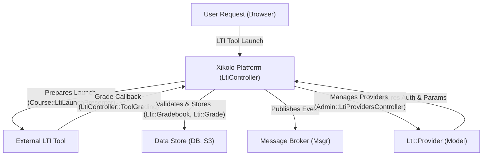
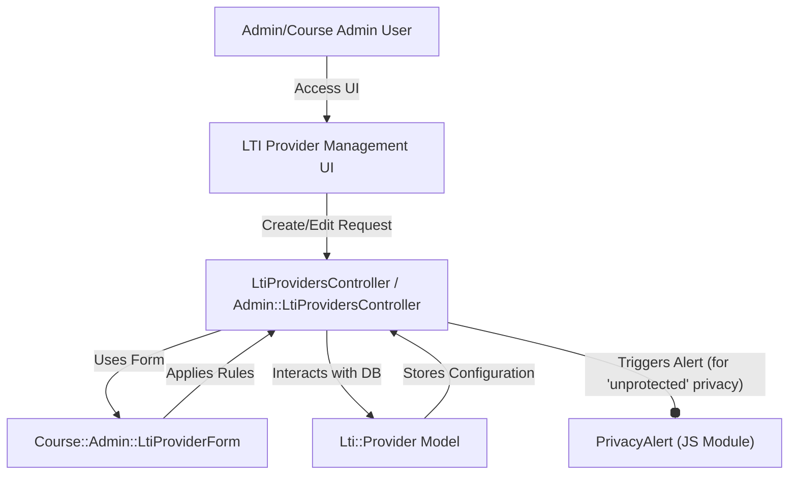
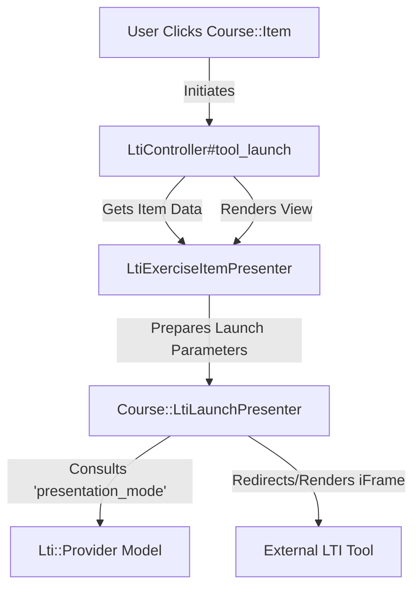
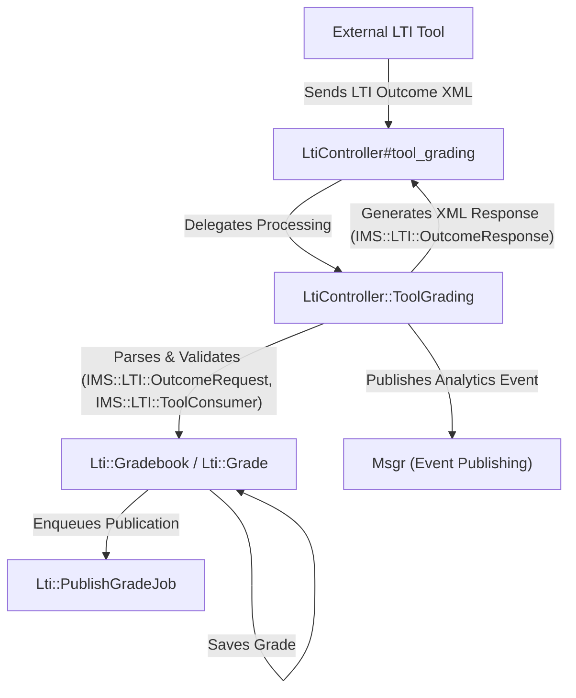
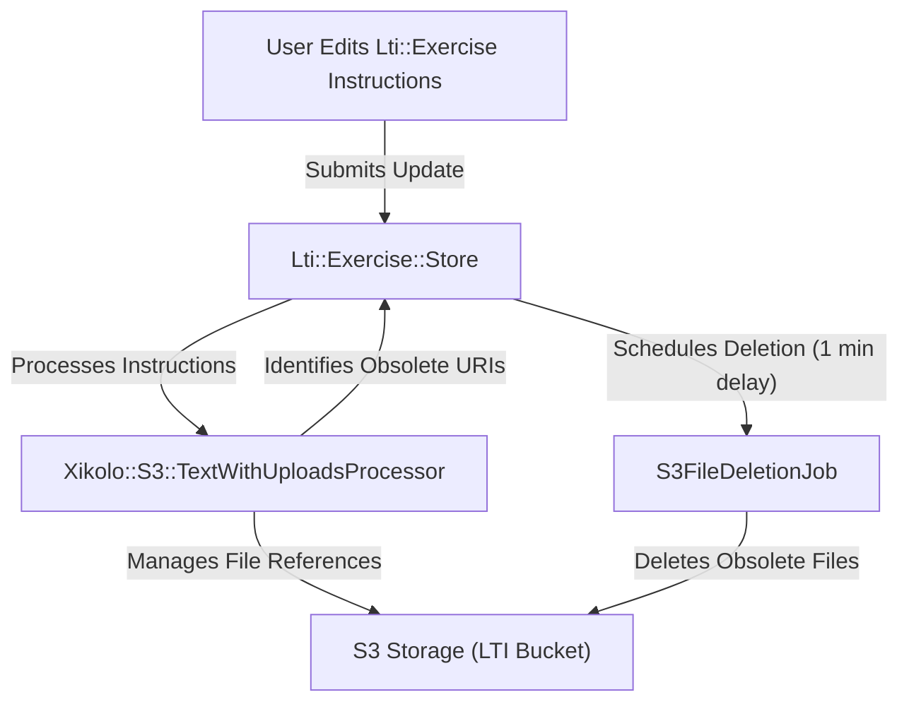

# Learning Tools Interoperability (LTI) Provider and Consumer Functionality - Technical Documentation

*Generated on 9/18/2025 | Xikolo Knowledge Base*

---

## 📋 Executive Summary

This report details the Xikolo platform's Learning Tools Interoperability (LTI) integration, specifically focusing on cluster 17_LEARN_LTIIntegration, which enables both LTI consumer capabilities for integrating external tools and a robust system for managing LTI tool providers. The primary purpose is to outline the architecture, operational workflows, and technical underpinnings that facilitate secure and efficient interaction with third-party educational services. Key components include specialized controllers for provider management, a dedicated LTI controller for handling launches and grade callbacks, and background jobs for grade publishing and content management. The scope covers the full lifecycle from provider configuration and LTI exercise creation to grade submission, processing, and event publishing, ensuring a seamless and extensible learning environment.

---

## 🏗️ Architecture Overview

The LTI integration architecture for Xikolo cluster 17_LEARN_LTIIntegration is designed to manage LTI provider configurations, facilitate secure LTI tool launches, and process grading outcomes from external learning tools. At its core, the system distinguishes between administrative and course-specific LTI provider management, handled by `Admin::LtiProvidersController` and `LtiProvidersController`, respectively. These controllers interact directly with the `Lti::Provider` model to perform CRUD operations, securing access via defined permissions like `lti.provider.manage`. User-facing LTI interactions, such as launching an LTI exercise (`Course::Item`), are managed by the `LtiController` in conjunction with `Course::LtiLaunchPresenter` for preparing launch data. Grade submissions from external tools are routed to `LtiController::ToolGrading`, a nested service object, which validates incoming requests using `IMS::LTI::OutcomeRequest` and `IMS::LTI::ToolConsumer` with credentials from `Lti::Provider`. Successful grading events trigger updates to `Lti::Gradebook` and `Lti::Grade` models, and events are published via `Msgr` for analytics. Furthermore, `Lti::Exercise::Store` manages LTI exercise content, including instructions with S3 file references, leveraging `Xikolo::S3::TextWithUploadsProcessor` and `S3FileDeletionJob` for robust file management. This modular structure ensures scalability and secure interoperability.

### Architecture Diagrams

#### Main LTI Integration Architecture

### 🔄 Component Interactions

Key interactions between components in this cluster:

- **Admin::LtiProvidersController:** Inherits from `Admin::BaseController` for base administrative functionality.
- **Admin::LtiProvidersController:** Requires `lti.provider.manage` permission for access [Source: app/controllers/admin/lti_providers_controller.rb, RAG: services/account/lib/tasks/permissions/lti.yml].
- **LtiController:** Receives LTI launch requests (`tool_launch`) and prepares data using `Course::LtiLaunchPresenter`.
- **LtiController:** Receives LTI outcome requests (`tool_grading`) and delegates processing to the nested `ToolGrading` class.
- **LtiController::ToolGrading:** Parses incoming LTI XML using `IMS::LTI::OutcomeRequest`.
- **LtiController::ToolGrading:** Verifies LTI OAuth 1.0a signatures and session validity using `IMS::LTI::ToolConsumer`.
- **LtiProvidersController:** Interacts with the `Lti::Provider` model for all database operations.
- **LtiProvidersController:** Uses `CourseContextHelper` to establish the course context.
- **Course::Admin::LtiProviderForm:** Used by `LtiProvidersController` to handle form submissions and apply validations.
- **Course::Admin::LtiProviderForm:** Defines attributes like `name`, `domain`, `consumer_key`, `shared_secret`, `presentation_mode`, `privacy`, and `custom_fields`.
- **Lti::PublishGradeJob:** Finds an `Lti::Grade` record by ID.
- **Lti::PublishGradeJob:** Calls the `publish!` method on the `Lti::Grade` instance (method implementation not provided in context).
- **Lti::Exercise::Store:** Updates attributes of an `Lti::Exercise` model.
- **Lti::Exercise::Store:** Uses `Xikolo::S3::TextWithUploadsProcessor` to parse and manage S3 file references within the exercise instructions.
- **LtiExerciseItemPresenter:** Inherits from `ItemPresenter` and includes `MarkdownHelper` for rendering instructions.
- **LtiExerciseItemPresenter:** Interacts with `Lti::Exercise` to get exercise details and `Lti::Gradebook` to retrieve user-specific grades.
- **Lti::Provider:** Created, read, updated, and deleted by `LtiProvidersController`.
- **Lti::Provider:** Provides `consumer_key` and `shared_secret` for LTI OAuth 1.0a signature verification in `ToolGrading`.
- **Lti::Exercise:** Associated with `Course::Item` as its content.
- **Lti::Exercise:** Managed by `Lti::Exercise::Store` for creation and updates, especially for `instructions`.
- **Lti::Gradebook:** Found by `ToolGrading` using the `lis_result_sourcedid` from LTI outcome requests.
- **Lti::Gradebook:** Stores `user_id` and `lti_exercise_id`.
- **Lti::Grade:** Created or updated by `Lti::Gradebook#submit!`.
- **Lti::Grade:** Referenced by `LtiExerciseItemPresenter` to display user scores.
- **Course::Item:** Found by `LtiController#tool_launch` using its UUID to initiate an LTI launch [Source: app/controllers/lti_controller.rb].
- **Course::Item:** Passed to `LtiExerciseItemPresenter` for rendering and data preparation [Source: app/presenters/lti_exercise_item_presenter.rb].
- **Course::Course:** Used by `LtiController` to retrieve the course context (`course.context_id`) and find courses by identifier (`Course::Course.by_identifier`) [Source: app/controllers/lti_controller.rb].
- **Course::Course:** Used by `LtiProvidersController` to scope LTI providers to a specific course (`course_id: the_course.id`) [Source: app/controllers/lti_providers_controller.rb].
- **Xikolo::S3::TextWithUploadsProcessor:** Instantiated by `Lti::Exercise::Store` to handle the `instructions` field of an `Lti::Exercise` [Source: app/operations/lti/exercise/store.rb].
- **Xikolo::S3::TextWithUploadsProcessor:** Configured with `bucket`, `purpose`, `current` text, `text` input, and `valid_refs` [Source: app/operations/lti/exercise/store.rb].
- **S3FileDeletionJob:** Scheduled by `Lti::Exercise::Store` to delete obsolete S3 files associated with LTI exercise instructions. The job is set to wait for 1 minute before performing [Source: app/operations/lti/exercise/store.rb].
- **Msgr:** Used by `LtiController::ToolGrading` to publish LTI submission events to the `xikolo.web.exp_event.create` topic [Source: app/controllers/lti_controller.rb].
- **IMS::LTI::OutcomeRequest:** Used by `LtiController::ToolGrading` to parse the raw HTTP request into a structured LTI outcome request object (`IMS::LTI::OutcomeRequest.from_post_request(request)`) [Source: app/controllers/lti_controller.rb].
- **IMS::LTI::OutcomeRequest:** Provides access to request parameters like `lis_result_sourcedid` (grading ID), `score`, `message_identifier`, and `operation` [Source: app/controllers/lti_controller.rb].
- **IMS::LTI::ToolConsumer:** Instantiated by `LtiController::ToolGrading` with the `Lti::Provider`'s `consumer_key` and `shared_secret` [Source: app/controllers/lti_controller.rb].
- **IMS::LTI::ToolConsumer:** Used to validate the authenticity of incoming LTI requests via `consumer.valid_request? @request` [Source: app/controllers/lti_controller.rb].
- **IMS::LTI::OutcomeResponse:** Instantiated by `LtiController::ToolGrading` to build the response XML [Source: app/controllers/lti_controller.rb].
- **IMS::LTI::OutcomeResponse:** Configured with `message_ref_identifier`, `operation`, `severity`, `code_major` (e.g., 'success', 'failure', 'unsupported'), based on the processing outcome [Source: app/controllers/lti_controller.rb].
- **PrivacyAlert:** Interacts with the DOM to find privacy radio buttons.
- **PrivacyAlert:** Uses `swal` (SweetAlert2) to display a confirmation dialog.
- **LtiProvidersIndex:** Interacts with the DOM to toggle visibility of 'add new provider' and 'edit provider' forms.
- **LtiProvidersIndex:** Attaches event listeners to buttons and links for form manipulation.
- **Course::LtiLaunchPresenter:** Initializes with a `Course::Item` and `User`.
- **Course::LtiLaunchPresenter:** Delegates to `item.content.launch_for(user)` to retrieve LTI launch details.

---

## ⚙️ Technical Workflows

### 1. LTI Provider Configuration Workflow
Administrators initiate this workflow to establish or modify LTI tool providers, either globally or within a specific course context. For global providers, the `Admin::LtiProvidersController` facilitates standard CRUD operations on `Lti::Provider` records, with access controlled by the `lti.provider.manage` permission. When creating or updating a provider, the `Course::Admin::LtiProviderForm` is used to define and validate crucial attributes like name, domain, consumer key, and shared secret. Frontend components like `LtiProvidersIndex` manage the display of provider lists and forms, while `PrivacyAlert` ensures that privacy settings, especially 'unprotected' data sharing, are confirmed by the administrator. Course-specific providers follow a similar flow via `LtiProvidersController`, which uses `CourseContextHelper` to scope providers to a `Course::Course` instance and requires `lti.provider.edit_privacy_mode` for altering privacy settings. Both controllers leverage strong parameter filtering to secure data integrity.

### 2. LTI Tool Launch Workflow
This workflow describes how a user initiates an interaction with an external LTI tool from within the Xikolo platform. When a user clicks on a `Course::Item` that is configured as an LTI exercise, the `LtiController#tool_launch` action is invoked. The `Course::LtiLaunchPresenter` is instantiated with the `Course::Item` and `current_user` to prepare the necessary LTI launch parameters. This presenter also determines the appropriate display method—either an introductory page with a launch button or an embedded iframe—based on the `Lti::Provider`'s `presentation_mode` and the user's interaction state. The system then generates an HTML form with the LTI launch data, which is submitted to the external LTI tool. The `LtiExerciseItemPresenter` further enriches the display by retrieving exercise details from `Lti::Exercise` and user-specific grades from `Lti::Gradebook` and `Lti::Grade`, allowing for dynamic rendering of instructions and performance metrics.

### 3. LTI Grade Submission and Processing Workflow
This workflow covers the reception and processing of grade outcomes sent by external LTI tools back to the Xikolo platform. External LTI tools send grading results to the `LtiController#tool_grading` endpoint, which is configured to bypass CSRF and authentication middleware for backend-to-backend communication. The core processing logic resides within `LtiController::ToolGrading`. This nested service object first parses the incoming LTI XML request using `IMS::LTI::OutcomeRequest`, extracting parameters like `lis_result_sourcedid` and `score`. It then validates the LTI OAuth 1.0a signature and session validity using `IMS::LTI::ToolConsumer` and the `Lti::Provider`'s `consumer_key` and `shared_secret`. Upon successful validation, the service submits the received score to the `Lti::Gradebook`, creating or updating an `Lti::Grade` record. An LTI submission event containing `course_id`, `score`, and `provider_name` is published to the `xikolo.web.exp_event.create` topic via `Msgr`. Finally, an XML response is generated using `IMS::LTI::OutcomeResponse` to acknowledge the grading operation back to the external tool.

### 4. LTI Exercise Content Management Workflow
This workflow details how the rich text content, specifically `instructions`, for `Lti::Exercise` objects is managed, particularly when it includes embedded file uploads. The `Lti::Exercise::Store` operation is responsible for this process. When `instructions` are provided, this operation instantiates `Xikolo::S3::TextWithUploadsProcessor` to handle the text and its associated S3 file references. The processor is configured with specific S3 parameters such as the `bucket` (`:lti`), `purpose` ('lti_exercise_instructions'), and access control (`ACL: :public_read`). It manages existing valid references and defines a callback for new uploads to determine their S3 keys, cache control, and content types. After processing, if any files become obsolete (no longer referenced in the updated instructions), `S3FileDeletionJob` is enqueued with a 1-minute delay. This delay provides fault tolerance, ensuring that client-side pages referencing old files have sufficient time to load before the files are permanently removed from S3.

### Workflow Diagrams

#### LTI Provider Management Workflow

#### LTI Tool Launch Workflow

#### LTI Grade Submission and Processing Workflow

#### LTI Exercise Content Management Workflow

### 🔀 Process Workflows

Detailed workflow processes for this cluster:

- **LtiController Process:** Receives LTI outcome requests (`tool_grading`) and delegates processing to the nested `ToolGrading` class.
  *Source: LtiController*
- **Lti::Exercise::Store Process:** Uses `Xikolo::S3::TextWithUploadsProcessor` to parse and manage S3 file references within the exercise instructions.
  *Source: Lti::Exercise::Store*
- **Lti::Grade Process:** Processed by `Lti::PublishGradeJob` to update course progress.
  *Source: Lti::Grade*
- **IMS::LTI::OutcomeResponse Process:** Configured with `message_ref_identifier`, `operation`, `severity`, `code_major` (e.g., 'success', 'failure', 'unsupported'), based on the processing outcome .
  *Source: IMS::LTI::OutcomeResponse*

---

## 🔧 Implementation Details

### Technical Considerations
The LTI integration in Xikolo exhibits several technical considerations. The `LtiController::ToolGrading` class, while nested, carries substantial logic, and its extraction into a dedicated service object (`Lti::ToolGradingService`) is identified as technical debt, aiming for better modularity and testability. Hardcoded constants within `ToolGrading`, such as `MAXIMUM_SESSION_AGE` and `SCORE_REGEXP`, are noted as areas for improvement through externalized configuration. A current limitation is the unavailability of the `user_agent` for backend LTI submission requests, leading to a gap in analytics data. The client-side privacy alert for LTI Providers, handled by `PrivacyAlert`, uses `swal` (SweetAlert2) and `I18n` for localized confirmation dialogues when 'unprotected' privacy is selected. The `Lti::Exercise::Store` implements a delayed deletion of S3 files for obsolete instruction references (1-minute delay via `S3FileDeletionJob`), which, while fault-tolerant, requires careful management to prevent race conditions during rapid content updates.

### Dependencies and Integrations
The core LTI functionality relies on several key dependencies and integrations. The `Admin::LtiProvidersController` and `LtiProvidersController` depend on the `Lti::Provider` model for all CRUD operations, and `Admin::BaseController` and `Abstract::FrontendController` for base functionality. Permission checks integrate with the account service via `lti.provider.manage` and `lti.provider.edit_privacy_mode` permissions. `LtiController` integrates with `Course::Item` and `Course::Course` for context, delegating LTI launch data preparation to `Course::LtiLaunchPresenter`. For grade processing, `LtiController::ToolGrading` critically depends on `IMS::LTI::OutcomeRequest` for parsing incoming XML, `IMS::LTI::ToolConsumer` for OAuth 1.0a signature verification using `Lti::Provider` credentials, and `IMS::LTI::OutcomeResponse` for generating XML acknowledgments. It also integrates with `Lti::Gradebook` to find and update grade entries and with `Msgr` to publish submission events to RabbitMQ (`xikolo.web.exp_event.create`). `Lti::PublishGradeJob` depends on `Lti::Grade` and is expected to integrate with the Xikolo `CourseService` API for final grade publication (`Xikolo.api(:course).value!.rel(:result).put`). Content management for LTI exercises in `Lti::Exercise::Store` integrates with `Xikolo::S3::TextWithUploadsProcessor` for S3 file handling and schedules `S3FileDeletionJob` for cleanup.

### Configuration Requirements
Configuration requirements are primarily derived from LTI Provider settings and S3 parameters. LTI Providers, managed through `Course::Admin::LtiProviderForm`, require configuration of `name`, `domain`, `consumer_key`, `shared_secret`, `presentation_mode` (default 'window'), `privacy` (default 'anonymized'), and `custom_fields`. The `privacy` setting, which determines user data sharing, is sensitive and requires `lti.provider.edit_privacy_mode` permission to alter in course-specific contexts, and triggers a confirmation alert for 'unprotected' mode. For LTI exercise instructions that contain file uploads, `Lti::Exercise::Store` configures `Xikolo::S3::TextWithUploadsProcessor` with explicit S3 parameters: `bucket: :lti`, `purpose: 'lti_exercise_instructions'`. New S3 uploads are given `ACL: :public_read`, `Cache-Control: 'max-age=2592000, public'`, and `Content-Disposition: 'inline'`. `LtiController`'s `tool_grading` endpoint is configured to `skip_before_action :verify_authenticity_token` and `skip_around_action :auth_middleware` to accommodate external LTI 1.x callback requirements. Specific to grading, `IMS::LTI::ToolConsumer` relies on `consumer_key` and `shared_secret` from `Lti::Provider` for OAuth validation.

### 📚 Technical Sources & References

Key technical documentation and source references:

- Admin::LtiProvidersController: app/controllers/admin/lti_providers_controller.rb- Admin::LtiProvidersController: RAG: services/account/lib/tasks/permissions/lti.yml- LtiController: app/controllers/lti_controller.rb- LtiController: spec/controllers/lti_controller_spec.rb- LtiController::ToolGrading: app/controllers/lti_controller.rb- LtiController::ToolGrading: spec/controllers/lti_controller_spec.rb- LtiProvidersController: app/controllers/lti_providers_controller.rb- LtiProvidersController: spec/controllers/lti_providers_controller_spec.rb- Course::Admin::LtiProviderForm: app/forms/course/admin/lti_provider_form.rb- Lti::PublishGradeJob: app/jobs/lti/publish_grade_job.rb- Lti::Exercise::Store: app/operations/lti/exercise/store.rb- Lti::Exercise::Store: spec/operations/lti/exercise/store_spec.rb- LtiExerciseItemPresenter: app/presenters/lti_exercise_item_presenter.rb- LtiExerciseItemPresenter: spec/presenters/lti_exercise_item_presenter_spec.rb- Lti::Provider: app/controllers/lti_providers_controller.rb- Lti::Provider: app/forms/course/admin/lti_provider_form.rb- Lti::Exercise: app/operations/lti/exercise/store.rb- Lti::Exercise: app/presenters/lti_exercise_item_presenter.rb- Lti::Gradebook: app/controllers/lti_controller.rb- Lti::Gradebook: spec/controllers/lti_controller_spec.rb- Lti::Grade: app/jobs/lti/publish_grade_job.rb- Lti::Grade: app/presenters/lti_exercise_item_presenter.rb- Course::Item: app/controllers/lti_controller.rb- Course::Item: app/presenters/lti_exercise_item_presenter.rb- Course::Course: app/controllers/lti_controller.rb- Course::Course: app/controllers/lti_providers_controller.rb- Xikolo::S3::TextWithUploadsProcessor: app/operations/lti/exercise/store.rb- S3FileDeletionJob: app/operations/lti/exercise/store.rb- Msgr: app/controllers/lti_controller.rb- IMS::LTI::OutcomeRequest: app/controllers/lti_controller.rb- IMS::LTI::ToolConsumer: app/controllers/lti_controller.rb- IMS::LTI::OutcomeResponse: app/controllers/lti_controller.rb- PrivacyAlert: app/assets/admin/lti_providers/privacy-alert.js- LtiProvidersIndex: app/assets/teacher/lti-providers/index.js- Course::LtiLaunchPresenter: app/presenters/course/lti_launch_presenter.rb- Course::LtiLaunchPresenter: spec/controllers/lti_controller_spec.rb- Configuration: config/application.rb, Gemfile, config/database.yml- Process Management: Procfile, Procfile.web- Build & Deploy: Rakefile, package.json

---

*This documentation is automatically generated from cluster analysis and should be validated against the actual codebase.*
