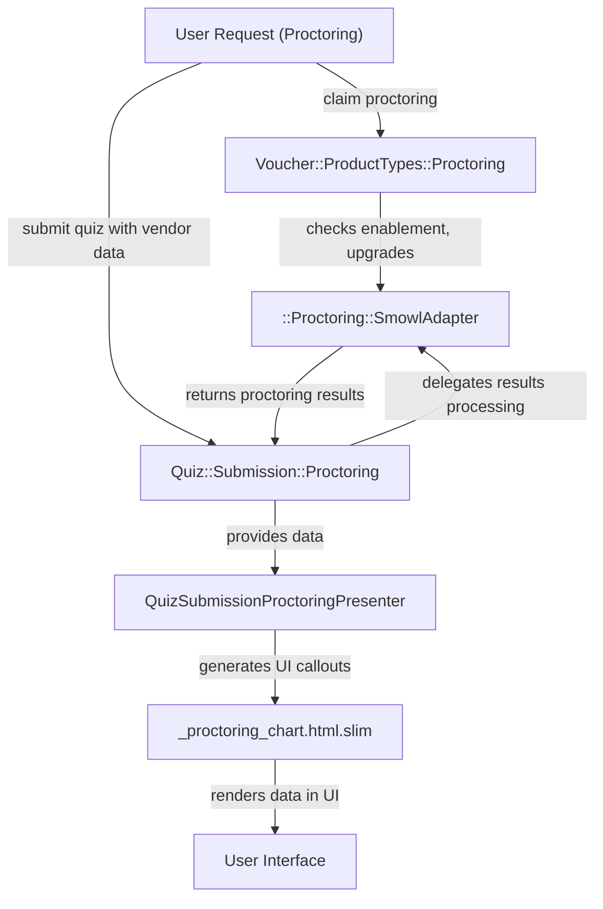
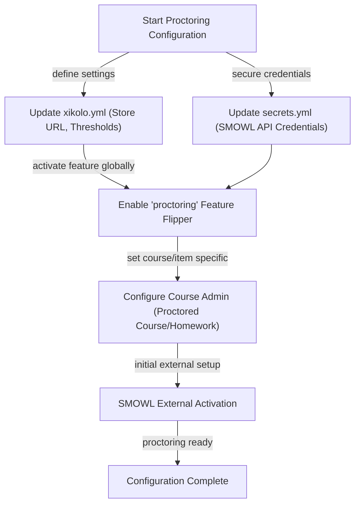
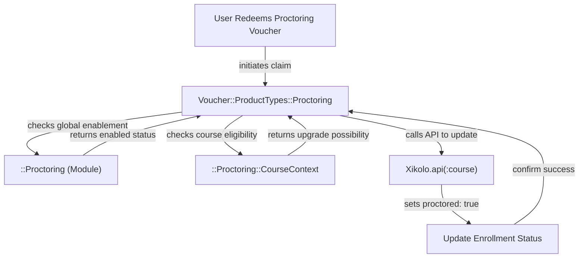
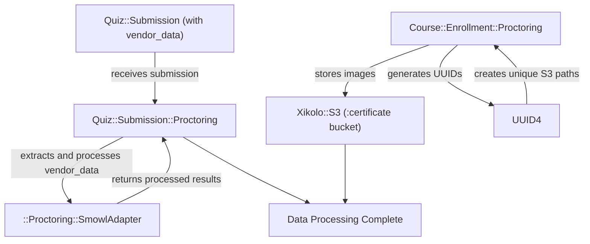
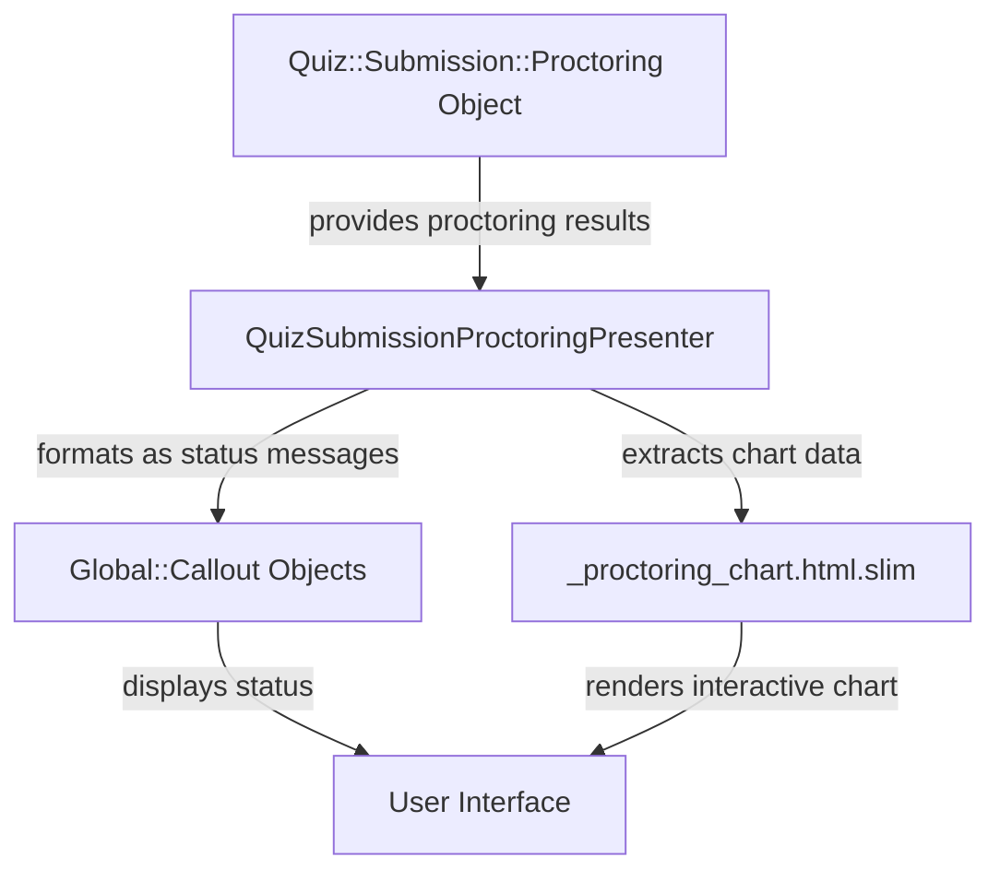

# Online Proctoring Integration for Quizzes and Exams - Technical Documentation

*Generated on 9/18/2025 | Xikolo Knowledge Base*

---

## 📋 Executive Summary

This report details the architecture and operational workflows of the Xikolo 18_LEARN_Proctoring cluster, which implements an online proctoring integration using the SMOWL solution for quizzes and exams. The primary purpose is to manage proctored enrollment status, process real-time proctoring results, and display these outcomes to users. Key components include models for handling enrollment and submission data, a service object for voucher-based proctoring activation, and presenters/views for rendering proctoring statistics. It is critical to note that this entire feature is explicitly marked as deprecated and is scheduled for removal from the platform.

---

## 🏗️ Architecture Overview

The Xikolo proctoring architecture is centered around several core components that manage the lifecycle of proctored activities, from configuration and user enrollment to data processing and result presentation. At its heart, the system integrates with the external SMOWL solution via a dedicated adapter, processing various states and outcomes. While broad, the system primarily involves backend logic for data handling and frontend components for visualization, all built upon existing Xikolo platform services like S3 for storage and a course microservice for enrollment updates. This section provides a high-level overview of the most impactful components and their interactions within this deprecated feature.

### Architecture Diagrams

#### Main Proctoring Architecture Overview

### 🔄 Component Interactions

Key interactions between components in this cluster:

- **Course::Enrollment::Proctoring:** Interacts with `UUID4` for generating unique identifiers [Source: app/models/course/enrollment/proctoring.rb].
- **Course::Enrollment::Proctoring:** Interacts with `Xikolo::S3` to access the `:certificate` bucket [Source: app/models/course/enrollment/proctoring.rb].
- **Quiz::Submission::Proctoring:** Initializes with a `Quiz::Submission` object [Source: app/models/quiz/submission/proctoring.rb].
- **Quiz::Submission::Proctoring:** Interacts with an implied `::Proctoring::SmowlAdapter` to get and interpret proctoring results from `vendor_data` [Source: app/models/quiz/submission/proctoring.rb].
- **Voucher::ProductTypes::Proctoring:** Checks global proctoring enablement via `::Proctoring.enabled?` [Source: app/models/voucher/product_types/proctoring.rb].
- **Voucher::ProductTypes::Proctoring:** Checks course-specific proctoring enablement via `course.proctored?` [Source: app/models/voucher/product_types/proctoring.rb].
- **QuizSubmissionProctoringPresenter:** Initializes with a `Quiz::Submission::Proctoring` object [Source: app/presenters/quiz_submission_proctoring_presenter.rb].
- **QuizSubmissionProctoringPresenter:** Calls `results` on the `Quiz::Submission::Proctoring` object to get the raw proctoring outcome [Source: app/presenters/quiz_submission_proctoring_presenter.rb].
- **_proctoring_chart.html.slim:** Receives `proctoring_data` as an input variable [Source: app/views/shared/_proctoring_chart.html.slim].
- **_proctoring_chart.html.slim:** Uses `dimple.js` (which relies on D3.js) for chart rendering [Source: app/views/shared/_proctoring_chart.html.slim].
- **::Proctoring::SmowlAdapter:** Instantiated by `Course::Enrollment::Proctoring` and `Quiz::Submission::Proctoring` [Source: app/models/course/enrollment/proctoring.rb, app/models/quiz/submission/proctoring.rb].
- **::Proctoring::SmowlAdapter:** Receives `course` context during initialization [Source: app/models/course/enrollment/proctoring.rb, app/models/quiz/submission/proctoring.rb].
- **::Proctoring::CourseContext:** Instantiated by `Voucher::ProductTypes::Proctoring` with `course` and `enrollment` objects [Source: app/models/voucher/product_types/proctoring.rb].
- **::Proctoring::CourseContext:** Provides `upgrade_possible?` method to check eligibility [Source: app/models/voucher/product_types/proctoring.rb].
- **::Proctoring (Module):** Provides `enabled?` method to check if proctoring is globally active [Source: app/models/voucher/product_types/proctoring.rb].
- **::Proctoring (Module):** Provides `store_url` method to retrieve the external shop URL [Source: app/models/voucher/product_types/proctoring.rb].

---

## ⚙️ Technical Workflows

### 1. Proctoring Configuration and Activation
This workflow details the comprehensive steps required to enable and configure the proctoring feature across the platform and for specific courses. It starts with platform-level settings defined in configuration files. The `::Proctoring (Module)` plays a central role in validating these settings, ensuring that SMOWL API credentials and feature thresholds are correctly established. Once the global feature flipper is active, individual courses and specific assignments can then be designated as 'proctored' via administrative interfaces. This process ensures that only correctly configured courses can leverage the proctoring capabilities, leveraging the `::Proctoring::SmowlAdapter` for any SMOWL-side activation requirements.

### 2. User Booking/Claiming Proctoring
This workflow describes the process by which a user can obtain proctored status for a course, typically through the redemption of a voucher. The `Voucher::ProductTypes::Proctoring` service object orchestrates this process, first checking `::Proctoring (Module)` to ascertain if the proctoring feature is globally enabled. It then consults the `course.proctored?` status to confirm course-level activation. Further eligibility checks, such as existing enrollments and the possibility of a proctoring upgrade, are performed using `::Proctoring::CourseContext`. Upon successful validation, an API call is made to `Xikolo.api(:course)` to update the user's enrollment record, officially marking them as proctored for that course.

### 3. Proctoring Data Processing and Storage
This workflow focuses on the handling and persistence of proctoring-related data, encompassing both image storage and quiz submission results. When a proctored enrollment is established, `Course::Enrollment::Proctoring` utilizes `UUID4` to generate unique identifiers, constructing specific S3 object paths for storing proctoring images within the `:certificate` bucket via `Xikolo::S3`. Concurrently, `Quiz::Submission::Proctoring` is responsible for extracting and interpreting raw `vendor_data` from quiz submissions. This data is then passed to `::Proctoring::SmowlAdapter`, which processes it to derive actionable proctoring results. This ensures that all relevant data generated during proctored activities is systematically captured and made accessible.

### 4. Proctoring Results Display
This workflow outlines how the processed proctoring results are presented to users within the Xikolo application's user interface. Following a quiz submission, `Quiz::Submission::Proctoring` retrieves the raw proctoring outcome from the `::Proctoring::SmowlAdapter`. The `QuizSubmissionProctoringPresenter` then takes this raw data and transforms it into user-friendly `Global::Callout` objects, providing localized messages indicating whether the submission was 'perfect', 'valid with issues', 'not passed', or if data is 'unavailable'. Additionally, the `_proctoring_chart.html.slim` view component receives `proctoring_data` and renders a visual bar chart using `dimple.js`, offering a detailed graphical representation of various proctoring metrics directly within the user interface.

### Workflow Diagrams

#### Proctoring Configuration and Activation Workflow

#### User Booking/Claiming Proctoring Workflow

#### Proctoring Data Processing and Storage Workflow

#### Proctoring Results Display Workflow

### 🔀 Process Workflows

Detailed workflow processes for this cluster:

- **::Proctoring::SmowlAdapter Process:** Processes `vendor_data` from quiz submissions to extract proctoring results .
  *Source: ::Proctoring::SmowlAdapter*

---

## 🔧 Implementation Details

The 18_LEARN_Proctoring cluster primarily integrates the SMOWL proctoring solution, which is notably marked as deprecated and slated for removal, indicating significant technical debt. From a technical standpoint, the feature relies on a blend of server-side Ruby/Rails models and presenters for business logic and data processing, coupled with client-side JavaScript for interactive data visualization. `Course::Enrollment::Proctoring` leverages `UUID4` for generating unique identifiers used in constructing S3 paths (e.g., `proctoring/{user_uid}/{course_uid}.jpg`) for image storage in the `Xikolo::S3` `:certificate` bucket. `Quiz::Submission::Proctoring` and `Voucher::ProductTypes::Proctoring` heavily interact with `::Proctoring::SmowlAdapter` and `::Proctoring::CourseContext` respectively, which encapsulate the logic for interpreting SMOWL-specific `vendor_data` and determining proctoring eligibility.

**Dependencies and Integrations:**
This feature integrates with several key external and internal services. It communicates with the external SMOWL service via the `::Proctoring::SmowlAdapter`, which relies on API credentials configured in `secrets.yml`. `Xikolo::S3` is used for storing proctoring-related images, and the `Xikolo.api(:course)` microservice is called to update user enrollment statuses. Internally, the system uses `UUID4` for unique ID generation, `I18n` for localization of messages, and `Global::Callout` for standardized UI feedback. On the frontend, `_proctoring_chart.html.slim` depends on `dimple.js` (which itself uses `D3.js`) for charting and `jQuery` for DOM manipulation and event handling, which are considered legacy practices given Xikolo's foundational context often includes React and TypeScript. The use of `raw` in the Slim template to embed `proctoring_data.to_json` could pose a Cross-Site Scripting (XSS) vulnerability if `proctoring_data` is not meticulously sanitized prior to rendering.

**Configuration Requirements:**
Enabling and operating the proctoring feature requires specific configurations across different layers:
*   **Platform-level `xikolo.yml`:** Must include a `store_url` (or locale-specific URLs) for external proctoring booking, and SMOWL-specific thresholds (e.g., `nobodyinthepicture`, `wronguser`, `severalpeople`, `webcamcovered`, `othertab`) to define pass/fail criteria for activities. Not specified in cluster data if these are default values.
*   **Platform-level `secrets.yml`:** Essential for securely storing SMOWL API credentials, specifically `smowl_entity`, `smowl_license_key`, and `smowl_password`. These are critical for the `::Proctoring::SmowlAdapter` to communicate with the SMOWL API.
*   **Feature Flipper:** The `proctoring` feature flipper must be globally enabled to activate the functionality across the platform, typically affecting all courses and logged-in users.
*   **Course Administration:** Individual courses must be explicitly designated as 'proctored' within the 'Certificates' section of course administration. Furthermore, specific homeworks or exams within these courses need to have their 'Proctored' option toggled on in their respective item settings.
*   **SMOWL-side Activation:** Initial activation on the external SMOWL platform is also a prerequisite for the feature to function correctly, though specific details of this external process are not specified in cluster data.

### 📚 Technical Sources & References

Key technical documentation and source references:

- Course::Enrollment::Proctoring: app/models/course/enrollment/proctoring.rb- Quiz::Submission::Proctoring: app/models/quiz/submission/proctoring.rb- Voucher::ProductTypes::Proctoring: app/models/voucher/product_types/proctoring.rb- QuizSubmissionProctoringPresenter: app/presenters/quiz_submission_proctoring_presenter.rb- _proctoring_chart.html.slim: app/views/shared/_proctoring_chart.html.slim- ::Proctoring::SmowlAdapter: app/models/course/enrollment/proctoring.rb- ::Proctoring::SmowlAdapter: app/models/quiz/submission/proctoring.rb- ::Proctoring::CourseContext: app/models/voucher/product_types/proctoring.rb- ::Proctoring (Module): app/models/voucher/product_types/proctoring.rb- ::Proctoring (Module): RAG: docs/app/features/proctoring.md- Configuration: config/application.rb, Gemfile, config/database.yml- Process Management: Procfile, Procfile.web- Build & Deploy: Rakefile, package.json

---

*This documentation is automatically generated from cluster analysis and should be validated against the actual codebase.*
