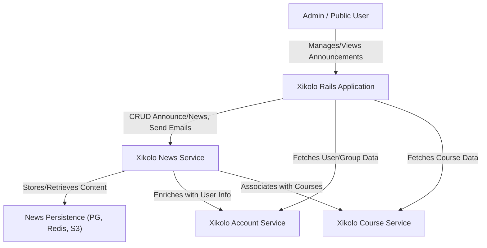
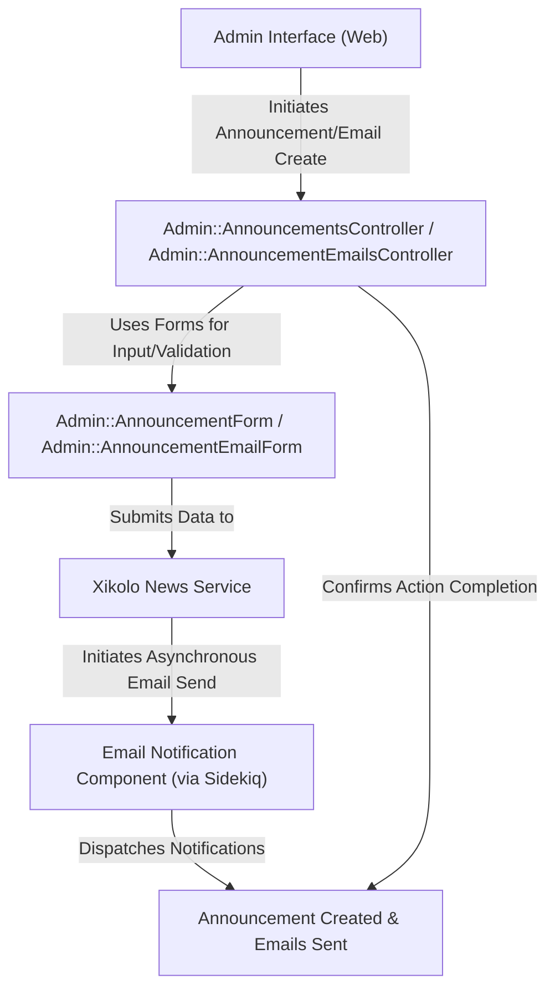
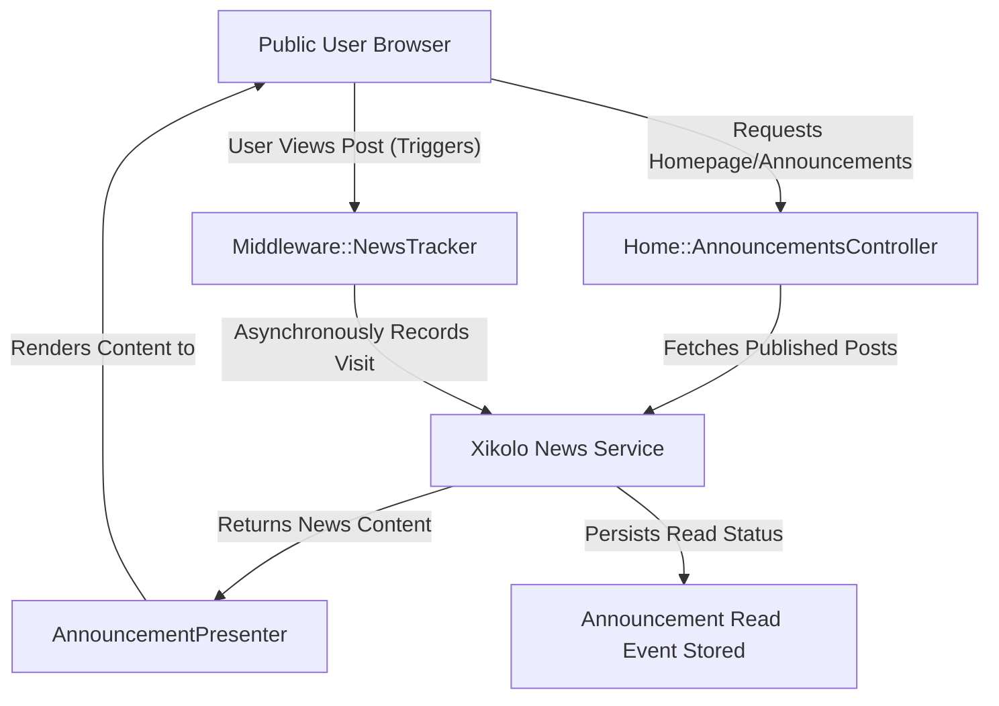

# Global and Course-Specific Announcements and News Management - Technical Documentation

*Generated on 9/18/2025 | Xikolo Knowledge Base*

---

## 📋 Executive Summary

This report details the Xikolo cluster 20_COMM_Announcements, a comprehensive system for managing and disseminating global and course-specific announcements and news. The system integrates a Ruby on Rails web frontend with the dedicated Xikolo News Service microservice, alongside Xikolo Account and Course Services. Its primary purpose is to facilitate the creation, management, email distribution, public display, and read tracking of announcements across the platform, supporting administrative operations and public content consumption.

---

## 🏗️ Architecture Overview

The architecture for Xikolo's Announcement and News Management system is designed as a distributed microservice-oriented setup, with the main Ruby on Rails application acting as the user-facing frontend. This frontend orchestrates interactions with several specialized microservices to manage content, user data, and course information. The core components include the primary Xikolo Rails Application, the dedicated Xikolo News Service for all announcement data, and supporting microservices for user and course information. Data persistence for announcements is handled by dedicated stores, primarily PostgreSQL, with Redis and S3 supporting caching and asset management. Asynchronous communication patterns, via RabbitMQ, are also central to the News Service's operations, particularly for email distribution and background processing.

### Architecture Diagrams

#### Main Architecture

### 🔄 Component Interactions

Key interactions between components in this cluster:

- **Admin::Announcement::RecipientsController:** Authorizes 'news.announcement.send' permission.
- **Admin::Announcement::RecipientsController:** Fetches user data from Xikolo::Account service via `account_api.rel(:users).get`.
- **Admin::AnnouncementEmailsController:** Requires 'admin_announcements' feature.
- **Admin::AnnouncementEmailsController:** Interacts with Xikolo::NewsService via `news_service` to get announcement and message details.
- **Admin::AnnouncementsController:** Requires 'admin_announcements' feature.
- **Admin::AnnouncementsController:** Authorizes 'news.announcement.create' and 'news.announcement.update' permissions.
- **AnnouncementsController:** Authorizes actions using `authorize!` and `current_user.allowed?` based on permissions like `news.announcement.create`, `news.announcement.update`, `news.announcement.delete`, `news.announcement.send`, `news.announcement.send_test` [Source: app/controllers/announcements_controller.rb, RAG: services/account/lib/tasks/permissions/news.yml].
- **AnnouncementsController:** Uses `Admin::NewsForm` for data binding and validation of announcement attributes [Source: app/controllers/announcements_controller.rb, app/forms/admin/news_form.rb].
- **Home::AnnouncementsController:** Checks for the 'announcements' feature flag [Source: app/controllers/home/announcements_controller.rb].
- **Home::AnnouncementsController:** Fetches announcement posts from the `news` microservice (`Xikolo.api(:news).rel(:posts).get`) [Source: app/controllers/home/announcements_controller.rb].
- **Admin::AnnouncementEmailForm:** Contains nested `Translation` subforms for subject and content in different languages.
- **Admin::AnnouncementEmailForm:** Uses `RecipientsArray` processor to transform recipient IDs to URNs for the NewsService.
- **Admin::AnnouncementEmailForm::RecipientsArray:** Processes `recipients` attribute for `Admin::AnnouncementEmailForm`.
- **Admin::AnnouncementEmailForm::TranslationsArray:** Processes `translations` attribute for `Admin::AnnouncementEmailForm`.
- **Admin::AnnouncementForm:** Contains nested `Translation` subforms for subject and content in different languages.
- **Admin::AnnouncementForm:** Uses `TranslationsArray` processor to manage default and additional language translations.
- **Admin::AnnouncementForm::TranslationsArray:** Processes `translations` attribute for `Admin::AnnouncementForm`.
- **Admin::NewsForm:** Inherits from `XUI::Form` [Source: app/forms/admin/news_form.rb].
- **Admin::NewsForm:** Defines attributes for announcement properties like `title`, `text`, `publish_at`, `language`, `visual_url`, `audience`, and `translations` [Source: app/forms/admin/news_form.rb].
- **Admin::NewsForm::Translation:** Defines attributes for `title`, `text`, and `language` of a translation [Source: app/forms/admin/news_form.rb].
- **Admin::NewsForm::Translation:** Used as a `subtype` for the `translations` attribute in `Admin::NewsForm` [Source: app/forms/admin/news_form.rb].
- **Admin::NewsForm::TranslationsArray:** Processes `translations` attribute for `Admin::NewsForm`.
- **Alert:** Uses `translations` (likely a JSONB or hstore column) to store multi-language content.
- **Alert:** Defines scopes `by_publication_date` and `published` for filtering.
- **Alert::Translation:** Initializes with a locale and data hash, providing `title` and `text` methods.
- **Admin::AnnouncementEmailPresenter:** Initializes with announcement and email resources [Source: app/presenters/admin/announcement_email_presenter.rb].
- **Admin::AnnouncementEmailPresenter:** Asynchronously fetches author and sender user details from the `account` microservice (`Xikolo.api(:account)`) [Source: app/presenters/admin/announcement_email_presenter.rb].
- **Admin::AnnouncementPresenter:** Initializes with an announcement resource [Source: app/presenters/admin/announcement_presenter.rb].
- **Admin::AnnouncementPresenter:** Provides formatted `created_at` and `title` [Source: app/presenters/admin/announcement_presenter.rb].
- **Admin::AnnouncementsListPresenter:** Delegates iteration methods (`each`, `any?`) to the underlying collection [Source: app/presenters/admin/announcements_list_presenter.rb].
- **Admin::AnnouncementsListPresenter:** Uses `RestifyPaginationCollection` for handling pagination metadata from the `news` service [Source: app/presenters/admin/announcements_list_presenter.rb].
- **AnnouncementPresenter:** Initializes with a news resource [Source: app/presenters/announcement_presenter.rb].
- **AnnouncementPresenter:** Includes `MarkdownHelper` to render markdown content [Source: app/presenters/announcement_presenter.rb].
- **Middleware::NewsTracker:** Intercepts HTTP requests to check for 'news' tracking parameters (`tracking_type`, `tracking_id`, `tracking_user`).
- **Middleware::NewsTracker:** Sends an asynchronous POST request to `Xikolo.api(:news).value!.rel(:visits)` to mark an announcement as read, without blocking the main request-response cycle.
- **Xikolo::NewsService:** Communicates with `Xikolo::Account` service to potentially retrieve user or account-related information. [Source: RAG: services/news/config/services.yml]
- **Xikolo::NewsService:** Communicates with `Xikolo::CourseService` to associate news with specific courses or retrieve course details. [Source: RAG: services/news/config/services.yml]
- **Xikolo::Account:** Provides user data (name, email) for announcement recipient selection.
- **Xikolo::Account:** Provides group data (access, content_test, custom_recipients) for recipient selection.
- **Xikolo::CourseService:** Provides course data (title, course_code) for announcement recipient selection.
- **News (Data Entity):** Created, read, updated, and deleted via the `Xikolo::NewsService` API. [Source: RAG: services/news/README.md]
- **News (Data Entity):** Potentially associated with `Course` entities from `Xikolo::CourseService`. [Source: RAG: services/news/config/services.yml]
- **Email Notification Component:** Receives news content and recipient information from other parts of `Xikolo::NewsService`.
- **Email Notification Component:** Utilizes custom templates and stylesheets located in `services/news/brand/<name>/assets/views/layouts` and `services/news/brand/<name>/assets/stylesheets` for branding. [Source: RAG: docs/app/development/branding/email.md]
- **News Service (Microservice):** Interacts with PostgreSQL for data persistence. [Source: services/news/config/database.yml]
- **News Service (Microservice):** Communicates with RabbitMQ for asynchronous messaging (both consuming and publishing). [Source: docker/compose.news.yml, services/news/config/rabbitmq.yml]
- **News Msgr Consumer:** Consumes messages from RabbitMQ. [Source: docker/compose.news.yml, services/news/config/rabbitmq.yml]
- **News Msgr Consumer:** Interacts with the News Service's PostgreSQL database for data operations.
- **News API Server:** Exposes an HTTP API (debug port 4300). [Source: docker/compose.news.yml]
- **News API Server:** Interacts with the News Service's PostgreSQL database for data operations.
- **News Sidekiq Worker:** Processes jobs from the Redis-backed Sidekiq queue. [Source: docker/compose.news.yml]
- **News Sidekiq Worker:** Interacts with the News Service's PostgreSQL database.

---

## ⚙️ Technical Workflows

### 1. Admin Announcement Creation & Email Distribution
This workflow details the process for administrators to create new announcements, including the option for email distribution. The process begins when an administrator accesses the dedicated user interface to initiate the creation of either a general announcement or a specific announcement email. The `Admin::AnnouncementsController` or `Admin::AnnouncementEmailsController` handles these initial requests. Data input is facilitated by form objects like `Admin::AnnouncementForm` for general content or `Admin::AnnouncementEmailForm` for email-specific details, which manage multi-language translations and recipient selection. For recipient selection, `Admin::Announcement::RecipientsController` dynamically fetches user and course data from the `Xikolo::Account` and `Xikolo::CourseService` microservices, caching these responses for performance. Once validated, the announcement data is submitted to the `Xikolo News Service` via its API. The News Service then takes over the responsibility for persisting the announcement and, if configured, initiating the email distribution process. Email sending is typically an asynchronous operation, leveraging the `Email Notification Component` within the News Service, which dispatches jobs to the `News Sidekiq Worker` for background processing. The main application receives confirmation of the announcement's creation and display status.

### 2. Public Announcement Display & Read Tracking
This workflow outlines how announcements are displayed to end-users and how user engagement (read events) is tracked. A public user's request for the application's homepage or a specific announcement page is initially handled by the `Home::AnnouncementsController`. This controller checks for the 'announcements' feature flag and then queries the `Xikolo News Service` API to fetch relevant announcement posts. Crucially, it adjusts query parameters, such as `published` status, `user_id`, and `language`, based on the current user's login status and permissions (e.g., `news.announcement.show` permission allows viewing drafts). The raw news resources returned by the News Service are then mapped to `AnnouncementPresenter` instances. The `AnnouncementPresenter` is responsible for formatting the content, including rendering markdown and generating a `teaser` from the full text, for display in the user interface. To track user engagement, the `Middleware::NewsTracker` intercepts HTTP requests. When it detects specific 'news' tracking parameters, it asynchronously sends a POST request to the `Xikolo News Service`'s `/visits` endpoint to mark the announcement as read by the user. This read tracking occurs without blocking the user's main request, ensuring a responsive user experience.

### Workflow Diagrams

#### Admin Announcement Creation & Email Workflow

#### Public Announcement Display & Read Tracking Workflow

### 🔀 Process Workflows

Detailed workflow processes for this cluster:

- **Admin::AnnouncementEmailsController Process:** Handles `Restify::UnprocessableEntity` errors during email creation.
  *Source: Admin::AnnouncementEmailsController*
- **Admin::AnnouncementsController Process:** Handles `Restify::UnprocessableEntity` errors during creation and update.
  *Source: Admin::AnnouncementsController*
- **AnnouncementsController Process:** Handles `Restify::UnprocessableEntity` errors from the `news` service for remote validation failures .
  *Source: AnnouncementsController*
- **Admin::AnnouncementEmailForm Process:** Uses `RecipientsArray` processor to transform recipient IDs to URNs for the NewsService.
  *Source: Admin::AnnouncementEmailForm*
- **Admin::AnnouncementEmailForm Process:** Uses `TranslationsArray` processor to manage default and additional language translations.
  *Source: Admin::AnnouncementEmailForm*
- **Admin::AnnouncementEmailForm::RecipientsArray Process:** Processes `recipients` attribute for `Admin::AnnouncementEmailForm`.
  *Source: Admin::AnnouncementEmailForm::RecipientsArray*
- **Admin::AnnouncementEmailForm::TranslationsArray Process:** Processes `translations` attribute for `Admin::AnnouncementEmailForm`.
  *Source: Admin::AnnouncementEmailForm::TranslationsArray*
- **Admin::AnnouncementForm Process:** Uses `TranslationsArray` processor to manage default and additional language translations.
  *Source: Admin::AnnouncementForm*

---

## 🔧 Implementation Details

The Xikolo 20_COMM_Announcements cluster is implemented with a clear separation of concerns, leveraging a Ruby on Rails monolith as the frontend interacting with dedicated microservices. Technical considerations include robust authorization and feature flag integration. Controllers such as `Admin::AnnouncementsController` and `Home::AnnouncementsController` rely on feature flags like `admin_announcements` and `announcements` respectively, ensuring functionality is only available when enabled. Permissions, including `news.announcement.create`, `news.announcement.update`, `news.announcement.send`, and `news.announcement.show`, are strictly enforced using `authorize!` and `current_user.allowed?` checks. Error handling for interactions with microservices, particularly `Restify::UnprocessableEntity` errors, is implemented in controllers to provide user feedback on remote validation failures.

Dependencies and integrations are central to the system's operation. The main Rails application heavily integrates with `Xikolo.api(:news)` for all core announcement and news data management, including CRUD operations, email sending, and visit tracking. It also depends on `Xikolo.api(:account)` to fetch user and group information for recipient selection and to resolve author/sender names for email displays. Similarly, `Xikolo.api(:course)` provides course details for targeted announcements. Within the `Xikolo News Service` itself, core dependencies include PostgreSQL for persistent data storage, RabbitMQ for asynchronous messaging and inter-service communication, Redis for caching and Sidekiq job management, and S3 for storing news-related assets. Form objects like `Admin::AnnouncementEmailForm`, `Admin::AnnouncementForm`, and `Admin::NewsForm` inherit from `XUI::Form`, providing a standardized approach to data binding and validation, including nested `Translation` subforms for multilingual content. Presenters such as `AnnouncementPresenter` utilize utilities like `MarkdownHelper` and `HtmlTruncator` for content rendering and `Admin::AnnouncementsListPresenter` leverages `RestifyPaginationCollection` for handling pagination metadata.

Configuration requirements involve application-wide settings for internationalization, specified via `Xikolo.config.locales['available']` and `Xikolo.config.locales['default']` to manage multiple language versions of content. Audience selection in `Admin::NewsForm` is derived from `Xikolo.config.access_groups`. Specific configuration values (e.g., database connection strings, RabbitMQ credentials, S3 bucket names) are sourced from `services/news/config/database.yml`, `services/news/config/rabbitmq.yml`, and `docker/config/xikolo/news.yml` respectively, but are not specified in the provided cluster data.

### 📚 Technical Sources & References

Key technical documentation and source references:

- Admin::Announcement::RecipientsController: app/controllers/admin/announcement/recipients_controller.rb- Admin::AnnouncementEmailsController: app/controllers/admin/announcement_emails_controller.rb- Admin::AnnouncementsController: app/controllers/admin/announcements_controller.rb- AnnouncementsController: app/controllers/announcements_controller.rb- AnnouncementsController: RAG: services/account/lib/tasks/permissions/news.yml- Home::AnnouncementsController: app/controllers/home/announcements_controller.rb- Home::AnnouncementsController: spec/requests/announcements/index_spec.rb- Admin::AnnouncementEmailForm: app/forms/admin/announcement_email_form.rb- Admin::AnnouncementEmailForm::Translation: app/forms/admin/announcement_email_form.rb- Admin::AnnouncementEmailForm::RecipientsArray: app/forms/admin/announcement_email_form.rb- Admin::AnnouncementEmailForm::TranslationsArray: app/forms/admin/announcement_email_form.rb- Admin::AnnouncementForm: app/forms/admin/announcement_form.rb- Admin::AnnouncementForm::Translation: app/forms/admin/announcement_form.rb- Admin::AnnouncementForm::TranslationsArray: app/forms/admin/announcement_form.rb- Admin::NewsForm: app/forms/admin/news_form.rb- Admin::NewsForm::Translation: app/forms/admin/news_form.rb- Admin::NewsForm::TranslationsArray: app/forms/admin/news_form.rb- Alert: app/models/alert.rb- Alert::Translation: app/models/alert.rb- Admin::AnnouncementEmailPresenter: app/presenters/admin/announcement_email_presenter.rb- Admin::AnnouncementPresenter: app/presenters/admin/announcement_presenter.rb- Admin::AnnouncementsListPresenter: app/presenters/admin/announcements_list_presenter.rb- AnnouncementPresenter: app/presenters/announcement_presenter.rb- Middleware::NewsTracker: lib/middleware/news_tracker.rb- Xikolo::NewsService: foundational_context- Xikolo::NewsService: RAG: services/news/README.md- Xikolo::Account: app/controllers/admin/announcement/recipients_controller.rb- Xikolo::Account: app/forms/admin/announcement_email_form.rb- Xikolo::CourseService: app/controllers/admin/announcement/recipients_controller.rb- News (Data Entity): foundational_context- News (Data Entity): RAG: services/news/README.md- Email Notification Component: RAG: docs/app/development/branding/email.md- Email Notification Component: foundational_context- announcements.scss: app/assets/admin/announcements/announcements.scss- News Service (Microservice): services/news/README.md- News Service (Microservice): docker/compose.news.yml- News Msgr Consumer: docker/compose.news.yml- News Msgr Consumer: services/news/config/rabbitmq.yml- News API Server: docker/compose.news.yml- News Sidekiq Worker: docker/compose.news.yml- News Sidekiq Worker: services/news/config/locales/en.yml- Configuration: config/application.rb, Gemfile, config/database.yml- Process Management: Procfile, Procfile.web- Build & Deploy: Rakefile, package.json

---

*This documentation is automatically generated from cluster analysis and should be validated against the actual codebase.*
