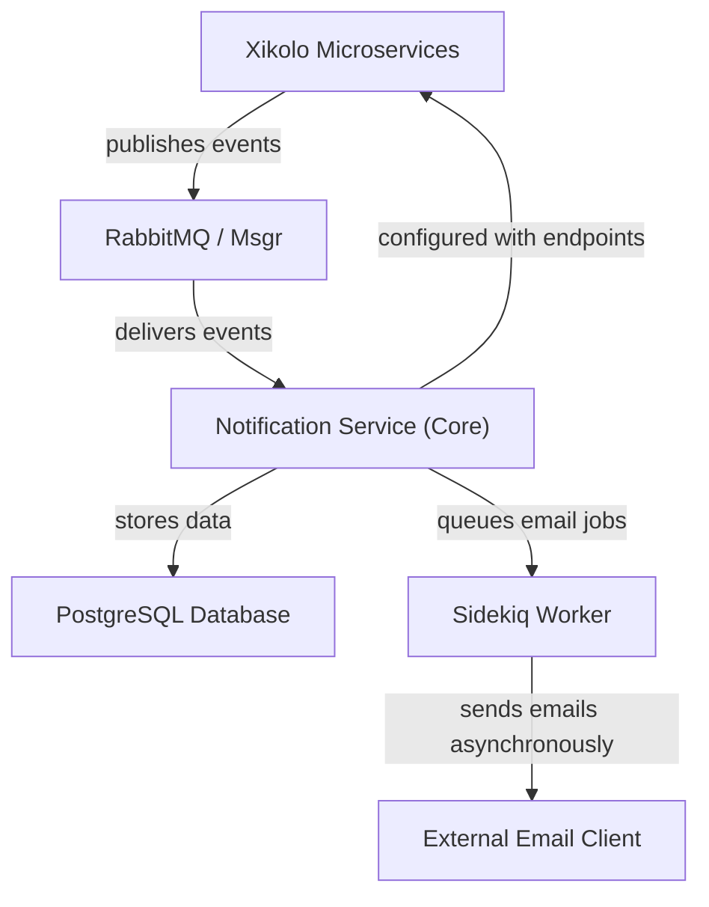
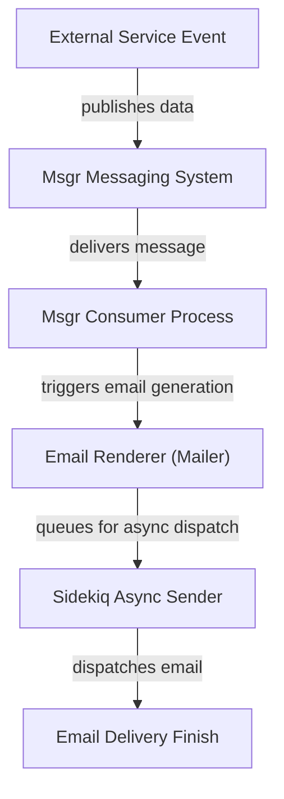
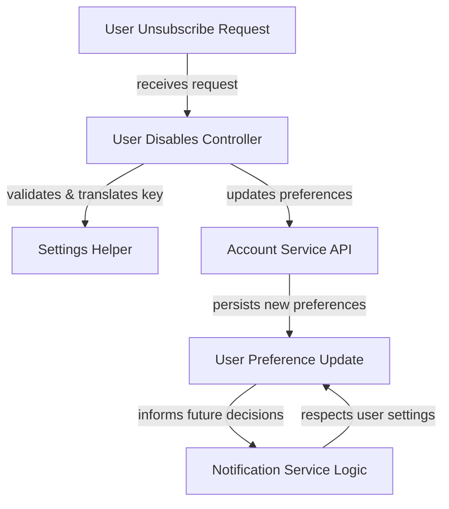

# Event-Driven Notification Microservice - Technical Documentation

*Generated on 9/18/2025 | Xikolo Knowledge Base*

---

## 📋 Executive Summary

The Xikolo Notification Service (cluster 21_COMM_Notifications) is a purpose-built microservice responsible for orchestrating and delivering all event-driven user notifications across the Xikolo ecosystem. Its primary function centers on processing incoming notification events via a robust messaging backbone and dispatching formatted email notifications to users. Key components include Msgr for inter-service communication, a dedicated Notification Service for event processing and email generation, and specialized tools for comprehensive user preference management and email styling. The service aims to provide a unified and customizable notification experience, ensuring timely and consistent communication while allowing users granular control over their preferences.

---

## 🏗️ Architecture Overview

The Xikolo Notification Service operates as a central microservice within the broader Xikolo architecture, designed for high availability and scalability in managing user communications. Its architecture is fundamentally event-driven, relying on a robust messaging system to ingest notification triggers from various source microservices. Processed events lead to the generation, styling, and dispatch of emails, often asynchronously to maintain system responsiveness. Data persistence for notification records and user preferences is handled by a PostgreSQL database, while asynchronous job processing is facilitated by Sidekiq, utilizing Redis for its queues. The service is also equipped with specialized components to manage email templating, styling, and tracking, ensuring a professional and trackable communication output. This modular design allows for clear separation of concerns and facilitates independent development and deployment of components.

### Architecture Diagrams

#### Main Architecture

### 🔄 Component Interactions

Key interactions between components in this cluster:

- **Xikolo::NotificationService:** Receives notification events from other Xikolo microservices (e.g., Account, Course, News, Pinboard) via RabbitMQ/Msgr. [Source: services/notification/README.md, services/notification/config/services.yml]
- **Xikolo::NotificationService:** Sends email notifications to users based on processed events. [Source: services/notification/README.md]
- **Msgr:** Other services publish notification event data to Msgr topics. [Source: services/notification/README.md]
- **Msgr:** NotificationService subscribes to Msgr topics to receive event data. [Source: services/notification/README.md]
- **Notification Consumers:** Receive messages from Msgr based on defined routes in `config/msgr.rb`. [Source: services/notification/README.md]
- **Notification Consumers:** Create notification records and trigger email rendering processes. [Source: services/notification/README.md]
- **Notification Mail Templates:** Rendered by the NotificationService when an email needs to be sent. [Source: services/notification/README.md]
- **Notification Mail Templates:** Can be customized per brand using `assets/views/layouts` within brand-specific folders. [Source: RAG: docs/app/development/branding/email.md]
- **Premailer:** Processes rendered HTML email content to embed CSS directly into `style` attributes. [Source: services/notification/README.md]
- **Inky:** Used within mail templates to define email layouts and components. [Source: services/notification/README.md]
- **Foundation for Emails:** Provides the underlying CSS and structural conventions used in conjunction with Inky for email templating. [Source: services/notification/README.md]
- **NotificationUserDisablesController:** Interacts with the Account microservice (via `Xikolo.api(:account)`) to fetch user email details and update user preferences. [Source: app/controllers/notification_user_disables_controller.rb]
- **NotificationUserDisablesController:** Utilizes `NotificationUserSettingsHelper` for hash generation and settings key translation. [Source: app/controllers/notification_user_disables_controller.rb]
- **NotificationUserSettingsHelper:** Used by `NotificationUserDisablesController` to validate unsubscribe requests and map preference keys. [Source: app/controllers/notification_user_disables_controller.rb]
- **NotificationService:** Receives notification events from other Xikolo services via `Msgr` (RabbitMQ). [Source: RAG: services/notification/README.md]
- **NotificationService:** Utilizes `MarkdownService` to render email content. [Source: services/notification/lib/markdown_service.rb]
- **MarkdownService:** Used by the `NotificationService` (or its mailers/workers) to render email bodies. [Source: services/notification/lib/markdown_service.rb]
- **TrackingMailInterceptor:** Intercepts emails being delivered by the `NotificationService`'s mailers. [Source: services/notification/lib/tracking_mail_interceptor.rb]
- **TrackingMailInterceptor:** Uses `Nokogiri` for HTML parsing and modification. [Source: services/notification/lib/tracking_mail_interceptor.rb]
- **Notification Service:** Receives events from other microservices (e.g., account, course, news, pinboard) via RabbitMQ. [Source: RAG: services/notification/README.md]
- **Notification Service:** Sends emails to users. [Source: RAG: services/notification/README.md]
- **Msgr Consumer:** Receives messages from RabbitMQ. [Source: RAG: services/notification/README.md]
- **Msgr Consumer:** Invokes `Consumer` and `ConsumerHelper` methods to handle specific event types. [Source: RAG: services/notification/README.md]
- **Mailer:** Receives data from `Msgr Consumer` or `Sidekiq Worker`. [Source: RAG: services/notification/README.md]
- **Mailer:** Uses locale files (`de.yml`, `en.yml`) for subject and body text. [Source: RAG: services/notification/config/locales/de.yml, RAG: services/notification/config/locales/en.yml]
- **Sidekiq Worker:** Receives jobs from `Msgr Consumer` or other parts of the `Notification Service`. [Source: RAG: docker/compose.notification.yml]
- **Sidekiq Worker:** Interacts with Redis for job queuing. [Source: RAG: docker/compose.notification.yml]

---

## ⚙️ Technical Workflows

### 1. Event-Driven Email Notification Flow
This workflow details the comprehensive process from an event originating in another Xikolo microservice to the final delivery of a styled and tracked email notification to a user. It highlights the asynchronous and component-rich nature of the notification generation.

Upon an event occurring in a source microservice (e.g., Account, Course, News, Pinboard), relevant notification data is packaged and published to a designated Msgr topic. The Msgr Messaging System acts as the central hub, reliably relaying this event. Within the Notification Service, a dedicated Msgr Consumer Process is configured to subscribe to these topics as defined in `config/msgr.rb`. This consumer receives and parses the incoming message, initiating the creation of a notification record. Subsequently, the Mailer component, acting as the Email Renderer, is invoked. It retrieves locale-specific content from `de.yml` or `en.yml` files, renders the mail templates (which may utilize `MarkdownService` for content), and then applies advanced styling transformations using `Inky` for layout structures and `Premailer` for CSS inlining, adhering to `Foundation for Emails` conventions. The `TrackingMailInterceptor` then steps in to modify the outgoing email, embedding tracking parameters and redirecting external links for analytical purposes. Finally, the constructed email is handed off to a `Sidekiq Async Sender`, which queues the job in Redis. The Sidekiq Worker then asynchronously processes this job, invoking the Mailer again to perform the actual dispatch to the External Email Client, completing the notification delivery.

### 2. User Notification Preference Management Flow
This workflow describes how users interact with the system to manage their notification preferences, specifically focusing on disabling certain notification types, and how these changes are processed and respected by the Notification Service.

When a user initiates an unsubscribe request, typically through a one-click link in an email or via a frontend interface, this User Request is routed to the `NotificationUserDisablesController`. This controller, acting as the User Disables Controller, receives the request parameters, including email, a security hash, and a notification key. It then leverages the `NotificationUserSettingsHelper` (the Settings Helper) to validate the provided hash and translate the simplified notification key (e.g., 'announcement') into a full preference path (e.g., 'notification.email.news.announcement'). Following validation, the `NotificationUserDisablesController` interacts with the `Account Service API` to update the user's notification preferences. This `Account Service API` is responsible for persisting the updated user preferences, effectively performing the User Preference Update. Although not explicitly detailed as a direct push, the `Notification Service Logic` is designed to be aware of and respect these preferences. When generating subsequent notifications, the Notification Service will either query the Account Service or have an updated view of user preferences, ensuring that emails are only sent for notification types the user has enabled, thus concluding the preference management cycle.

### Workflow Diagrams

#### Event-Driven Email Notification Flow

#### User Notification Preference Management Flow

### 🔀 Process Workflows

Detailed workflow processes for this cluster:

- **Xikolo::NotificationService Process:** Sends email notifications to users based on processed events.
  *Source: Xikolo::NotificationService*
- **Notification Consumers Process:** Create notification records and trigger email rendering processes.
  *Source: Notification Consumers*
- **Premailer Process:** Processes rendered HTML email content to embed CSS directly into `style` attributes.
  *Source: Premailer*

---

## 🔧 Implementation Details

The Xikolo Notification Service is implemented as a Ruby on Rails API-only microservice, leveraging an event-driven architectural pattern for inter-service communication.

**Technical Considerations:**
*   **Email Client Compatibility:** A significant technical consideration is ensuring consistent HTML email rendering across diverse and often challenging email clients, particularly Microsoft Outlook. To address this, the service employs `Premailer` for inline CSS styling, `Inky` for robust table-based layouts, and `Foundation for Emails` for a structured, responsive email design framework. This combination helps overcome many cross-client rendering inconsistencies. Adherence to best practices, such as using full six-digit color codes, is also recommended.
*   **Content Rendering:** For dynamic content within notifications, the `MarkdownService` is utilized to render Markdown formatted text into HTML, providing rich content capabilities while maintaining a consistent visual style.
*   **Tracking:** Outgoing emails are intercepted by the `TrackingMailInterceptor`. This component, using `Nokogiri` for HTML parsing, modifies email content to inject tracking parameters into links and images and to redirect external links through a dedicated tracking mechanism, enabling analytics on email engagement.
*   **Technical Debt:** The documentation highlights technical debt concerning the persistent challenge of HTML email client compatibility. Additionally, the purpose of the `notification-server` component, marked "only for debugging" but present in standard deployments, is unclear and requires clarification or removal if not utilized in production environments.

**Dependencies and Integrations:**
*   **Messaging:** The service heavily depends on `Msgr` (a Ruby gem for RabbitMQ) for its messaging backbone. It receives notification events from other Xikolo microservices (e.g., Account, Course, News, Pinboard) via RabbitMQ topics. Other services also publish their event data to Msgr topics.
*   **Data Storage:** Persistent data, such as notification records and potentially user preferences (or references to them), is stored in a `PostgreSQL` database, as indicated by `config/database.yml`.
*   **Asynchronous Processing:** `Sidekiq Worker` is integral for asynchronous task processing, primarily email sending. It relies on `Redis` for job queuing, ensuring the main message consumption process remains responsive.
*   **Microservice Interactions:** The `NotificationUserDisablesController` directly interacts with the `Account` microservice (via `Xikolo.api(:account)`) to fetch user email details and update notification preferences. The `services.yml` configuration file explicitly defines the endpoints for interacting with other core Xikolo services, enabling resource linking and data fetching.

**Configuration Requirements:**
*   **Msgr Routes:** Message consumption is governed by routes defined in `config/msgr.rb`, mapping specific Msgr topics to consumer methods.
*   **Service Endpoints:** The `services.yml` file within the Notification Service configures the endpoints of other Xikolo microservices, essential for cross-service communication and data retrieval.
*   **Mail Templates:** Email content is rendered from templates located in `app/views/{de|en}`. Branding customization is supported via `assets/views/layouts` within brand-specific folders and `foundation_.scss` stylesheets in `assets/stylesheets`.
*   **Localization:** The `Mailer` component utilizes locale files, specifically `config/locales/de.yml` and `config/locales/en.yml`, for localized subject lines and body text within emails.

### 📚 Technical Sources & References

Key technical documentation and source references:

- Xikolo::NotificationService: services/notification/README.md- Xikolo::NotificationService: services/notification/config/services.yml- Msgr: services/notification/README.md- Notification Consumers: services/notification/README.md- Notification Mail Templates: services/notification/README.md- Notification Mail Templates: RAG: docs/app/development/branding/email.md- Premailer: services/notification/README.md- Inky: services/notification/README.md- Foundation for Emails: services/notification/README.md- NotificationUserDisablesController: app/controllers/notification_user_disables_controller.rb- NotificationUserSettingsHelper: app/helpers/notification_user_settings_helper.rb- NotificationService: foundational_context- NotificationService: RAG: services/notification/README.md- MarkdownService: services/notification/lib/markdown_service.rb- TrackingMailInterceptor: services/notification/lib/tracking_mail_interceptor.rb- Notification Service: RAG: services/notification/README.md- Notification Service: RAG: docker/compose.notification.yml- Msgr Consumer: RAG: services/notification/README.md- Msgr Consumer: RAG: docker/compose.notification.yml- Mailer: RAG: services/notification/README.md- Mailer: RAG: services/notification/config/locales/de.yml- Sidekiq Worker: RAG: docker/compose.notification.yml- Sidekiq Worker: Foundational Context: Background Jobs- Configuration: config/application.rb, Gemfile, config/database.yml- Process Management: Procfile, Procfile.web- Build & Deploy: Rakefile, package.json

---

*This documentation is automatically generated from cluster analysis and should be validated against the actual codebase.*
