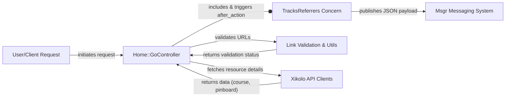
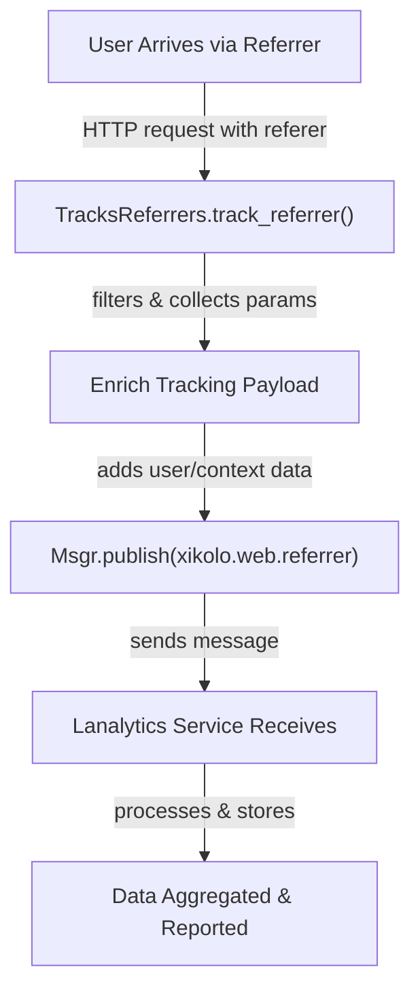
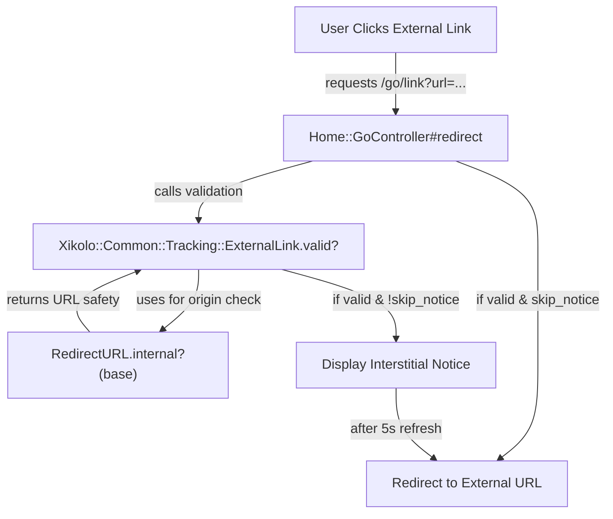
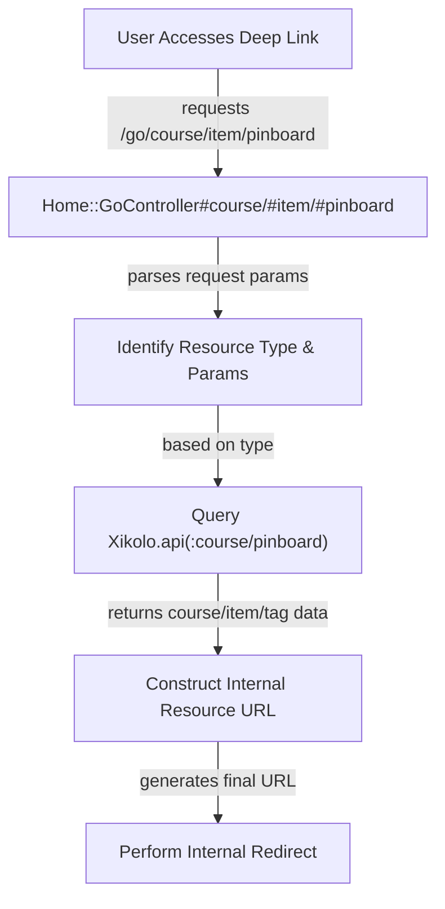
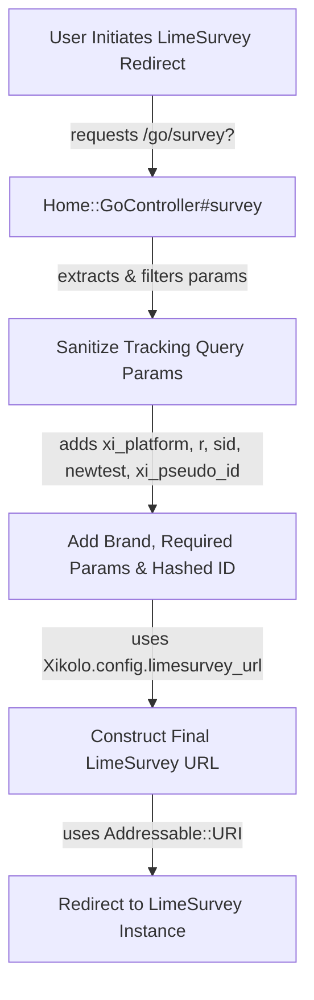

# User Referral & Redirect Tracking - Technical Documentation

*Generated on 9/18/2025 | Xikolo Knowledge Base*

---

## 📋 Executive Summary

The 22_COMM_ReferralTracking feature cluster is fundamental for gaining insights into user acquisition and ensuring secure navigation within the Xikolo platform. Its core function is to meticulously record how users arrive via external links and to orchestrate various redirection scenarios, encompassing both internal and external destinations. The scope spans referrer detection, asynchronous analytics reporting, secure deep linking for internal resources (such as courses and pinboards), and validated redirects to external services like LimeSurvey. Key components, including the `TracksReferrers` concern and `Home::GoController`, work collaboratively with utility classes like `RedirectURL` and `Xikolo::Common::Tracking::ExternalLink`, alongside messaging and API clients, to deliver a robust, secure, and insightful user routing experience.

---

## 🏗️ Architecture Overview

The User Referral & Redirect Tracking architecture provides a robust and secure framework for managing user entry points and dynamic content redirection. This system is centered around a frontend controller that integrates tracking capabilities and relies on specialized utility classes and asynchronous messaging for efficient and secure operations. It emphasizes URL validation and decoupled analytics data processing.

*   **`Home::GoController`**: This frontend controller (`app/controllers/home/go_controller.rb`) acts as the central hub for managing all redirection logic. It is responsible for handling safe external redirects, various deep linking functionalities for internal resources (courses, items, pinboards), and integrating with external survey platforms like LimeSurvey. It meticulously validates target URLs and constructs appropriate redirect paths.
*   **`TracksReferrers`**: Implemented as an `ActiveSupport::Concern` (`app/controllers/concerns/tracks_referrers.rb`), this component is included in public-facing controllers. Its primary function is to passively capture incoming HTTP referrer information. It intelligently filters out invalid or internal referrers and enriches the collected data with pertinent user and contextual details before preparing it for asynchronous transmission.
*   **`Msgr`**: This component serves as an `External Service Client` for the RabbitMQ message broker. It is strategically utilized by `TracksReferrers` to publish enriched JSON referrer tracking payloads to the `xikolo.web.referrer` topic. This ensures that analytics data is processed asynchronously by services like `lanalytics`, minimizing impact on the user's immediate request-response cycle.
*   **`Link Validation & Utils` (comprising `RedirectURL` and `Xikolo::Common::Tracking::ExternalLink`)**: This conceptual grouping represents crucial utility classes that collectively ensure URL safety. `RedirectURL` (`lib/redirect_url.rb`) parses URL strings and determines if a URL is internal or shares the same origin as the platform's base. `Xikolo::Common::Tracking::ExternalLink` (`gems/xikolo-common/lib/xikolo/common/tracking/external_link.rb`) is used by `Home::GoController` specifically for validating external URLs, including a checksum mechanism to ensure data integrity and prevent tampering.
*   **`Xikolo API Clients` (comprising `Xikolo.api(:course)` and `Xikolo.api(:pinboard)`)**: These are internal API clients that facilitate communication with respective Xikolo microservices (`Xikolo::CourseService` and `Xikolo::PinboardService`). `Home::GoController` uses these clients to fetch essential resource details (e.g., `course_id`, `course_code`, implicit tags) necessary for deep linking directly to specific courses, items, or pinboard entries.

The system's integration points are designed for efficiency and security: `TracksReferrers` hooks into controller lifecycles via `after_action`, ensuring referrer data is captured post-request. `Home::GoController` leverages both `Xikolo::Common::Tracking::ExternalLink` and `RedirectURL` for rigorous URL validation before any redirect. Direct interactions with `Msgr` for asynchronous analytics publishing and with the `Xikolo API Clients` for fetching dynamic resource data are integral to enabling robust tracking and flexible, secure redirection capabilities.

### Architecture Diagrams

#### Main Architecture

### 🔄 Component Interactions

Key interactions between components in this cluster:

- **TracksReferrers:** Includes `ActiveSupport::Concern` for mixin functionality. [Source: app/controllers/concerns/tracks_referrers.rb]
- **TracksReferrers:** Hooks into the controller lifecycle via `after_action :track_referrer`. [Source: app/controllers/concerns/tracks_referrers.rb]
- **Home::GoController:** Includes the `TracksReferrers` concern for referrer tracking. [Source: app/controllers/home/go_controller.rb]
- **Home::GoController:** Inherits from `Abstract::FrontendController`. [Source: app/controllers/home/go_controller.rb]
- **RedirectURL:** Initializes with a URL string, parsing it using `Addressable::URI`. [Source: lib/redirect_url.rb]
- **RedirectURL:** Provides `internal?(base)` method to check if the URL is relative or shares the same origin as the `base` URL. [Source: lib/redirect_url.rb]
- **Msgr:** Receives JSON payloads from `TracksReferrers` and publishes them to the `xikolo.web.referrer` topic. [Source: app/controllers/concerns/tracks_referrers.rb]
- **Xikolo.api(:course):** Used by `Home::GoController` to fetch item details (e.g., `course_id`) and course details (e.g., `course_code`) for deep linking. [Source: app/controllers/home/go_controller.rb]
- **Xikolo.api(:pinboard):** Used by `Home::GoController` to fetch implicit tags associated with items for pinboard deep linking. [Source: app/controllers/home/go_controller.rb]
- **Xikolo::Common::Tracking::ExternalLink:** Used by `Home::GoController#redirect` to validate the target URL and its `checksum` before performing an external redirect. [Source: app/controllers/home/go_controller.rb]

---

## ⚙️ Technical Workflows

This section details the primary technical workflows supported by the User Referral & Redirect Tracking cluster, outlining the specific processes and component interactions for each.

### 1. External Referrer Tracking
This workflow captures and processes information about external websites that refer users to the Xikolo platform, providing crucial data for user acquisition analysis. The process begins when a user's web browser makes an HTTP request to a public-facing Xikolo page, including an `HTTP Referer` header. The `TracksReferrers` concern, active in the handling controller, intercepts this request post-action. It first filters out specific requests, such as those with a `logo: 'true'` parameter or those originating from the Xikolo domain itself (identified by comparing `request.referer` host with `Xikolo.base_url.host`). If the referrer is deemed valid and external, a `tracking_payload` is generated from request parameters like `tracking_campaign` or `tracking_id`. This payload is then enriched with server-side metadata, incorporating `user_id` (from `current_user` or validated `tracking_user`), contextual `course_id`, the `request.original_url` as `referrer_page`, and a `created_at` timestamp. Finally, `Msgr` publishes this comprehensive JSON payload to the `xikolo.web.referrer` topic, ensuring asynchronous processing by an analytics service like `lanalytics` for aggregation and reporting, thereby completing the tracking lifecycle without impacting user experience.

### 2. Safe External Redirect
This workflow manages secure redirects to external URLs, proactively mitigating open redirect vulnerabilities and providing an optional user-friendly interstitial notice page before navigation.

Upon a user clicking an external link that routes through `Home::GoController#redirect`, the controller initiates a stringent validation process. It primarily utilizes `Xikolo::Common::Tracking::ExternalLink`, in conjunction with a `params[:checksum]`, to verify the target URL's integrity and security. This validation class internally leverages `RedirectURL` to determine if the URL is relative or shares the same origin, ensuring it is not a malicious redirect. Based on the `show_notice` parameter or the `skip_redirect_notice` cookie, `Home::GoController` decides whether to perform an immediate redirect or to display an interstitial notice page. If the notice is displayed, the actual redirection is delayed for 5 seconds using an HTTP `Refresh` header, allowing the user to be informed. Once the URL is validated and any notice period concludes, `Home::GoController` executes the final redirect to the verified external URL, securely guiding the user to their destination.

### 3. Course/Item/Pinboard Deep Linking
This workflow provides direct access points for users to specific internal resources within the Xikolo platform, such as courses, individual course items, or pinboard entries, utilizing unique identifiers or codes.

When a user accesses a deep link (e.g., via `/go/course`, `/go/item`, or `/go/pinboard` endpoints), `Home::GoController` receives the request. Its initial step is to identify the specific resource type and extract relevant parameters (e.g., `course_id`, `item_id`, or pinboard tags) from the URL. For course- and item-related deep links, `Home::GoController` interacts with `Xikolo.api(:course)` to fetch necessary details such as `course_code` and specific item information. For pinboard deep links, it queries `Xikolo.api(:pinboard)` to retrieve implicit tags associated with items, which are crucial for constructing the precise pinboard view. After successfully fetching all required resource details from these respective microservices, `Home::GoController` then constructs the canonical internal URL for the resource. Finally, it performs an internal redirect, ensuring the user lands directly on the intended content page within the Xikolo platform.

### 4. LimeSurvey Integration
This workflow facilitates the secure and controlled redirection of users from the Xikolo platform to an external LimeSurvey instance, ensuring meticulous parameter handling and privacy-preserving user identification for survey participation.

When a user initiates a redirect to LimeSurvey, typically through an action handled by `Home::GoController#survey`, the controller begins by sanitizing the incoming query parameters. It explicitly removes sensitive tracking and user-related parameters (e.g., `tracking`, `referrer`, `user_id`) to uphold user privacy. Subsequently, the controller adds mandatory LimeSurvey-specific parameters, including `r`, `sid`, `newtest`, and a platform identifier `xi_platform` (derived from `Xikolo.config.brand`). For authenticated users, `Home::GoController` securely hashes `current_user.id` using `Digest::SHA256.hexdigest` and adds this as `xi_pseudo_id` to the URL. The final LimeSurvey target URL is meticulously constructed using `Addressable::URI` and `Xikolo.config.limesurvey_url`, ensuring all necessary and sanitized parameters are correctly appended. Once the URL is complete, `Home::GoController` performs an immediate redirect to the external LimeSurvey instance, allowing for seamless and secure survey participation.

### Workflow Diagrams

#### External Referrer Tracking Workflow

#### Safe External Redirect Workflow

#### Course/Item/Pinboard Deep Linking Workflow

#### LimeSurvey Integration Workflow

### 🔀 Process Workflows

Detailed workflow processes for this cluster:

- **TracksReferrers Process:** Publishes an enriched JSON payload to the `xikolo.web.referrer` topic via `Msgr` for asynchronous processing by the `lanalytics` service.
  *Source: TracksReferrers*

---

## 🔧 Implementation Details

The Referral Tracking and Redirection Management cluster is implemented with a focus on functional correctness, security, and efficient integration into the broader Xikolo ecosystem, leveraging several technical considerations and explicit dependencies.

**Technical Considerations:**
The `TracksReferrers` concern actively prevents the capture of irrelevant or internal referrer data. It explicitly ignores requests containing a `logo: 'true'` parameter, commonly associated with email tracking pixels. Furthermore, it validates referrers against `Xikolo.base_url.host` to ensure only external sources are recorded, preventing self-referencing data. The tracking payload itself is an aggregation of request parameters and enriched server-side metadata, including `user_id` (derived from `current_user` or a validated `tracking_user` UUID using `UUID4.try_convert`), `course_id` (if contextually available), and the `referrer_page` (`request.original_url`). For redirection, `Home::GoController` manages two distinct redirect behaviors: immediate or delayed (5-second interstitial notice) based on `show_notice` parameters or the presence of a `skip_redirect_notice` cookie. The LimeSurvey integration incorporates critical privacy safeguards, removing raw `user_id` and tracking parameters, and instead appending a SHA256 hashed `current_user.id` as `xi_pseudo_id` to external survey URLs, preserving user anonymity while allowing for aggregated insights.

**Dependencies and Integrations:**
This cluster's functionality is deeply intertwined with several key dependencies. `TracksReferrers` is built as an `ActiveSupport::Concern`, allowing its mixin functionality into controllers, and relies on `URI.parse` for robust URL parsing. For asynchronous analytics, it integrates with `Msgr`, which acts as a client to a RabbitMQ message broker, publishing data to the `xikolo.web.referrer` topic. `Home::GoController` extends `Abstract::FrontendController` and incorporates `TracksReferrers`. Its deep linking capabilities are achieved through integration with `Xikolo.api(:course)` and `Xikolo.api(:pinboard)`, which are API clients for internal microservices. For URL safety and validation, `Home::GoController` uses `Xikolo::Common::Tracking::ExternalLink`, which itself utilizes the `RedirectURL` utility class for internal/same-origin checks. The LimeSurvey redirection mechanism depends on `Addressable::URI` for meticulous URL construction and manipulation, and `Digest::SHA256` for secure hashing of user identifiers.

**Configuration Requirements:**
Critical operational parameters for this cluster are sourced from the global `Xikolo` configuration. `TracksReferrers` relies on `Xikolo.base_url.host` to accurately distinguish between internal and external referrer origins. For LimeSurvey integration, `Home::GoController` requires `Xikolo.config.limesurvey_url` to construct the base URL for external surveys, and `Xikolo.config.brand` to supply the platform identifier (`xi_platform`) within the survey parameters. While other components like `Msgr` or the `Xikolo.api` clients have their own broader configuration, specific details pertinent to this cluster's direct functionality are not specified in cluster data.

### 📚 Technical Sources & References

Key technical documentation and source references:

- TracksReferrers: app/controllers/concerns/tracks_referrers.rb- TracksReferrers: spec/requests/tracking/referrer_spec.rb- Home::GoController: app/controllers/home/go_controller.rb- Home::GoController: spec/requests/go/survey_spec.rb- RedirectURL: lib/redirect_url.rb- Msgr: app/controllers/concerns/tracks_referrers.rb- Msgr: Gemfile- Xikolo.api(:course): app/controllers/home/go_controller.rb- Xikolo.api(:course): config/routes.rb- Xikolo.api(:pinboard): app/controllers/home/go_controller.rb- Xikolo.api(:pinboard): config/routes.rb- Xikolo::Common::Tracking::ExternalLink: app/controllers/home/go_controller.rb- Xikolo::Common::Tracking::ExternalLink: gems/xikolo-common/Gemfile- Configuration: config/application.rb, Gemfile, config/database.yml- Process Management: Procfile, Procfile.web- Build & Deploy: Rakefile, package.json

---

*This documentation is automatically generated from cluster analysis and should be validated against the actual codebase.*
