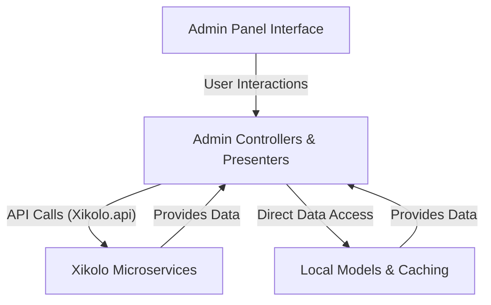
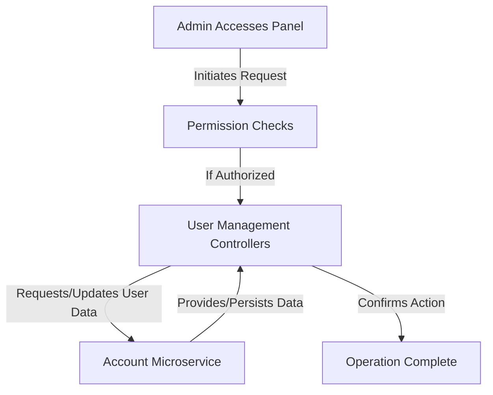
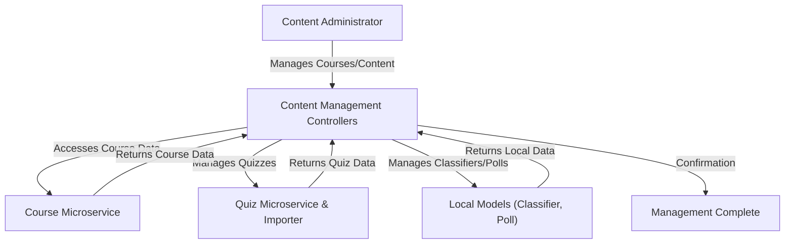
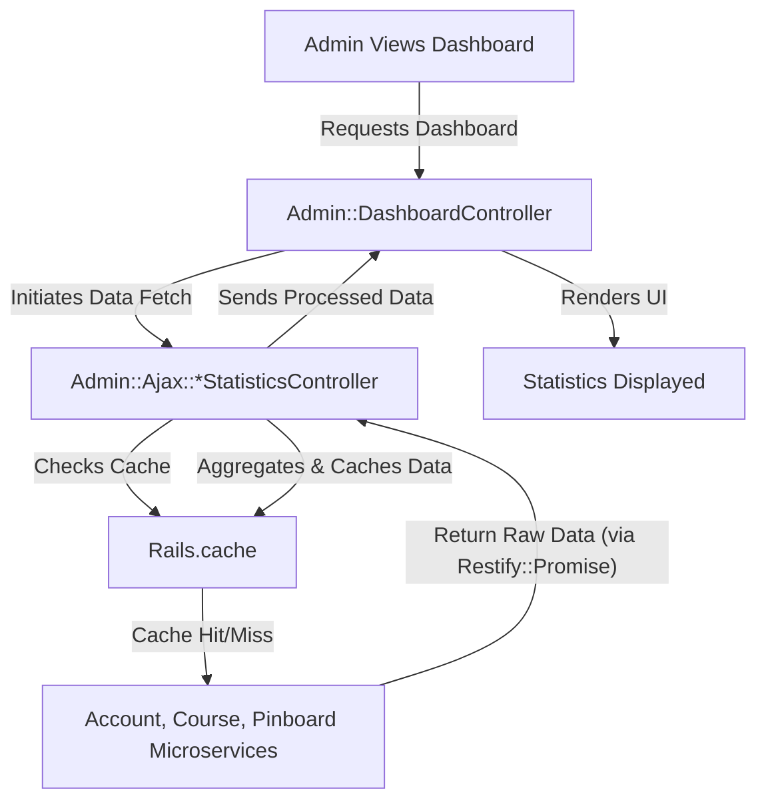

# General Administration Panel Functionality - Technical Documentation

*Generated on 9/18/2025 | Xikolo Knowledge Base*

---

## 📋 Executive Summary

The Xikolo 30_ADMIN_GeneralPanel cluster provides a robust administrative interface for managing critical platform functionalities including user accounts, course content, and system-wide statistics. This comprehensive suite of tools is predominantly implemented within the `Admin` namespace of the primary web application, leveraging a sophisticated microservice architecture. Key components within this panel frequently interact with specialized backend services such as `account`, `course`, `quiz`, `pinboard`, and `quizimporter` via `Xikolo.api` and `Restify` clients. The architecture emphasizes patterns like strong authorization, dedicated presenter objects for view logic, and form objects for validation, alongside performance optimizations such as `Rails.cache` and asynchronous API requests. The core purpose is to empower administrators with efficient and secure control over the platform's operational aspects.

---

## 🏗️ Architecture Overview

The architecture for the General Administration Panel Functionality (`30_ADMIN_GeneralPanel`) centers around a client-side administrative user interface interacting with a web layer composed of `Admin` controllers and associated `Presenters` and `Form` objects. This web layer acts as an orchestration point, communicating extensively with various backend microservices and, in some cases, with local data models. Controllers within the `Admin` namespace serve as the primary request handlers, delegating most data operations to specialized microservices like `account`, `course`, `quiz`, `pinboard`, and `quizimporter`. 

Interaction with microservices is standardized through `Xikolo.api(:service_name).value!`, which returns a `Restify` client for performing `get`, `post`, `patch`, or `delete` requests. Presenter objects, such as `Admin::CourseEditPresenter` and `Admin::ClusterPresenter`, are extensively used to encapsulate view-specific logic, aggregate data from multiple sources, and format it for the user interface, thus keeping controllers lean. Complementary form objects like `Admin::ChannelForm` and `Admin::UserForm` manage parameter sanitization, validations, and mapping data to microservice resource formats, including handling `remote_errors`. For performance, particularly in statistics-focused areas, `Rails.cache` is utilized, and `Restify::Promise` facilitates concurrent API calls to efficiently aggregate data from multiple services. Asynchronous operations, like course cloning, are handled via `Msgr.publish` to specific message topics.

### Main Architecture Diagram

### Architecture Diagrams

#### General Administration Panel Functionality - Main Architecture

### 🔄 Component Interactions

Key interactions between components in this cluster:

- **Admin::Ajax::ClassifiersController:** Interacts with `Course::Classifier` model to fetch and query data.
- **Admin::Ajax::CoursesController:** Communicates with the `course` microservice via `Xikolo.api(:course)` to fetch course data.
- **Admin::Ajax::DetailStatisticsController:** Communicates with the `course` microservice via `Xikolo.api(:course)` to fetch metric data.
- **Admin::Ajax::DetailStatisticsController:** Communicates with the `pinboard` microservice via `Xikolo.api(:pinboard)` for most active user statistics.
- **Admin::Ajax::PlatformStatisticsController:** Communicates with the `account` microservice via `Xikolo.api(:account)` for user statistics.
- **Admin::Ajax::PlatformStatisticsController:** Communicates with the `course` microservice via `Xikolo.api(:course)` for enrollment and certificate statistics.
- **Admin::Ajax::StreamsController:** Interacts with `Video::Stream` model to query and limit streams.
- **Admin::Ajax::UsersController:** Communicates with the `account` microservice via `Xikolo.api(:account)` to fetch user data.
- **Admin::BansController:** Communicates with the `account` microservice via `Xikolo.api(:account)` to post user ban requests.
- **Admin::ChannelsController:** Communicates with the `course` microservice via `Xikolo.api(:course)` for channel data management.
- **Admin::ChannelsController:** Uses `Admin::ChannelEditPresenter` to prepare channel data for views.
- **Admin::ChannelsOrderController:** Communicates with the `course` microservice via `Xikolo.api(:course)` to update channel positions.
- **Admin::ChannelsOrderController:** Uses `Admin::ChannelOrderPresenter` to prepare channel data for ordering.
- **Admin::Classifier::CoursesOrderController:** Interacts with `Course::Classifier` and `Course::ClassifierAssignment` models to manage course ordering.
- **Admin::Classifier::CoursesOrderController:** Interacts with `Course::Course` to validate course IDs.
- **Admin::ClassifiersController:** Interacts with `Course::Classifier` and `Course::Cluster` models for data persistence.
- **Admin::Cluster::ClassifiersOrderController:** Interacts with `Course::Cluster` and `Course::Classifier` models to update ordering.
- **Admin::ClustersController:** Interacts with `Course::Cluster` model for data persistence.
- **Admin::ClustersController:** Uses `Admin::ClusterPresenter` to prepare cluster data for views.
- **Admin::CourseManagementController:** Communicates with `course` microservice via `Xikolo.api(:course)` for course, section, item, and statistics data.
- **Admin::CourseManagementController:** Communicates with `quiz` microservice via `Xikolo.api(:quiz)` for quiz, submission, and statistics data.
- **Admin::CoursesController:** Communicates with the `course` microservice via `Xikolo.api(:course)` for all course data and operations.
- **Admin::CoursesController:** Initiates course cloning via `Msgr.publish` to the `xikolo.course.clone` topic.
- **Admin::DashboardController:** Uses `PlatformDashboardNav` to determine navigation items based on user permissions.
- **Admin::DocumentLocalizationsController:** Communicates with the `course` microservice via `Xikolo.api(:course)` for document localization data.
- **Admin::DocumentLocalizationsController:** Requires `Xikolo.config.beta_features['documents']` to be enabled.
- **Admin::DocumentsController:** Communicates with the `course` microservice via `Xikolo.api(:course)` for document, course, and tag data.
- **Admin::DocumentsController:** Uses `DocumentsListPresenter` to build the document list view.
- **Admin::ManualConfirmationsController:** Communicates with the `account` microservice via `Xikolo.api(:account)` to fetch user and email data, then patch the email confirmation status.
- **Admin::MasqueradesController:** Communicates with the `account` microservice via `Xikolo.api(:account)` to manage user sessions and masquerade status.
- **Admin::PermissionsController:** Communicates with the `account` microservice via `Xikolo.api(:account)` to manage user group memberships.
- **Admin::PollOptionsController:** Interacts with the local `Poll::Poll` model to add/remove options.
- **Admin::PollsController:** Interacts with the local `Poll::Poll` model for data persistence.
- **Admin::TeachersController:** Communicates with the `course` microservice via `Xikolo.api(:course)` for teacher data.
- **Admin::TeachersController:** Communicates with the `account` microservice via `Xikolo.api(:account)` to fetch user details for new teacher creation.
- **Admin::UsersController:** Communicates with the `account` microservice via `Xikolo.api(:account)` to fetch and create user data.
- **Admin::UsersController:** Uses `UserListPresenter` to present user lists.
- **Admin::ChannelEditPresenter:** Wraps `Admin::ChannelForm` and channel data (hash).
- **Admin::Classifier::CoursesOrderPresenter:** Delegates to `Course::Classifier` for title, courses, and cluster information.
- **Admin::ClusterPresenter:** Delegates to `Course::Cluster` for id, title, translations, and classifiers.
- **Admin::ClusterPresenter:** Uses `I18n` for localized sort mode display.
- **Admin::CourseEditPresenter:** Delegates to `Admin::CourseForm` for form-related attributes.
- **Admin::CourseEditPresenter:** Delegates to `BasicCoursePresenter` for core course attributes.
- **Admin::CourseListPresenter:** Wraps a collection of courses.
- **Admin::CourseListPresenter:** Uses `RestifyPaginationCollection` for pagination.
- **Admin::SubscriptionListPresenter:** Uses `RestifyPaginationCollection` for pagination.
- **AdminNavigation:** Checks user permissions using `user.allowed?`.
- **AdminNavigation:** Checks feature flags using `user.feature?` and `Xikolo.config.beta_features`.

---

## ⚙️ Technical Workflows

The Xikolo General Administration Panel encompasses several critical workflows, each designed to provide administrators with granular control and comprehensive oversight of the platform. These workflows are built upon a microservice-oriented architecture, utilizing dedicated controllers, presenters, and interactions with various backend services and local models.

### 1. User Account Administration
Administrators can efficiently manage user accounts within the platform. This workflow includes functionality to list all users, search for specific users (often via AJAX endpoints for autocomplete functionality), create new user accounts, and perform critical administrative actions such as banning users, manually confirming email addresses, and temporarily masquerading as another user for support or debugging purposes. Furthermore, this workflow provides the capability to manage user permissions by assigning or revoking group memberships, directly influencing the administrative access levels within the system. The `Admin::UsersController` serves as a central point for user listing and creation, while `Admin::Ajax::UsersController` provides dynamic search capabilities. Specific actions like banning are handled by `Admin::BansController`, email confirmations by `Admin::ManualConfirmationsController`, and session masquerading by `Admin::MasqueradesController`. User group permissions are managed through `Admin::PermissionsController`. All these components primarily interface with the `account` microservice to fetch and modify user-related data, ensuring a centralized and consistent user management experience.

### 2. Course and Content Management
This workflow empowers administrators with extensive control over course content and structure. It covers the entire lifecycle of courses, from creation and editing to cloning and deletion, and extends to managing course-specific components like channels, clusters, classifiers, documents, and polls. The `Admin::CoursesController` is central for core course operations, interacting heavily with the `course` microservice. `Admin::ChannelsController` and `Admin::ChannelsOrderController` facilitate the management and ordering of course channels, also via the `course` microservice. Content categorization is handled through `Admin::ClustersController` and `Admin::ClassifiersController`, which interact with local `Course::Cluster` and `Course::Classifier` models to manage and order content classifiers and their assigned courses (`Admin::Cluster::ClassifiersOrderController`, `Admin::Classifier::CoursesOrderController`).

Documents and their localizations are managed by `Admin::DocumentsController` and `Admin::DocumentLocalizationsController`, which communicate with the `course` microservice, contingent on a beta feature flag. Teacher profiles are administered through `Admin::TeachersController`, which interacts with both `course` and `account` microservices. Quiz content, including submissions and imports, is managed by `Admin::CourseManagementController` (a controller identified for refactoring), engaging with the `course`, `quiz`, and `quizimporter` services. Polls are managed locally via `Admin::PollsController` and `Admin::PollOptionsController`. Dynamic data loading for forms, such as searching for courses, classifiers, or video streams, is supported by dedicated AJAX controllers like `Admin::Ajax::CoursesController`, `Admin::Ajax::ClassifiersController`, and `Admin::Ajax::StreamsController`.

### 3. Platform Statistics and Dashboard Viewing
This workflow provides administrators with a centralized dashboard to monitor critical platform metrics. The `Admin::DashboardController` serves as the entry point, orchestrating the display of navigation items based on user permissions. The actual data aggregation and retrieval for statistics are handled by specialized AJAX controllers: `Admin::Ajax::DetailStatisticsController` for course-specific metrics (e.g., top countries, item types, active users) and `Admin::Ajax::PlatformStatisticsController` for platform-wide statistics (e.g., total learners, enrollments, certificate counts). These statistics controllers communicate with the `account`, `course`, and `pinboard` microservices to gather raw data. To enhance performance and reduce load on backend services, `Rails.cache` is extensively used to cache statistical results. Furthermore, `Restify::Promise` is employed by `Admin::Ajax::PlatformStatisticsController` to execute concurrent API requests, ensuring efficient data aggregation from multiple microservices before presentation on the dashboard. This allows for a responsive and up-to-date overview of the platform's health and activity.

### Workflow Diagrams

#### User Account Administration Workflow

#### Course and Content Management Workflow

#### Platform Statistics and Dashboard Viewing Workflow

### 🔀 Process Workflows

Detailed workflow processes for this cluster:

- **Key Components and Workflows::** Key Components and Workflows:
  *Source: documentation*

---

## 🔧 Implementation Details

The Xikolo General Administration Panel leverages a set of well-defined technical patterns to ensure robust, scalable, and maintainable functionality across its diverse administrative tasks.

### Technical Considerations
*   **Microservice Interaction:** The overarching pattern is the delegation of data operations to specialized microservices. Controllers consistently use `Xikolo.api(:service_name).value!` to obtain a `Restify` client, enabling uniform `get`, `post`, `patch`, or `delete` requests to `account`, `course`, `quiz`, `pinboard`, and `quizimporter` services. This ensures a clear separation of concerns and adherence to a distributed architecture.
*   **Authorization:** Access control is strictly enforced through `authorize!` and `require_permission` methods. Permissions are checked against the user's roles, often with a `context: :root` for global administrative rights or a `the_course.context_id` for course-specific management, ensuring only authorized personnel can perform actions.
*   **Presenter Pattern:** A significant portion of view-specific logic, data formatting, and complex data aggregation is handled by presenter objects (e.g., `Admin::CourseEditPresenter`, `Admin::ClusterPresenter`). This strategy keeps controllers concise and focuses on handling request-response cycles, while presenters prepare data for display, often aggregating from multiple API calls or local models.
*   **Form Objects:** Dedicated form objects, such as `Admin::ChannelForm`, `Admin::CourseForm`, and `Admin::UserForm`, are employed for robust parameter sanitization, validation, and mapping incoming request parameters to the specific resource formats expected by microservices. They are also responsible for managing `remote_errors` returned from backend services, providing a consistent error handling mechanism.
*   **AJAX Endpoints:** The `Admin::Ajax` namespace is specifically designed to provide dynamic data loading, primarily for autocomplete fields and dashboard statistics. These endpoints typically return JSON responses, facilitating a highly interactive user experience without full page reloads.
*   **Caching:** `Rails.cache` is strategically implemented, particularly within statistics controllers like `Admin::Ajax::DetailStatisticsController` and `Admin::Ajax::PlatformStatisticsController`, to reduce redundant API calls and accelerate dashboard data retrieval, improving overall performance and user responsiveness.
*   **Asynchronous Operations:** `Restify::Promise` is used for concurrent API requests, especially evident in `Admin::Ajax::PlatformStatisticsController`, to aggregate data from multiple microservices efficiently. Furthermore, significant operations such as course cloning are handled asynchronously via `Msgr.publish` to a `xikolo.course.clone` topic, offloading long-running tasks to background processes.
*   **Feature Flags:** Controlled rollout of new functionalities is managed through feature flags. For instance, document management (`Admin::DocumentsController`, `Admin::DocumentLocalizationsController`) requires `Xikolo.config.beta_features['documents']` to be enabled. Other features rely on `user.feature?`, `Proctoring.enabled?`, or `CourseReactivation.enabled?` checks.

### Dependencies and Integrations
The Admin Panel deeply integrates with and depends on several Xikolo microservices and internal models:
*   **Microservices:** `account`, `course`, `quiz`, `pinboard`, `quizimporter`. These services are critical for user management, course content, quizzes, statistics, and specialized imports, respectively.
*   **Local Models:** `Course::Classifier`, `Course::ClassifierAssignment`, `Course::Cluster` (for managing course classification and ordering), `Video::Stream` (for stream listings), and `Poll::Poll` (for polls and their options) are directly interacted with by certain controllers.
*   **External Libraries:** The `Restify` client library is fundamental for all HTTP-based microservice communications, including the use of `RestifyPaginationCollection` for pagination in presenters like `Admin::CourseListPresenter` and `Admin::SubscriptionListPresenter`.
*   **Internationalization:** `I18n` is used, as seen in `Admin::ClusterPresenter`, for displaying localized content such as sort modes.
*   **Routing:** `Rails.application.routes.url_helpers` is utilized by `Admin::CourseListPresenter` for URL generation.

### Configuration Requirements
Specific features and behaviors within the Admin Panel are governed by configurations:
*   The document management feature requires `Xikolo.config.beta_features['documents']` to be set to true for `Admin::DocumentLocalizationsController` and `Admin::DocumentsController`.
*   Platform statistics calculations in `Admin::Ajax::PlatformStatisticsController` incorporate `Xikolo.config.global_enrollment_delta` and `Xikolo.config.global_users_delta`.
*   `Admin::CourseEditPresenter` considers `Xikolo.config.course_languages` and `Xikolo.config.access_groups` for form presentation, along with feature flags like `Proctoring.enabled?` and `CourseReactivation.enabled?`.

### Technical Debt
Several areas of technical debt are noted in the cluster data, indicating future refactoring opportunities:
*   The `Admin::CourseManagementController` is explicitly marked as a `TODO: refactor` due to its monolithic nature and broad responsibilities, suggesting a need for extraction into more focused resource-based controllers.
*   Pagination is a recurring `TODO` item across multiple controllers, including `Admin::Ajax::StreamsController`, `Admin::PollsController`, and `Admin::UsersController`, indicating a need to implement robust pagination for improved performance and usability with large datasets.
*   Error handling, while present, sometimes uses generic messages. Improved specificity in error feedback could benefit user experience.
*   Usage of `Acfs.run` is occasionally noted as a candidate for refactoring with callbacks or more integrated patterns.

### 📚 Technical Sources & References

Key technical documentation and source references:

- Admin::Ajax::ClassifiersController: app/controllers/admin/ajax/classifiers_controller.rb- Admin::Ajax::CoursesController: app/controllers/admin/ajax/courses_controller.rb- Admin::Ajax::CoursesController: spec/requests/admin/ajax/find_courses_spec.rb- Admin::Ajax::DetailStatisticsController: app/controllers/admin/ajax/detail_statistics_controller.rb- Admin::Ajax::PlatformStatisticsController: app/controllers/admin/ajax/platform_statistics_controller.rb- Admin::Ajax::StreamsController: app/controllers/admin/ajax/streams_controller.rb- Admin::Ajax::UsersController: app/controllers/admin/ajax/users_controller.rb- Admin::Ajax::UsersController: spec/requests/admin/ajax/find_users_spec.rb- Admin::BansController: app/controllers/admin/bans_controller.rb- Admin::BansController: spec/requests/admin/bans/create_spec.rb- Admin::BaseController: app/controllers/admin/base_controller.rb- Admin::ChannelsController: app/controllers/admin/channels_controller.rb- Admin::ChannelsController: app/presenters/admin/channel_edit_presenter.rb- Admin::ChannelsOrderController: app/controllers/admin/channels_order_controller.rb- Admin::ChannelsOrderController: app/presenters/admin/channel_order_presenter.rb- Admin::Classifier::CoursesOrderController: app/controllers/admin/classifier/courses_order_controller.rb- Admin::Classifier::CoursesOrderController: app/presenters/admin/classifier/courses_order_presenter.rb- Admin::ClassifiersController: app/controllers/admin/classifiers_controller.rb- Admin::Cluster::ClassifiersOrderController: app/controllers/admin/cluster/classifiers_order_controller.rb- Admin::Cluster::ClassifiersOrderController: app/presenters/admin/cluster_presenter.rb- Admin::ClustersController: app/controllers/admin/clusters_controller.rb- Admin::ClustersController: app/presenters/admin/cluster_presenter.rb- Admin::CourseManagementController: app/controllers/admin/course_management_controller.rb- Admin::CourseManagementController: spec/controllers/admin/course_management_controller_spec.rb- Admin::CoursesController: app/controllers/admin/courses_controller.rb- Admin::CoursesController: app/presenters/admin/course_edit_presenter.rb- Admin::DashboardController: app/controllers/admin/dashboard_controller.rb- Admin::DocumentLocalizationsController: app/controllers/admin/document_localizations_controller.rb- Admin::DocumentsController: app/controllers/admin/documents_controller.rb- Admin::ManualConfirmationsController: app/controllers/admin/manual_confirmations_controller.rb- Admin::MasqueradesController: app/controllers/admin/masquerades_controller.rb- Admin::PermissionsController: app/controllers/admin/permissions_controller.rb- Admin::PermissionsController: RAG: docs/app/features/permissions/reporting.md- Admin::PollOptionsController: app/controllers/admin/poll_options_controller.rb- Admin::PollsController: app/controllers/admin/polls_controller.rb- Admin::TeachersController: app/controllers/admin/teachers_controller.rb- Admin::UsersController: app/controllers/admin/users_controller.rb- Admin::UsersController: spec/controllers/admin/users_controller_spec.rb- Admin::ChannelEditPresenter: app/presenters/admin/channel_edit_presenter.rb- Admin::ChannelOrderPresenter: app/presenters/admin/channel_order_presenter.rb- Admin::Classifier::CoursesOrderPresenter: app/presenters/admin/classifier/courses_order_presenter.rb- Admin::ClusterPresenter: app/presenters/admin/cluster_presenter.rb- Admin::CourseEditPresenter: app/presenters/admin/course_edit_presenter.rb- Admin::CourseListPresenter: app/presenters/admin/course_list_presenter.rb- Admin::SubscriptionListPresenter: app/presenters/admin/subscription_list_presenter.rb- AdminNavigation: app/presenters/admin_navigation.rb- Configuration: config/application.rb, Gemfile, config/database.yml- Process Management: Procfile, Procfile.web- Build & Deploy: Rakefile, package.json

---

*This documentation is automatically generated from cluster analysis and should be validated against the actual codebase.*
