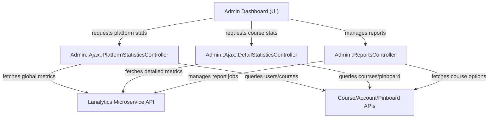
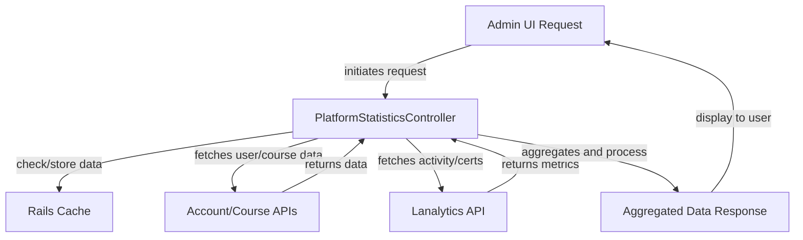
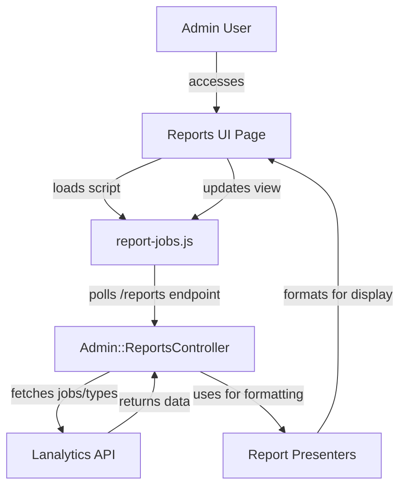
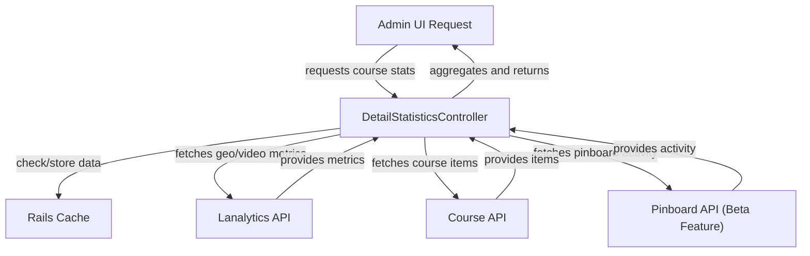

# Platform-Wide and Course-Specific Analytics and Reporting - Technical Documentation

*Generated on 9/18/2025 | Xikolo Knowledge Base*

---

## 📋 Executive Summary

The Xikolo 31_ADMIN_Analytics cluster provides a centralized and comprehensive system for analytics and reporting across the learning platform. Its core purpose is to offer administrators and stakeholders deep insights into platform-wide usage, granular course performance, and user activity through a suite of administrative controllers and specialized models. This cluster enables the generation, management, and display of diverse statistical data and custom reports, consolidating information from various microservices and internal data models to ensure data-driven decision-making and operational oversight. Key components include AJAX controllers for dynamic data retrieval, dedicated models for statistical calculations, and a robust reporting interface.

---

## 🏗️ Architecture Overview

The architecture for the 31_ADMIN_Analytics cluster is designed to aggregate and present analytics from various microservices and internal models. It primarily relies on specialized administrative controllers acting as an intermediary layer between the user interface and distributed data sources. Caching mechanisms are extensively utilized to enhance performance and reduce load on backend services. The reporting subsystem provides flexible job management and data presentation through dedicated presenters.

Key Components:
*   **Admin Dashboard (UI):** The primary user interface for administrators to view statistics and manage reports, initiating data requests to the backend controllers.
*   **Admin::Ajax::PlatformStatisticsController:** This controller is responsible for gathering and consolidating high-level platform statistics, such as user counts, total enrollments, and overall activity, from various APIs.
*   **Admin::Ajax::DetailStatisticsController:** Focuses on providing in-depth, course-specific metrics, including geographical data, top content types, and video engagement. It leverages external APIs and a GeoIP lookup service.
*   **Admin::ReportsController:** Serves as the central component for managing custom reports, facilitating their creation, listing, restarting, and deletion. It interacts heavily with the `lanalytics_api`.
*   **Lanalytics Microservice API:** A critical backend service that stores and processes analytics data, providing aggregated metrics and managing report generation jobs.
*   **External Data Services (Course, Account, Pinboard APIs):** Represents various microservices (`course_api`, `account_api`, `pinboard_api`) that are queried by the administrative controllers to enrich analytics data with user, course, and specific feature (e.g., pinboard) details.

### Architecture Diagrams

#### Main Architecture Overview

### 🔄 Component Interactions

Key interactions between components in this cluster:

- **Admin::Ajax::ClassifiersController:** Interacts with `Course::Classifier` model to retrieve classifier data.
- **Admin::Ajax::CoursesController:** Communicates with `course_api` service to fetch course details.
- **Admin::Ajax::DetailStatisticsController:** Fetches 'top_countries', 'top_cities', 'top_items', 'video_statistics' metrics from `learnanalytics_api` via `fetch_metric` helper. [Source: app/controllers/admin/ajax/detail_statistics_controller.rb]
- **Admin::Ajax::DetailStatisticsController:** Fetches course items from `course_api`. [Source: app/controllers/admin/ajax/detail_statistics_controller.rb]
- **Admin::Ajax::PlatformStatisticsController:** Fetches account statistics from `account_api`. [Source: app/controllers/admin/ajax/platform_statistics_controller.rb]
- **Admin::Ajax::PlatformStatisticsController:** Fetches course statistics (global enrollments, course count) from `course_api`. [Source: app/controllers/admin/ajax/platform_statistics_controller.rb]
- **Admin::Ajax::StreamsController:** Interacts with `Video::Stream` model to retrieve stream data.
- **Admin::Ajax::UsersController:** Communicates with `account_api` service to fetch user details.
- **Admin::ReportsController:** Fetches report jobs and report types from `learnanalytics_api`. [Source: app/controllers/admin/reports_controller.rb]
- **Admin::ReportsController:** Creates, restarts, and deletes report jobs via `learnanalytics_api`. [Source: app/controllers/admin/reports_controller.rb]
- **Admin::StatisticsController:** Initializes `IconNavigationPresenter` for dashboard navigation. [Source: app/controllers/admin/statistics_controller.rb]
- **LanalyticsHelper:** Accesses `current_user` to determine user ID.
- **LanalyticsHelper:** Reads `ENV['RELEASE_NUMBER']` for build version.
- **Course::EnrollmentsStatistics:** Queries `Course::Enrollment` records directly from the database. [Source: app/models/course/enrollments_statistics.rb]
- **Course::EnrollmentsStatistics:** Considers `course.enrollment_delta` for adjusted counts. [Source: app/models/course/enrollments_statistics.rb]
- **Course::Statistics:** Uses `Course::EnrollmentsStatistics` to get enrollment data. [Source: app/models/course/statistics.rb]
- **Course::Statistics:** Queries `Course::Visit` records to determine user shows. [Source: app/models/course/statistics.rb]
- **Admin::ReportJobPresenter:** Receives raw job data and `current_user` object. [Source: app/presenters/admin/report_job_presenter.rb]
- **Admin::ReportJobPresenter:** Determines if a job is downloadable, error-prone, or restartable based on its status. [Source: app/presenters/admin/report_job_presenter.rb]
- **Admin::ReportPresenter:** Receives report type definition, list of courses, list of classifiers, and prefill data. [Source: app/presenters/admin/report_presenter.rb]
- **Admin::ReportPresenter:** Maps `courses` and `classifiers` data to select input options. [Source: app/presenters/admin/report_presenter.rb]
- **Admin::StatisticsPresenter:** Queries `Course::Classifier` to find relevant courses. [Source: app/presenters/admin/statistics_presenter.rb]
- **Admin::StatisticsPresenter:** Wraps `Course::Course` objects with an inner `Course` class for formatted display. [Source: app/presenters/admin/statistics_presenter.rb]
- **GeoIP::Lookup:** Reads from the `vendor/GeoLite2-Country/GeoLite2-Country.mmdb` database.
- **Course::Admin::StatisticsController:** Uses `CourseContextHelper` to establish course context. [Source: app/controllers/course/admin/statistics_controller.rb]
- **Course::Admin::StatisticsController:** Uses `Acfs.run` (likely a frontend data fetching mechanism) for each statistics view. [Source: app/controllers/course/admin/statistics_controller.rb]
- **Poll::Stats:** Directly queries the database (`poll_responses` table) using raw SQL to count responses. [Source: app/models/poll/stats.rb]
- **Voucher::Stats:** Queries `Voucher::Voucher` and `Course::Course` models directly from the database. [Source: app/models/voucher/stats.rb]
- **report-jobs.js:** Polls the `/reports` endpoint every 10 seconds to update the report jobs table. [Source: app/assets/admin/reports/report-jobs.js]
- **report-jobs.js:** Fetches HTML content from `/reports` and injects it into the `[data-id="report-jobs"]` element. [Source: app/assets/admin/reports/report-jobs.js]
- **lanalytics.report.admin Role:** Includes `lanalytics.report.create` permission. [Source: RAG: services/account/lib/tasks/permissions/lanalytics.yml]
- **lanalytics.report.admin Role:** Includes `lanalytics.report.delete` permission. [Source: RAG: services/account/lib/tasks/permissions/lanalytics.yml]

---

## ⚙️ Technical Workflows

### 1. Platform-Wide Statistics Retrieval
This workflow describes how platform-level statistics are retrieved and presented to an administrator. The process emphasizes concurrent data fetching and aggressive caching to ensure responsiveness.

An administrator initiates a request for platform statistics from the Admin UI. The `Admin::Ajax::PlatformStatisticsController` intercepts this request and first attempts to retrieve the data from `Rails.cache`. If the data is not cached or has expired, the controller performs concurrent API calls using `Restify::Promise` to `account_api` for user statistics (e.g., confirmed users, daily registrations) and `course_api` for global course statistics (e.g., total enrollments, course counts). Simultaneously, it fetches active user counts and certificate statistics from the `learnanalytics_api` via a `fetch_metric` helper. Once all data is gathered, it applies any configured global deltas (e.g., `Xikolo.config.global_users_delta`), aggregates the results, stores them in `Rails.cache` for future requests (with expiration times ranging from 30 minutes to 1 hour), and renders the aggregated data for display in the Admin UI.

### 2. Custom Report Generation and Management
This workflow outlines the process an administrator follows to create, manage, and view custom reports within the system.

The administrator navigates to the reports management page, which is managed by the `Admin::ReportsController`. Upon loading, the `report-jobs.js` frontend script initiates polling of the `/reports` endpoint every 10 seconds to keep the report jobs table updated asynchronously. The `Admin::ReportsController` fetches available report types and existing report jobs from the `lanalytics_api`. It then uses `Admin::ReportJobPresenter` to format existing jobs for display and `Admin::ReportPresenter` to prepare report creation forms, dynamically populating options like courses (from `course_api`) and classifiers (from `Course::Classifier`). When an administrator submits a new report creation request, the `Admin::ReportsController` sends this request, including `task_type`, `task_scope`, and `options`, to the `lanalytics_api`. For managing existing jobs, the controller also facilitates restarting failed jobs and deleting completed or failed jobs through direct interactions with the `lanalytics_api`. The frontend continuously updates the display, showing job progress, completion status, or error details in a modal if a job fails.

### 3. Detailed Course Statistics Retrieval
This workflow details how specific analytical data for individual courses is fetched and presented, including geographical and content engagement metrics.

An administrator selects a specific course and requests its detailed statistics from the Admin UI. This request is handled by the `Admin::Ajax::DetailStatisticsController`. Similar to platform statistics, the controller first checks `Rails.cache` for existing data, caching results for up to 6 hours. If a cache miss occurs, the controller proceeds to fetch various metrics. It requests `top_countries`, `top_cities`, `top_items`, and `video_statistics` from the `learnanalytics_api` using the `fetch_metric` helper. To determine `top_item_types`, it first retrieves all course items from `course_api` and then combines this with the `top_items` metrics. Additionally, if the `teaching_team_pinboard_activity` beta feature is enabled, the controller queries the `pinboard_api` for pinboard activity statistics. Geographical data might implicitly rely on `GeoIP::Lookup` being used by an underlying service to enrich IP addresses. Once all data is collected and processed, it's served to the Admin UI for display.

### Workflow Diagrams

#### Workflow: Platform Statistics Retrieval

#### Workflow: Custom Report Generation and Management

#### Workflow: Detailed Course Statistics Retrieval

### 🔀 Process Workflows

Detailed workflow processes for this cluster:

- **Core platform-wide and course-specific analytics and reporting operations**
- **Data processing and validation workflows**
- **Component interaction and integration processes**

---

## 🔧 Implementation Details

The 31_ADMIN_Analytics cluster integrates deeply with various microservices and internal models to provide comprehensive insights. Frontend interactions, primarily driven by AJAX, ensure a dynamic user experience, while backend processes focus on efficient data aggregation and presentation.

**Technical Considerations:**
*   **Caching Strategy:** `Rails.cache` is extensively used across `Admin::Ajax::PlatformStatisticsController` (30 mins to 1 hour expiration) and `Admin::Ajax::DetailStatisticsController` (6 hours expiration) for platform-wide and course-specific statistics respectively, along with a `race_condition_ttl` to prevent thundering herd problems. `Course::Statistics` also caches certificate data for 1 hour. This indicates a strong emphasis on performance optimization for frequently accessed statistics.
*   **Concurrent API Calls:** `Restify::Promise` is employed in `Admin::Ajax::PlatformStatisticsController` to make concurrent API calls to `account_api` and `course_api`, significantly reducing latency for fetching multiple data points simultaneously.
*   **Data Transformation:** Presenters like `Admin::ReportJobPresenter` and `Admin::ReportPresenter` are crucial for formatting raw data received from APIs or models into a user-friendly format for display, including mapping IDs to human-readable titles and handling conditional display logic (e.g., job restartability).
*   **Asynchronous Frontend Updates:** The `report-jobs.js` script exemplifies a client-side polling mechanism, updating report job listings every 10 seconds. This pushes the responsibility of maintaining an up-to-date view to the client, reducing server-side complexity for real-time updates.
*   **Direct Database Queries & Raw SQL:** Components like `Course::EnrollmentsStatistics`, `Course::Statistics`, `Poll::Stats`, and `Voucher::Stats` directly query the database. `Poll::Stats` notably uses raw SQL for `poll_responses` counting, which might be a performance optimization but poses a technical debt due to maintainability.

**Dependencies and Integrations:**
*   **Microservices:** Direct API interactions with `account_api`, `course_api`, `lanalytics_api`, and `pinboard_api` are fundamental for data retrieval and report job management. These are accessed via `Xikolo.api()` or `Restify::Promise`.
*   **Internal Models:** Relies heavily on internal ActiveRecord models such as `Course::Classifier`, `Video::Stream`, `Course::Enrollment`, `Course::Visit`, `Poll::Poll`, and `Voucher::Voucher` for data that resides within the primary application's database or is managed directly.
*   **Utility Modules:** `GeoIP::Lookup` provides IP address to geographical location resolution, reading from `vendor/GeoLite2-Country/GeoLite2-Country.mmdb`. `LanalyticsHelper` provides frontend configuration details like user ID and `ENV['RELEASE_NUMBER']`.
*   **Frontend Data Fetching:** `Acfs.run` is utilized within `Course::Admin::StatisticsController` for various course statistics views, indicating a specialized frontend data fetching mechanism.

**Configuration Requirements:**
*   **Global Deltas:** `Xikolo.config.global_enrollment_delta` and `Xikolo.config.global_users_delta` are used to adjust global enrollment and user counts, respectively. These are critical for accurate platform-wide reporting.
*   **Feature Flags:** The `teaching_team_pinboard_activity` beta feature controls access to pinboard statistics in `Admin::Ajax::DetailStatisticsController` and `Course::Admin::StatisticsController`.
*   **Environment Variables:** `ENV['RELEASE_NUMBER']` is read by `LanalyticsHelper` to include the build version in frontend analytics data, which is useful for debugging and tracking.
*   **GeoIP Database:** The presence of `vendor/GeoLite2-Country/GeoLite2-Country.mmdb` is explicitly required by `GeoIP::Lookup` for geographical data resolution. This database is not included in the open-source codebase and must be sourced externally.
*   **Permissions:** Specific permissions are required for various actions, such as `global.dashboard.show` for viewing dashboards, `lanalytics.report.create` and `lanalytics.report.delete` for report management. The `lanalytics.report.admin` role bundles these reporting permissions, managed manually via Rails console in the `account` service, which is noted as a potential technical debt for its lack of a user-friendly interface.

### 📚 Technical Sources & References

Key technical documentation and source references:

- Admin::Ajax::ClassifiersController: app/controllers/admin/ajax/classifiers_controller.rb- Admin::Ajax::CoursesController: app/controllers/admin/ajax/courses_controller.rb- Admin::Ajax::DetailStatisticsController: app/controllers/admin/ajax/detail_statistics_controller.rb- Admin::Ajax::PlatformStatisticsController: app/controllers/admin/ajax/platform_statistics_controller.rb- Admin::Ajax::StreamsController: app/controllers/admin/ajax/streams_controller.rb- Admin::Ajax::UsersController: app/controllers/admin/ajax/users_controller.rb- Admin::ReportsController: app/controllers/admin/reports_controller.rb- Admin::StatisticsController: app/controllers/admin/statistics_controller.rb- LanalyticsHelper: app/helpers/lanalytics_helper.rb- Course::EnrollmentsStatistics: app/models/course/enrollments_statistics.rb- Course::Statistics: app/models/course/statistics.rb- Admin::ReportJobPresenter: app/presenters/admin/report_job_presenter.rb- Admin::ReportPresenter: app/presenters/admin/report_presenter.rb- Admin::StatisticsPresenter: app/presenters/admin/statistics_presenter.rb- GeoIP::Lookup: lib/geo_ip/lookup.rb- Course::Admin::StatisticsController: app/controllers/course/admin/statistics_controller.rb- Poll::Stats: app/models/poll/stats.rb- Voucher::Stats: app/models/voucher/stats.rb- report-jobs.js: app/assets/admin/reports/report-jobs.js- lanalytics.report.admin Role: RAG: docs/app/features/permissions/reporting.md- lanalytics.report.admin Role: RAG: services/account/lib/tasks/permissions/lanalytics.yml- Configuration: config/application.rb, Gemfile, config/database.yml- Process Management: Procfile, Procfile.web- Build & Deploy: Rakefile, package.json

---

*This documentation is automatically generated from cluster analysis and should be validated against the actual codebase.*
