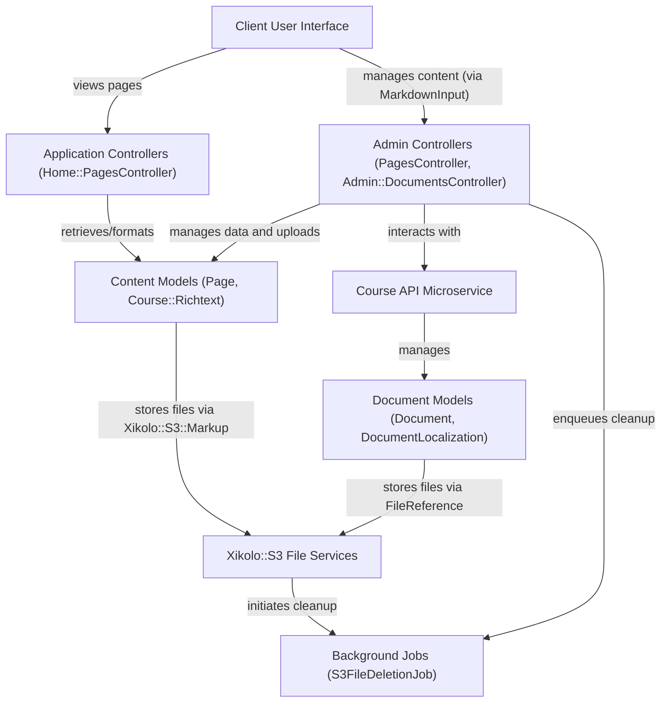
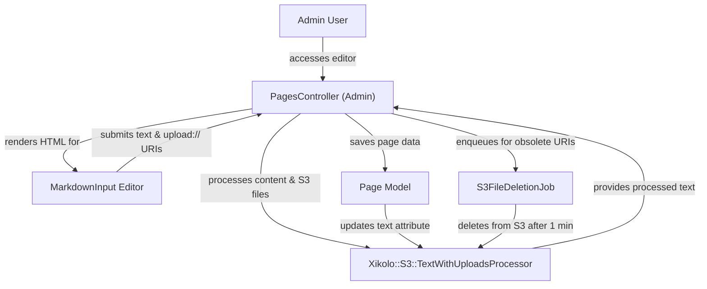
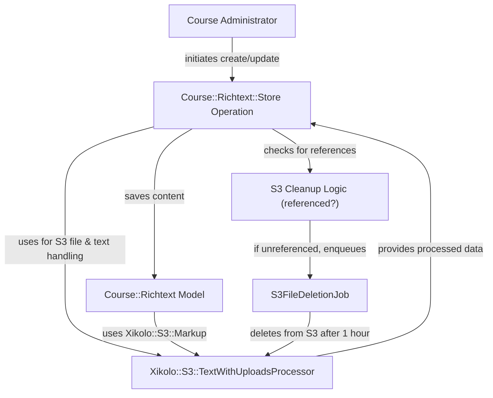
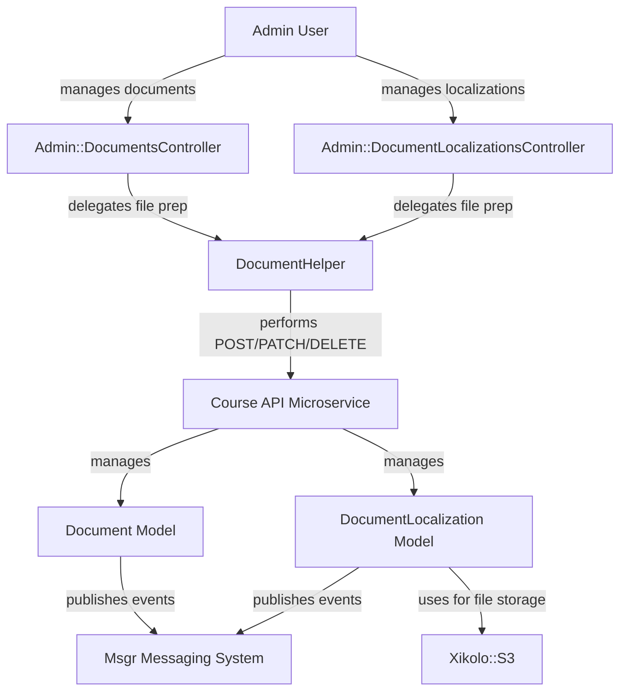

# Static Pages and Rich Text Content Management - Technical Documentation

*Generated on 9/18/2025 | Xikolo Knowledge Base*

---

## 📋 Executive Summary

This report details the Xikolo cluster `32_ADMIN_ContentManagement`, a robust system designed for managing diverse content types, including static platform pages, rich text within courses, and general documents. The core purpose of this system is to provide comprehensive capabilities for content creation, editing, and display, deeply integrated with S3 for scalable file storage and supporting multi-locale content. Key components include dedicated models for pages and rich text, administrative and public-facing controllers, and specialized S3 utility services that handle file uploads, processing, and scheduled deletion, ensuring a streamlined and resilient content management workflow across the Xikolo platform. The architecture is designed to support both application-level content and interaction with a dedicated Course API microservice for document management, enhancing flexibility and scalability.

---

## 🏗️ Architecture Overview

The `32_ADMIN_ContentManagement` cluster exhibits a multi-layered architecture, integrating client-side interfaces with backend controllers, domain-specific models, and external services like S3 and a Course API microservice. Frontend interactions are facilitated by rich text editors, while controllers orchestrate data flow and business logic. Core content models manage structured data and interact with specialized S3 services for file handling. Background jobs ensure data consistency and resource cleanup, particularly for S3-hosted assets. The overall design emphasizes modularity, allowing distinct management workflows for static pages, course-embedded rich text, and general documents, while leveraging common infrastructure components for S3 integration and messaging.

### Architecture Diagrams

#### Main Content Management Architecture

### 🔄 Component Interactions

Key interactions between components in this cluster:

- **Page:** Is created, read, updated, and deleted by `PagesController`.
- **Page:** Its `text` attribute is processed by `Xikolo::S3::TextWithUploadsProcessor` for embedded file management.
- **Course::Richtext:** Belongs to `Course::Course`.
- **Course::Richtext:** Has one `Course::Item` polymorphically as its content.
- **Home::PagesController:** Retrieves Page records using `Page.preferred_locales`.
- **Home::PagesController:** Instantiates `PagePresenter` to format page data.
- **PagesController:** Interacts with the `Page` model to find, initialize, and save page data.
- **PagesController:** Delegates embedded file processing to `Xikolo::S3::TextWithUploadsProcessor`.
- **MarkdownInput:** Renders HTML for the rich text editor and file upload dropzone.
- **MarkdownInput:** Generates S3 upload parameters using `::FileUpload`.
- **Xikolo::S3::Markup:** Used by the `Page` model to define the behavior of its `text` attribute.
- **Xikolo::S3::Markup:** Interacts implicitly with `Xikolo::S3::TextWithUploadsProcessor` during content updates.
- **Xikolo::S3::TextWithUploadsProcessor:** Invoked by `PagesController` to process page content before saving.
- **Xikolo::S3::TextWithUploadsProcessor:** Interacts with S3 (via `xikolo-s3` gem) to upload and manage files.
- **S3FileDeletionJob:** Enqueued by `PagesController` after a successful page update that results in obsolete S3 files.
- **Course::Richtext::Store:** Receives `Course::Richtext` instance and parameters.
- **Course::Richtext::Store:** Uses `Xikolo::S3::TextWithUploadsProcessor` to manage text and S3 uploads.
- **initializeMarkdownEditor:** Called by `initMarkdownEditorOnSelector`.
- **initializeMarkdownEditor:** Likely initializes `@toast-ui/editor` based on project dependencies.
- **initMarkdownEditorOnSelector:** Calls `initializeMarkdownEditor`.
- **Admin::DocumentLocalizationsController:** Interacts with `Xikolo.api(:course)` to manage `DocumentLocalization` records. [Source: app/controllers/admin/document_localizations_controller.rb]
- **Admin::DocumentLocalizationsController:** Uses `DocumentHelper` for file upload related functionalities. [Source: app/controllers/admin/document_localizations_controller.rb]
- **Admin::DocumentsController:** Interacts with `Xikolo.api(:course)` to manage `Document` records, fetch courses, and document tags. [Source: app/controllers/admin/documents_controller.rb]
- **Admin::DocumentsController:** Uses `DocumentsListPresenter` to build the document list for display. [Source: app/controllers/admin/documents_controller.rb]
- **Course::DocumentsController:** Inherits from `Abstract::FrontendController` and includes `CourseContextHelper` and `DocumentHelper`. [Source: app/controllers/course/documents_controller.rb]
- **Course::DocumentsController:** Requires `Xikolo.config.beta_features['documents']` to be enabled for access. [Source: app/controllers/course/documents_controller.rb]
- **Document:** Interacts with `Course` (has_and_belongs_to_many).
- **Document:** Interacts with `Item` via `DocumentsItem` (has_many through).
- **DocumentLocalization:** Belongs to `Document`.
- **DocumentLocalization:** Includes `FileReference` concern for S3 file management.
- **DocumentsListPresenter:** Delegates document properties to `DocumentPresenter` for individual document display. [Source: app/presenters/documents_list_presenter.rb]
- **DocumentsListPresenter:** Extracts unique languages from `document['localizations']` and tags from `@tags` for filter options. [Source: app/presenters/documents_list_presenter.rb]
- **Course::DocumentsPresenter:** Initializes with `user_id`, `course`, and `current_user`. [Source: app/presenters/course/documents_presenter.rb]
- **Course::DocumentsPresenter:** Finds `Xikolo::Course::Enrollment` to check learning evaluation status. [Source: app/presenters/course/documents_presenter.rb]
- **DocumentsPresenter:** Fetches course details from `course_api` using `enrollment.course_id`. [Source: app/presenters/documents_presenter.rb]
- **DocumentsPresenter:** Finds `Certificate::Template` and `Certificate::OpenBadgeTemplate` based on course and certificate type. [Source: app/presenters/documents_presenter.rb]
- **Xikolo::S3::SingleFileUpload:** Interacts with `Xikolo::S3.bucket_for(:uploads)` to access the temporary upload bucket. [Source: gems/xikolo-s3/lib/xikolo/s3/single_file_upload.rb]
- **Xikolo::S3::SingleFileUpload:** Checks S3 object metadata (`xikolo-state`, `xikolo-purpose`) for validity. [Source: gems/xikolo-s3/lib/xikolo/s3/single_file_upload.rb]
- **Xikolo::S3::UploadByUri:** Parses `upload://` URIs to locate files in the temporary upload bucket. [Source: gems/xikolo-s3/lib/xikolo/s3/upload_by_uri.rb]
- **Xikolo::S3::UploadByUri:** Interacts with `Xikolo::S3.bucket_for(:uploads)` and other specified buckets. [Source: gems/xikolo-s3/lib/xikolo/s3/upload_by_uri.rb]
- **DocumentHelper:** Defines `Document` and `Localization` `Struct`s with `ActiveModel` concerns for data representation. [Source: app/helpers/document_helper.rb]
- **DocumentHelper:** Performs `POST`, `PATCH`, `DELETE` requests to `Xikolo.api(:course)` (Course API) for document and localization management. [Source: app/helpers/document_helper.rb]
- **Course::Documents::FilterBar:** Renders a form for filtering documents, submitting to `course_documents_path`.
- **Course::Documents::FilterBar:** Renders `Global::FilterBar::Controls` for filter management.
- **PagePresenter:** Receives a `Page` object and its translations for presentation.
- **PagePresenter:** Utilizes `MarkdownHelper` to convert Markdown text to HTML.
- **MarkdownHelper:** Included and used by `PagePresenter` to render page content for display.
- **DocumentsItem:** Belongs to `Document`.
- **DocumentsItem:** Belongs to `Item`.
- **DocumentsController:** Interacts with `Document` model for data access and manipulation.
- **DocumentsController:** Uses `ApplicationController` as its base.
- **DocumentLocalizationsController:** Interacts with `DocumentLocalization` model for data access and manipulation.
- **DocumentLocalizationsController:** Uses `ApplicationController` as its base.
- **DocumentsTagsController:** Interacts with `Document.all_tags` to fetch tag data.
- **DocumentsTagsController:** Uses `ApplicationController` as its base.
- **Duplicated::Visual:** Belongs to `Course`.
- **Duplicated::Visual:** Optionally belongs to `Duplicated::Video`.
- **Course::Visual::Clone:** Takes `Duplicated::Visual` and `Course` objects as input.
- **Course::Visual::Clone:** Interacts with `Xikolo::S3` to copy image files.
- **FileDeletionWorker:** Includes `Sidekiq::Job` module.
- **FileDeletionWorker:** Interacts with `Xikolo::S3` to perform file deletion.
- **Msgr:** Receives messages from `Document` model (after_create, after_update, soft_delete).
- **Msgr:** Receives messages from `DocumentLocalization` model (after_create, after_update, soft_delete).
- **Xikolo::S3:** Used by `DocumentLocalization` for file uploads and key generation.
- **Xikolo::S3:** Used by `Duplicated::Visual` to generate public image URLs.
- **FileReference:** Included in `DocumentLocalization` to handle file uploads and S3 key generation.
- **PaperTrail:** Included in `DocumentLocalization` to track changes.

---

## ⚙️ Technical Workflows

### 1. Static Page Creation and Update Workflow
This workflow details how administrators manage static pages on the Xikolo platform, including text content and embedded file uploads. An `Admin User` initiates the process by accessing the `PagesController`, which is responsible for administrative editing and updates of `Page` records. The frontend renders a `MarkdownInput` editor, which supports rich text and a file upload dropzone. When content, including potential `upload://` URIs for new files, is submitted, the `PagesController` delegates the processing to `Xikolo::S3::TextWithUploadsProcessor`. This service parses the text, moves files from a temporary S3 bucket to a permanent one, and updates `s3://` URIs within the page's `text` attribute. If the processing and `Page` model save successfully, `S3FileDeletionJob` is asynchronously scheduled with a 1-minute delay to remove any previously referenced S3 files that are no longer part of the updated content, ensuring fault tolerance and efficient storage management.

### 2. Course Rich Text Content Management Workflow
This workflow focuses on managing rich text content embedded within courses, such as learning materials. A `Course Administrator` initiates content creation or updates, which are encapsulated by the `Course::Richtext::Store` operation. This operation receives the `Course::Richtext` instance and content parameters. Similar to static pages, `Course::Richtext::Store` utilizes `Xikolo::S3::TextWithUploadsProcessor` to handle the rich text content and any embedded S3 file uploads. This involves parsing the text, configuring S3 keys specific to courses (e.g., `courses/{cid}/rtfiles/{upload.unique_sanitized_name}`), and managing the transition of files to permanent S3 storage. Upon a successful save of the `Course::Richtext` model, `Course::Richtext::Store` schedules `S3FileDeletionJob` for any obsolete URIs. Crucially, before deletion, a check is performed to ensure that these URIs are not referenced by other `Course::Richtext` instances or by `Course::Course` descriptions, preventing accidental deletion of shared assets. This job is scheduled with a longer delay of 1 hour to further ensure content availability.

### 3. General Document and Localization Management Workflow
This workflow outlines the administrative process for managing general documents and their localized versions, leveraging a microservice architecture. An `Admin User` interacts with `Admin::DocumentsController` and `Admin::DocumentLocalizationsController` to create, update, or delete `Document` and `DocumentLocalization` records. These administrative controllers interact directly with the `Xikolo.api(:course)` endpoint, which represents a 'Course-specific Document and Media Asset Management Microservice'. The microservice, in turn, manages the `Document` and `DocumentLocalization` models. For localized documents, the `DocumentLocalization` model includes the `FileReference` concern, which handles S3 file management, including file uploads and S3 key generation, in conjunction with the `Xikolo::S3` utility module. The `DocumentHelper` assists in preparing file uploads and handling API requests. Furthermore, `Msgr` is used to publish messages (e.g., after_create, after_update, soft_delete) from both `Document` and `DocumentLocalization` models to RabbitMQ, enabling other parts of the system to react to document lifecycle events. This distributed approach ensures specialized management and event-driven integration.

### Workflow Diagrams

#### Static Page Creation and Update Workflow

#### Course Rich Text Content Management Workflow

#### General Document & Localization Management Workflow

### 🔀 Process Workflows

Detailed workflow processes for this cluster:

- **Page Process:** Its `text` attribute is processed by `Xikolo::S3::TextWithUploadsProcessor` for embedded file management.
  *Source: Page*
- **PagesController Process:** Delegates embedded file processing to `Xikolo::S3::TextWithUploadsProcessor`.
  *Source: PagesController*
- **Xikolo::S3::Markup Process:** Interacts implicitly with `Xikolo::S3::TextWithUploadsProcessor` during content updates.
  *Source: Xikolo::S3::Markup*
- **Xikolo::S3::TextWithUploadsProcessor Process:** Invoked by `PagesController` to process page content before saving.
  *Source: Xikolo::S3::TextWithUploadsProcessor*
- **Xikolo::S3::TextWithUploadsProcessor Process:** Provides `result` (processed text), `valid?`, `commit!`, `rollback!`, and `obsolete_uris` methods to `PagesController`.
  *Source: Xikolo::S3::TextWithUploadsProcessor*
- **Course::Richtext::Store Process:** Uses `Xikolo::S3::TextWithUploadsProcessor` to manage text and S3 uploads.
  *Source: Course::Richtext::Store*

---

## 🔧 Implementation Details

The `32_ADMIN_ContentManagement` cluster leverages several technical components and considerations for its operations. The `Page` model's associations for `translations` and `other_translations` use `inverse_of: false`, which, as indicated in cluster data, could potentially lead to N+1 query issues if not carefully managed within the application logic. Similarly, the `Course::Richtext.referenced?` method, critical for preventing premature S3 file deletions, relies on `LIKE` queries on text columns. While functional, this implementation could become a performance bottleneck with larger datasets, highlighting the recommendation to consider leveraging PostgreSQL's `pg_trgm` extension for improved performance, as it is already enabled in the schema. 

Custom S3 logic, particularly within `Xikolo::S3::Markup` and `Xikolo::S3::TextWithUploadsProcessor`, provides powerful integration for handling embedded files but introduces a maintenance burden due to its bespoke nature, necessitating thorough testing and documentation. The delayed S3 object deletion, implemented via `S3FileDeletionJob` with delays of 1 minute for pages and 1 hour for richtext content, is a deliberate design choice for fault tolerance, allowing users with slow connections to complete loading before files are permanently removed. This, however, means obsolete files temporarily reside in S3 storage.

Dependencies and integrations are central to the system's operation. The `MarkdownInput` component, a SimpleForm input, directly renders HTML for the rich text editor and integrates with frontend JavaScript functions like `initializeMarkdownEditor` to activate `@toast-ui/editor`. This component generates S3 upload parameters using `::FileUpload`. For general document management, administrative controllers (`Admin::DocumentLocalizationsController`, `Admin::DocumentsController`) and `Course::DocumentsController` interact extensively with `Xikolo.api(:course)`, acting as a `Restify` client to a 'Course-specific Document and Media Asset Management Microservice'. The `DocumentHelper` further facilitates these interactions by defining `Struct`s for data representation and performing API requests. The `Document` and `DocumentLocalization` models utilize `Msgr` for publishing lifecycle events to RabbitMQ, enabling an event-driven architecture. `DocumentLocalization` also includes the `FileReference` concern for S3 file management and `PaperTrail` for versioning. `Xikolo::S3` serves as a fundamental shared utility module for all S3 interactions, including file uploads, copying, and deletions, further utilized by components such as `Duplicated::Visual` and `Course::Visual::Clone`.

Configuration requirements include enabling `Xikolo.config.beta_features['documents']` for access to course document features. Furthermore, `Xikolo.config.locales['available']` is accessed by `PagePresenter` to determine available locales for new translations. The S3 bucket names and purposes, such as `:pages` with `'helpdesk_page_file'` and `:course` with `'course_richtext'`, are hardcoded in certain controllers (e.g., `PagesController`) and utilities, as indicated in the cluster data, implying that these are specific, non-dynamic configurations. The `Xikolo::S3` module expects S3 buckets to be configured via `Xikolo.config.s3['buckets']` for proper operation.

### 📚 Technical Sources & References

Key technical documentation and source references:

- Page: app/models/page.rb- Course::Richtext: app/models/course/richtext.rb- Course::Richtext: spec/models/course/richtext_spec.rb- Home::PagesController: app/controllers/home/pages_controller.rb- PagesController: app/controllers/pages_controller.rb- MarkdownInput: app/inputs/markdown_input.rb- Xikolo::S3::Markup: app/models/page.rb- Xikolo::S3::TextWithUploadsProcessor: app/controllers/pages_controller.rb- S3FileDeletionJob: app/controllers/pages_controller.rb- Course::Richtext::Store: app/operations/course/richtext/store.rb- Course::Richtext::Store: spec/operations/course/richtext/store_spec.rb- initializeMarkdownEditor: app/assets/util/markdown-editor.ts- initializeMarkdownEditor: foundational_context: package.json- initMarkdownEditorOnSelector: app/assets/util/markdown-editor.ts- Admin::DocumentLocalizationsController: app/controllers/admin/document_localizations_controller.rb- Admin::DocumentsController: app/controllers/admin/documents_controller.rb- Admin::DocumentsController: app/presenters/documents_list_presenter.rb- Course::DocumentsController: app/controllers/course/documents_controller.rb- Document: services/course/app/models/document.rb- DocumentLocalization: services/course/app/models/document_localization.rb- DocumentsListPresenter: app/presenters/documents_list_presenter.rb- Course::DocumentsPresenter: app/presenters/course/documents_presenter.rb- DocumentsPresenter: app/presenters/documents_presenter.rb- Xikolo::S3::SingleFileUpload: gems/xikolo-s3/lib/xikolo/s3/single_file_upload.rb- Xikolo::S3::SingleFileUpload: RAG: gems/xikolo-s3/README.md- Xikolo::S3::UploadByUri: gems/xikolo-s3/lib/xikolo/s3/upload_by_uri.rb- Xikolo::S3::UploadByUri: RAG: gems/xikolo-s3/README.md- DocumentHelper: app/helpers/document_helper.rb- Course::Documents::FilterBar: app/components/course/documents/filter_bar.rb- Course::Documents::FilterBar: app/components/course/documents/filter_bar.html.slim- PagePresenter: app/presenters/page_presenter.rb- MarkdownHelper: app/presenters/page_presenter.rb- DocumentsItem: services/course/app/models/documents_item.rb- DocumentsController: services/course/app/controllers/documents_controller.rb- DocumentLocalizationsController: services/course/app/controllers/document_localizations_controller.rb- DocumentsTagsController: services/course/app/controllers/documents_tags_controller.rb- Duplicated::Visual: services/course/app/models/duplicated/visual.rb- Course::Visual::Clone: services/course/app/operations/course/visual/clone.rb- FileDeletionWorker: services/course/app/workers/file_deletion_worker.rb- Msgr: services/course/app/models/document.rb- Msgr: services/course/app/models/document_localization.rb- Xikolo::S3: services/course/app/models/document_localization.rb- Xikolo::S3: services/course/app/models/duplicated/visual.rb- FileReference: services/course/app/models/document_localization.rb- PaperTrail: services/course/app/models/document_localization.rb- Configuration: config/application.rb, Gemfile, config/database.yml- Process Management: Procfile, Procfile.web- Build & Deploy: Rakefile, package.json

---

*This documentation is automatically generated from cluster analysis and should be validated against the actual codebase.*
