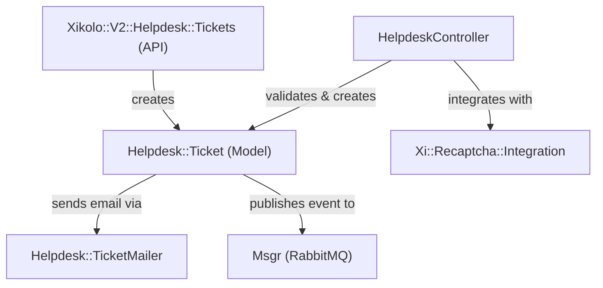
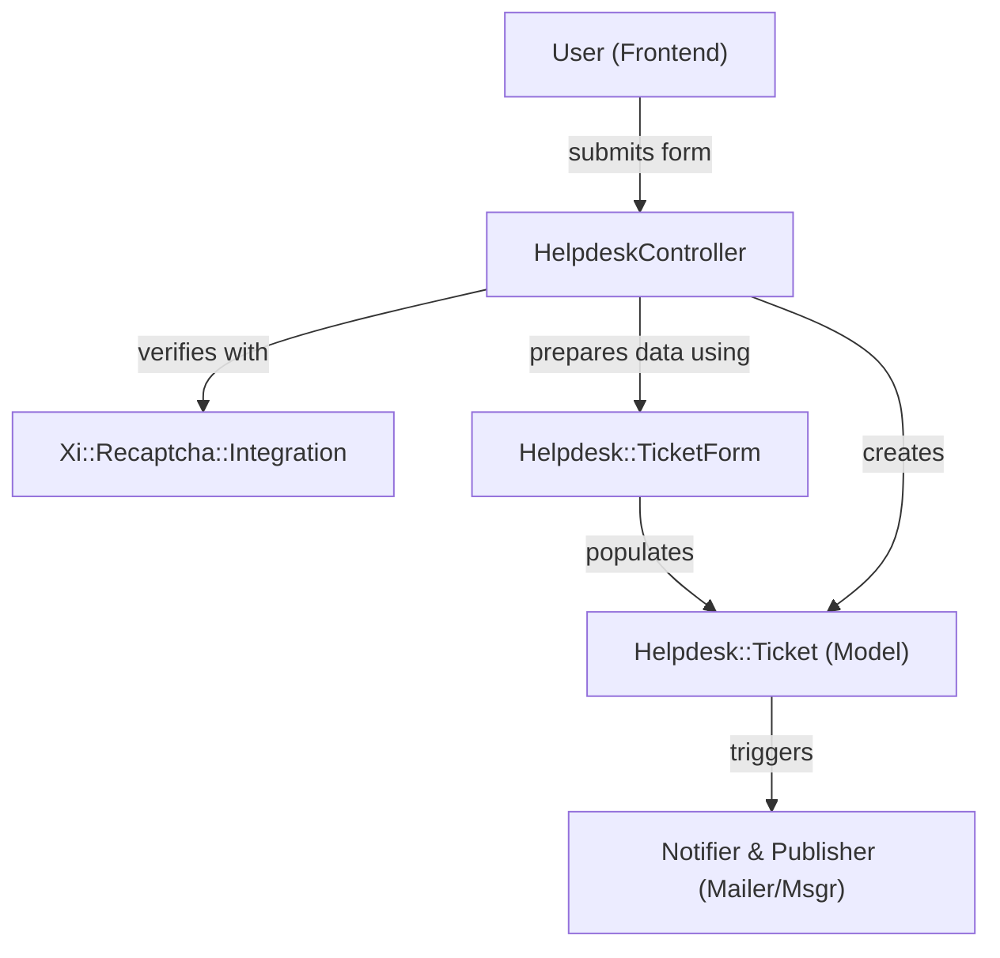
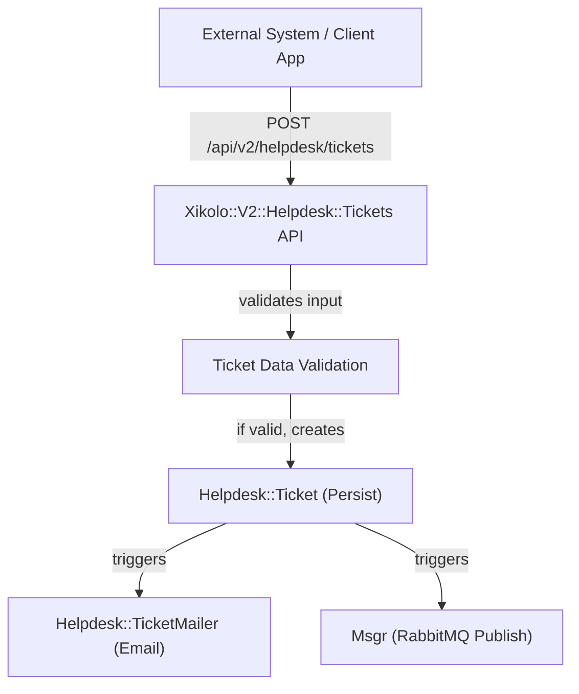
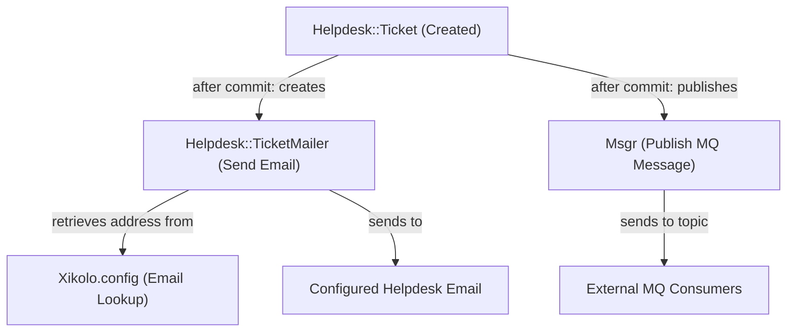

# User Support, Ticket Management, and Helpdesk Integration - Technical Documentation

*Generated on 9/18/2025 | Xikolo Knowledge Base*

---

## 📋 Executive Summary

This report documents cluster 33_ADMIN_Support, focusing on the system for user support, ticket management, and helpdesk integration within the Xikolo platform. The primary objective is to provide a robust infrastructure that enables users to submit support requests through both web-based interfaces and programmatic API interactions. Key components like `Helpdesk::Ticket`, `HelpdeskController`, and `Xikolo::V2::Helpdesk::Tickets` facilitate ticket creation, while `Helpdesk::TicketMailer` and `Msgr` ensure automated notifications and asynchronous event processing. The system incorporates stringent data validation and spam prevention mechanisms, offering a comprehensive and extensible solution for managing diverse support inquiries, including those related to specific courses.

---

## 🏗️ Architecture Overview

The architecture of the Xikolo 33_ADMIN_Support cluster is designed around a core `Helpdesk::Ticket` model, supported by both a web-facing controller and a dedicated API endpoint for ticket submission. The system emphasizes clear separation of concerns, with specialized components handling user interaction, data validation, persistence, and post-creation notifications. Frontend user submissions are managed by the `HelpdeskController`, which utilizes a `Helpdesk::TicketForm` for data encapsulation and `Xi::Recaptcha::Integration` for spam prevention. Programmatic submissions leverage the `Xikolo::V2::Helpdesk::Tickets` API endpoint. Upon successful ticket creation, the system triggers asynchronous processes via `Helpdesk::TicketMailer` for email notifications and `Msgr` for message queue publishing, ensuring external systems or support staff are promptly informed. Configuration settings are centralized through `Xikolo.config`, influencing behaviors such as email recipients.

### Architecture Diagrams

#### Main Architecture

### 🔄 Component Interactions

Key interactions between components in this cluster:

- **Helpdesk::Ticket:** Belongs to `Course::Course` (optional) for course-specific tickets. [Source: app/models/helpdesk/ticket.rb]
- **Helpdesk::Ticket:** Triggers `Helpdesk::TicketMailer` to send email notifications upon creation. [Source: app/models/helpdesk/ticket.rb, spec/models/helpdesk/ticket_spec.rb]
- **HelpdeskController:** Interacts with `Xi::Recaptcha::Integration` for spam prevention. [Source: app/controllers/helpdesk_controller.rb]
- **HelpdeskController:** Uses `Helpdesk::TicketForm` to initialize and annotate form data. [Source: app/controllers/helpdesk_controller.rb]
- **Helpdesk::TicketForm:** Provides `categories_for` method, delegating to `Helpdesk::CategoryOptions`. [Source: app/forms/helpdesk/ticket_form.rb]
- **Helpdesk::TicketForm:** Used by `HelpdeskController` to manage form data. [Source: app/controllers/helpdesk_controller.rb]
- **Helpdesk::TicketMailer:** Receives a `Helpdesk::Ticket` object to construct the email. [Source: app/mailers/helpdesk/ticket_mailer.rb]
- **Helpdesk::TicketMailer:** Retrieves helpdesk email recipient from `Xikolo.config.helpdesk_email`. [Source: app/mailers/helpdesk/ticket_mailer.rb]
- **Xikolo::V2::Helpdesk::Tickets:** Creates `Helpdesk::Ticket` records [Source: api/xikolo/v2/helpdesk/tickets.rb]
- **Xikolo::V2::Helpdesk::Tickets:** Accesses `current_user` for user details if authenticated [Source: api/xikolo/v2/helpdesk/tickets.rb]
- **Xi::Recaptcha::Integration:** Used by `HelpdeskController` to verify form submissions. [Source: app/controllers/helpdesk_controller.rb]
- **Msgr:** Receives a `Helpdesk::Ticket`'s JSON representation and publishes it to the `xikolo.helpdesk.ticket.create` topic. [Source: app/models/helpdesk/ticket.rb, spec/models/helpdesk/ticket_spec.rb]
- **Helpdesk::CategoryOptions:** Used by `HelpdeskController` to determine ticket topic. [Source: app/controllers/helpdesk_controller.rb]
- **Helpdesk::CategoryOptions:** Used by `Helpdesk::TicketForm` to retrieve categories for display. [Source: app/forms/helpdesk/ticket_form.rb]
- **Xikolo.config:** Accessed by `Helpdesk::TicketMailer` to get the recipient email address [Source: app/mailers/helpdesk/ticket_mailer.rb]

---

## ⚙️ Technical Workflows

### 1. User Submits Helpdesk Ticket (Frontend)
This workflow describes the process initiated when a user submits a support ticket via the Xikolo web interface. The user interacts with the `HelpdeskController`, which is responsible for orchestrating the submission. Initially, the `HelpdeskController` leverages `Xi::Recaptcha::Integration` to verify the submission, mitigating spam. Form data is then processed using `Helpdesk::TicketForm`, which encapsulates and validates the input, and also retrieves dynamic category options from `Helpdesk::CategoryOptions`. The controller then constructs and persists a new `Helpdesk::Ticket` record in the database. Upon successful creation, an `after_commit` callback on the `Helpdesk::Ticket` model triggers two critical post-creation actions: sending an email notification via `Helpdesk::TicketMailer` to the configured helpdesk address and publishing a JSON representation of the ticket to a RabbitMQ topic using `Msgr`. This ensures immediate notification and enables further asynchronous processing by other services.

### 2. User Submits Helpdesk Ticket (API)
This workflow outlines the programmatic submission of helpdesk tickets, typically by an external system or client application. A POST request is made to the `/api/v2/helpdesk/tickets` endpoint, which is managed by the `Xikolo::V2::Helpdesk::Tickets` API endpoint. This endpoint receives the request payload, validates the provided ticket attributes (e.g., `title`, `report`, `topic`), and automatically assigns user details like `mail` and `user_id` if an authenticated `current_user` is present via an authorization header. The API endpoint then proceeds to create a new `Helpdesk::Ticket` record. Similar to the frontend submission, the creation of the `Helpdesk::Ticket` triggers `after_commit` callbacks. These callbacks initiate an email notification via `Helpdesk::TicketMailer` and dispatch a message to the `xikolo.helpdesk.ticket.create` RabbitMQ topic through `Msgr`, ensuring consistency in post-creation processing regardless of the submission origin.

### 3. Helpdesk Ticket Processing
This workflow details the automated actions that occur immediately following the successful creation of a `Helpdesk::Ticket` record, regardless of whether it originated from the frontend or API. The `Helpdesk::Ticket` model includes `after_commit` callbacks that are executed specifically after a new ticket is persisted. First, `Helpdesk::TicketMailer` is invoked to send an email notification. This mailer receives the newly created `Helpdesk::Ticket` object, constructs the email content, sets the `reply_to` address to the submitter's email, and retrieves the primary recipient address from `Xikolo.config.helpdesk_email`. Second, `Msgr` is engaged to publish a message to the RabbitMQ `xikolo.helpdesk.ticket.create` topic. This message contains a JSON representation of the `Helpdesk::Ticket`. This asynchronous messaging mechanism allows other microservices or external helpdesk systems to subscribe to and consume these events, facilitating further automation and integration within the broader Xikolo ecosystem or with third-party support platforms.

### Workflow Diagrams

#### User Submits Helpdesk Ticket (Frontend)

#### User Submits Helpdesk Ticket (API)

#### Helpdesk Ticket Processing

### 🔀 Process Workflows

Detailed workflow processes for this cluster:

- **Xikolo::V2::Helpdesk::Tickets Process:** Raises `Xikolo::Error::UnprocessableEntity` on `ActiveRecord::RecordInvalid`
  *Source: Xikolo::V2::Helpdesk::Tickets*

---

## 🔧 Implementation Details

The Xikolo 33_ADMIN_Support cluster is implemented with a clear separation of concerns, utilizing Ruby on Rails conventions for models and controllers, and a Grape-based API for programmatic interactions.

**Technical Considerations:**
Several technical aspects from the cluster data highlight areas for potential improvement:
*   **Direct `params` Access:** The `create_ticket!` method within `HelpdeskController` directly accesses `params` for several fields (e.g., `userAgent`, `cookie`, `language`, `category`) without uniformly utilizing `ticket_params`. While `params.permit` is employed for `ticket_params`, this pattern could introduce mass assignment vulnerabilities if not meticulously managed across all parameter usages. A more consistent approach using a dedicated form object or strictly permitted parameters would enhance security and maintainability.
*   **Generic `data` Field:** The `data` field in `Helpdesk::Ticket` and `Helpdesk::TicketForm` is defined as a generic string. This approach might lead to inconsistent data storage if various client information needs to be captured. Evolving this to a structured format, such as a JSONB column in the database, would significantly improve querying, analysis capabilities, and overall data integrity.
*   **`allowed_title` Validation Complexity:** The `allowed_title` validation in `Helpdesk::Ticket` employs a complex regular expression (`URI::DEFAULT_PARSER.make_regexp`) to prevent URLs in the ticket title. This regex can be brittle and prone to unexpected behavior, potentially leading to false positives or negatives, depending on how a 'URL' is precisely defined within a title. Simplification or a more robust, tested validation approach might be beneficial.

**Dependencies and Integrations:**
This cluster exhibits tight integrations among its components and with external systems:
*   `Helpdesk::Ticket` is optionally associated with `Course::Course` for course-specific support requests. It also has critical dependencies on `Helpdesk::TicketMailer` and `Msgr` for its `after_commit` callbacks.
*   `HelpdeskController` depends heavily on `Xi::Recaptcha::Integration` for spam verification, `Helpdesk::TicketForm` for managing form data, and `Helpdesk::CategoryOptions` for dynamic category selection. It also creates instances of `Helpdesk::Ticket` and accesses `current_user` for authenticated user details.
*   `Helpdesk::TicketForm` delegates category retrieval to `Helpdesk::CategoryOptions`.
*   `Helpdesk::TicketMailer` relies on `Helpdesk::Ticket` to construct email content and `Xikolo.config` to determine the recipient email address.
*   `Xikolo::V2::Helpdesk::Tickets` (API endpoint) directly creates `Helpdesk::Ticket` records and uses `current_user` for user context if available.
*   `Msgr` serves as the integration point with RabbitMQ, facilitating asynchronous communication by publishing ticket creation events.

**Configuration Requirements:**
The cluster relies on `Xikolo.config` for essential settings:
*   **Helpdesk Email Recipient:** `Xikolo.config.helpdesk_email` is accessed by `Helpdesk::TicketMailer` to determine the destination address for all new ticket notifications. This is a critical configuration point for ensuring support requests reach the appropriate support team.
*   **reCAPTCHA Enablement:** `Xi::Recaptcha::Integration` checks `Xikolo.config.recaptcha['enabled']` to determine if reCAPTCHA verification should be active for web-based form submissions. If this setting is false, reCAPTCHA checks are bypassed.
*   Other configuration requirements are not explicitly specified in the cluster data provided.

### 📚 Technical Sources & References

Key technical documentation and source references:

- Helpdesk::Ticket: app/models/helpdesk/ticket.rb- Helpdesk::Ticket: spec/models/helpdesk/ticket_spec.rb- HelpdeskController: app/controllers/helpdesk_controller.rb- Helpdesk::TicketForm: app/forms/helpdesk/ticket_form.rb- Helpdesk::TicketMailer: app/mailers/helpdesk/ticket_mailer.rb- Helpdesk::TicketMailer: app/models/helpdesk/ticket.rb- Xikolo::V2::Helpdesk::Tickets: api/xikolo/v2/helpdesk/tickets.rb- Xi::Recaptcha::Integration: app/controllers/helpdesk_controller.rb- Msgr: app/models/helpdesk/ticket.rb- Msgr: spec/models/helpdesk/ticket_spec.rb- Helpdesk::CategoryOptions: app/controllers/helpdesk_controller.rb- Helpdesk::CategoryOptions: app/forms/helpdesk/ticket_form.rb- Xikolo.config: app/mailers/helpdesk/ticket_mailer.rb- Configuration: config/application.rb, Gemfile, config/database.yml- Process Management: Procfile, Procfile.web- Build & Deploy: Rakefile, package.json

---

*This documentation is automatically generated from cluster analysis and should be validated against the actual codebase.*
