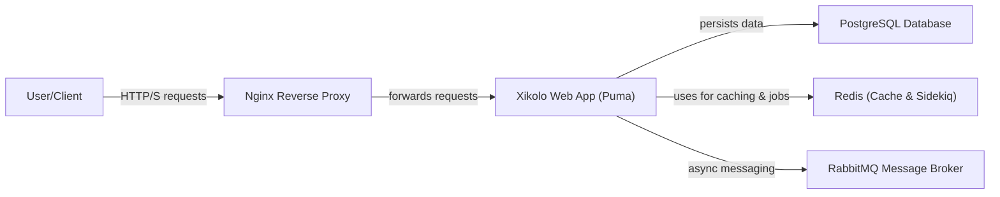
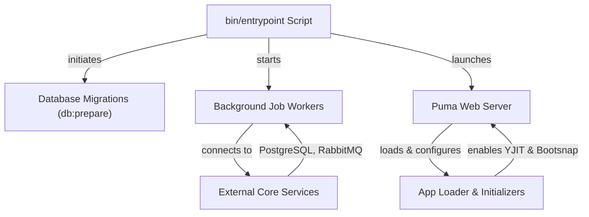
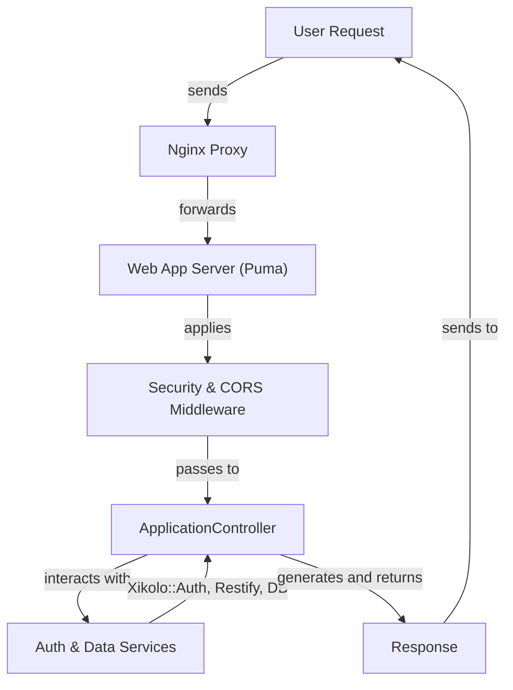

# Core Application Infrastructure & Shared Configuration - Technical Documentation

*Generated on 9/18/2025 | Xikolo Knowledge Base*

---

## 📋 Executive Summary

The Xikolo platform's Core Application (40_INFRA_SystemCore) serves as the central Ruby on Rails 7.2.0 application, built on Ruby 3.4.4, operating within a distributed microservice architecture. It functions as both a user-facing frontend and an API gateway, orchestrating complex interactions with various backend services. The primary purpose of this core system is to provide the foundational infrastructure, manage shared configurations, handle user authentication, process requests, and ensure robust background job execution and monitoring. Key components include the `Xikolo::Web::Application` server, `PostgreSQL` for data, `RabbitMQ` for messaging, and `Redis` for caching and job queues. This report synthesizes insights into the system's architecture, critical operational workflows, and implementation specifics to provide a comprehensive overview.

---

## 🏗️ Architecture Overview

The Xikolo Core Application operates within a robust, containerized microservice architecture. External user requests are initially received by an `Nginx` reverse proxy, which then efficiently routes this traffic to the main `Xikolo::Web::Application`, served by `Puma` application servers. This Rails instance is the central orchestrator for user interactions and API calls. It extensively utilizes the `Xikolo (Global Config/Namespace)` for environment-specific settings, feature toggles, and sensitive `Secrets` crucial for its operation. For persistent data storage, `PostgreSQL` serves as the primary relational database. Two distinct `Redis` instances, `RedisCache` and `RedisSidekiq`, are fundamental for improving performance through caching and for managing asynchronous background job queues, respectively. Asynchronous communication between the various services is facilitated by `RabbitMQ`, with the `Msgr` client embedded within the web application handling message exchange. This foundational architecture ensures high scalability, modularity, and availability for the entire Xikolo platform.

**Key Components & Interactions:**

*   **Nginx Reverse Proxy:** This component acts as the public entry point, receiving all incoming HTTP and HTTPS requests. It effectively distributes and routes traffic to the appropriate backend services, including the `Xikolo Web Application` and other `DockerComposeService` instances. `Nginx` exposes ports `8000:80` and `8443:443` for external access, directing requests to internal application servers.
*   **Xikolo Web Application (Puma):** This is the core Rails application, hosted on the `Puma` application server. It's responsible for processing user requests, handling API calls, and integrating various Rails frameworks. It manages database connections with `PostgreSQL` and interacts with `RabbitMQ` via `Msgr`. `Puma` is configured to gracefully manage `ActiveRecord` database connections and `Msgr` client disconnections during worker lifecycle events, such as forking.
*   **PostgreSQL Database:** `PostgreSQL` provides the primary relational data persistence layer for the `Xikolo Web Application` and all other `DockerComposeService` microservices. Its schema is maintained through database migrations initiated by `DockerComposeInit` services during deployment.
*   **Redis (Cache & Sidekiq):** This represents two distinct Redis instances. `RedisCache` is used by `Xikolo Web Application` and other services for caching frequently accessed data, thereby enhancing responsiveness. `RedisSidekiq` is specifically dedicated to `Sidekiq` for managing background job queues, processing, and scheduling. Both are accessed by `DockerComposeWeb` and `DockerComposeService` instances for their respective roles.
*   **RabbitMQ Message Broker:** `RabbitMQ` serves as the central message broker for the platform, enabling asynchronous communication and event-driven patterns between services. The `web-msgr` and `*-msgr` services within the `Xikolo Web Application` and microservices connect to `RabbitMQ` for publishing and consuming messages.
*   **Xikolo.config:** While not a runtime service, `Xikolo.config` is a critical logical component that provides centralized, application-wide configuration values, including site name, base URL, SMTP settings, CSP policies, and feature toggles. It loads settings from `app/xikolo.yml` and sensitive `Secrets` from `config/secrets.yml`, influencing `Xikolo::Web::Application` behaviors and integrations.

### Architecture Diagrams

#### Main Application Architecture

### 🔄 Component Interactions

Key interactions between components in this cluster:

- **Xikolo::Web::Application:** Loads Rails frameworks (ActiveRecord, ActionController, etc.). [Source: config/application.rb]
- **Xikolo::Web::Application:** Configures `Xikolo.brand` based on `ENV['BRAND']`. [Source: config/application.rb]
- **ApplicationController:** Includes `FeatureTogglesHelper` for feature flag evaluation [Source: app/controllers/application_controller.rb]
- **ApplicationController:** Includes `Login` module for authentication-related helpers [Source: app/controllers/application_controller.rb]
- **ApplicationJob:** Sets the default queue for jobs to 'default' [Source: app/jobs/application_job.rb]
- **ApplicationJob:** Defines a `max_run_time` of 20 minutes for jobs [Source: app/jobs/application_job.rb]
- **ApplicationOperation:** Provides a `call` class method to execute operations [Source: app/operations/application_operation.rb]
- **ApplicationOperation:** Uses `ResultNegotiation` to wrap operation results, allowing clients to react to different outcomes (e.g., `success`, `failure`) [Source: app/operations/application_operation.rb]
- **Makefile:** Orchestrates `webpack` and `sprockets` targets for asset compilation [Source: Makefile]
- **Makefile:** Invokes `bundle exec rake assets:i18n:export` for i18n file generation [Source: Makefile]
- **Procfile:** Starts `bin/rails server` for the web application.
- **Procfile:** Starts `yarn start` for web assets compilation.
- **bin/entrypoint:** Executes database migrations via `bundle exec rake db:prepare` [Source: bin/entrypoint]
- **bin/entrypoint:** Starts Delayed Job workers via `bundle exec rake delayed:work` [Source: bin/entrypoint]
- **Xikolo (Global Config/Namespace):** Sets the application `brand` based on `ENV['BRAND']` [Source: config/application.rb]
- **Xikolo (Global Config/Namespace):** Includes `Xikolo::Common::Secrets` for accessing sensitive configuration [Source: config/application.rb]
- **Xikolo::Common::Auth::Middleware:** Called by `ApplicationController#auth_middleware` during `around_action` [Source: app/controllers/application_controller.rb]
- **Xikolo::Common::Auth::Middleware:** Processes `RelayState` from SAML/OpenID Connect for session management [Source: app/controllers/application_controller.rb]
- **Xikolo::Common::Auth::CurrentUser:** Used by `ApplicationController#current_user` to represent the authenticated user [Source: app/controllers/application_controller.rb]
- **Xikolo::Common::Auth::CurrentUser:** Provides `logged_in?`, `anonymous?`, `allowed?`, `allowed_any?`, `feature?` methods [Source: app/controllers/application_controller.rb]
- **Msgr:** Connects to RabbitMQ for message exchange [Source: Gemfile, config/rabbitmq.yml]
- **Msgr:** Routes messages to specific handlers (e.g., for gamification events) [Source: config/msgr.rb]
- **Sentry:** Integrated via `sentry-rails`, `sentry-ruby`, `sentry-sidekiq` gems [Source: Gemfile]
- **Sentry:** Sets user context with `current_user.id` in `ApplicationController` [Source: app/controllers/application_controller.rb]
- **Telegraf:** Receives metrics from `Xikolo.metrics` [Source: RAG: gems/xikolo-common/README.md]
- **Telegraf:** Sends collected data to a configured Telegraf endpoint [Source: config/application.rb]
- **Rack::Attack:** Intercepts incoming requests before they reach the Rails application. [Source: config/application.rb]
- **Rack::Attack:** Applies rate limiting and blocking rules to requests. [Source: config/application.rb]
- **Rack::Cors:** Allows POST requests from `*.openhpi.de`. [Source: config/application.rb]
- **Rack::Cors:** Allows GET requests from any origin (`*`) to `/playlists/*` for external video players. [Source: config/application.rb]
- **I18n:** Configured in `config/application.rb` with `available_locales` (`de`, `en`), `default_locale` (`en`), and `fallbacks` (`en`) [Source: config/application.rb]
- **I18n:** Used by `Rakefile` tasks (`assets:i18n:export`, `i18n:missing_keys`) for managing translation files [Source: Rakefile]
- **Bootsnap:** Accelerates application startup by caching various Ruby artifacts. [Source: config/boot.rb]
- **Bootsnap:** Loaded conditionally based on the Rails environment (development only). [Source: config/boot.rb]
- **RubyVM::YJIT:** Enabled in an `after_initialize` block if `RubyVM::YJIT.enable` is defined (Ruby 3.3+) [Source: config/initializers/enable_yjit.rb]
- **Lookbook:** Configured in `config/application.rb` to show previews, define preview layouts, listen paths, and page paths [Source: config/application.rb]
- **Imagecrop:** Used by `ApplicationHelper#imagecrop` to transform image URLs [Source: app/helpers/application_helper.rb]
- **Imagecrop:** Relies on `imgproxy` gem [Source: Gemfile]
- **BrowserSupport:** Instantiated by `ApplicationHelper#browser_support` to provide browser-specific information [Source: app/helpers/application_helper.rb]
- **BrowserSupport:** Used to determine whether to hide browser warnings based on cookies [Source: app/helpers/application_helper.rb]
- **Acfs:** Queue is cleared `before_action` in `ApplicationController` [Source: app/controllers/application_controller.rb]
- **Acfs:** Used for promise-compatible interfaces in `ApplicationController` [Source: app/controllers/application_controller.rb]
- **Restify:** Facilitates HTTP requests to other microservices [Source: Gemfile]
- **Restify:** Handles `BadGateway`, `ServiceUnavailable`, and `GatewayTimeout` exceptions [Source: config/application.rb]
- **Delayed (Delayed Job):** Configured as `config.active_job.queue_adapter = :delayed` in `config/application.rb` [Source: config/application.rb]
- **Delayed (Delayed Job):** Workers are started via `bin/rake delayed:work` in `Procfile` and `bin/entrypoint` [Source: Procfile, bin/entrypoint]
- **Sidekiq:** Processes background jobs using Redis [Source: Gemfile, config/sidekiq_redis.yml]
- **Sidekiq:** Runs scheduled cron jobs defined in `config/cron.yml` [Source: Gemfile, RAG: gems/xikolo-sidekiq/README.md]
- **Xikolo.config:** Provides configuration values to Xikolo::Web::Application and other components [Source: config/application.rb]
- **Xikolo.config:** Reads configuration from `app/xikolo.yml` and environment-specific YAML files [Source: app/xikolo.yml, RAG: docs/app/development/application_configuration/index.md, RAG: gems/xikolo-config/README.md]
- **Xikolo.metrics:** Sends data to Telegraf [Source: RAG: gems/xikolo-common/README.md]
- **Xikolo.metrics:** Used by various application components to report custom events and values [Source: RAG: gems/xikolo-common/README.md]
- **Xikolo::S3:** Configures AWS S3 client using `xikolo-config`. [Source: RAG: gems/xikolo-s3/README.md]
- **Xikolo::S3:** Interacts with AWS S3 buckets and objects for file storage and retrieval. [Source: RAG: gems/xikolo-s3/README.md]
- **Puma:** Serves HTTP requests for the Rails application [Source: Gemfile, config/puma.rb]
- **Puma:** Manages ActiveRecord database connections during worker lifecycle [Source: config/puma.rb]
- **Delayed Job:** Processes jobs enqueued via Active Job [Source: config/application.rb]
- **Delayed Job:** Utilizes a dedicated 'mails' queue for email delivery [Source: config/application.rb]
- **Grape:** Defines API endpoints for the main application [Source: Gemfile]
- **Grape:** Integrates with `grape-entity` for API response serialization [Source: Gemfile]
- **Dockerignore:** Interacts with Docker build processes to filter context.
- **EnvFile:** Provides environment variables to `Procfile` for local execution.
- **EnvFile:** Provides environment variables to Docker Compose services for container configuration.
- **PumaConfiguration:** Serves the Rails application (web and microservices).
- **PumaConfiguration:** Disconnects from `ActiveRecord::Base` and `Msgr.client` before forking workers.
- **UnicornConfiguration:** Serves the Rails application.
- **UnicornConfiguration:** Disconnects from `ActiveRecord::Base` before forking workers.
- **DockerBakeHCL:** Defines base images used by service-specific Dockerfiles (e.g., `account.Dockerfile`, `web.Dockerfile`).
- **DockerBakeHCL:** Utilizes `CI_REGISTRY_IMAGE` and `TAG` variables for image naming and versioning.
- **DockerComposeBackground:** Provides database services to all application components.
- **DockerComposeBackground:** Provides message queuing for inter-service communication and background jobs.
- **DockerComposeInit:** Depends on `PostgreSQL`, `RabbitMQ`, `RedisCache`, `RedisSidekiq` being healthy.
- **DockerComposeInit:** Runs database migrations for the `xikolo-web` application.
- **DockerComposeService:** Builds images from service-specific Dockerfiles.
- **DockerComposeService:** Uses environment variables from `.env`.
- **DockerComposeWeb:** Builds image from `docker/files/web.Dockerfile`.
- **DockerComposeWeb:** Uses environment variables from `.env`.
- **DockerComposeNginx:** Routes traffic to `DockerComposeWeb` and `DockerComposeService` instances.
- **DockerComposeNginx:** Exposes ports `8000:80` and `8443:443` for external access.
- **DockerComposeMain:** Includes `DockerComposeBackground`, `DockerComposeInit`, `DockerComposeWeb`, `DockerComposeService` (for all microservices), and `DockerComposeNginx`.
- **PostgreSQL:** Accessed by `DockerComposeWeb` and all `DockerComposeService` instances.
- **PostgreSQL:** Initialized by `init-database` service.
- **RabbitMQ:** Used by `web-msgr` and `*-msgr` services for message processing.
- **RabbitMQ:** Accessed by `DockerComposeWeb` and all `DockerComposeService` instances for message publishing/consuming.
- **RedisCache:** Accessed by `DockerComposeWeb` and all `DockerComposeService` instances for caching operations.
- **RedisSidekiq:** Accessed by `web-sidekiq` and `*-sidekiq` services for job queuing and processing.
- **Minio:** Provides file storage capabilities to application services that require S3-compatible storage.
- **Mailpit:** Receives emails sent by application services for testing purposes.
- **Nginx:** Receives incoming HTTP/HTTPS requests.
- **Nginx:** Forwards requests to `web-server` and `*-server` services based on routing rules.
- **Xikolo.config (app/xikolo.yml):** Provides `locales` settings for I18n. [Source: app/xikolo.yml]
- **Xikolo.config (app/xikolo.yml):** Defines `email.smtp` server for outgoing emails. [Source: app/xikolo.yml]
- **Secrets (config/secrets.yml):** Provides `secret_key_base` for Rails cookie signing. [Source: config/secrets.yml]
- **Secrets (config/secrets.yml):** Supplies `imgproxy_key` and `imgproxy_salt` for signing image processing URLs. [Source: config/secrets.yml]
- **Service Endpoints (config/services.yml):** Provides endpoint URLs for `account`, `course`, `learnanalytics`, `news`, `notification`, `pinboard`, `quiz`, `quizimporter`, and `timeeffort` services. [Source: config/services.yml]
- **Service Endpoints (config/services.yml):** Allows environment variables (`ENV['XIKOLO_SERVICE_ACCOUNT']`, etc.) to override default `localhost` URLs. [Source: config/services.yml]
- **Redis Configuration (Cache & Sidekiq):** Configures Redis `url` and `db` for caching. [Source: config/cache_redis.yml]
- **Redis Configuration (Cache & Sidekiq):** Configures Redis `url`, `db`, `pool_timeout`, and `network_timeout` for Sidekiq. [Source: config/sidekiq_redis.yml]
- **Rake Tasks:** Loads `Xikolo::Web::Application.load_tasks` to make application-specific tasks available. [Source: Rakefile]
- **Rake Tasks:** `ci:setup` interacts with the database (`db:drop:all`, `db:create:all`, `db:schema:load`) and asset pipeline (`assets:i18n:export`). [Source: Rakefile]
- **Middleware::NewsTracker:** Intercepts incoming requests. [Source: config/application.rb]
- **Middleware::NewsTracker:** Performs custom tracking logic for news-related operations. [Source: config/application.rb]
- **Xikolo::Common:** Integrates `Restify` for HTTP communication with other services. [Source: RAG: gems/xikolo-common/README.md]
- **Xikolo::Common:** Provides `Xikolo.metrics` object to send data to Telegraf for monitoring. [Source: RAG: gems/xikolo-common/README.md]
- **Xikolo::Config:** Reads configuration from `xikolo.yml` files, respecting Rails environments. [Source: RAG: gems/xikolo-config/README.md]
- **Xikolo::Config:** Provides `Xikolo.base_url` as an `Addressable::URI` object for URL generation. [Source: RAG: gems/xikolo-config/README.md]
- **Xikolo::Sidekiq:** Configures Sidekiq to use Redis, with connection details from `config/sidekiq_redis.yml`. [Source: RAG: gems/xikolo-sidekiq/README.md]
- **Xikolo::Sidekiq:** Integrates with ActiveJob for background processing. [Source: RAG: gems/xikolo-sidekiq/README.md]
- **check-gem-versions:** Reads `Gemfile.lock` files from the `web` application and all `services/*` directories. [Source: scripts/check-gem-versions]
- **check-gem-versions:** Outputs reports in console or CSV format. [Source: scripts/check-gem-versions]

---

## ⚙️ Technical Workflows

### 1. Application Initialization and System Readiness

The application initialization workflow describes the sequence of operations required to bring the Xikolo::Web::Application to a fully operational state, particularly within a Dockerized environment. The process commences with the `bin/entrypoint` script, which orchestrates several critical pre-launch tasks. Firstly, it executes database migrations by running `bundle exec rake db:prepare`, ensuring the `PostgreSQL` database schema is up-to-date. Following this, it initiates essential background job processors: `Delayed Job` workers are started via `bundle exec rake delayed:work`, and the `msgr` AMQP consumer is launched via `bundle exec msgr` to connect to `RabbitMQ`. Once these foundational services are active and connected, the `Puma` application server is started using `/app/bin/thrust puma`, ready to handle incoming HTTP requests. During the `Xikolo::Web::Application` loading phase, core Rails frameworks are initialized, and configuration from `Xikolo.config` (including brand settings from `ENV['BRAND']`) is applied. Performance enhancements such as `Bootsnap` are conditionally loaded for development environments, and `RubyVM::YJIT` is enabled post-initialization if the Ruby version is 3.3 or newer, providing significant runtime performance improvements. Additionally, crucial middlewares like `Rack::Attack` and `Rack::Cors` are configured during the application boot process to enforce security and cross-origin policies.

### 2. User Request Processing and Authentication Flow

This workflow details how an external user request is processed, from its entry into the system through to the application logic and the generation of a response, with a focus on authentication. The journey begins when a `userRequest` reaches the `nginxProxy`, which acts as the primary reverse proxy and load balancer. `Nginx` then forwards this request to an available instance of the `webAppServer` (Puma). Upon reception by the `Puma` server, the request passes through a series of `requestMiddleware`. Here, `Rack::Attack` applies rate-limiting and blocking rules to mitigate abusive traffic, and `Rack::Cors` enforces Cross-Origin Resource Sharing policies, permitting or denying requests based on origin and method (e.g., allowing POST requests from `*.openhpi.de`). If the request is permitted, it proceeds to the `ApplicationController`. Inside the `ApplicationController`, an `around_action` hook invokes `Xikolo::Common::Auth::Middleware`, which handles the primary authentication flow, processing `RelayState` from SAML/OpenID Connect for session management and populating the request environment with `xikolo_context`. The `ApplicationController` then utilizes `Xikolo::Common::Auth::CurrentUser` to represent the authenticated user, providing methods for authorization checks (`allowed?`, `feature?`) and also setting `Sentry` user context for error tracking. Data required for the request is fetched from `backendServices`, which includes direct queries to `PostgreSQL`, cached data from `RedisCache`, and interactions with other microservices via `Restify`. Any errors encountered during this process are logged to `Sentry`. Finally, the `ApplicationController` compiles the necessary data and renders a `response`, which is then sent back through `Nginx` to the `userClient`.

### 3. Asynchronous Background Job Execution

This workflow describes the mechanism for processing background tasks asynchronously, crucial for maintaining application responsiveness by offloading long-running or non-blocking operations. The `Xikolo::Web::Application` initiates background tasks by enqueuing them via `ActiveJob`. This framework is configured in `config/application.rb` to use `:delayed` as its queue adapter, directing jobs to `Delayed Job`. Alternatively, `Sidekiq` is also heavily utilized for background job processing and scheduled tasks. All jobs inherit from `ApplicationJob`, which defines a default queue (`'default'`), a `max_run_time` of 20 minutes, and a special `ExpectedRetry` error class; this error is used for explicit job retries that `Sentry` is configured to ignore, preventing noise in error tracking. `Delayed Job` workers are started as separate processes via `bin/rake delayed:work`, typically managing their job queue and state within the `PostgreSQL` database. `Sidekiq` workers, on the other hand, are launched via `bundle exec sidekiq` and rely on `RedisSidekiq` for their job queues, processing, and status management. `Sidekiq-cron` further extends Sidekiq's capabilities by loading scheduled tasks from `config/cron.yml` to execute periodic jobs. During the execution of any background job, `Sentry` is actively integrated (via the `sentry-sidekiq` gem) to capture and report unhandled exceptions, ensuring comprehensive error monitoring for asynchronous operations.

### Workflow Diagrams

#### Application Initialization Workflow

#### User Request Processing Workflow

### 🔀 Process Workflows

Detailed workflow processes for this cluster:

- **ApplicationController Process:** Uses `Xikolo::Common::Auth::Middleware` for handling authentication flow
  *Source: ApplicationController*
- **Xikolo::Common::Auth::Middleware Process:** Processes `RelayState` from SAML/OpenID Connect for session management
  *Source: Xikolo::Common::Auth::Middleware*
- **Sidekiq Process:** Processes background jobs using Redis
  *Source: Sidekiq*
- **Xikolo::S3 Process:** Receives upload references from the frontend for processing.
  *Source: Xikolo::S3*
- **Delayed Job Process:** Processes jobs enqueued via Active Job
  *Source: Delayed Job*
- **Dockerignore Process:** Interacts with Docker build processes to filter context.
  *Source: Dockerignore*
- **UnicornConfiguration Process:** Manages graceful restarts by signaling old Unicorn processes.
  *Source: UnicornConfiguration*
- **RabbitMQ Process:** Used by `web-msgr` and `*-msgr` services for message processing.
  *Source: RabbitMQ*

---

## 🔧 Implementation Details

The Xikolo core application is a Ruby on Rails 7.2.0 application, built on Ruby 3.4.4. A critical technical consideration is the platform's microservice architecture, where the `Xikolo::Web::Application` acts as a central hub. Inter-service communication is primarily handled by the `Restify` client, which is actively replacing the legacy `Acfs` client. The application's `config/application.rb` explicitly maps `Acfs` and `Restify` exceptions (`BadGateway`, `ServiceUnavailable`, `GatewayTimeout`) to HTTP status codes for consistent error handling. The ongoing migration from `Acfs` to `Restify` is a significant technical debt item, aiming to streamline internal HTTP communication.

Deployment relies heavily on containerization using Docker and Docker Compose. `DockerBakeHCL` defines multi-platform base images (`ruby-base`, `ruby-base-node`) for consistency across services. The `docker-compose.yml` file orchestrates the entire development environment, integrating `DockerComposeBackground` (for `PostgreSQL`, `RabbitMQ`, `RedisCache`, `RedisSidekiq`, `Minio`, `Mailpit`), `DockerComposeInit` (for database migrations and permission loading), `DockerComposeWeb` (the main Rails application), and `DockerComposeService` (for other microservices). `Nginx` serves as the ingress controller, routing external traffic to internal services. The `bin/entrypoint` script within Docker containers handles startup tasks such as `bundle exec rake db:prepare` for database migrations, and initiating background workers (`delayed`, `msgr`, `sidekiq`). Performance is enhanced by enabling `RubyVM::YJIT` for Ruby 3.3+ via `config/initializers/enable_yjit.rb` and by conditionally loading `Bootsnap` in development for faster application boot times.

Configuration management follows a layered approach. Core Rails settings, including autoload paths, `ActiveJob` queue adapter (`:delayed`), `ActionMailer` defaults, `I18n` locales, custom exception mappings, and middlewares (`Rack::Attack`, `Middleware::NewsTracker`, `Rack::Cors`, `Telegraf`), are defined in `config/application.rb`. `Xikolo.config` (from `app/xikolo.yml`) centralizes application-wide settings such as `site_name`, `base_url`, `mailsender`, CSP policies, S3 bucket configurations (leveraging `Xikolo::S3`), and various feature toggles (`beta_features`, `gamification`, `recaptcha`). Sensitive credentials are stored in `config/secrets.yml` (`secret_key_base`, `imgproxy_key/salt`, Smowl credentials, various bridge API secrets). Microservice endpoints are defined in `config/services.yml`, allowing overrides via environment variables (e.g., `ENV['XIKOLO_SERVICE_ACCOUNT']`). Redis specific configurations for caching and Sidekiq are managed via `config/cache_redis.yml` and `config/sidekiq_redis.yml` respectively, also supporting environment variable overrides (`CACHE_REDIS_URL`, `SIDEKIQ_REDIS_URL`).

Dependencies include `PostgreSQL` for transactional data, `RabbitMQ` for asynchronous message passing (used by `Msgr`), and `Redis` instances for both caching (`RedisCache`) and background job queuing (`RedisSidekiq`). `Minio` provides S3-compatible object storage, utilized by `Xikolo::S3` for file management. `Mailpit` is a development-time dependency for testing email functionality. Monitoring and observability are achieved through `Sentry` for error tracking and `Telegraf` for metric collection, with `Xikolo.metrics` providing custom application metrics. Internationalization (I18n) supports German (`de`) and English (`en`) locales, with brand-specific localizations managed by `Makefile` tasks for asset and i18n file generation, integrating with `i18n-js` for frontend translations. `Rake Tasks` provide utilities for CI setup, API documentation generation, and asset pipeline management.

Identified technical debt includes the ongoing `Acfs` to `Restify` migration, the use of YAML serialization for `paper_trail` which requires explicit class whitelisting (JSON migration recommended), and the presence of `UnicornConfiguration` alongside `PumaConfiguration` potentially indicating a legacy server setup that needs consolidation.

### 📚 Technical Sources & References

Key technical documentation and source references:

- Xikolo::Web::Application: config/application.rb- Xikolo::Web::Application: RAG: docs/app/development/branding/initializers.md- ApplicationController: app/controllers/application_controller.rb- ApplicationJob: app/jobs/application_job.rb- ApplicationRecord: app/models/application_record.rb- ApplicationOperation: app/operations/application_operation.rb- Makefile: Makefile- Procfile: Procfile- Procfile: Procfile.web- bin/entrypoint: bin/entrypoint- Xikolo (Global Config/Namespace): config/application.rb- Xikolo (Global Config/Namespace): app/controllers/application_controller.rb- Xikolo::Common::Auth::Middleware: app/controllers/application_controller.rb- Xikolo::Common::Auth::CurrentUser: app/controllers/application_controller.rb- Msgr: Gemfile- Msgr: config/msgr.rb- Sentry: Gemfile- Sentry: app/controllers/application_controller.rb- Telegraf: Gemfile- Telegraf: config/application.rb- Rack::Attack: config/application.rb- Rack::Cors: config/application.rb- I18n: config/application.rb- I18n: Rakefile- Bootsnap: config/boot.rb- RubyVM::YJIT: config/initializers/enable_yjit.rb- Lookbook: Gemfile- Lookbook: config/application.rb- Imagecrop: app/helpers/application_helper.rb- Imagecrop: Gemfile- BrowserSupport: app/helpers/application_helper.rb- Acfs: Gemfile- Acfs: app/controllers/application_controller.rb- Restify: Gemfile- Restify: config/application.rb- Delayed (Delayed Job): Gemfile- Delayed (Delayed Job): config/application.rb- Sidekiq: Gemfile- Sidekiq: config/sidekiq_redis.yml- Xikolo.config: app/xikolo.yml- Xikolo.config: config/application.rb- Xikolo.metrics: Gemfile- Xikolo.metrics: RAG: gems/xikolo-common/README.md- Xikolo::S3: gems/xikolo-s3/README.md- Puma: Gemfile- Puma: config/puma.rb- Delayed Job: Gemfile- Delayed Job: config/application.rb- Grape: Gemfile- Dockerignore: .dockerignore- EnvFile: .env- EnvFile: .env.docker- PumaConfiguration: config/puma.rb- PumaConfiguration: config/puma.production.rb- UnicornConfiguration: config/unicorn.rb- DockerBakeHCL: docker-bake.hcl- DockerBakeHCL: RAG: docker/README.md- DockerComposeBackground: RAG: docker/compose.background.yml- DockerComposeInit: RAG: docker/compose.init.yml- DockerComposeService: RAG: docker/compose.account.yml- DockerComposeService: RAG: docker/compose.course.yml- DockerComposeWeb: RAG: docker/compose.web.yml- DockerComposeNginx: RAG: docker/compose.yml- DockerComposeMain: RAG: docker/compose.yml- PostgreSQL: RAG: docker/compose.background.yml- PostgreSQL: RAG: docs/app/deployment/opensource/index.md- RabbitMQ: RAG: docker/compose.background.yml- RabbitMQ: RAG: docs/app/deployment/opensource/index.md- RedisCache: RAG: docker/compose.background.yml- RedisCache: RAG: docs/app/deployment/opensource/index.md- RedisSidekiq: RAG: docker/compose.background.yml- RedisSidekiq: RAG: docs/app/deployment/opensource/index.md- Minio: RAG: docker/compose.background.yml- Minio: RAG: docs/app/deployment/opensource/index.md- Mailpit: RAG: docker/compose.background.yml- Nginx: RAG: docker/compose.yml- Xikolo.config (app/xikolo.yml): app/xikolo.yml- Xikolo.config (app/xikolo.yml): config/xikolo.test.yml- Secrets (config/secrets.yml): config/secrets.yml- Secrets (config/secrets.yml): RAG: config/secrets.yml- Service Endpoints (config/services.yml): config/services.yml- Service Endpoints (config/services.yml): RAG: config/services.yml- Redis Configuration (Cache & Sidekiq): config/cache_redis.yml- Redis Configuration (Cache & Sidekiq): config/sidekiq_redis.yml- Rake Tasks: Rakefile- Middleware::NewsTracker: config/application.rb- Xikolo::Common: gems/xikolo-common/README.md- Xikolo::Config: gems/xikolo-config/README.md- Xikolo::Config: gems/xikolo-config/lib/xikolo/config.yml- Xikolo::Sidekiq: gems/xikolo-sidekiq/README.md- Xikolo::UI::Form: Gemfile- check-gem-versions: scripts/check-gem-versions- Configuration: config/application.rb, Gemfile, config/database.yml- Process Management: Procfile, Procfile.web- Build & Deploy: Rakefile, package.json

---

*This documentation is automatically generated from cluster analysis and should be validated against the actual codebase.*
