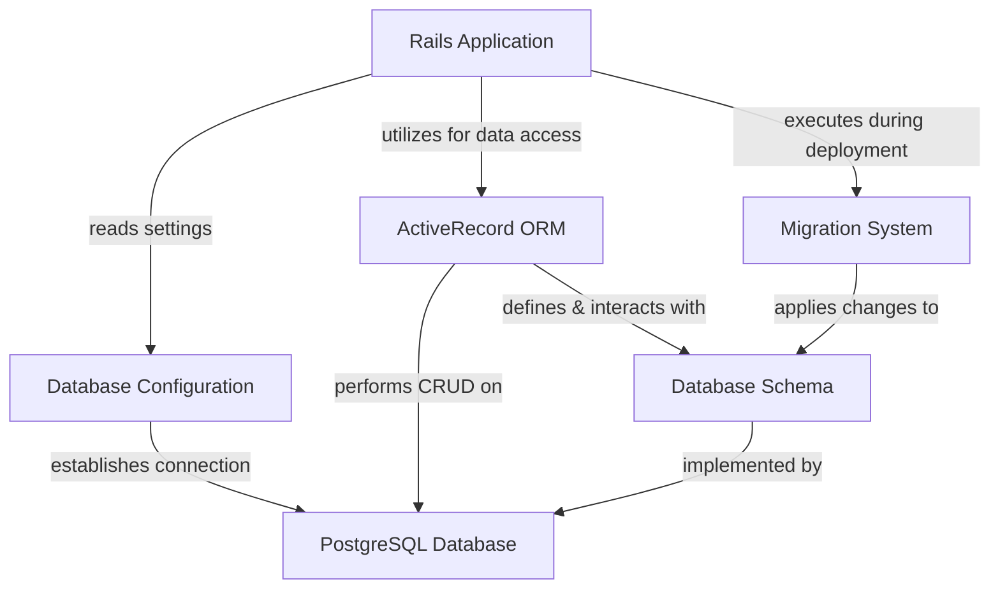
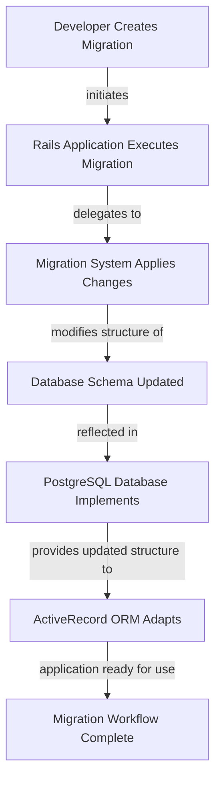
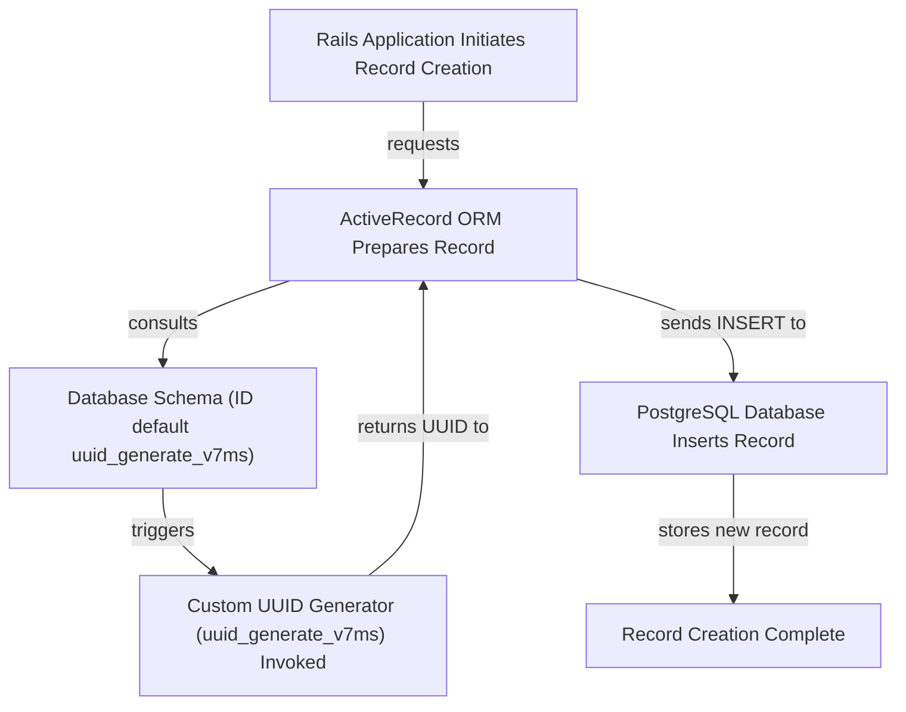
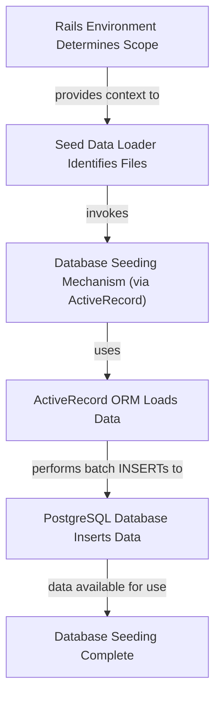

# Database Schema, Migrations, and Seed Data - Technical Documentation

*Generated on 9/18/2025 | Xikolo Knowledge Base*

---

## 📋 Executive Summary

The Xikolo project utilizes PostgreSQL as its central data store, underpinning both the main application and its array of microservices. This report delivers a detailed overview of the database architecture, emphasizing its configuration, sophisticated schema design, robust migration strategies, and structured data seeding processes. Core components like the PostgreSQL Database, ActiveRecord ORM, and specialized gems such as Fx for functions and Scenic for views, are integrated to form a resilient and extensible data layer. The primary purpose is to document how data is managed, evolved, and populated, ensuring consistency and performance across the entire Xikolo ecosystem, with a clear focus on leveraging PostgreSQL's advanced features for data integrity and efficient querying.

---

## 🏗️ Architecture Overview

The Xikolo database architecture is designed for scalability and maintainability, primarily centered around a PostgreSQL database managed by ActiveRecord within the Rails application environment. The system's robustness stems from a clear separation of concerns, where configuration drives connectivity, ActiveRecord handles data interactions and schema definitions, and a dedicated migration system ensures controlled evolution of the database structure. This setup allows for dynamic adjustment to various deployment environments while maintaining a consistent data interaction model. The architecture supports complex data structures and advanced PostgreSQL features, providing a solid foundation for the application's evolving data requirements. The interplay between these core components ensures that data persistence is not only efficient but also adaptable to future changes and operational demands.

### Architecture Diagrams

#### Database Architecture Overview

### 🔄 Component Interactions

Key interactions between components in this cluster:

- **Database Configuration:** Rails Application: Reads configuration to establish database connections.
- **Database Configuration:** Deployment Tooling: Overrides production settings during deployment.
- **Database Schema:** Active Record ORM: Provides the Ruby interface for interacting with the database tables and views.
- **Database Schema:** PostgreSQL Database: Implements the defined schema, extensions, enums, and functions.
- **Migration System (Active Record Migrations):** Database Schema: Applies structural and data changes to the database.
- **Migration System (Active Record Migrations):** Rails Application: Executes migrations during deployment and development cycles.
- **Seed Data Loader:** Rails Environment: Determines which environment-specific seed files to load.
- **Seed Data Loader:** Database: Inserts initial data based on the loaded seed files.
- **Custom UUID Generator (uuid_generate_v7ms):** Database Schema: Set as the default value for `id` columns in many tables.
- **Custom UUID Generator (uuid_generate_v7ms):** Active Record: Automatically invoked when new records are created without an explicit UUID.
- **PostgreSQL Database:** ActiveRecord interacts with PostgreSQL for all data operations.
- **PostgreSQL Database:** Fx gem interacts with PostgreSQL to manage functions.
- **ActiveRecord:** Manages schema migrations and definitions.
- **ActiveRecord:** Interacts with PostgreSQL for CRUD operations.
- **Fx Gem:** Configures schema dumping behavior for PostgreSQL functions.
- **Fx Gem:** Integrates with ActiveRecord's migration process.
- **Scenic Gem:** Defines and manages the `embed_courses` view.
- **Scenic Gem:** Integrates with ActiveRecord's migration process.
- **PostgreSQL Extensions:** Provide underlying functionality for data types, search, and custom functions.
- **uuid_generate_v7ms Function:** Called by ActiveRecord during record creation to assign primary keys.
- **Custom Enum Types:** Enforce data constraints on various table columns.
- **embed_courses View:** Provides a consolidated data source for course information.
- **embed_courses View:** Used by application logic to retrieve complex course details.
- **Database Seeding Mechanism:** Loads seed data into the PostgreSQL database via ActiveRecord.
- **PaperTrail Gem:** Records changes to tracked models in the `versions` table.
- **DelayedJob Gem:** Stores and manages asynchronous tasks for background processing.

---

## ⚙️ Technical Workflows

### 1. Schema Migration Workflow
This workflow details the process of evolving the database schema, including structural and data alterations, using Active Record Migrations. It is a crucial process for maintaining a consistent and up-to-date database schema across different environments and during application deployments. The workflow emphasizes best practices such as ensuring reversibility, utilizing performance optimizations, and mocking models within migrations to prevent future issues due to model refactoring. The Migration System (Active Record Migrations) orchestrates these changes, applying them systematically to the Database Schema, which is then implemented by the PostgreSQL Database. This structured approach ensures that all changes are tracked, auditable, and can be rolled back if necessary, providing a stable foundation for continuous development and deployment.

### 2. New Record Creation Workflow with Custom UUID
This workflow illustrates how new records are created in the database, highlighting the integration of the custom `uuid_generate_v7ms` function for primary key generation. The Xikolo project mandates UUIDs as primary keys for most tables, ensuring global uniqueness and simplifying data merging or distribution scenarios. When the Rails Application initiates the creation of a new record through ActiveRecord, the ORM automatically leverages the predefined default value in the Database Schema, which points to the custom PostgreSQL function. This ensures that every new record is assigned a unique, time-ordered UUID v7 without explicit application-level generation, offloading this responsibility to the highly optimized database layer. This automation streamlines development and guarantees data consistency.

### 3. Database Seeding Workflow
The Database Seeding Workflow is responsible for populating the PostgreSQL Database with initial or sample data, essential for setting up development, test, and sometimes production environments. This process is highly structured and environment-aware, allowing for different data sets to be loaded based on the specific context. The Seed Data Loader, invoked through `db/seeds.rb`, intelligently scans and executes Ruby files containing data definitions, first loading common data from a global directory, then environment-specific data. This mechanism ensures that initial data is consistently applied, enabling developers and automated tests to work with a predictable and relevant dataset. The use of ActiveRecord during the seeding process ensures that data insertion adheres to the defined schema and ORM conventions.

### Workflow Diagrams

#### Schema Migration Workflow

#### New Record Creation Workflow

#### Database Seeding Workflow

### 🔀 Process Workflows

Detailed workflow processes for this cluster:

- **Fx Gem Process:** Integrates with ActiveRecord's migration process.
  *Source: Fx Gem*
- **Scenic Gem Process:** Integrates with ActiveRecord's migration process.
  *Source: Scenic Gem*
- **DelayedJob Gem Process:** Stores and manages asynchronous tasks for background processing.
  *Source: DelayedJob Gem*

---

## 🔧 Implementation Details

The Xikolo database implementation leverages several advanced PostgreSQL features and Ruby gem integrations to establish a robust and flexible data layer. Database configurations are centrally managed via `config/database.yml` across all services (account, course, news, notification, pinboard, quiz, timeeffort). These configurations, including `postgresql` adapter, connection pool size, and a 10-second statement timeout, are dynamically driven by environment variables such as `DATABASE_URL`, `CONCURRENCY`, and `RAILS_MAX_THREADS`, which allows for flexible deployment and scaling. If an environment variable is not explicitly set, default values are applied as indicated in cluster data, often dictating production settings during deployment.

The database schema, defined in `db/schema.rb`, extensively utilizes PostgreSQL-specific capabilities. Enabled extensions include `hstore` for key-value storage, `pg_trgm` for trigram-based full-text search, `pgcrypto` for cryptographic functions, `plpgsql` for procedural language, `unaccent` for accent removal, and `uuid-ossp` for UUID generation. Most tables employ UUIDs as primary keys, with a custom `uuid_generate_v7ms()` function—managed by the Fx Gem—providing UUID v7 generation with millisecond precision as the default. Data types like `jsonb` are widely used for structured JSON data (e.g., `translations`, `recipients`), and array columns store lists of values. For efficient searching, the `questions` table features a `tsvector` column with a `gin_trgm_ops` index for full-text search.

Furthermore, the Scenic Gem manages the `embed_courses` materialized view, which denormalizes course data for optimized querying. Custom enum types, such as `link_target`, `node_type`, `offer_category`, `payment_frequency`, and `sort_mode`, enforce data integrity by constraining column values. The Migration System (Active Record Migrations) governs schema evolution, supporting both structural and data changes, with best practices documented for performance (e.g., bulk operations, batch processing) and reversibility. The Seed Data Loader, through `db/seeds.rb`, enables environment-specific data population by loading files alphabetically from `db/seeds/all/**/*.rb` and `db/seeds//**/*.rb`, with the `` parameter configurable via `SEED_ENV`. The PaperTrail Gem is integrated for auditing model changes, and DelayedJob Gem handles asynchronous tasks, both evidenced by their respective tables in the schema, contributing to the application's overall resilience and operational capabilities.

### 📚 Technical Sources & References

Key technical documentation and source references:

- Database Configuration: config/database.yml- Database Configuration: RAG: services/account/config/database.yml- Database Schema: db/schema.rb- Migration System (Active Record Migrations): db/schema.rb- Migration System (Active Record Migrations): RAG: docs/app/development/best_practices/database_migrations.md- Seed Data Loader: db/seeds.rb- Custom UUID Generator (uuid_generate_v7ms): db/schema.rb- PostgreSQL Database: Gemfile- PostgreSQL Database: db/schema.rb- ActiveRecord: db/schema.rb- ActiveRecord: RAG: docs/app/development/best_practices/database_migrations.md- Fx Gem: config/initializers/fx.rb- Fx Gem: db/schema.rb- Scenic Gem: db/schema.rb- PostgreSQL Extensions: db/schema.rb- uuid_generate_v7ms Function: db/schema.rb- Custom Enum Types: db/schema.rb- embed_courses View: db/schema.rb- Database Seeding Mechanism: db/seeds.rb- PaperTrail Gem: Gemfile- PaperTrail Gem: db/schema.rb- DelayedJob Gem: Gemfile- DelayedJob Gem: db/schema.rb- Configuration: config/application.rb, Gemfile, config/database.yml- Process Management: Procfile, Procfile.web- Build & Deploy: Rakefile, package.json

---

*This documentation is automatically generated from cluster analysis and should be validated against the actual codebase.*
