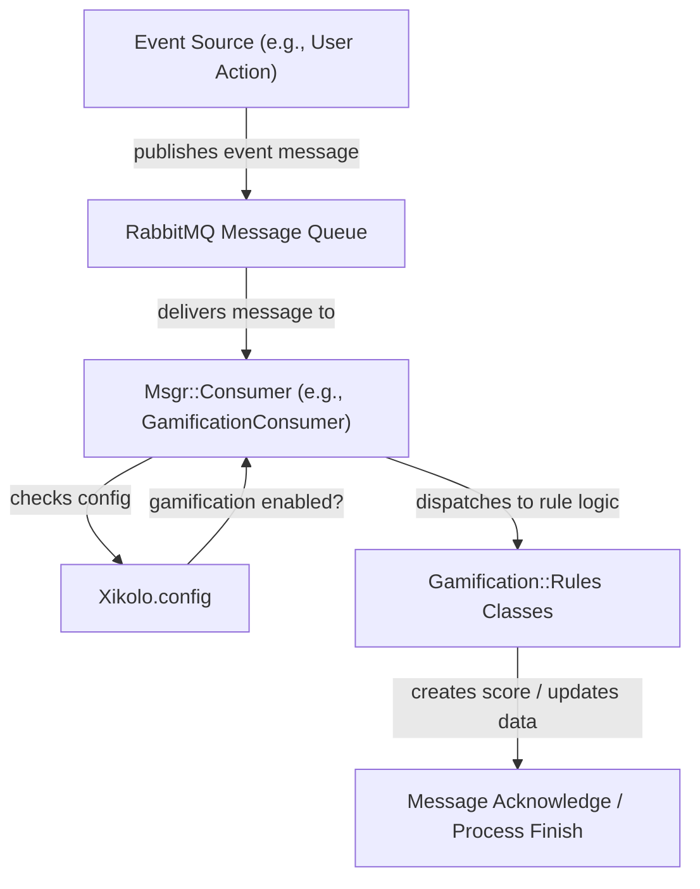
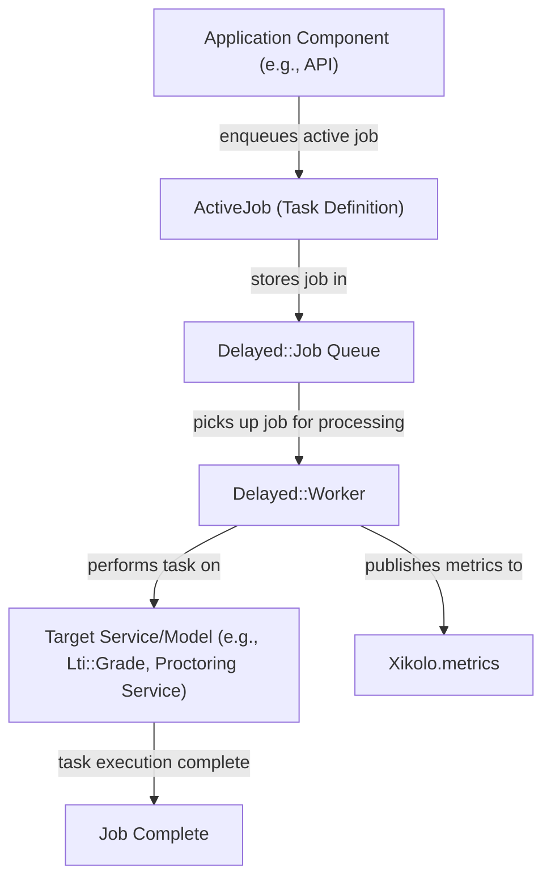
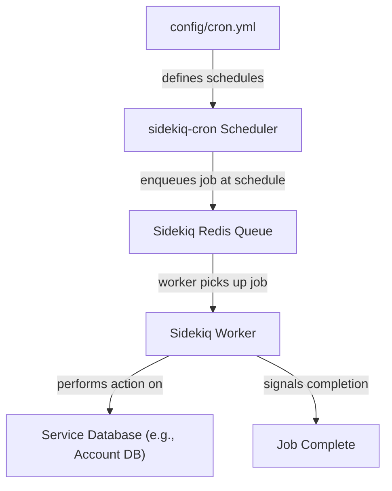

# Background Job Processing and Message Consumers - Technical Documentation

*Generated on 9/18/2025 | Xikolo Knowledge Base*

---

## 📋 Executive Summary

This report details the robust asynchronous processing architecture of the Xikolo 42_INFRA_BackgroundJobs cluster, which expertly manages both real-time event handling and deferred task execution. The system employs a dual strategy, integrating `Msgr` message-driven consumers for event processing via RabbitMQ and two distinct background job processors, `Delayed::Job` and `Sidekiq`, for handling asynchronous and scheduled tasks. This comprehensive setup ensures efficient, scalable, and resilient task management across various microservices, significantly enhancing the application's responsiveness and operational stability. Key components include specialized message consumers, ActiveJob-compatible background job classes, and a robust scheduling mechanism provided by `sidekiq-cron` and `Xikolo::Sidekiq`, all contributing to a highly effective asynchronous ecosystem.

---

## 🏗️ Architecture Overview

The Xikolo asynchronous processing architecture is designed for scalability and responsiveness, built upon a dual foundation of event-driven messaging and background job processing. Message Consumers, specifically instances of `Msgr::Consumer`, form the backbone of real-time event handling, subscribing to RabbitMQ queues to process events from various services. Concurrently, `ActiveJob` serves as an abstraction layer for background tasks, allowing jobs to be processed by either `Delayed::Job` or `Sidekiq`, depending on configuration and task requirements. `Delayed::Job` primarily handles deferred tasks with configurable queues and retry mechanisms, reporting metrics to `Xikolo.metrics`. `Sidekiq`, supported by the `xikolo-sidekiq` gem and `sidekiq-cron`, manages scheduled and recurring tasks, utilizing Redis for queue management and separate databases for isolation. This dual-processor approach provides flexibility, ensuring optimal handling for diverse asynchronous workloads, from immediate event reactions to long-running batch operations.

### Architecture Diagrams


#### Main Architecture

```mermaid
graph TD
  rabbitMQ["RabbitMQ"]
  msgrConsumers["Msgr Consumers (e.g., GamificationConsumer)"]
  activeJob["ActiveJob (Abstraction Layer)"]
  delayedJobWorker["Delayed Job Worker"]
  sidekiqProcessor["Sidekiq Processor"]
  xikoloMetrics["Xikolo.metrics"]

  rabbitMQ -->|"publishes messages"| msgrConsumers
  msgrConsumers -->|"processes event, ack message"| rabbitMQ
  activeJob -->|"enqueues job for deferred tasks"| delayedJobWorker
  activeJob -->|"enqueues job for scheduled tasks"| sidekiqProcessor
  delayedJobWorker -->|"reports execution to"| xikoloMetrics
  sidekiqProcessor -->|"reports execution (via Xikolo::Sidekiq) to"| xikoloMetrics
  delayedJobWorker -->|"executes task on system resources"| SystemResources[ "System Resources/Services" ]
  sidekiqProcessor -->|"executes task on system resources"| SystemResources
```


### 🔄 Component Interactions

Key interactions between components in this cluster:

- **Msgr::Consumer:** Receives messages from RabbitMQ queues.
- **Msgr::Consumer:** Dispatches message payloads to specific consumer methods.
- **GamificationConsumer:** Receives messages from RabbitMQ (e.g., `result_create`, `visit_create`, `vote_create`, `comment_create`, `question_create`, `answer_accepted`, `answer_create`).
- **GamificationConsumer:** Interacts with `Xikolo.config` to check if gamification is enabled. [Source: app/consumers/gamification_consumer.rb]
- **CourseConsumer:** Receives `clone` messages from RabbitMQ with `old_course_id` and `new_course_code` in the payload. [Source: services/course/app/consumers/course_consumer.rb]
- **CourseConsumer:** Invokes `Course::Clone.call` with the provided course IDs. [Source: services/course/app/consumers/course_consumer.rb]
- **NewsConsumer:** Receives `update_state` messages from RabbitMQ with `news_id` and other update attributes. [Source: services/news/app/consumers/news_consumer.rb]
- **NewsConsumer:** Interacts with the `News` model to find and update a news record. [Source: services/news/app/consumers/news_consumer.rb]
- **ApplicationJob:** Inherited by specific job classes to define asynchronous tasks.
- **ApplicationJob:** Interacts with the underlying queuing backend (Delayed Job in this context). [Source: Gemfile, config/initializers/delayed.rb]
- **LongRunningApplicationJob:** Sets `queue_as` to 'long_running'. [Source: app/jobs/long_running_application_job.rb]
- **LongRunningApplicationJob:** Overrides `max_run_time` to 10 hours and `max_attempts` to 5. [Source: app/jobs/long_running_application_job.rb]
- **Lti::PublishGradeJob:** Queued on the `default` queue. [Source: app/jobs/lti/publish_grade_job.rb]
- **Lti::PublishGradeJob:** Finds an `Lti::Grade` record by ID. [Source: app/jobs/lti/publish_grade_job.rb]
- **Proctoring::StoreSubmissionResultsJob:** Queued on the `default` queue with `eventual` priority. [Source: app/jobs/proctoring/store_submission_results_job.rb]
- **Proctoring::StoreSubmissionResultsJob:** Includes retry logic for `Proctoring::ServiceError` and `ExpectedRetry` with exponential backoff and fixed waits. [Source: app/jobs/proctoring/store_submission_results_job.rb]
- **Proctoring::UploadCertificateImageJob:** Queued on the `default` queue with `eventual` priority. [Source: app/jobs/proctoring/upload_certificate_image_job.rb]
- **Proctoring::UploadCertificateImageJob:** Includes retry logic for `Proctoring::ServiceError`. [Source: app/jobs/proctoring/upload_certificate_image_job.rb]
- **RefreshSitemapJob:** Queued on the `default` queue with `reporting` priority. [Source: app/jobs/refresh_sitemap_job.rb]
- **RefreshSitemapJob:** The `perform` method is empty. [Source: app/jobs/refresh_sitemap_job.rb]
- **Delayed::Worker:** Processes jobs from ActiveJob.
- **Delayed::Worker:** Reports job metrics (run, error, failure) to `Xikolo.metrics`.
- **UnconfirmedAccountsDeletionWorker:** Scheduled to run daily at 3 a.m. via `sidekiq-cron`. [Source: services/account/config/cron.yml]
- **UnconfirmedAccountsDeletionWorker:** Processes jobs on the `default` queue. [Source: services/account/config/cron.yml]
- **Voucher::DeleteClaimantIPJob:** Executed periodically by Sidekiq via `sidekiq-cron`.
- **Video::SyncVideosJob:** Executed periodically by Sidekiq via `sidekiq-cron`.
- **Xikolo::Sidekiq:** Configures Sidekiq Redis connection using `config/sidekiq_redis.yml`. [Source: RAG: gems/xikolo-sidekiq/README.md]
- **Xikolo::Sidekiq:** Loads and parses `config/cron.yml` for `sidekiq-cron` job definitions. [Source: RAG: gems/xikolo-sidekiq/README.md]
- **Delayed::Job:** Processes jobs enqueued via ActiveJob (e.g., Voucher::DeleteClaimantIPJob, Video::SyncVideosJob).
- **Delayed::Job:** Publishes job events to ActiveSupport::Notifications.
- **Sidekiq:** Processes background jobs (implied by `sidekiq-cron` and `xikolo-sidekiq` gem).
- **Sidekiq:** Executes scheduled jobs defined in `config/cron.yml`.
- **ActiveJob:** Jobs defined as ActiveJob classes are enqueued for processing.
- **ActiveJob:** Jobs are processed by either Delayed::Job or Sidekiq depending on the environment and configuration.
- **Xikolo.metrics:** Receives job execution events (run, error, failure) from ActiveSupport::Notifications.
- **Xikolo.metrics:** Records detailed metrics including job ID, attempts, run time, and duration.
- **sidekiq-cron:** Reads and parses `config/cron.yml` to set up scheduled jobs.
- **sidekiq-cron:** Enqueues ActiveJobs (like Voucher::DeleteClaimantIPJob, Video::SyncVideosJob) into the background job processor.
- **Msgr:** Consumes messages from RabbitMQ (configured via `config/rabbitmq.yml`).
- **Msgr:** Routes messages to the `Gamification` component (e.g., `gamification#vote_create`).
- **Gamification:** Receives and processes messages routed by `Msgr` from `xikolo.pinboard` and `xikolo.course` events.

---

## ⚙️ Technical Workflows

### 1. Event-Driven Message Processing Workflow
This workflow describes how the system processes real-time events from other services using RabbitMQ and `Msgr::Consumer` classes. When an event occurs, a message is published to a RabbitMQ queue. A specific `Msgr::Consumer` (e.g., `GamificationConsumer`, `CourseConsumer`, `NewsConsumer`) is configured to listen to this queue. Upon receiving a message, the consumer dispatches its payload to a relevant internal method. For instance, `GamificationConsumer` checks `Xikolo.config` for feature enablement and then instantiates and calls `create_score!` on appropriate `Gamification::Rules` classes based on the message content (e.g., `result_create`, `visit_create`). The `CourseConsumer` processes `clone` messages by invoking `Course::Clone.call` for course duplication. After successful processing, the consumer acknowledges the message to RabbitMQ, preventing re-delivery and ensuring message durability. This mechanism facilitates loose coupling and efficient inter-service communication.

### 2. Delayed Job Execution Workflow
This workflow outlines the execution of deferred, asynchronous tasks using `ActiveJob` and `Delayed::Job`. Application components enqueue tasks by creating instances of `ApplicationJob` or its specialized subclasses, such as `Lti::PublishGradeJob`, `Proctoring::StoreSubmissionResultsJob`, or `LongRunningApplicationJob`. These jobs are then placed into a `Delayed::Job` queue. `Delayed::Worker` continuously monitors these queues, picking up jobs based on priority and availability. Each job can specify its `queue_as`, `max_run_time`, and `max_attempts`, with global defaults set in `config/initializers/delayed.rb`. For example, `Proctoring::StoreSubmissionResultsJob` has specific retry logic for `Proctoring::ServiceError` with exponential backoff. During execution, `Delayed::Worker` reports detailed job metrics (run, error, failure) to `Xikolo.metrics` via `ActiveSupport::Notifications`, providing crucial insights into job performance and errors. This ensures reliable processing of tasks that do not require immediate synchronous completion.

### 3. Scheduled Sidekiq Job Execution Workflow
This workflow details the execution of recurring, time-based tasks leveraging `Sidekiq` and `sidekiq-cron`. Scheduled jobs, such as `UnconfirmedAccountsDeletionWorker`, `Voucher::DeleteClaimantIPJob`, and `Video::SyncVideosJob`, are defined in `config/cron.yml` files across different services. The `sidekiq-cron` component reads and parses these YAML configurations to set up the recurring schedule. At their designated times, `sidekiq-cron` enqueues these `ActiveJob`-compatible tasks into `Sidekiq`'s Redis-backed queues. The `Xikolo::Sidekiq` gem centralizes the configuration for Sidekiq, including Redis connection settings defined in `config/sidekiq_redis.yml`, which also specifies different Redis databases per environment for data isolation. `Sidekiq` workers then pick up and process these jobs. For instance, `UnconfirmedAccountsDeletionWorker` interacts with the Account service's database to identify and remove old, unconfirmed accounts. This system ensures that routine maintenance and synchronization tasks are performed reliably and automatically on a defined schedule.

### Workflow Diagrams


#### Event-Driven Message Processing



#### Delayed Job Execution Flow



#### Scheduled Sidekiq Job Execution Flow




### 🔀 Process Workflows

Detailed workflow processes for this cluster:

- **Delayed::Worker Process:** Processes jobs from ActiveJob.
  *Source: Delayed::Worker*
- **UnconfirmedAccountsDeletionWorker Process:** Processes jobs on the `default` queue.
  *Source: UnconfirmedAccountsDeletionWorker*
- **Delayed::Job Process:** Processes jobs enqueued via ActiveJob (e.g., Voucher::DeleteClaimantIPJob, Video::SyncVideosJob).
  *Source: Delayed::Job*
- **Sidekiq Process:** Processes background jobs (implied by `sidekiq-cron` and `xikolo-sidekiq` gem).
  *Source: Sidekiq*
- **ActiveJob Process:** Jobs defined as ActiveJob classes are enqueued for processing.
  *Source: ActiveJob*
- **ActiveJob Process:** Jobs are processed by either Delayed::Job or Sidekiq depending on the environment and configuration.
  *Source: ActiveJob*
- **sidekiq-cron Process:** Enqueues ActiveJobs (like Voucher::DeleteClaimantIPJob, Video::SyncVideosJob) into the background job processor.
  *Source: sidekiq-cron*
- **Gamification Process:** Receives and processes messages routed by `Msgr` from `xikolo.pinboard` and `xikolo.course` events.
  *Source: Gamification*

---

## 🔧 Implementation Details

The Xikolo cluster employs a comprehensive strategy for asynchronous processing, utilizing both message queues and background job processors. For message-driven interactions, `Msgr` consumes messages from RabbitMQ, configured via `config/rabbitmq.yml` (though explicit file content is not specified in cluster data). `Msgr::Consumer` classes like `GamificationConsumer`, `CourseConsumer`, and `NewsConsumer` are the implementation points, where they receive payloads, perform specific logic (e.g., `Gamification::Rules::Course::TakeExam.new(payload).create_score!`, `Course::Clone.call`), and then acknowledge the message. These interactions are direct and event-driven, with `Xikolo.config` being a dependency for feature checks within consumers.

Background jobs are handled via `ActiveJob`, providing an abstraction over two distinct backends: `Delayed::Job` and `Sidekiq`. `Delayed::Job` is primarily configured through `config/initializers/delayed.rb`, which sets global parameters like `max_attempts` (25) and `max_run_time` (10 hours) and restricts processing to specific queues (`default`, `long_running`, `mails`). It also integrates with `ActiveSupport::Notifications` to publish metrics to `Xikolo.metrics`. Specific jobs like `Lti::PublishGradeJob` and `Proctoring::StoreSubmissionResultsJob` inherit from `ApplicationJob`, using `default` queues and defining their own retry logic for specific errors, though the `perform` methods for `Proctoring::StoreSubmissionResultsJob` and `Proctoring::UploadCertificateImageJob` are noted as empty in the cluster data, indicating external service interactions not explicitly shown.

`Sidekiq` is utilized for scheduled tasks, managed by the `sidekiq-cron` gem. The `xikolo-sidekiq` gem centralizes its configuration, loading cron job definitions from `config/cron.yml` (e.g., `UnconfirmedAccountsDeletionWorker` daily at 3 a.m., `Voucher::DeleteClaimantIPJob` daily at 4:15 a.m., `Video::SyncVideosJob` every 2 hours). Redis serves as the backend for Sidekiq queues, with connection details specified in service-specific `config/sidekiq_redis.yml` files, ensuring Redis database isolation for various environments. Dependencies include RabbitMQ for Msgr, Redis for Sidekiq, and `Xikolo.metrics` for monitoring both Delayed Job and Sidekiq performance.

### 📚 Technical Sources & References

Key technical documentation and source references:

- Msgr::Consumer: Gemfile- Msgr::Consumer: app/consumers/gamification_consumer.rb- GamificationConsumer: app/consumers/gamification_consumer.rb- CourseConsumer: services/course/app/consumers/course_consumer.rb- NewsConsumer: services/news/app/consumers/news_consumer.rb- ApplicationJob: app/jobs/long_running_application_job.rb- ApplicationJob: app/jobs/lti/publish_grade_job.rb- LongRunningApplicationJob: app/jobs/long_running_application_job.rb- Lti::PublishGradeJob: app/jobs/lti/publish_grade_job.rb- Proctoring::StoreSubmissionResultsJob: app/jobs/proctoring/store_submission_results_job.rb- Proctoring::UploadCertificateImageJob: app/jobs/proctoring/upload_certificate_image_job.rb- RefreshSitemapJob: app/jobs/refresh_sitemap_job.rb- Delayed::Worker: config/initializers/delayed.rb- Delayed::Worker: Gemfile- UnconfirmedAccountsDeletionWorker: services/account/config/cron.yml- UnconfirmedAccountsDeletionWorker: RAG: services/account/config/cron.yml- Voucher::DeleteClaimantIPJob: RAG: config/cron.yml- Video::SyncVideosJob: RAG: config/cron.yml- Xikolo::Sidekiq: Gemfile- Xikolo::Sidekiq: RAG: gems/xikolo-sidekiq/README.md- Delayed::Job: config/initializers/delayed.rb- Delayed::Job: config/cron.yml- Sidekiq: Gemfile- Sidekiq: RAG: gems/xikolo-sidekiq/README.md- ActiveJob: config/cron.yml- ActiveJob: config/initializers/delayed.rb- Xikolo.metrics: config/initializers/delayed.rb- sidekiq-cron: RAG: gems/xikolo-sidekiq/README.md- sidekiq-cron: config/cron.yml- Msgr: config/msgr.rb- Msgr: Gemfile- Gamification: config/msgr.rb- Configuration: config/application.rb, Gemfile, config/database.yml- Process Management: Procfile, Procfile.web- Build & Deploy: Rakefile, package.json

---

*This documentation is automatically generated from cluster analysis and should be validated against the actual codebase.*
