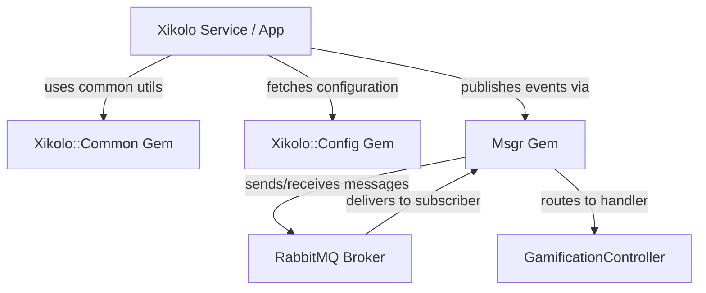
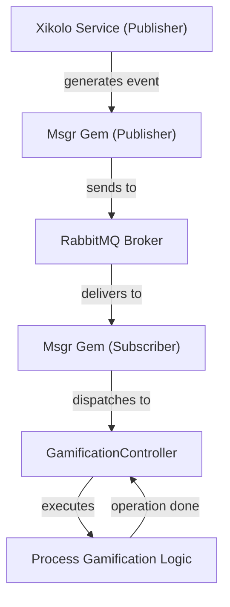
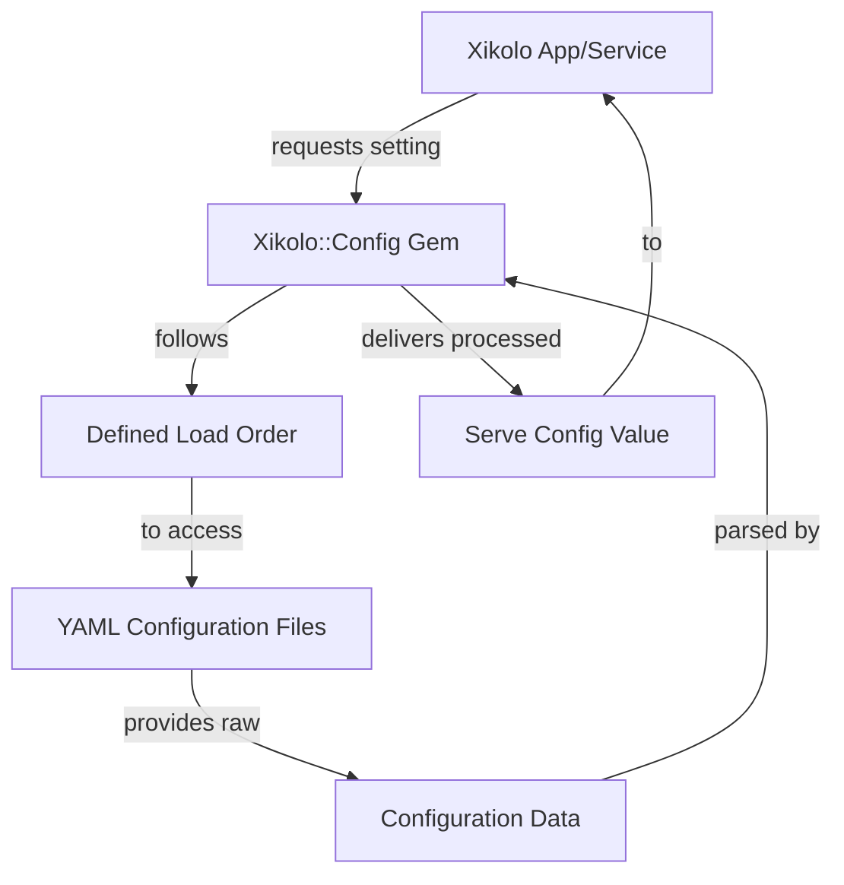
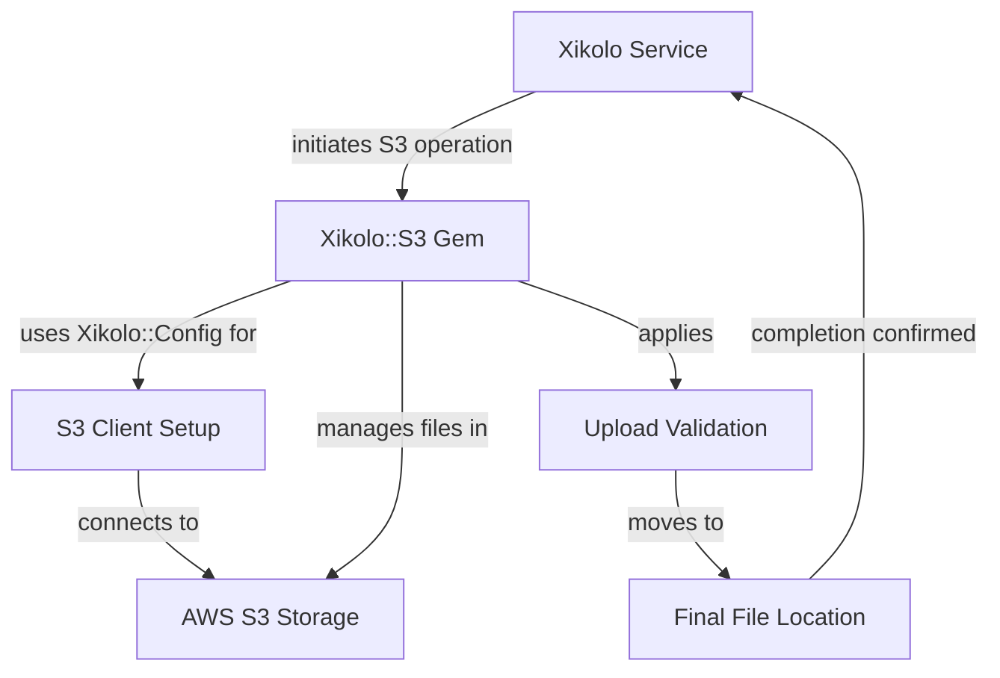
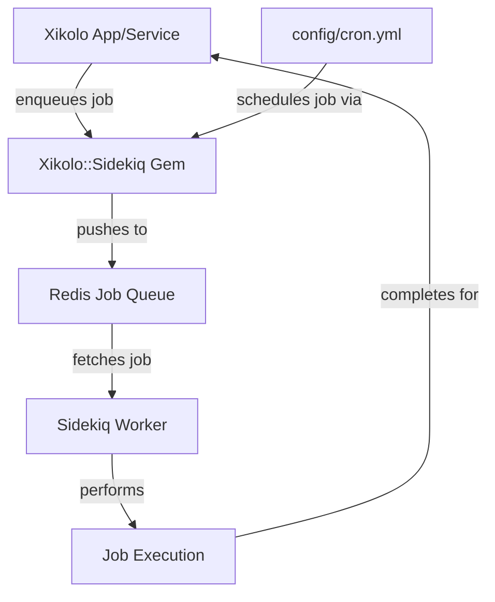

# Internal Ruby Gems and Inter-Service Communication (RabbitMQ) - Technical Documentation

*Generated on 9/19/2025 | Xikolo Knowledge Base*

---

## 📋 Executive Summary

The Xikolo project implements a robust microservice architecture with inter-service communication primarily facilitated by RabbitMQ, ensuring asynchronous and decoupled interactions. This foundational approach is complemented by a suite of internal Ruby gems (Xikolo::Common, Xikolo::Config, Xikolo::S3, Xikolo::Sidekiq) that encapsulate shared functionalities, enforce architectural consistency, and streamline development across the main Xikolo application and its various microservices. Key components like the `Msgr` gem handle message publishing and subscription, while specialized handlers such as the `GamificationController` react to specific events, demonstrating an event-driven paradigm. The architecture prioritizes modularity, reusability, and maintainability by centralizing common utilities, configuration, file management, and background job processing.

---

## 🏗️ Architecture Overview

The Xikolo architecture for service communication revolves around a message broker, RabbitMQ, and a set of internal Ruby gems that standardize common functionalities. The main Xikolo application and various microservices interact using these components to achieve a decoupled and efficient system. `Xikolo::Common` provides fundamental utilities like HTTP communication via Restify, metric collection for Telegraf/Grafana, and authentication helpers for services. `Xikolo::Config` serves as the central configuration store, reading settings from YAML files and providing them across the ecosystem. For asynchronous communication, services utilize the `Msgr` gem to publish and subscribe to messages, which are then routed through `RabbitMQ`. A specific example of a message consumer is the `GamificationController`, responsible for processing events received from RabbitMQ to trigger gamification logic. Additionally, `Xikolo::S3` manages file operations with AWS S3, and `Xikolo::Sidekiq` handles background job processing through Redis, but these are auxiliary to the core communication diagram's focus on message flow. This design ensures that services can communicate reliably without direct dependencies, allowing for independent development and scaling.

### Architecture Diagrams

#### Main Architecture Overview

### 🔄 Component Interactions

Key interactions between components in this cluster:

- **Xikolo::Common:** Installs and configures common libraries like Restify for HTTP communication between services. [Source: RAG: gems/xikolo-common/README.md]
- **Xikolo::Common:** Sends custom application metrics to Telegraf via the `Xikolo.metrics` object for monitoring in Grafana. [Source: RAG: gems/xikolo-common/README.md]
- **Xikolo::Config:** Reads configuration values from various YAML files (e.g., `config/xikolo.yml`, `/etc/xikolo.yml`) based on a defined merge order. [Source: RAG: gems/xikolo-config/README.md]
- **Xikolo::Config:** Provides configuration settings (e.g., `Xikolo.brand`, `Xikolo.base_url`, `mailsender`) to other Xikolo components and services. [Source: RAG: gems/xikolo-config/README.md]
- **Xikolo::S3:** Configures the AWS S3 client using settings from `xikolo-config`. [Source: RAG: gems/xikolo-s3/README.md]
- **Xikolo::S3:** Interacts with AWS S3 for storing, retrieving, and managing files (e.g., `Aws::S3::Bucket`, `Aws::S3::Object`). [Source: RAG: gems/xikolo-s3/README.md]
- **Xikolo::Sidekiq:** Configures the Sidekiq Redis connection using `config/sidekiq_redis.yml` for environment-specific settings. [Source: RAG: gems/xikolo-sidekiq/README.md]
- **Xikolo::Sidekiq:** Integrates Sidekiq with ActiveJob for consistent background job enqueueing. [Source: RAG: gems/xikolo-sidekiq/README.md]
- **Msgr:** Publishes messages from services to RabbitMQ. [Source: Gemfile, services/*/Gemfile]
- **Msgr:** Subscribes to specific message queues on RabbitMQ based on defined routes. [Source: config/msgr.rb]
- **RabbitMQ:** Receives messages published by various Xikolo services and the main application. [Source: RAG: config/rabbitmq.yml, RAG: services/account/config/rabbitmq.yml]
- **RabbitMQ:** Routes and delivers messages to subscribing services and applications based on routing keys and queue configurations. [Source: config/msgr.rb]
- **GamificationController:** Subscribes to RabbitMQ messages with routing keys like `xikolo.pinboard.*` and `xikolo.course.result.create`. [Source: config/msgr.rb]
- **GamificationController:** Processes specific events (e.g., `vote_create`, `question_create`, `answer_accepted`, `result_create`, `visit_create`) to trigger gamification logic. [Source: config/msgr.rb]

---

## ⚙️ Technical Workflows

### 1. Gamification Event Processing
This workflow outlines how user activities and service-generated events within the Xikolo ecosystem are asynchronously processed to update gamification states. When a user performs an action, such as creating a vote on a pinboard or completing a course, the responsible Xikolo service (e.g., PinboardService, CourseService) publishes a domain-specific event. This event is routed through the `Msgr` gem, which acts as the publisher, sending the message to `RabbitMQ`. RabbitMQ, serving as the central message broker, reliably queues and delivers this message. On the consuming side, another instance of the `Msgr` gem, configured as a subscriber, receives the message from RabbitMQ. Based on predefined routing keys in `config/msgr.rb` (e.g., `xikolo.pinboard.*`, `xikolo.course.result.create`), `Msgr` dispatches the message to the appropriate handler, which in this case is the `GamificationController`. The `GamificationController` then processes the event, applying specific gamification logic, such as awarding experience points or badges, and updates the relevant user profiles. This decoupled approach ensures that gamification logic reacts to events in real-time without introducing tight coupling between the event-generating services and the gamification system.

### 2. Centralized Configuration Management
This workflow details how all Xikolo applications and services maintain consistent and environment-specific configurations using the `Xikolo::Config` gem. When any Xikolo application or service requires a configuration value (e.g., `Xikolo.brand`, `Xikolo.base_url`, `mailsender`), it requests this setting from the `Xikolo::Config` gem. The `Xikolo::Config` gem then initiates a process to load configuration data from various YAML files. It strictly adheres to a defined merge order, typically starting with `config/xikolo.yml` and allowing for overrides from environment-specific files or `/etc/xikolo.yml`, which is managed by tools like Salt in production. After loading and merging all applicable configuration values, `Xikolo::Config` processes these settings, resolving any dynamic values. Finally, the gem provides the requested, merged, and processed configuration value back to the requesting application or service. This ensures that all components operate with the correct, validated, and environment-aware settings, promoting consistency and reducing configuration errors across the distributed system.

### 3. S3 File Management
This workflow describes the standardized approach to handling file operations within the Xikolo ecosystem, leveraging the `Xikolo::S3` gem for interaction with AWS S3. When a Xikolo service needs to perform a file operation, such as uploading a user-generated document or retrieving an existing asset, it initiates an action via the `Xikolo::S3` gem. The `Xikolo::S3` gem is responsible for configuring the AWS S3 client, drawing necessary settings (like AWS credentials and bucket names) from `Xikolo::Config`. For uploads, files are initially placed in a temporary S3 bucket. Following this temporary storage, the `Xikolo::S3` gem performs crucial validation checks, including inspecting metadata fields like `xikolo-state` and `xikolo-purpose` to ensure the file's legitimacy and proper usage. After successful validation, the file is copied from the temporary location to its final, designated S3 bucket and key within AWS S3 storage, adhering to each service's responsibility for its file management. Upon the successful completion of the S3 operation, including any validation and copying, `Xikolo::S3` confirms the status back to the requesting service, providing relevant details like the S3 URI for the stored file. This workflow streamlines file handling, enforces security, and maintains data integrity.

### 4. Background Job Processing
This workflow outlines how Xikolo services handle asynchronous tasks and scheduled operations through a robust background job processing system, orchestrated by the `Xikolo::Sidekiq` gem. When a Xikolo application or service needs to perform a task that doesn't require an immediate response or is resource-intensive (e.g., sending emails, generating reports), it enqueues a background job. This action is facilitated by the `Xikolo::Sidekiq` gem, which integrates with ActiveJob for consistent job enqueueing. The `Xikolo::Sidekiq` gem pushes the job details into a `Redis` job queue, using connection configurations defined in `config/sidekiq_redis.yml`, which allows for environment-specific Redis database settings. Concurrently, for recurring tasks, the `Xikolo::Sidekiq` gem also loads and processes `config/cron.yml` to schedule periodic jobs via `sidekiq-cron`. `Sidekiq Worker` processes continuously poll the `Redis` job queue, fetching available jobs. Once a job is fetched, a `Sidekiq Worker` executes the encapsulated task. After the job's successful completion, the `Sidekiq Worker` updates its status, and this successful execution is often reported back through logging or metric systems, ensuring reliable asynchronous task management and efficient resource utilization by offloading long-running processes from the main application thread.

### Workflow Diagrams

#### 1. Gamification Event Processing Workflow

#### 2. Centralized Configuration Management Workflow

#### 3. S3 File Management Workflow

#### 4. Background Job Processing Workflow

### 🔀 Process Workflows

Detailed workflow processes for this cluster:

- **Xikolo::S3 Process:** Processes and validates file uploads, handling temporary storage, metadata (`xikolo-state`, `xikolo-purpose`), and copying to final destinations.
  *Source: Xikolo::S3*
- **RabbitMQ Process:** Provides reliable message queuing for background processing and event-driven architectures.
  *Source: RabbitMQ*
- **GamificationController Process:** Processes specific events (e.g., `vote_create`, `question_create`, `answer_accepted`, `result_create`, `visit_create`) to trigger gamification logic.
  *Source: GamificationController*

---

## 🔧 Implementation Details

The Xikolo infrastructure relies heavily on internal Ruby gems and RabbitMQ for its service communication, each with specific technical considerations and configurations. 

**Technical Considerations:**
*   **Xikolo::Common:** This gem centralizes common utilities, installing and configuring `Restify` for standardized HTTP communication between services. It provides a `Xikolo.metrics` object for sending custom application metrics to Telegraf for Grafana monitoring. Authentication helpers for interacting with the Account service are also integrated.
*   **Xikolo::Config:** Configuration values are read from YAML files, with `config/xikolo.yml` and `/etc/xikolo.yml` being primary sources, allowing for environment-specific overrides based on a defined merge order. Essential configurations include `Xikolo.brand` for visual themes and `Xikolo.base_url` for generating absolute URLs.
*   **Xikolo::S3:** This gem configures the AWS S3 client using settings sourced from `xikolo-config`. It enforces the use of S3 URIs (`s3://${bucket}/${key}`) for file references and recommends a `_uri` suffix for relevant database columns. File uploads are processed with mandatory metadata like `xikolo-state` and `xikolo-purpose`. The `UploadByUri` approach is the recommended method for new implementations, as the older `SingleFileUpload` has known drawbacks. The `Xikolo::S3::TextWithUploadsProcessor` assists in managing S3 file references within markup fields.
*   **Xikolo::Sidekiq:** This gem configures Sidekiq, integrating it with ActiveJob for background job enqueueing. It manages the Sidekiq Redis connection using `config/sidekiq_redis.yml` for environment-specific Redis database settings. Additionally, it loads and parses `config/cron.yml` to schedule periodic background jobs via the `sidekiq-cron` gem.
*   **Msgr & RabbitMQ:** `Msgr` acts as the Ruby client for RabbitMQ, handling message publication and subscription. Messages are routed based on definitions in `config/msgr.rb`, which includes specific routing keys (e.g., `xikolo.pinboard.*`, `xikolo.course.result.create`) for different event types. Test environments utilize `Msgr::TestPool` for isolation and often set `raise_exceptions: true` for clearer error handling.
*   **GamificationController:** This component subscribes to RabbitMQ messages with specific routing keys (e.g., `xikolo.pinboard.*`, `xikolo.course.result.create`) and processes the incoming events to trigger gamification logic, demonstrating an event-driven consumer pattern.

**Dependencies and Integrations:**
*   `Xikolo::Common` integrates with `Restify` for HTTP communication, `Telegraf` for metrics, and the `Account` service for authentication.
*   `Xikolo::Config` serves as a core dependency for almost all other Xikolo components and services requiring centralized settings.
*   `Xikolo::S3` depends on `Xikolo::Config` for its AWS S3 client configuration and interacts directly with `AWS S3` for storage operations.
*   `Xikolo::Sidekiq` integrates with `ActiveJob` for job enqueueing, `Redis` for job queuing, and `sidekiq-cron` for scheduling periodic tasks.
*   `Msgr` is tightly integrated with `RabbitMQ` for message brokering and relies on application-specific routing definitions.
*   `GamificationController` integrates with `Msgr` to receive and process messages from `RabbitMQ`.

**Configuration Requirements:**
*   **RabbitMQ:** Each application and microservice requires a `config/rabbitmq.yml` file, which typically defines the RabbitMQ URI, defaulting to `amqp://localhost/` or utilizing the `XIKolo_RABBITMQ_URL` environment variable. Some configurations explicitly set `checkcredentials: false`.
*   **Centralized Config:** `Xikolo::Config` relies on `config/xikolo.yml` and `/etc/xikolo.yml` for its base and overridden configuration values. Adding new configuration values requires explicit team decision.
*   **Sidekiq:** `config/sidekiq_redis.yml` is necessary to configure the Sidekiq Redis connection for environment-specific settings. `config/cron.yml` is used to define periodic background jobs when `sidekiq-cron` is present.
*   **S3:** S3 bucket names for various purposes must be configured in `Xikolo.config.s3['buckets']` for the `Xikolo::S3` gem to function correctly, as indicated by the error message `"Configure the #{name} bucket in Xikolo.config.s3['buckets']!"` from the gem's code. File uploads require `xikolo-state` and `xikolo-purpose` metadata for proper processing.

### 📚 Technical Sources & References

Key technical documentation and source references:

- Xikolo::Common: RAG: gems/xikolo-common/README.md- Xikolo::Config: RAG: gems/xikolo-config/README.md- Xikolo::S3: RAG: gems/xikolo-s3/README.md- Xikolo::Sidekiq: RAG: gems/xikolo-sidekiq/README.md- Msgr: Gemfile- Msgr: services/*/Gemfile- RabbitMQ: RAG: config/rabbitmq.yml- RabbitMQ: RAG: services/account/config/rabbitmq.yml- GamificationController: config/msgr.rb- Configuration: config/application.rb, Gemfile, config/database.yml- Process Management: Procfile, Procfile.web- Build & Deploy: Rakefile, package.json

---

*This documentation is automatically generated from cluster analysis and should be validated against the actual codebase.*
