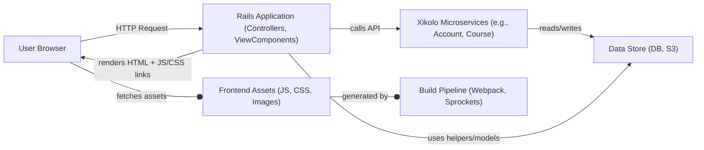
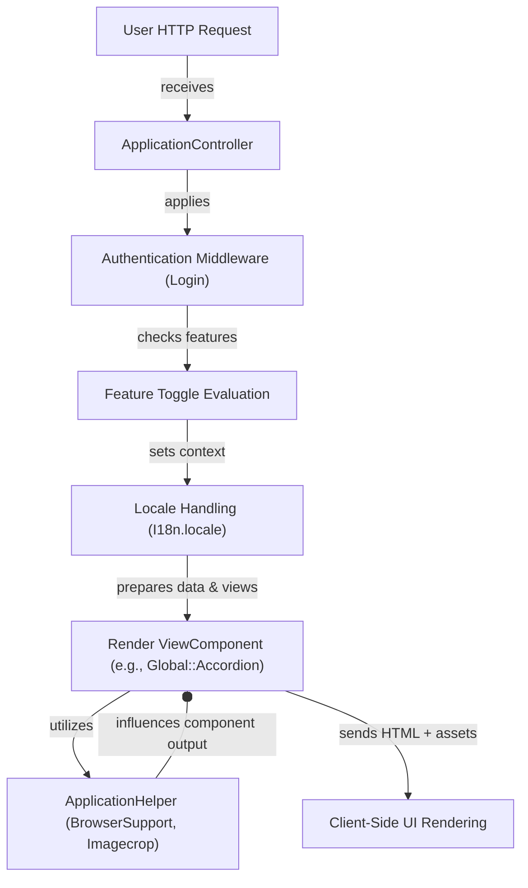
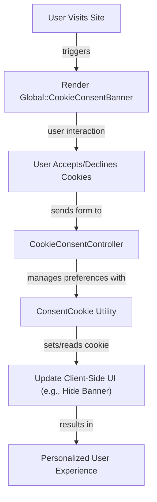

# General Application Logic, Shared Helpers, Layouts, and Global UI Elements - Technical Documentation

*Generated on 9/18/2025 | Xikolo Knowledge Base*

---

## 📋 Executive Summary

This report details the `44_INFRA_UIComponents` cluster, a foundational domain encompassing the core structure, shared functionalities, and standardized user interface elements for the Xikolo platform. It integrates a hybrid frontend asset management pipeline, robust server-side UI components built with ViewComponent, and essential core application logic housed within various controllers and helpers. The cluster ensures a consistent, maintainable, and extensible user experience by providing a unified approach to styling, form handling, navigation, and client-side interactions, underpinned by strict development tooling and internationalization capabilities.

---

## 🏗️ Architecture Overview

The architecture of the Xikolo UIComponents cluster is designed for modularity and maintainability, blending Ruby on Rails server-side rendering with modern client-side asset management. At its core, `ApplicationController` acts as the central hub for all incoming user requests, enforcing global concerns like authentication, authorization, and locale management. User interface elements are primarily composed of `ViewComponent`s, which encapsulate presentation logic and HTML, rendered by the Rails application. These components are then enhanced and styled by a sophisticated frontend asset pipeline, managed by `Webpack` and `Sprockets`, compiling `TypeScript` and `Sass` into deployable assets for the `UserBrowser`. Critical helper modules like `ApplicationHelper` and `MarkdownHelper` provide common utilities across the application, interacting with external services and internal models. The entire system communicates with various `Xikolo.api` microservices for core data and business logic.

### Architecture Diagrams

#### Main Architecture

### 🔄 Component Interactions

Key interactions between components in this cluster:

- **ApplicationController:** Includes `FeatureTogglesHelper` for feature flag checks. [Source: app/controllers/application_controller.rb]
- **ApplicationController:** Includes `Login` module for authentication logic. [Source: app/controllers/application_controller.rb]
- **CookieConsentController:** Interacts with `ConsentCookie` to manage cookie preferences [Source: app/controllers/cookie_consent_controller.rb]
- **ErrorsController:** Logs exceptions to `::Mnemosyne` [Source: app/controllers/errors_controller.rb]
- **ErrorsController:** Captures exceptions with `Sentry` [Source: app/controllers/errors_controller.rb]
- **FilesController:** Fetches user data from `Xikolo::Account::User` [Source: app/controllers/files_controller.rb]
- **FilesController:** Uses `Imagecrop.transform` for image manipulation [Source: app/controllers/files_controller.rb]
- **Home::GoController:** Uses `Xikolo::Common::Tracking::ExternalLink` for safe external redirects [Source: app/controllers/home/go_controller.rb]
- **Home::GoController:** Interacts with `Xikolo.api(:course)` and `Xikolo.api(:pinboard)` for deep linking [Source: app/controllers/home/go_controller.rb]
- **Home::HomeController:** Checks `feature?('announcements')` and `Xikolo.api?(:news)` for news integration [Source: app/controllers/home/home_controller.rb]
- **Home::HomeController:** Uses `Rails.application.config.homepage_course_loader`, `homepage_topics_loader`, `homepage_video_loader` for dynamic content loading [Source: app/controllers/home/home_controller.rb, RAG: docs/app/development/branding/homepage.md]
- **Home::PagesController:** Interacts with the `Page` model to retrieve page content and translations [Source: app/controllers/home/pages_controller.rb, app/models/page.rb]
- **Home::PagesController:** Uses `PagePresenter` to format page data for views [Source: app/controllers/home/pages_controller.rb]
- **IcalController:** Requires `ical_feed` feature [Source: app/controllers/ical_controller.rb]
- **IcalController:** Fetches `next_dates` from `Xikolo.api(:course)` [Source: app/controllers/ical_controller.rb]
- **LearningModeController:** Requires `quiz_recap` feature [Source: app/controllers/learning_mode_controller.rb]
- **LearningModeController:** Uses `CourseContextHelper` for course-specific context [Source: app/controllers/learning_mode_controller.rb]
- **PagesController:** Requires `helpdesk.page.store` permission [Source: app/controllers/pages_controller.rb]
- **PagesController:** Interacts with the `Page` model for content management [Source: app/controllers/pages_controller.rb, app/models/page.rb]
- **UsersController:** Requires `ensure_logged_in` before actions [Source: app/controllers/users_controller.rb]
- **UsersController:** Authorizes `account.user.delete` and `account.user.change_password` permissions [Source: app/controllers/users_controller.rb]
- **WebManifestController:** Checks `WebManifest.configured?` before rendering [Source: app/controllers/web_manifest_controller.rb]
- **WebManifestController:** Uses `Xikolo.config.site_name` for manifest name [Source: app/controllers/web_manifest_controller.rb]
- **ApplicationHelper:** Uses `BrowserSupport` to determine browser compatibility. [Source: app/helpers/application_helper.rb]
- **ApplicationHelper:** Interacts with `Imagecrop` for image URL transformations. [Source: app/helpers/application_helper.rb]
- **IcalHelper:** Interacts with `Xikolo::Account::Token` to create user tokens [Source: app/helpers/ical_helper.rb]
- **IcalHelper:** Uses `Digest::SHA256` for hash generation [Source: app/helpers/ical_helper.rb]
- **MarkdownHelper:** Uses `Redcarpet::Markdown` for Markdown rendering [Source: app/helpers/markdown_helper.rb]
- **MarkdownHelper:** Uses `Sanitize.fragment` with `SANITIZE_CONFIG` for HTML sanitization [Source: app/helpers/markdown_helper.rb]
- **SessionHelper:** Interacts with `Xikolo.api(:account)` to delete user sessions [Source: app/helpers/session_helper.rb]
- **SessionHelper:** Captures exceptions with `Sentry` and `Mnemosyne` for API errors during logout [Source: app/helpers/session_helper.rb]
- **UUIDHelper:** Uses `UUID4` for UUID conversion and parameterization [Source: app/helpers/uuid_helper.rb]
- **ViewMethodsHelper:** Includes `ActionView::Helpers` [Source: app/helpers/view_methods_helper.rb]
- **ViewMethodsHelper:** Extends `SanitizeHelper::ClassMethods` [Source: app/helpers/view_methods_helper.rb]
- **Page:** Uses `Xikolo::S3::Markup` for the `text` attribute, integrating with S3 for file uploads [Source: app/models/page.rb, Foundational Context]
- **Page:** Manages `has_many` associations for `translations` and `other_translations` [Source: app/models/page.rb]
- **Breadcrumbs:** Used by views or layouts to render the breadcrumb navigation.
- **MenuWithPermissions:** Includes `Rails.application.routes.url_helpers` and `ActionView::Helpers::UrlHelper` for link generation [Source: app/presenters/menu_with_permissions.rb]
- **MenuWithPermissions:** Checks user permissions via `user.allowed?` [Source: app/presenters/menu_with_permissions.rb]
- **PlatformDashboardNav:** Extends `MenuWithPermissions` [Source: app/presenters/platform_dashboard_nav.rb]
- **PlatformDashboardNav:** Defines menu items for 'Dashboard' and 'News' with `user.allowed?('global.dashboard.show')` permission checks [Source: app/presenters/platform_dashboard_nav.rb]
- **Presenter:** Inherited by `PrivatePresenter` and other presenter classes.
- **AjaxPaginationRenderer:** Extends `PaginationRenderer` [Source: lib/ajax_pagination_renderer.rb]
- **PaginationRenderer:** Includes `ActionView::Helpers::OutputSafetyHelper` [Source: lib/pagination_renderer.rb]
- **PaginationRenderer:** Uses `I18n.t` for localized pagination texts [Source: lib/pagination_renderer.rb, RAG: config/locales/en.yml, RAG: config/locales/de.yml]
- **RedirectURL:** Uses `Addressable::URI` for URL parsing and normalization [Source: lib/redirect_url.rb]
- **app/assets/javascripts/application.js:** Requires `xfn/ready` for DOM readiness [Source: app/assets/javascripts/application.js]
- **app/assets/javascripts/application.js:** Requires `jquery2` for DOM manipulation [Source: app/assets/javascripts/application.js]
- **app/assets/javascripts/xfn/ready.js:** Interacts with `document.readyState` and `document.addEventListener('DOMContentLoaded')` [Source: app/assets/javascripts/xfn/ready.js]
- **app/assets/main.js:** Imports `form-request-submit-polyfill` [Source: app/assets/main.js]
- **app/assets/main.js:** Initializes `Rails` UJS [Source: app/assets/main.js]
- **app/assets/main.scss:** Imports `stylesheets/theme` for brand-specific styling [Source: app/assets/main.scss, RAG: docs/app/development/branding/stylesheets.md]
- **app/assets/main.scss:** Imports `stylesheets/global` for general application styles [Source: app/assets/main.scss, RAG: docs/app/development/branding/stylesheets.md]
- **Global::Accordion:** Renders `Global::AccordionSection` components as its sections [Source: app/components/global/accordion.rb, app/components/global/accordion_section.rb]
- **Global::Accordion:** Uses `data-controller='accordion'` for JavaScript interaction [Source: app/components/global/accordion.html.slim]
- **Global::AccordionSection:** Renders `Global::FaIcon` for the expand/collapse indicators [Source: app/components/global/accordion_section.html.slim, app/components/global/fa_icon.rb]
- **Global::AccordionSection:** Uses `data-accordion-target='toggle-button'` for JavaScript interaction [Source: app/components/global/accordion_section.html.slim]
- **Global::ActionsDropdown:** Renders `Global::FaIcon` for the dropdown control icon [Source: app/components/global/actions_dropdown.html.slim, app/components/global/fa_icon.rb]
- **Global::ActionsDropdown:** Uses `data-behaviour='dropdown'` and `data-behaviour='menu-dropdown'` for JavaScript interaction [Source: app/components/global/actions_dropdown.html.slim]
- **Global::Callout:** Renders `Global::FaIcon` for the message indicator [Source: app/components/global/callout.html.slim, app/components/global/fa_icon.rb]
- **Global::CookieConsentBanner:** Interacts with `ConsentCookie` to get current consent status [Source: app/components/global/cookie_consent_banner.rb]
- **Global::CookieConsentBanner:** Uses `Translations` to render consent text [Source: app/components/global/cookie_consent_banner.rb]
- **Global::CopyToClipboard:** Uses `data-behavior='copy-to-clipboard'` for JavaScript interaction [Source: app/components/global/copy_to_clipboard.html.slim]
- **Global::CopyToClipboard:** Renders `Global::FaIcon` for the copy icon [Source: app/components/global/copy_to_clipboard.html.slim, app/components/global/fa_icon.rb]
- **Global::CourseListBanner:** Fetches `Banner.current` from the database [Source: app/components/global/course_list_banner.rb]
- **Global::CourseListBanner:** Uses `Rails.cache.fetch` for server-side caching of banner data [Source: app/components/global/course_list_banner.rb, RAG: docs/app/features/course_list_banner.md]
- **Global::CustomHeadSnippets:** Reads custom HTML snippets from `Xikolo.config.custom_html` [Source: app/components/global/custom_head_snippets.rb]
- **Global::CustomHeadSnippets:** Uses `Global::CustomHeadSnippets::Requirements` to evaluate snippet conditions, including `CookieConsent` [Source: app/components/global/custom_head_snippets.rb]
- **Global::DisclosureWidget:** Renders `Global::FaIcon` for the open/closed state indicators [Source: app/components/global/disclosure_widget.html.slim, app/components/global/fa_icon.rb]
- **Global::DownloadButton:** Renders `Global::FaIcon` if the button type is `:download` [Source: app/components/global/download_button.html.slim, app/components/global/fa_icon.rb]
- **Global::FilterBar::Controls:** Renders `Global::FaIcon` for filter and reset icons [Source: app/components/global/filter_bar/controls.html.slim, app/components/global/fa_icon.rb]
- **Global::FilterBar::Controls:** Renders `Global::Pill` for displaying the results count [Source: app/components/global/filter_bar/controls.html.slim, app/components/global/pill.rb]
- **Global::FilterBar::Filter:** Uses `select_tag` and `hidden_field_tag` for form elements [Source: app/components/global/filter_bar/filter.html.slim]
- **Global::FilterBar::Filter:** Uses `I18n.t` for localization of blank options and disabled text [Source: app/components/global/filter_bar/filter.rb, RAG: config/locales/en.yml, RAG: config/locales/de.yml]
- **Global::FilterBar::Search:** Uses `text_field_tag` for the search input [Source: app/components/global/filter_bar/search.html.slim]
- **Global::FilterBar::Search:** Renders `Global::FaIcon` for search and clear buttons [Source: app/components/global/filter_bar/search.html.slim, app/components/global/fa_icon.rb]
- **Global::FlashBlock:** Renders `Global::FlashMessage` for standard flash messages [Source: app/components/global/flash_block.html.slim, app/components/global/flash_message.rb]
- **Global::FlashBlock:** Renders `Global::FlashLayer` for SweetAlert2-style flash layers [Source: app/components/global/flash_block.html.slim, app/components/global/flash_layer.rb]
- **Global::FlashLayer:** Injects JavaScript to call `xuiSwal.fire` (SweetAlert2) [Source: app/components/global/flash_layer.html.slim]
- **Global::FlashLayer:** Uses `ready` function for DOM readiness [Source: app/components/global/flash_layer.html.slim, app/assets/javascripts/xfn/ready.js]
- **Global::FlashMessage:** Renders `Global::FaIcon` for the message icon and close button [Source: app/components/global/flash_message.html.slim, app/components/global/fa_icon.rb]
- **Global::FlashMessage:** Uses `data-hide-on-click` for JavaScript interaction to dismiss the message [Source: app/components/global/flash_message.html.slim]
- **Global::HeadlineTooltip:** Renders `Global::BasicTooltip` [Source: app/components/global/headline_tooltip.html.slim, app/components/global/basic_tooltip.rb]
- **Global::HelpdeskButton:** Renders `Global::FaIcon` for the button icon [Source: app/components/global/helpdesk_button.html.slim, app/components/global/fa_icon.rb]
- **Global::HelpdeskButton:** Renders `State::Loading` while the helpdesk panel content loads [Source: app/components/global/helpdesk_button.html.slim]
- **Global::ItemStatus:** Renders `Global::FaIcon` for the status icon [Source: app/components/global/item_status.html.slim, app/components/global/fa_icon.rb]
- **Global::LabeledCopyButton:** Uses `data-behavior='copy-to-clipboard'` for JavaScript interaction [Source: app/components/global/labeled_copy_button.html.slim]
- **Global::LinkItem:** Renders `Global::FaIcon` if an icon class is provided [Source: app/components/global/link_item.html.slim, app/components/global/fa_icon.rb]
- **Global::PageHeader:** Renders `Global::Pill` if a pill is provided [Source: app/components/global/page_header.rb, app/components/global/pill.rb]
- **Global::Slider:** Renders `Global::FaIcon` for scroll buttons [Source: app/components/global/slider.html.slim, app/components/global/fa_icon.rb]
- **Global::Slider:** Uses `data-controller='slider'` and `data-slider-target` for JavaScript interaction [Source: app/components/global/slider.html.slim]
- **Global::SvgIcon:** Reads SVG content from a file path [Source: app/components/global/svg_icon.rb]
- **Global::Table:** Renders `State::Empty` if no data is provided [Source: app/components/global/table.html.slim]
- **Global::Table:** Uses `I18n.t` for the 'no data' message [Source: app/components/global/table.html.slim, RAG: config/locales/en.yml, RAG: config/locales/de.yml]
- **Global::UserAvatar:** Uses `avatar_path` helper to construct the image URL [Source: app/components/global/user_avatar.rb]
- **Webpack:** Processes JavaScript/TypeScript files from `app/assets/`.
- **Webpack:** Processes Sass files from `app/assets/` and `brand/*/assets`.
- **Yarn:** Installs dependencies listed in `package.json`.
- **Yarn:** Used for running build, start, format, and lint scripts.
- **ViewComponent:** Components are rendered within Rails views (e.g., `.html.slim` templates) using the `render` helper.
- **ViewComponent:** Integrates with `lookbook` for cataloging, documenting, and previewing component variants.
- **React:** Components are bundled by Webpack and transpiled by Babel.
- **TypeScript:** Transpiled by Babel.
- **TypeScript:** Configuration defined in `tsconfig.json`.
- **Sass:** Sass files are compiled by `sass-embedded` via `sass-loader` within the Webpack pipeline.
- **Sass:** Compiled CSS is then processed by `PostCSS`.
- **PostCSS:** Integrated into Webpack via `postcss-loader`.
- **PostCSS:** Processes output from Sass.
- **ESLint:** Analyzes `**/*.{js,mjs,cjs,ts}` files.
- **ESLint:** Integrated into the pre-commit hook via `lint-staged`.
- **Stylelint:** Analyzes `app/assets/**/*.{css,scss}` and `brand/*/assets/**/*.{css,scss}`.
- **Stylelint:** Integrated into the pre-commit hook via `lint-staged`.
- **Prettier:** Formats various file types on commit via `lint-staged`.
- **Prettier:** Ignores specific auto-generated or vendored directories and files.
- **I18n-js:** Used in client-side JavaScript code for displaying localized text.
- **I18n-js:** The `I18n` global variable is exposed and marked as `readonly` in ESLint configuration.
- **XikoloVideoPlayer:** Used within the application to embed and manage video playback.
- **XikoloVideoPlayer:** Managed as a Node.js dependency via `Yarn`.
- **SimpleForm:** Interacts with ApplicationComponent (implicitly, as custom inputs are rendered within views).
- **SimpleForm:** Uses I18n for internationalization of labels, hints, and errors.
- **Form::DynamicSortableList:** Renders Global::FaIcon for UI elements.
- **Form::DynamicSortableList:** Emits JavaScript events (via data-behavior attributes) for client-side sorting, adding, and deleting.
- **SimpleFormTranslateWithVariables:** Prepends to SimpleForm::Inputs::Base.
- **SimpleFormTranslateWithVariables:** Uses I18n for translation and interpolation.
- **SubmitButtonPrimary:** Includes into SimpleForm::FormBuilder.
- **SimpleForm::Components::Pattern:** Integrated into SimpleForm's wrapper configuration.
- **SimpleFormDynamicDefaultFormClass:** Included into ActionView.
- **SimpleFormDynamicDefaultFormClass:** Inspects SimpleForm's default wrapper configuration.
- **AdvancedOptionsHelpers:** Included into ActionView.
- **AdvancedOptionsHelpers:** Uses SecureRandom.uuid for unique element IDs.
- **FrontendFormHandler:** Reads content_type and other input values from the DOM.
- **FrontendFormHandler:** Modifies DOM elements to show/hide form sections.
- **PrivatePresenter:** Inherits from `Presenter`.
- **PrivatePresenter:** Extends child classes with `Preloading` module.
- **Preloading::Preloader:** Used by `PrivatePresenter` and its descendants via the `load` method to fetch associated data efficiently.
- **IconNavigationPresenter:** Inherits from `PrivatePresenter`.
- **IconNavigationPresenter:** Used by views or layouts to render dynamic icon navigation menus.
- **CoursePresenter:** Delegates to the `course` object for core data.
- **CoursePresenter:** Uses `ActionView::Helpers::TagHelper` and `ActionView::Context` for HTML generation within the presenter.
- **_piwik.html.slim:** Reads configuration from `Xikolo.config`.
- **_piwik.html.slim:** Intended to be included in the main application layout for site-wide tracking.
- **browser-warning.js:** Interacts with the DOM to find and hide the warning alert element (`[data-browser-warning="alert"]`). [Source: app/assets/components/global/browser-warning.js]
- **browser-warning.js:** Uses `js-cookie` to set a cookie (`_browser_warning`) with a 365-day expiration. [Source: app/assets/components/global/browser-warning.js]
- **BrowserSupport:** Receives a `browser` object (likely from the `browser` gem) upon initialization and queries its properties (e.g., `bot?`, `ie?`, `edge?`, `version`, `platform.mac?`, `webkit?`, `firefox?`) to perform compatibility checks. [Source: lib/browser_support.rb]
- **Babel:** Used by Webpack via `babel-loader`.
- **Babel:** Applies `@babel/preset-env` and `@babel/plugin-transform-runtime`.
- **Sass (sass-embedded):** Integrated into Webpack via `sass-loader`.
- **Sass (sass-embedded):** Output is further processed by PostCSS.
- **Sprockets:** Coexists with Webpack for asset management.
- **jQuery:** Can still be used for existing jQuery plugins, but new code should avoid it.
- **gon:** Receives data from Rails controllers/views.
- **gon:** Provides `user_id`, `in_app`, `env`, `build_version`, `item_id`, `section_id`, `course_id` to frontend JavaScript.
- **Husky & lint-staged:** Runs Prettier for formatting.
- **Husky & lint-staged:** Executes ESLint for JavaScript/TypeScript.
- **application.js:** Requires `xfn/ready` for document ready events. [Source: app/assets/javascripts/application.js]
- **application.js:** Requires `jquery2` for DOM manipulation and AJAX. [Source: app/assets/javascripts/application.js]
- **main.js:** Imports `form-request-submit-polyfill` for browser compatibility. [Source: app/assets/main.js]
- **main.js:** Initializes `@rails/ujs` for unobtrusive JavaScript features. [Source: app/assets/main.js]
- **main.scss:** Imports `stylesheets/theme` to load theme-specific variables and styles first. [Source: app/assets/main.scss, RAG: docs/app/development/branding/stylesheets.md]
- **main.scss:** Imports `stylesheets/global` to load general application styles. [Source: app/assets/main.scss, RAG: docs/app/development/branding/stylesheets.md]
- **_theme.scss:** Imports `theme/color_schema` for color definitions. [Source: app/assets/stylesheets/_theme.scss, RAG: docs/app/development/branding/stylesheets.md]
- **_theme.scss:** Imports `theme/common/variables` for shared SCSS variables. [Source: app/assets/stylesheets/_theme.scss, RAG: docs/app/development/branding/stylesheets.md]
- **_global.scss:** Imports `bs-variables` for Bootstrap 3 variable overrides. [Source: app/assets/stylesheets/_global.scss]
- **_global.scss:** Imports `libs` for external library styles. [Source: app/assets/stylesheets/_global.scss]
- **_bs-variables.scss:** Defines and overrides Bootstrap 3.4.1 variables, influencing the styling of elements that still rely on Bootstrap. [Source: app/assets/stylesheets/_bs-variables.scss]
- **_bs-variables.scss:** Uses `sass:color` and `sass:math` functions for color adjustments and calculations. [Source: app/assets/stylesheets/_bs-variables.scss]
- **_components.scss:** Imports styles for various global components (e.g., `accordion`, `tooltip`, `cookie_consent_banner`). [Source: app/assets/stylesheets/_components.scss]
- **_components.scss:** Imports styles for navigation components (e.g., `navigation_bar`, `navigation_tabs`). [Source: app/assets/stylesheets/_components.scss]
- **_partials.scss:** Imports styles for various legacy UI elements (e.g., `grid`, `typography`, `forms`, `navigation`, `quiz`, `dashboard`). [Source: app/assets/stylesheets/_partials.scss]
- **_partials.scss:** Imports styles for XUI components (`upload`, `mdupload`, `imageupload`). [Source: app/assets/stylesheets/_partials.scss]
- **_grid-settings.scss:** Defines `$column`, `$gutter`, `$grid-columns`, `$max-width` for the grid system. [Source: app/assets/stylesheets/_grid-settings.scss]
- **_grid-settings.scss:** Defines various breakpoints (`$xs-to-sm`, `$sm-to-md`, `$md-to-lg`, `$breakpoint-s`, etc.) and corresponding mixins (`@mixin small`, `@mixin medium`, `@mixin large`). [Source: app/assets/stylesheets/_grid-settings.scss]
- **application.html.slim:** Uses `ApplicationHelper#sentry_meta_tags` for Sentry integration. [Source: app/views/layouts/application.html.slim]
- **application.html.slim:** Includes `include_gon` for passing data to JavaScript. [Source: app/views/layouts/application.html.slim]
- **simple.html.slim:** Includes `include_gon` for passing data to JavaScript. [Source: app/views/layouts/simple.html.slim]
- **simple.html.slim:** Links `bootstrap`, `fontawesome`, and `styles` stylesheets. [Source: app/views/layouts/simple.html.slim]
- **Rails Asset Pipeline:** Links image directories (`../images`).
- **Rails Asset Pipeline:** Includes legacy JavaScript files like `application.js`, `m.e.i.n.e.l.js`, `moment.js`.
- **Husky:** Triggers `lint-staged` and `tsc --skipLibCheck --noEmit` on `pre-commit`.
- **lint-staged:** Receives staged files from Husky.
- **lint-staged:** Executes `prettier`, `editorconfig-checker`, `rubocop`, `slim-lint`, `eslint`, `stylelint`, and `markdownlint` on respective file types.
- **TypeScript Compiler (tsc):** Executed with `--skipLibCheck --noEmit` during the pre-commit hook to ensure type correctness without generating output files.
- **Sass (dartsass-sprockets):** Processes `.scss` files, including imports from `stylesheets/theme` and `stylesheets/global`.
- **Sass (dartsass-sprockets):** Used for both Webpack and potentially Rails Asset Pipeline managed styles.
- **Node.js:** Executes Webpack build and dev server commands.
- **Node.js:** Runs Yarn for dependency management.
- **Markdownlint:** Analyzes `**/*.{md,md.erb}` files.
- **Markdownlint:** Integrated into the pre-commit hook via `lint-staged`.
- **Accordion (JS):** User clicks a button (`data-accordion-target='toggle-button'`) to toggle the expanded state of a section.
- **Accordion (JS):** Automatically collapses other expanded sections when a new one is opened.
- **Accordion (Ruby ViewComponent):** Renders `AccordionSection` components, which are then controlled by the client-side `Accordion (JS)`.
- **ActionsDropdown:** Renders a button that, when clicked, triggers the client-side `Dropdown (JS)` to show/hide the menu.
- **ActionsDropdown:** Accepts `actions` and `destructive_actions` as blocks for menu items.
- **BasicTooltip:** Used by `HeadlineTooltip` to display contextual information.
- **Browser Warning:** User clicks a button (`data-browser-warning="dismiss"`) to hide the alert.
- **Browser Warning:** Interacts with `js-cookie` library to set a cookie.
- **Clear Button:** User clicks a button (`data-id='clear-button'`).
- **Clear Button:** Resets the value of the input specified by `data-clear-target`.
- **Cookie Consent Banner (JS):** User clicks the close button to hide the banner.
- **Cookie Consent Banner (Ruby ViewComponent):** Interacts with `ConsentCookie` to determine if a banner should be shown and what text to display.
- **Cookie Consent Banner (Ruby ViewComponent):** Renders a form for accepting or declining cookies.
- **Copy to Clipboard (JS):** User clicks an element (`data-behavior='copy-to-clipboard'`).
- **Copy to Clipboard (JS):** Accesses `navigator.clipboard.writeText()` to copy content.
- **Copy to Clipboard (Ruby ViewComponent):** Renders HTML elements with `data-behavior='copy-to-clipboard'` for client-side interaction.
- **CourseListBanner:** Fetches banner data from `Banner.current` (cached).
- **CustomHeadSnippets:** Reads configuration from `Xikolo.config.custom_html`.
- **CustomHeadSnippets:** Evaluates `Requirements` (e.g., `ConsentCookie`) to determine if a snippet should be rendered.
- **Custom Select (TomSelect):** Initializes `TomSelect` on elements with `data-behavior='custom-select'`.
- **Custom Select (TomSelect):** Uses `classifiers-select.js` to load classifier data from `/admin/find_classifiers`.
- **DisclosureWidget:** Toggles content visibility based on user interaction with the summary element.
- **Dropdown (JS):** User clicks an element (`data-behaviour='dropdown'`) to toggle its `aria-expanded` state.
- **Dropdown (JS):** Closes other dropdowns when a new one is opened, unless it's a nested parent.
- **Expand Course Card:** User hovers over a course card (`data-behavior='expandable'`).
- **Expand Course Card:** Clones the card and adds `course-card--expanded` class to display extended information.
- **FilterBar::Controls:** Renders a 'Reset' link that, when clicked, triggers client-side `hide-on-click` and `show-on-click` to manage content visibility.
- **FilterBar::Controls:** Can be configured to use `data-behavior='fixed'` for sticky positioning.
- **FilterBar::Filter:** Renders a `select_tag` that, when changed, triggers a form submission (via `data-change='submit'`).
- **FilterBar::Filter:** Can integrate with client-side `Custom Select (TomSelect)` for enhanced multi-select functionality.
- **FilterBar::Search:** Renders a `text_field_tag` for search input.
- **FilterBar::Search:** Includes a button (`data-id='clear-button'`) that interacts with the client-side `Clear Button` to clear the input and submit the form.
- **Fixed Bar:** Observes an element's intersection with the viewport using `IntersectionObserver`.
- **Fixed Bar:** Clones the element and appends it to the body with `js-fixed` class when the original element is no longer intersecting at the top threshold.
- **Flatpickr (JS):** Initializes `flatpickr` on elements with `data-behaviour~=datepicker`.
- **Flatpickr (JS):** Uses `luxon` for ISO date parsing and formatting.
- **FlashBlock:** Renders `FlashMessage` for standard flash messages.
- **FlashBlock:** Renders `FlashLayer` for messages displayed as `SweetAlert2` dialogs.
- **FlashLayer:** Generates JavaScript to call `xuiSwal.fire()` on the client-side.
- **FlashMessage:** Renders a button with `data-hide-on-click` attribute to hide the message via client-side JavaScript.
- **HeadlineTooltip:** Renders `Global::BasicTooltip`.
- **Helpdesk Button (JS):** Observes the footer copyright element (`data-id="footer-copyright"`) using `IntersectionObserver`.
- **Helpdesk Button (JS):** Adds/removes `helpdesk-button--bottom-reached` class to the helpdesk button based on intersection state.
- **Helpdesk Button (Ruby ViewComponent):** Checks user feature flags (`@user.feature?`) to determine the appropriate chatbot version and icon.
- **Helpdesk Button (Ruby ViewComponent):** Renders a button that, when clicked, likely toggles the visibility of the helpdesk panel (client-side interaction).
- **Hide/Show on Click:** User clicks an element with `data-hide-on-click` or `data-show-on-click`.
- **Hide/Show on Click:** Sets the `hidden` attribute of the target element to `true` or `false`.
- **LabeledCopyButton:** Renders a button with `data-behavior='copy-to-clipboard'` and `data-text` attributes for client-side copy functionality.
- **PageHeader:** Can render a `Global::Pill` component within its structure.
- **Slider (JS):** User clicks scroll buttons (`data-slider-target='scroll-button-left/right'`) to scroll content.
- **Slider (JS):** Uses `IntersectionObserver` to monitor visibility of `intersector-left/right` elements within the slider content.
- **Slider (Ruby ViewComponent):** Renders HTML elements with `data-controller='slider'` and `data-slider-target` attributes for client-side control.
- **SvgIcon:** Reads SVG content directly from the file system.
- **System Alerts:** User clicks the alerts container to expand the toggle button (`aria-expanded=true`).
- **System Alerts:** User clicks the close button (`data-id='system-alerts__close-btn'`) to collapse the toggle button (`aria-expanded=false`).
- **Table:** Renders `State::Empty` if `data` is empty.
- **Toggle Menu:** User clicks an element (`data-behaviour='toggle-menu'`) to toggle its `aria-expanded` state.
- **Toggle Menu:** Dynamically sets `style.left` or `style.right` property based on `data-follow-menu` and the controlled menu's `offsetWidth`.
- **Tooltip (JS):** User hovers over an element with `data-tooltip` attribute.
- **Tooltip (JS):** Dynamically creates and inserts tooltip content into a container (`data-id='tooltip'`).
- **Transcript:** Receives cues data to `fill()` the transcript.
- **Transcript:** Updates active cues (`updateActiveCues()`) based on video playback.
- **UserAvatar:** Generates avatar image URL using `avatar_path` helper.

---

## ⚙️ Technical Workflows

### 1. User Request and UI Rendering Workflow
This workflow describes how a user's request is processed by the Xikolo application, leading to the rendering of a dynamic user interface. The process begins when a user's browser sends a request to the Xikolo application. This request is first handled by the `ApplicationController`, which acts as the central entry point for web requests. The controller applies various cross-cutting concerns, including `Login` module for authentication checks, `Locale` module for internationalization, and `FeatureTogglesHelper` to determine feature flag-driven behaviors. After these initial processing steps, the controller prepares data and selects the appropriate view or `ViewComponent` for rendering. `ViewComponent`s, such as `Global::Accordion`, encapsulate UI logic and structure. During rendering, these components might utilize `ApplicationHelper` for tasks like browser compatibility checks or image transformations. The final HTML, along with the necessary JavaScript and CSS assets, is served to the `UserBrowser`. Frontend assets, including `application.js` (for legacy jQuery/Bootstrap) and `main.js` (for modern Webpack-bundled TypeScript/React components), are managed by the hybrid asset pipeline (`Webpack` and `Sprockets`) and then executed client-side, bringing the UI to life.

### 2. Cookie Consent Management Workflow
This workflow details how user cookie consent is managed within the Xikolo platform, ensuring compliance and a personalized user experience. When a `UserVisitsSite`, the system first checks for existing cookie preferences. If no consent is found or a new consent is required, the `Global::CookieConsentBanner` ViewComponent is rendered on the page. This component is responsible for displaying the consent message and options to `Accept` or `Decline` cookies. When the `UserAction` of accepting or declining is triggered (e.g., by clicking a button on the banner), the request is routed to the `CookieConsentController`. This controller then interacts with the `ConsentCookie` utility to persist the user's preferences. It calls methods like `accept()` or `decline()` on the `ConsentCookie` object, updating the client-side cookie status. Following this interaction, the application can `UpdateClientSide` elements (e.g., hiding the banner) and ensure the `ExperienceFinal` is tailored to the user's consent, potentially affecting features that rely on specific cookies, such as `Global::CustomHeadSnippets` which evaluates `CookieConsent` requirements before injecting HTML.

### Workflow Diagrams

#### User Request Handling Workflow

#### Cookie Consent Management Workflow

### 🔀 Process Workflows

Detailed workflow processes for this cluster:

- **ApplicationController Process:** Uses `Xikolo::Common::Auth::Middleware` for authentication processing.
  *Source: ApplicationController*
- **PagesController Process:** Uses `Xikolo::S3::TextWithUploadsProcessor` for S3 file uploads within page content
  *Source: PagesController*
- **Webpack Process:** Processes JavaScript/TypeScript files from `app/assets/`.
  *Source: Webpack*
- **Webpack Process:** Processes Sass files from `app/assets/` and `brand/*/assets`.
  *Source: Webpack*
- **Sass Process:** Compiled CSS is then processed by `PostCSS`.
  *Source: Sass*
- **PostCSS Process:** Processes output from Sass.
  *Source: PostCSS*
- **XikoloVideoPlayer Process:** Follows semantic versioning and has a dedicated release process on GitHub and npmjs.org.
  *Source: XikoloVideoPlayer*
- **Sass (sass-embedded) Process:** Output is further processed by PostCSS.
  *Source: Sass (sass-embedded)*

---

## 🔧 Implementation Details

The `44_INFRA_UIComponents` cluster leverages a blend of modern and legacy technologies, indicating a phased migration strategy. On the **frontend**, a hybrid asset pipeline is in place: `Sprockets` handles legacy JavaScript (`application.js` requiring `jquery2`, `bootstrap-sprockets.js`) and images, while `Webpack` is the primary bundler for modern `TypeScript`, `React`, and `Sass` files (`app/assets/main.js`, `app/assets/main.scss`). This setup ensures wide browser compatibility through `Babel` transpilation and CSS processing via `PostCSS`. Code quality is rigorously enforced by `Husky & lint-staged` running `ESLint` for JavaScript/TypeScript, `Stylelint` for CSS/Sass, `Prettier` for formatting, and `Markdownlint` for documentation. `I18n-js` facilitates client-side internationalization, synchronizing with Rails' `I18n` system.

**Server-side UI** is primarily built with `ViewComponent`, using `ApplicationComponent` as a base class. Components like `Global::Accordion`, `Global::ActionsDropdown`, and `Global::FilterBar` (with its sub-components `Controls`, `Filter`, `Search`) provide reusable, encapsulated UI patterns. These components frequently render `Global::FaIcon` for iconography and utilize `I18n.t` for localization. `SimpleForm` is extensively customized for rich form inputs, integrating custom input types and dynamic behaviors via `FrontendFormHandler` and `Form::DynamicSortableList`.

**Core application logic** resides in `ApplicationController` and specialized controllers. `ApplicationController` centralizes `Login`, `Locale`, `FeatureTogglesHelper`, and integrates with `Acfs` and `Xikolo::Common::Auth::Middleware`. Specific controllers like `CookieConsentController` interact with `ConsentCookie`, `ErrorsController` logs to `Sentry` and `::Mnemosyne`, and `PagesController` manages `Page` model content with `Xikolo::S3::TextWithUploadsProcessor` for S3 uploads. `Home::GoController` handles safe external redirects using `Xikolo::Common::Tracking::ExternalLink` and deep linking via `Xikolo.api(:course)` and `Xikolo.api(:pinboard)`. Presenters like `MenuWithPermissions` and `PlatformDashboardNav` abstract view logic, checking `user.allowed?` for permission-based navigation.

**Dependencies and integrations** include several internal `Xikolo.api` services (e.g., `:account`, `:course`, `:news`, `:pinboard`) for microservice communication. External tools and libraries like `Sentry` and `Mnemosyne` are used for error tracking and performance monitoring, `Imagecrop` for image transformations, and `XikoloVideoPlayer` for video playback. `gon` is used to bridge backend Ruby data to frontend JavaScript.

**Configuration requirements** are driven by `Xikolo.config`, which provides site-wide settings such as `site_name` for `WebManifestController`, `piwik` settings for analytics via `_piwik.html.slim`, and `custom_html` for `Global::CustomHeadSnippets` to inject dynamic HTML based on `CookieConsent` requirements. `WebManifest` settings define PWA capabilities. Most configurations are loaded through `Xikolo.config`, with specific localization files (`config/locales/en.yml`, `config/locales/de.yml`) providing translated strings for `I18n.t` usage across the application and its components.

### 📚 Technical Sources & References

Key technical documentation and source references:

- ApplicationController: app/controllers/application_controller.rb- CookieConsentController: app/controllers/cookie_consent_controller.rb- ErrorsController: app/controllers/errors_controller.rb- FilesController: app/controllers/files_controller.rb- FilesController: app/helpers/application_helper.rb- Home::GoController: app/controllers/home/go_controller.rb- Home::HomeController: app/controllers/home/home_controller.rb- Home::HomeController: app/presenters/announcement_presenter.rb- Home::PagesController: app/controllers/home/pages_controller.rb- Home::PagesController: app/models/page.rb- IcalController: app/controllers/ical_controller.rb- IcalController: app/helpers/ical_helper.rb- LearningModeController: app/controllers/learning_mode_controller.rb- PagesController: app/controllers/pages_controller.rb- PagesController: app/models/page.rb- PingController: app/controllers/ping_controller.rb- UsersController: app/controllers/users_controller.rb- UsersController: app/helpers/session_helper.rb- WebManifestController: app/controllers/web_manifest_controller.rb- ApplicationHelper: app/helpers/application_helper.rb- IcalHelper: app/helpers/ical_helper.rb- MarkdownHelper: app/helpers/markdown_helper.rb- SessionHelper: app/helpers/session_helper.rb- UUIDHelper: app/helpers/uuid_helper.rb- ViewMethodsHelper: app/helpers/view_methods_helper.rb- Page: app/models/page.rb- Page: app/models/application_record.rb- WellKnownFile: app/models/well_known_file.rb- WellKnownFile: app/models/application_record.rb- ApplicationOperation: app/operations/application_operation.rb- Breadcrumbs: app/presenters/breadcrumbs.rb- MenuWithPermissions: app/presenters/menu_with_permissions.rb- PlatformDashboardNav: app/presenters/platform_dashboard_nav.rb- PlatformDashboardNav: app/presenters/menu_with_permissions.rb- Presenter: app/presenters/presenter.rb- AjaxPaginationRenderer: lib/ajax_pagination_renderer.rb- AjaxPaginationRenderer: lib/pagination_renderer.rb- PaginationRenderer: lib/pagination_renderer.rb- RedirectURL: lib/redirect_url.rb- app/assets/javascripts/application.js: app/assets/javascripts/application.js- app/assets/javascripts/xfn/ready.js: app/assets/javascripts/xfn/ready.js- app/assets/main.js: app/assets/main.js- app/assets/main.scss: app/assets/main.scss- Global::Accordion: app/components/global/accordion.rb- Global::Accordion: app/components/global/accordion.html.slim- Global::AccordionSection: app/components/global/accordion_section.rb- Global::AccordionSection: app/components/global/accordion_section.html.slim- Global::ActionsDropdown: app/components/global/actions_dropdown.rb- Global::ActionsDropdown: app/components/global/actions_dropdown.html.slim- Global::BasicTooltip: app/components/global/basic_tooltip.rb- Global::BasicTooltip: app/components/global/basic_tooltip.html.slim- Global::Callout: app/components/global/callout.rb- Global::Callout: app/components/global/callout.html.slim- Global::CookieConsentBanner: app/components/global/cookie_consent_banner.rb- Global::CookieConsentBanner: app/components/global/cookie_consent_banner.html.slim- Global::CopyToClipboard: app/components/global/copy_to_clipboard.rb- Global::CopyToClipboard: app/components/global/copy_to_clipboard.html.slim- Global::CourseListBanner: app/components/global/course_list_banner.rb- Global::CourseListBanner: app/components/global/course_list_banner.html.slim- Global::CustomHeadSnippets: app/components/global/custom_head_snippets.rb- Global::CustomHeadSnippets: app/components/global/custom_head_snippets.html.slim- Global::DisclosureWidget: app/components/global/disclosure_widget.rb- Global::DisclosureWidget: app/components/global/disclosure_widget.html.slim- Global::DownloadButton: app/components/global/download_button.rb- Global::DownloadButton: app/components/global/download_button.html.slim- Global::FaIcon: app/components/global/fa_icon.rb- Global::FaIcon: app/components/global/fa_icon.html.slim- Global::FilterBar::Controls: app/components/global/filter_bar/controls.rb- Global::FilterBar::Controls: app/components/global/filter_bar/controls.html.slim- Global::FilterBar::Filter: app/components/global/filter_bar/filter.rb- Global::FilterBar::Filter: app/components/global/filter_bar/filter.html.slim- Global::FilterBar::Search: app/components/global/filter_bar/search.rb- Global::FilterBar::Search: app/components/global/filter_bar/search.html.slim- Global::FlashBlock: app/components/global/flash_block.rb- Global::FlashBlock: app/components/global/flash_block.html.slim- Global::FlashLayer: app/components/global/flash_layer.rb- Global::FlashLayer: app/components/global/flash_layer.html.slim- Global::FlashMessage: app/components/global/flash_message.rb- Global::FlashMessage: app/components/global/flash_message.html.slim- Global::HeadlineTooltip: app/components/global/headline_tooltip.rb- Global::HeadlineTooltip: app/components/global/headline_tooltip.html.slim- Global::HelpdeskButton: app/components/global/helpdesk_button.rb- Global::HelpdeskButton: app/components/global/helpdesk_button.html.slim- Global::ItemStatus: app/components/global/item_status.rb- Global::ItemStatus: app/components/global/item_status.html.slim- Global::LabeledCopyButton: app/components/global/labeled_copy_button.rb- Global::LabeledCopyButton: app/components/global/labeled_copy_button.html.slim- Global::LinkItem: app/components/global/link_item.rb- Global::LinkItem: app/components/global/link_item.html.slim- Global::Meter: app/components/global/meter.rb- Global::Meter: app/components/global/meter.html.slim- Global::PageHeader: app/components/global/page_header.rb- Global::PageHeader: app/components/global/page_header.html.slim- Global::Pill: app/components/global/pill.rb- Global::Pill: app/components/global/pill_preview.rb- Global::Slider: app/components/global/slider.rb- Global::Slider: app/components/global/slider.html.slim- Global::SvgIcon: app/components/global/svg_icon.rb- Global::SvgIcon: app/components/global/svg_icon.html.slim- Global::Table: app/components/global/table.rb- Global::Table: app/components/global/table.html.slim- Global::UserAvatar: app/components/global/user_avatar.rb- Global::UserAvatar: app/components/global/user_avatar.html.slim- Webpack: package.json- Webpack: config/assets/webpack.config.mjs- Yarn: package.json- Yarn: RAG: docs/app/development/frontend/webpack_bundles.md- ViewComponent: Gemfile- ViewComponent: RAG: docs/app/development/frontend/components/index.md- React: package.json- React: RAG: foundational_context- TypeScript: package.json- TypeScript: tsconfig.json- Sass: package.json- Sass: Gemfile- PostCSS: package.json- ESLint: package.json- ESLint: eslint.config.mjs- Stylelint: package.json- Stylelint: .stylelintrc.js- Prettier: package.json- Prettier: .prettierignore- I18n-js: package.json- I18n-js: eslint.config.mjs- XikoloVideoPlayer: package.json- XikoloVideoPlayer: RAG: docs/app/development/frontend/video-player.md- SimpleForm: config/initializers/simple_form.rb- SimpleForm: RAG: config/locales/simple_form.en.yml- Form::DynamicSortableList: app/components/form/dynamic_sortable_list.rb- Form::DynamicSortableList: app/components/form/dynamic_sortable_list.html.slim- SimpleFormTranslateWithVariables: config/initializers/simple_form.rb- SubmitButtonPrimary: config/initializers/simple_form.rb- SimpleForm::Components::Pattern: config/initializers/simple_form.rb- SimpleFormDynamicDefaultFormClass: config/initializers/simple_form.rb- AdvancedOptionsHelpers: config/initializers/simple_form.rb- FrontendFormHandler: RAG: docs/app/development/implementation/course_items_form.md- PrivatePresenter: app/presenters/private_presenter.rb- Preloading::Preloader: app/presenters/private_presenter.rb- IconNavigationPresenter: app/presenters/icon_navigation_presenter.rb- CoursePresenter: app/presenters/course_presenter.rb- _piwik.html.slim: app/views/shared/_piwik.html.slim- browser-warning.js: app/assets/components/global/browser-warning.js- BrowserSupport: lib/browser_support.rb- Babel: package.json- Babel: foundational_context- Sass (sass-embedded): package.json- Sass (sass-embedded): RAG: docs/app/development/frontend/CSS/css_styleguide.md- Sprockets: app/assets/config/manifest.js- Sprockets: RAG: foundational_context- jQuery: package.json- jQuery: RAG: docs/app/development/frontend/js_styleguide.md- gon: app/assets/global.d.ts- gon: foundational_context- Husky & lint-staged: package.json- ApplicationComponent: app/components/application_component.rb- application.js: app/assets/javascripts/application.js- application.js: foundational_context- main.js: app/assets/main.js- main.js: foundational_context- main.scss: app/assets/main.scss- main.scss: RAG: docs/app/development/branding/stylesheets.md- _theme.scss: app/assets/stylesheets/_theme.scss- _theme.scss: RAG: docs/app/development/branding/stylesheets.md- _global.scss: app/assets/stylesheets/_global.scss- _global.scss: RAG: docs/app/development/frontend/CSS/index.md- _bs-variables.scss: app/assets/stylesheets/_bs-variables.scss- _bs-variables.scss: RAG: docs/app/development/frontend/CSS/index.md- _components.scss: app/assets/stylesheets/_components.scss- _components.scss: RAG: docs/app/development/frontend/CSS/index.md- _partials.scss: app/assets/stylesheets/_partials.scss- _partials.scss: RAG: docs/app/development/frontend/CSS/index.md- _grid-settings.scss: app/assets/stylesheets/_grid-settings.scss- _grid-settings.scss: RAG: docs/app/development/frontend/CSS/css_styleguide.md- application.html.slim: app/views/layouts/application.html.slim- application.html.slim: app/helpers/application_helper.rb- simple.html.slim: app/views/layouts/simple.html.slim- simple.html.slim: foundational_context- plain.html.slim: app/views/layouts/plain.html.slim- Rails Asset Pipeline: app/assets/config/manifest.js- Rails Asset Pipeline: eslint.config.mjs- Husky: package.json- Husky: .husky/pre-commit- lint-staged: package.json- lint-staged: .husky/pre-commit- TypeScript Compiler (tsc): tsconfig.json- TypeScript Compiler (tsc): .husky/pre-commit- Sass (dartsass-sprockets): foundational_context- Sass (dartsass-sprockets): app/assets/main.scss- Node.js: package.json- Node.js: RAG: docs/app/development/local_setup/update_node.md- Markdownlint: package.json- Markdownlint: .husky/pre-commit- Accordion (JS): app/assets/components/global/accordion.js- Accordion (Ruby ViewComponent): app/components/global/accordion.rb- Accordion (Ruby ViewComponent): app/components/global/accordion.html.slim- ActionsDropdown: app/components/global/actions_dropdown.rb- ActionsDropdown: app/components/global/actions_dropdown.html.slim- BasicTooltip: app/components/global/basic_tooltip.rb- BasicTooltip: app/components/global/basic_tooltip.html.slim- Browser Warning: app/assets/components/global/browser-warning.js- Callout: app/components/global/callout.rb- Callout: app/components/global/callout.html.slim- Clear Button: app/assets/components/global/clear-button.js- Cookie Consent Banner (JS): app/assets/components/global/cookie-consent-banner.js- Cookie Consent Banner (Ruby ViewComponent): app/components/global/cookie_consent_banner.rb- Cookie Consent Banner (Ruby ViewComponent): app/components/global/cookie_consent_banner.html.slim- Copy to Clipboard (JS): app/assets/components/global/copy-to-clipboard.ts- Copy to Clipboard (Ruby ViewComponent): app/components/global/copy_to_clipboard.rb- Copy to Clipboard (Ruby ViewComponent): app/components/global/copy_to_clipboard.html.slim- CourseListBanner: app/components/global/course_list_banner.rb- CourseListBanner: app/components/global/course_list_banner.html.slim- CustomHeadSnippets: app/components/global/custom_head_snippets.rb- CustomHeadSnippets: app/components/global/custom_head_snippets.html.slim- Custom Select (TomSelect): app/assets/components/global/custom-select.ts- Custom Select (TomSelect): app/assets/components/global/custom-select/classifiers-select.js- DisclosureWidget: app/components/global/disclosure_widget.rb- DisclosureWidget: app/components/global/disclosure_widget.html.slim- DownloadButton: app/components/global/download_button.rb- DownloadButton: app/components/global/download_button.html.slim- Dropdown (JS): app/assets/components/global/dropdown.js- Expand Course Card: app/assets/components/global/expand-course-card.js- FaIcon: app/components/global/fa_icon.rb- FaIcon: app/components/global/fa_icon.html.slim- FilterBar::Controls: app/components/global/filter_bar/controls.rb- FilterBar::Controls: app/components/global/filter_bar/controls.html.slim- FilterBar::Filter: app/components/global/filter_bar/filter.rb- FilterBar::Filter: app/components/global/filter_bar/filter.html.slim- FilterBar::Search: app/components/global/filter_bar/search.rb- FilterBar::Search: app/components/global/filter_bar/search.html.slim- Fixed Bar: app/assets/components/global/fixed-bar.js- Flatpickr (JS): app/assets/components/global/flatpickr.js- Flatpickr (JS): app/assets/components/global/flatpickr/customButtonsPlugin.js- FlashBlock: app/components/global/flash_block.rb- FlashBlock: app/components/global/flash_block.html.slim- FlashLayer: app/components/global/flash_layer.rb- FlashLayer: app/components/global/flash_layer.html.slim- FlashMessage: app/components/global/flash_message.rb- FlashMessage: app/components/global/flash_message.html.slim- HeadlineTooltip: app/components/global/headline_tooltip.rb- HeadlineTooltip: app/components/global/headline_tooltip.html.slim- Helpdesk Button (JS): app/assets/components/global/helpdesk-button.js- Helpdesk Button (Ruby ViewComponent): app/components/global/helpdesk_button.rb- Helpdesk Button (Ruby ViewComponent): app/components/global/helpdesk_button.html.slim- Hide/Show on Click: app/assets/components/global/hide-on-click.js- Hide/Show on Click: app/assets/components/global/show-on-click.js- ItemStatus: app/components/global/item_status.rb- ItemStatus: app/components/global/item_status.html.slim- LabeledCopyButton: app/components/global/labeled_copy_button.rb- LabeledCopyButton: app/components/global/labeled_copy_button.html.slim- LinkItem: app/components/global/link_item.rb- LinkItem: app/components/global/link_item.html.slim- Meter: app/components/global/meter.rb- Meter: app/components/global/meter.html.slim- PageHeader: app/components/global/page_header.rb- PageHeader: app/components/global/page_header.html.slim- Pill: app/components/global/pill.rb- Slider (JS): app/assets/components/global/slider.js- Slider (Ruby ViewComponent): app/components/global/slider.rb- Slider (Ruby ViewComponent): app/components/global/slider.html.slim- SvgIcon: app/components/global/svg_icon.rb- SvgIcon: app/components/global/svg_icon.html.slim- System Alerts: app/assets/components/global/system-alerts.js- Table: app/components/global/table.rb- Table: app/components/global/table.html.slim- Toggle Menu: app/assets/components/global/toggle-menu.js- Tooltip (JS): app/assets/components/global/tooltip.js- Transcript: app/assets/components/global/transcript.js- UserAvatar: app/components/global/user_avatar.rb- UserAvatar: app/components/global/user_avatar.html.slim- Configuration: config/application.rb, Gemfile, config/database.yml- Process Management: Procfile, Procfile.web- Build & Deploy: Rakefile, package.json

---

*This documentation is automatically generated from cluster analysis and should be validated against the actual codebase.*
