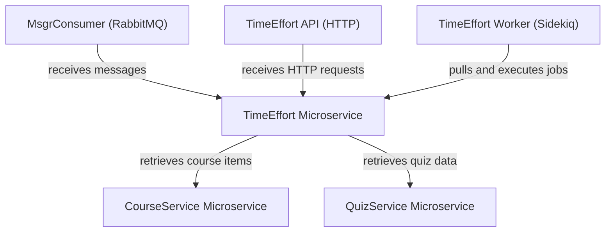
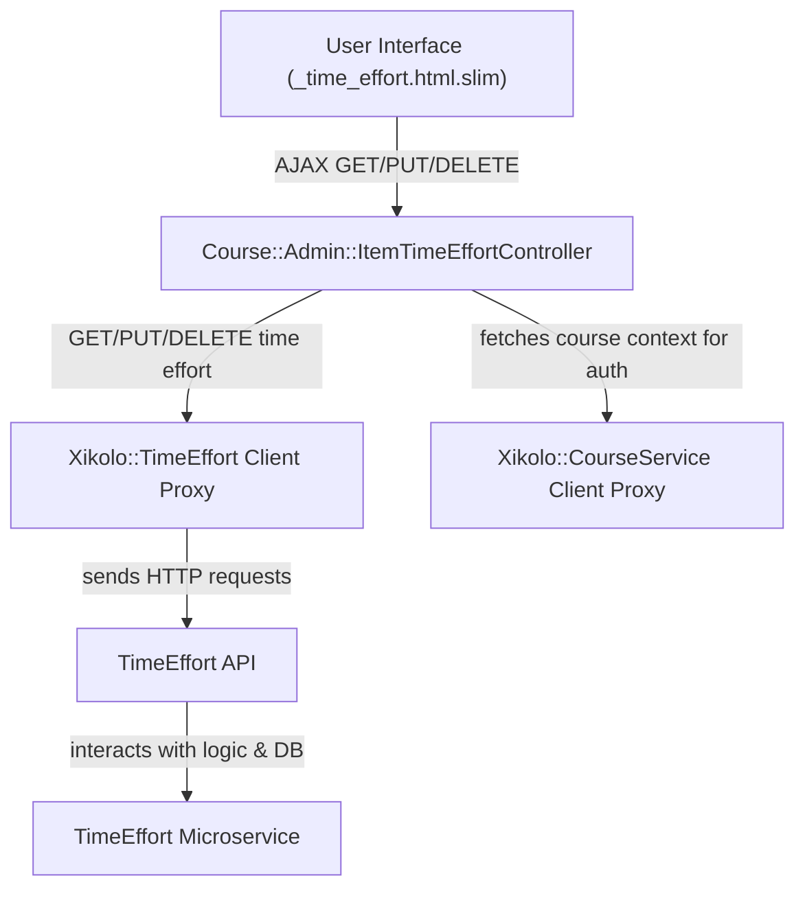
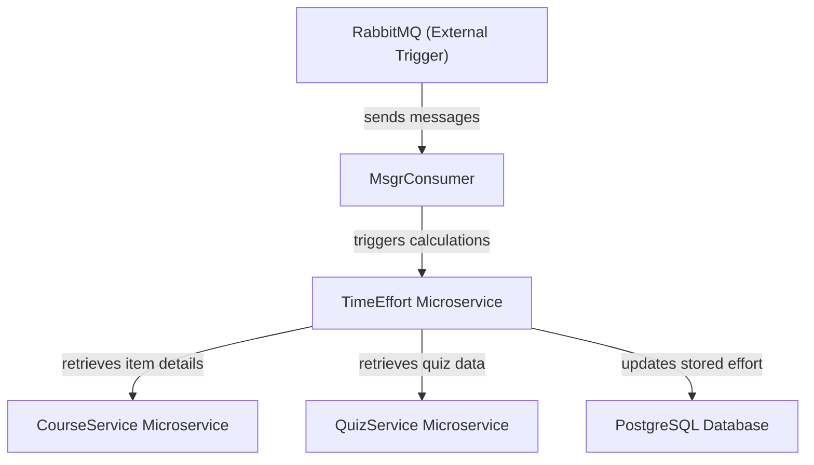

# Time Effort Microservice: Learning Item Duration Calculation - Technical Documentation

*Generated on 9/19/2025 | Xikolo Knowledge Base*

---

## 📋 Executive Summary

The Xikolo Time Effort Microservice (cluster 45_INFRA_TimeEffort) is a specialized backend service dedicated to the estimation, calculation, and management of time effort for course items within the Xikolo platform. It operates within a distributed microservice architecture, integrating with other core services like CourseService and QuizService to provide dynamic and persisted time estimations. Key components include an HTTP API for direct requests, a RabbitMQ consumer for event-driven processing, and a Sidekiq worker for asynchronous tasks, all leveraging PostgreSQL for data persistence and Redis for caching/job management. The primary purpose is to provide robust, configurable, and accurate time effort data, crucial for learner planning and content management.

---

## 🏗️ Architecture Overview

The Time Effort Microservice architecture is designed for scalability and modularity, focusing on the core responsibility of time effort management. It comprises a central microservice (`TimeEffortService`) that exposes various operational modes and interacts with foundational infrastructure and other domain-specific microservices. This setup ensures that time effort calculations can be triggered via different mechanisms—real-time API calls, asynchronous message processing, or scheduled background jobs—while drawing necessary data from external sources. The service also includes robust error handling utilities and operation wrappers to standardize internal logic outcomes.

### Architecture Diagrams

#### Main TimeEffort Microservice Architecture

### 🔄 Component Interactions

Key interactions between components in this cluster:

- **TimeEffortService:** Interacts with CourseService to retrieve course item details and structure. [Source: services/timeeffort/config/services.yml]
- **TimeEffortService:** Interacts with QuizService to retrieve quiz-specific data relevant to time effort calculation. [Source: services/timeeffort/config/services.yml]
- **MsgrConsumer:** Receives messages from RabbitMQ. [Source: RAG: docker/compose.timeeffort.yml, RAG: services/timeeffort/config/rabbitmq.yml]
- **MsgrConsumer:** Triggers TimeEffortService logic (e.g., calculations, data updates). [Source: foundational_context]
- **TimeEffortAPI:** Receives HTTP requests (e.g., GET for effort, POST for updates). [Source: RAG: docker/compose.timeeffort.yml]
- **TimeEffortAPI:** Interacts with TimeEffortService core logic and database. [Source: foundational_context]
- **TimeEffortWorker:** Pulls jobs from Redis-backed Sidekiq queue. [Source: foundational_context, RAG: docker/compose.timeeffort.yml]
- **TimeEffortWorker:** Executes TimeEffortService logic. [Source: foundational_context]
- **Course::Admin::ItemTimeEffortController:** Receives AJAX GET, PUT, and DELETE requests from the `_time_effort.html.slim` frontend component. [Source: app/controllers/course/admin/item_time_effort_controller.rb]
- **Course::Admin::ItemTimeEffortController:** Communicates with the `Xikolo::TimeEffort` microservice (via `Xikolo.api(:timeeffort)` and `Restify`) to fetch, update, or delete time effort data for course items. [Source: app/controllers/course/admin/item_time_effort_controller.rb]
- **_time_effort.html.slim:** Renders HTML for the time effort display and editable input field. [Source: app/views/items/_time_effort.html.slim]
- **_time_effort.html.slim:** Uses `bootstrap-editable` for in-place editing of the time effort value. [Source: app/views/items/_time_effort.html.slim]
- **Xikolo::TimeEffort Microservice (Client Proxy):** Receives calls from `Course::Admin::ItemTimeEffortController` to perform GET, PUT, and DELETE operations on item time effort. [Source: app/controllers/course/admin/item_time_effort_controller.rb]
- **Xikolo::TimeEffort Microservice (Client Proxy):** Sends HTTP requests to the actual `Xikolo::TimeEffort` microservice, likely using `Restify` for inter-service communication. [Source: app/controllers/course/admin/item_time_effort_controller.rb, RAG: foundational_context]
- **Xikolo::CourseService Microservice (Client Proxy):** Receives calls from `Course::Admin::ItemTimeEffortController` to fetch course details. [Source: app/controllers/course/admin/item_time_effort_controller.rb]
- **Xikolo::CourseService Microservice (Client Proxy):** Sends HTTP requests to the actual `Xikolo::CourseService` microservice, likely using `Restify`. [Source: app/controllers/course/admin/item_time_effort_controller.rb, RAG: foundational_context]
- **Errors (TimeEffort Service):** Error classes within this module are intended to be raised by the `Xikolo::TimeEffort` microservice's business logic when specific validation or operational failures occur. [Source: services/timeeffort/lib/errors.rb]
- **Errors (TimeEffort Service):** Provides a standardized format for error messages that can be serialized into JSON for API responses. [Source: services/timeeffort/lib/errors.rb]
- **Operation (TimeEffort Service):** Used internally within the `Xikolo::TimeEffort` microservice to wrap the results of business logic executions. [Source: services/timeeffort/lib/operation.rb]
- **Operation (TimeEffort Service):** Provides methods (`error!`, `success?`) to manage and query the operation's status and errors. [Source: services/timeeffort/lib/operation.rb]
- **CourseService:** Provides course item data to TimeEffortService for effort calculation. [Source: services/timeeffort/config/services.yml]
- **QuizService:** Provides quiz data to TimeEffortService for effort calculation. [Source: services/timeeffort/config/services.yml]

---

## ⚙️ Technical Workflows

The Xikolo Time Effort system supports distinct technical workflows, enabling both synchronous user-driven interactions and asynchronous background processing. Each workflow is critical for maintaining accurate and accessible time effort data across the platform, relying on specific component interactions as detailed below. The `TimeEffortService` acts as the central hub for all calculations and data persistence, adapting to various input triggers.

### Workflow Diagrams

#### User-Initiated Time Effort Management Workflow

#### Asynchronous Time Effort Recalculation Workflow

### 🔀 Process Workflows

Detailed workflow processes for this cluster:

- **Core time effort microservice: learning item duration calculation operations**
- **Data processing and validation workflows**
- **Component interaction and integration processes**

---

## 🔧 Implementation Details

The Time Effort Microservice is implemented as a Docker container, `xikolo-timeeffort:latest`, supporting three distinct operational modes: `timeeffort-msgr` for RabbitMQ message consumption, `timeeffort-server` for exposing an HTTP API (listening on port 80), and `timeeffort-sidekiq` for processing background jobs. This allows for flexible deployment configurations and diverse interaction patterns. The service’s core functionality can be dynamically enabled or disabled via the `timeeffort.enabled` feature flag, as configured in `app/xikolo.yml`.

Dependencies include PostgreSQL for persistent data storage, configured via `DATABASE_URL` and `CONCURRENCY` environment variables. RabbitMQ is used for asynchronous message queuing and inter-service communication, with its connectivity managed by the `XIKOLO_RABBITMQ_URL` environment variable. Redis serves as a caching layer and as the backend for Sidekiq job management, although specific configuration details for Redis beyond its role with Sidekiq are not specified in cluster data. 

Inter-service communication is facilitated through both RabbitMQ for event-driven interactions and direct HTTP calls using `Restify` for client proxies. The `TimeEffortService` makes outbound HTTP requests to the `CourseService` and `QuizService` microservices, whose locations are specified by `XIKOLO_SERVICE_COURSE` and `XIKOLO_SERVICE_QUIZ` environment variables, respectively. These external services provide crucial learning item and quiz data necessary for time effort calculations. The `Errors (TimeEffort Service)` module defines custom error classes for internal business logic failures, providing structured error responses, though the main application's `Course::Admin::ItemTimeEffortController` does not currently parse these detailed error types, potentially leading to generic user feedback. The `Operation (TimeEffort Service)` class wraps business logic results, offering a standardized way to manage operation status and errors within the microservice.

### 📚 Technical Sources & References

Key technical documentation and source references:

- TimeEffortService: services/timeeffort/config/services.yml- TimeEffortService: services/timeeffort/README.rdoc- MsgrConsumer: foundational_context- MsgrConsumer: RAG: docker/compose.timeeffort.yml- TimeEffortAPI: foundational_context- TimeEffortAPI: RAG: docker/compose.timeeffort.yml- TimeEffortWorker: foundational_context- TimeEffortWorker: RAG: docker/compose.timeeffort.yml- Course::Admin::ItemTimeEffortController: app/controllers/course/admin/item_time_effort_controller.rb- Course::Admin::ItemTimeEffortController: RAG: foundational_context- _time_effort.html.slim: app/views/items/_time_effort.html.slim- Xikolo::TimeEffort Microservice (Client Proxy): app/controllers/course/admin/item_time_effort_controller.rb- Xikolo::TimeEffort Microservice (Client Proxy): RAG: foundational_context- Xikolo::CourseService Microservice (Client Proxy): app/controllers/course/admin/item_time_effort_controller.rb- Xikolo::CourseService Microservice (Client Proxy): RAG: foundational_context- Errors (TimeEffort Service): services/timeeffort/lib/errors.rb- Operation (TimeEffort Service): services/timeeffort/lib/operation.rb- CourseService: services/timeeffort/config/services.yml- QuizService: services/timeeffort/config/services.yml- Configuration: config/application.rb, Gemfile, config/database.yml- Process Management: Procfile, Procfile.web- Build & Deploy: Rakefile, package.json

---

*This documentation is automatically generated from cluster analysis and should be validated against the actual codebase.*
