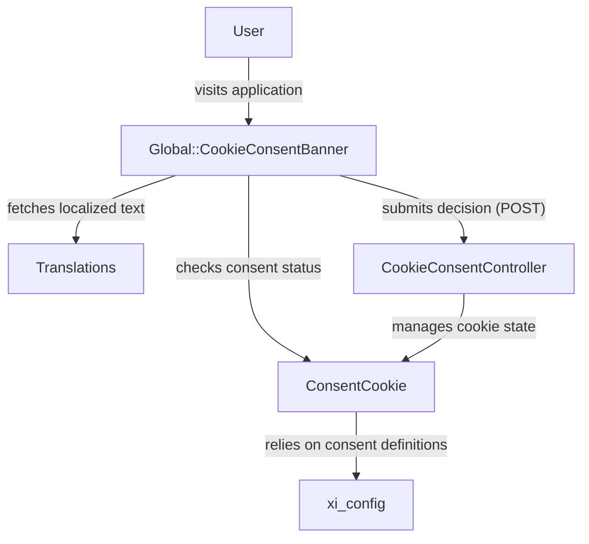
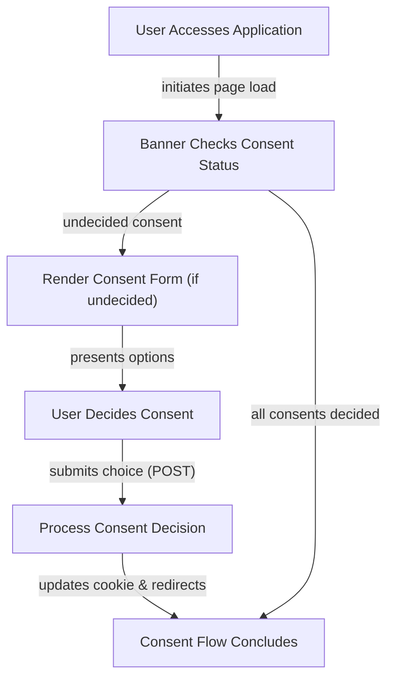

# Cookie Consent Management - Technical Documentation

*Generated on 9/19/2025 | Xikolo Knowledge Base*

---

## 📋 Executive Summary

The Xikolo cluster 50_SEC_CookieConsent manages the application's cookie consent mechanism, ensuring user preferences regarding cookie usage are captured and respected. This system primarily operates through a client-side banner, `Global::CookieConsentBanner`, which interacts with the user to obtain their consent. User decisions are then processed by the `CookieConsentController`, which in turn utilizes the `ConsentCookie` service object to manage the persistent `cookie_consents` cookie. The main purpose is to display a consent banner for undecided cookie types and store user choices with a one-year expiry, preventing repeated prompts for decided consents.

---

## 🏗️ Architecture Overview

The Cookie Consent Management feature comprises several key components that work in concert to manage user cookie preferences. At the frontend, the `Global::CookieConsentBanner` is responsible for rendering the visual banner and gathering user input. This banner dynamically determines whether to display itself by querying the `ConsentCookie` for the current consent status and fetching localized text via the `Translations` utility. User decisions (accept or decline) are submitted as a POST request to the `CookieConsentController`. This controller acts as the central processing unit, receiving the consent input and delegating the actual cookie manipulation to the `ConsentCookie` service object. The `ConsentCookie` is crucial for reading, writing, and updating the `cookie_consents` cookie on the client side, relying on `xi_config` for the definitions of available consents and `ActionDispatch::Cookies::CookieJar` for low-level cookie operations. After processing, the controller redirects the user back to their previous page, and the banner will no longer display for decided consents on subsequent page loads.

### Architecture Diagrams

#### Main Architecture: Cookie Consent Management

### 🔄 Component Interactions

Key interactions between components in this cluster:

- **Global::CookieConsentBanner:** Interacts with `ConsentCookie` to determine if a banner should be rendered and to retrieve current consent details. [Source: app/components/global/cookie_consent_banner.rb]
- **Global::CookieConsentBanner:** Interacts with `Translations` to fetch localized consent text. [Source: app/components/global/cookie_consent_banner.rb]
- **CookieConsentController:** Receives consent decisions from `Global::CookieConsentBanner`. [Source: app/components/global/cookie_consent_banner.html.slim]
- **CookieConsentController:** Instantiates and uses `ConsentCookie` to manage the `cookie_consents` cookie based on user input. [Source: app/controllers/cookie_consent_controller.rb]
- **ConsentCookie:** Accessed by `Global::CookieConsentBanner` to check for current consent and render the banner. [Source: app/components/global/cookie_consent_banner.rb]
- **ConsentCookie:** Accessed by `CookieConsentController` to record user decisions (accept/decline) into the cookie. [Source: app/controllers/cookie_consent_controller.rb]

---

## ⚙️ Technical Workflows

### 1. Cookie Consent Decision Workflow

This workflow outlines the process from a user visiting the application to their cookie consent decision being recorded and respected, leading to the banner's conditional display.

Upon a user's initial visit to the application, the `Global::CookieConsentBanner` component is initialized. It immediately checks the client's `cookie_consents` using the `ConsentCookie` service to determine if there are any undecided cookie consents. If an undecided consent is identified, the banner is rendered prominently at the bottom of the page, displaying localized text (fetched via `Translations`) and offering "Accept" and "Decline" options. The user then interacts with this banner by clicking either "Accept" or "Decline". This action triggers a POST request, specifically to the `CookieConsentController#create` action, transmitting the `consent_name` and the user's decision. The `CookieConsentController` takes this input and, through its `create` action, instructs an instance of `ConsentCookie` to update the `cookie_consents` cookie with the new decision for the specified consent. The cookie, which stores decisions as a JSON array (e.g., `["+google_analytics"]`), is set with a one-year expiry. Finally, the controller redirects the user back to the page they were on, completing the server-side processing. For all subsequent page loads, the `Global::CookieConsentBanner` will re-evaluate the `cookie_consents` cookie, and if all configured consents have been decided, the banner will no longer be displayed, ensuring a seamless user experience.

### Workflow Diagrams

#### Workflow: Cookie Consent Decision

### 🔀 Process Workflows

Detailed workflow processes for this cluster:

- **CookieConsentController Process:** Redirects the user back to the previous page after processing the consent.
  *Source: CookieConsentController*

---

## 🔧 Implementation Details

The Cookie Consent Management system demonstrates several key technical considerations and dependencies. The `Global::CookieConsentBanner` component, responsible for UI rendering, employs `html_safe` for displaying consent text. As indicated in the cluster data, this practice explicitly disables Rubocop's `Rails/OutputSafety` check and necessitates strict control and sanitization of the `text` variable's source (e.g., `Translations` or `xi_config`) to mitigate potential Cross-Site Scripting (XSS) risks.

The core logic for managing the `cookie_consents` cookie resides within the `ConsentCookie` service object. This class is instantiated by both the `Global::CookieConsentBanner` (for reading consent status) and the `CookieConsentController` (for writing decisions). The `ConsentCookie`'s functionality, although initially observed as inferred from its usage and test suite, is actually partially implemented in `app/lib/consent_cookie.rb` with methods like `accept`, `decline`, `current`, and `add` directly manipulating the `cookie_consents` value. The cookie itself is a JSON array, encoding decisions with `+` for accepted and `-` for declined, and is consistently set with a one-year expiry, providing long-term persistence for user choices.

Key dependencies for this feature include `Translations`, which `Global::CookieConsentBanner` uses to fetch localized text for the consent banner, ensuring internationalization support. More critically, the `ConsentCookie` relies on `xi_config` to define and order the available cookie consents and their associated texts. This central configuration point dictates which consents are presented to the user and in what sequence, necessitating careful management of this external configuration. Furthermore, `ConsentCookie` directly interacts with `ActionDispatch::Cookies::CookieJar` to perform the actual client-side cookie manipulation. As indicated by the RAG context, this specific cookie consent mechanism is primarily client-side focused and does not provide a post-banner user interface for managing consent decisions, distinguishing it from broader, more comprehensive user consent management systems that might allow profile-based preference adjustments or integration with external consent managers.

### 📚 Technical Sources & References

Key technical documentation and source references:

- Global::CookieConsentBanner: app/components/global/cookie_consent_banner.rb- Global::CookieConsentBanner: app/components/global/cookie_consent_banner.html.slim- CookieConsentController: app/controllers/cookie_consent_controller.rb- CookieConsentController: spec/requests/cookie_consent/create_spec.rb- ConsentCookie: app/components/global/cookie_consent_banner.rb- ConsentCookie: app/controllers/cookie_consent_controller.rb- Configuration: config/application.rb, Gemfile, config/database.yml- Process Management: Procfile, Procfile.web- Build & Deploy: Rakefile, package.json

---

*This documentation is automatically generated from cluster analysis and should be validated against the actual codebase.*
