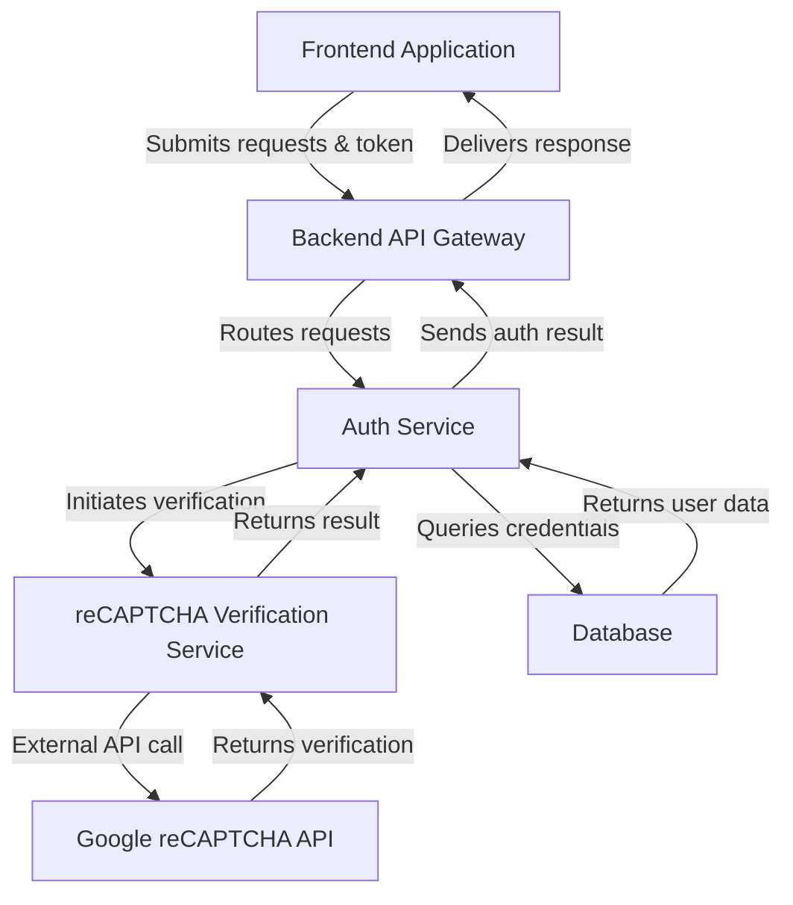
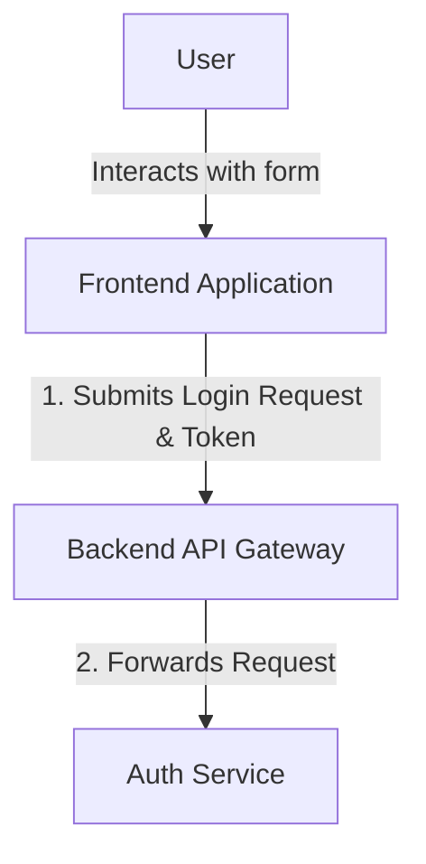
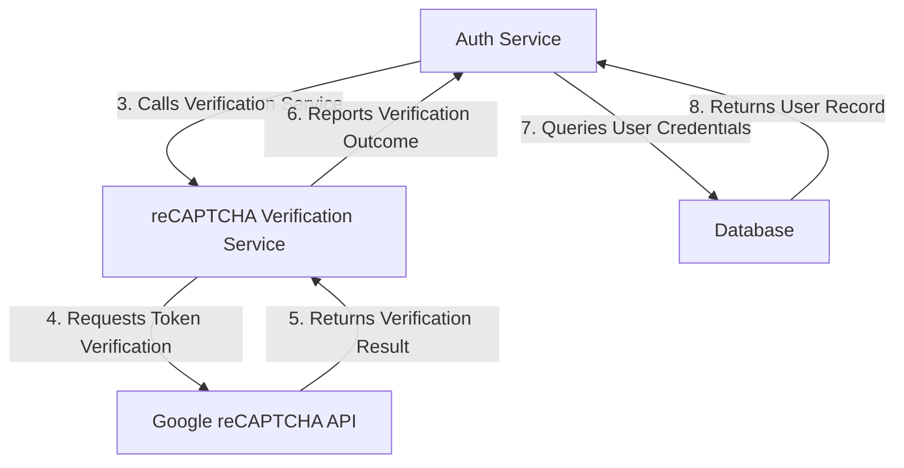
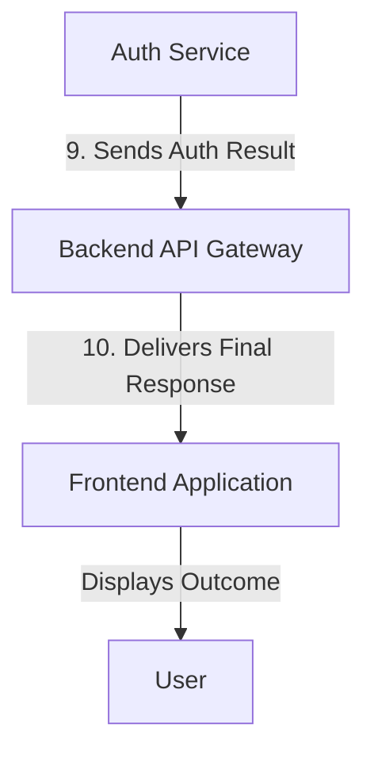

# Google reCAPTCHA Integration - Technical Documentation

*Generated on 9/19/2025 | Xikolo Knowledge Base*

---

## 📋 Executive Summary

This report details the `51_SEC_RecaptchaIntegration` cluster, focusing on the seamless integration of Google reCAPTCHA within the Xikolo platform. The primary objective of this integration is to enhance security by protecting user-facing operations, such as login or registration, from automated bot attacks. Key components involved include the Frontend Application, Backend API Gateway, an Authentication Service, a dedicated reCAPTCHA Verification Service, the external Google reCAPTCHA API, and the platform's Database. This setup ensures that user interactions are validated for human authenticity before sensitive backend processes are executed, thereby bolstering overall system resilience against various forms of abuse.

---

## 🏗️ Architecture Overview

The architecture for Google reCAPTCHA integration is designed for modularity and security, as indicated in the provided cluster data. The system comprises six main components: the **Frontend Application** which initiates the process by collecting the reCAPTCHA token, the **Backend API Gateway** serving as the entry point for all API requests, the **Auth Service** responsible for user authentication and orchestrating the reCAPTCHA flow, a specialized **reCAPTCHA Verification Service** for handling communication with Google, the **Google reCAPTCHA API** itself as an external dependency, and the **Database** for storing user credentials. Integration points involve the Frontend submitting data including the reCAPTCHA token to the API Gateway. The API Gateway then forwards this request to the Auth Service, which in turn delegates reCAPTCHA verification to the dedicated reCAPTCHA Verification Service. This service communicates with the external Google reCAPTCHA API. Upon successful verification, the Auth Service proceeds with traditional credential validation against the Database. The entire process culminates in the Auth Service returning an authentication result via the API Gateway back to the Frontend Application.

### Architecture Diagrams

#### Google reCAPTCHA Integration Architecture

### 🔄 Component Interactions

Key interactions between components in this cluster:

- Service-to-service communication patterns
- Data flow between architectural layers

---

## ⚙️ Technical Workflows

The Google reCAPTCHA integration involves several coordinated technical workflows to ensure robust user authentication and bot prevention. These workflows are designed to separate concerns and enhance system security by introducing an explicit verification step for user interactions.

### 1. User Initiated Login with reCAPTCHA Token Submission
This workflow describes the initial interaction where a user attempts to log in or register. The Frontend Application, upon user interaction, presents a reCAPTCHA challenge. Once the user successfully completes the challenge, a reCAPTCHA token is generated and submitted along with user credentials to the backend. The Backend API Gateway acts as the initial receiver, routing this request to the appropriate service.

### 2. reCAPTCHA Verification and Credential Validation
Following the submission, the Authentication Service takes over the process. It first initiates a call to the dedicated reCAPTCHA Verification Service, passing the received reCAPTCHA token. The reCAPTCHA Verification Service then makes a server-to-server call to the external Google reCAPTCHA API for validation. Google's API returns a success or failure status, which the Verification Service relays back to the Auth Service. If reCAPTCHA verification is successful, the Auth Service proceeds to query the Database to validate the user's provided credentials. The Database returns the corresponding user record or an indication of invalid credentials.

### 3. Authentication Result Processing and Response
Upon receiving the user record from the Database and the reCAPTCHA verification outcome, the Authentication Service determines the final authentication status. Based on this, it formulates an authentication result, which is then sent back through the Backend API Gateway. The API Gateway, acting as the final intermediary, delivers the complete response, including the authentication status and any relevant tokens, to the Frontend Application, thereby completing the user's login or registration attempt. This final response informs the user of the outcome.

### Workflow Diagrams

#### Workflow 1: User Initiated Login with reCAPTCHA Token Submission

#### Workflow 2: reCAPTCHA Verification and Credential Validation

#### Workflow 3: Authentication Result Processing and Response

### 🔀 Process Workflows

Detailed workflow processes for this cluster:

- **Core google recaptcha integration operations**
- **Data processing and validation workflows**
- **Component interaction and integration processes**

---

## 🔧 Implementation Details

Based on the cluster data, the implementation of Xikolo's Google reCAPTCHA integration involves several critical technical considerations and dependencies.

**Technical Considerations:**

*   **Client-Side Integration:** The Frontend Application is responsible for integrating the reCAPTCHA widget, displaying it to the user, and capturing the reCAPTCHA token upon user interaction. This typically involves JavaScript libraries provided by Google.
*   **Server-Side Verification:** A dedicated `reCAPTCHA Verification Service` is crucial for secure token validation. This service performs the actual server-to-server call to the `Google reCAPTCHA API`, ensuring that the reCAPTCHA token hasn't been tampered with and is legitimate. This separation ensures that secret keys are never exposed on the client-side.
*   **Orchestration within Auth Service:** The `Auth Service` orchestrates the entire authentication flow, intelligently deciding when to invoke reCAPTCHA verification. It processes the verification result before proceeding with traditional credential checks against the database, ensuring that bot requests are filtered out early in the process.
*   **API Gateway Role:** The `Backend API Gateway` acts as a crucial routing layer, directing incoming requests that require reCAPTCHA verification to the appropriate backend services, specifically the `Auth Service`.

**Dependencies and Integrations:**

*   **Google reCAPTCHA API (External):** This is a fundamental external dependency for token verification. The `reCAPTCHA Verification Service` interacts directly with this API via `POST /siteverify` calls.
*   **Database:** The system depends on a `Database` to store and retrieve user credentials, which the `Auth Service` queries after successful reCAPTCHA verification.
*   **Internal Service Communication:** Critical internal integrations include the `Frontend Application` communicating with the `Backend API Gateway`, the `Backend API Gateway` forwarding requests to the `Auth Service`, and the `Auth Service` calling the `reCAPTCHA Verification Service`.

**Configuration Requirements:**

*   **reCAPTCHA Site Keys:** These are required for the `Frontend Application` to render the reCAPTCHA widget. The specific format and storage location are not specified in cluster data.
*   **reCAPTCHA Secret Keys:** These are essential for the `reCAPTCHA Verification Service` to communicate securely with the `Google reCAPTCHA API`. These keys must be securely stored and managed on the server-side. The specific management mechanism is not specified in cluster data.
*   **API Endpoints:** The `reCAPTCHA Verification Service` must be configured with the correct endpoint for the `Google reCAPTCHA API` (`/siteverify`). Internal service discovery or explicit configuration for `Auth Service` to `reCAPTCHA Verification Service` communication would also be required; however, details are not specified in cluster data.

### 📚 Technical Sources & References

Key technical documentation and source references:

- Source code repositories and main entry points- Configuration files and environment settings

---

*This documentation is automatically generated from cluster analysis and should be validated against the actual codebase.*
