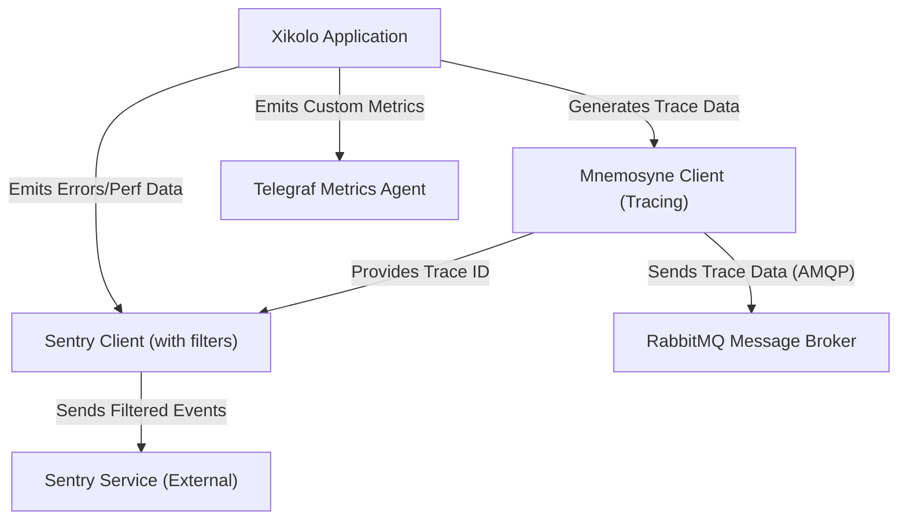
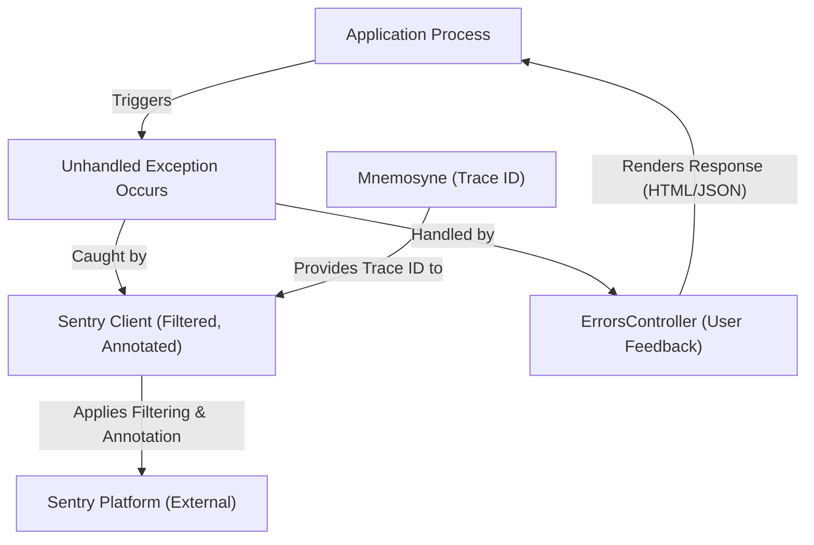
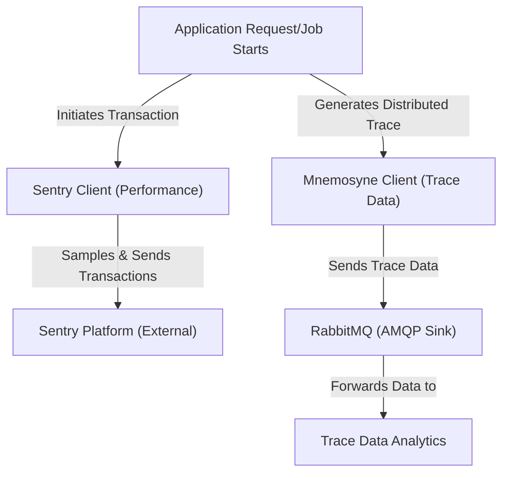
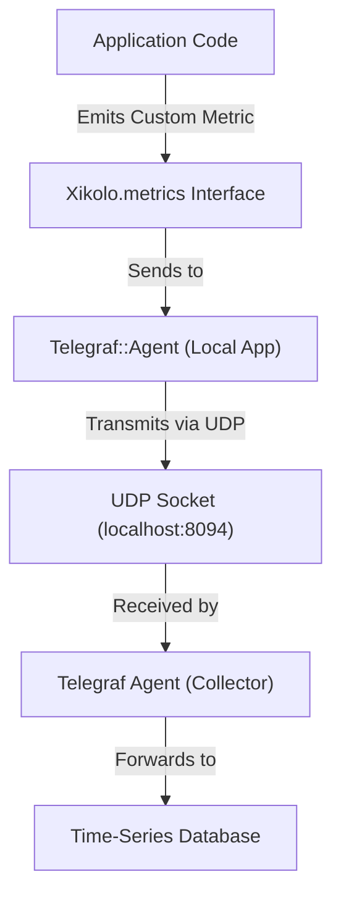

# Application Performance Monitoring and Error Logging - Technical Documentation

*Generated on 9/19/2025 | Xikolo Knowledge Base*

---

## 📋 Executive Summary

The Xikolo 60_DEVOPS_Monitoring cluster implements a robust and integrated strategy for application performance monitoring, logging, and error management. This system leverages Sentry for comprehensive error tracking and performance profiling, Mnemosyne for distributed transaction tracing, and Telegraf for custom application metrics. The primary purpose is to provide deep observability into application health, swiftly identify performance bottlenecks, and streamline error resolution across monolithic and microservice architectures. This multi-faceted approach ensures efficient incident response and continuous operational improvement by correlating errors with traces and metrics, providing a unified view of application health and performance.

---

## 🏗️ Architecture Overview

The monitoring architecture for Xikolo cluster 60_DEVOPS_Monitoring is designed to provide comprehensive observability across its various application components and microservices. It strategically integrates Sentry for error tracking and performance monitoring, Mnemosyne for distributed tracing, and a Telegraf agent for custom metrics collection. This setup enables detailed insights into application behavior, from high-level performance trends to granular error occurrences and their root causes. The system is designed for a multi-layered approach to incident detection and analysis, fostering proactive maintenance and efficient debugging processes.

### Key Components and Interactions

**1. Xikolo Application:** This represents the core application logic, encompassing both web and microservice components. It is the source of all performance data, errors, and custom metrics. Exceptions within the application are caught by the `ErrorsController`, while custom metrics are emitted via the `Xikolo.metrics` interface.

**2. Sentry Client (with filters):** The Sentry client is embedded within the application, configured to capture exceptions and performance transaction data. It integrates `ActiveSupport::ParameterFilter` to sanitize sensitive parameters before events are sent. Crucially, the `AnnotateSentryErrorsForMnemosyne` middleware also ensures that Mnemosyne trace IDs are attached to Sentry events, enabling direct correlation.

**3. Mnemosyne Client (Tracing):** This client is responsible for collecting distributed trace data, providing end-to-end visibility of requests across services. It captures granular details of operations and, when errors occur, can attach them. Mnemosyne is configured to send its collected trace data asynchronously to a centralized message broker.

**4. Telegraf Metrics Agent:** Implemented via `Xikolo::Common::Metrics`, this agent facilitates the collection of custom application metrics. Application code interacts with `Xikolo.metrics` to increment counters or set gauges, which are then packaged and sent as UDP packets to a local Telegraf agent.

**5. Sentry Service (External):** This is the external platform that receives, processes, and stores the filtered error events and performance transaction data sent by the Sentry clients. It provides dashboards, alerting, and analysis tools for operational teams.

**6. RabbitMQ Message Broker:** Serving as the AMQP sink for Mnemosyne, RabbitMQ receives and queues all distributed trace data from various Mnemosyne instances. This centralizes trace data collection, allowing for subsequent processing, storage, and analysis by a trace data analytics system. The `XIKOLO_RABBITMQ_URL` environment variable configures its connection.

### Architecture Diagrams

#### Main Architecture

### 🔄 Component Interactions

Key interactions between components in this cluster:

- **Sentry:** Receives captured exceptions from `ErrorsController` and other parts of the application. [Source: RAG: docs/app/development/monitoring/index.md]
- **Sentry:** Receives performance transaction data from the application. [Source: config/initializers/sentry.rb]
- **Mnemosyne:** Receives attached errors from `ErrorsController` via `::Mnemosyne.attach_error`. [Source: app/controllers/errors_controller.rb]
- **Mnemosyne:** Provides a trace ID (`current_trace&.uuid`) that can be correlated with Sentry events. [Source: app/controllers/errors_controller.rb, config/initializers/sentry.rb]
- **Telegraf::Agent (via Xikolo::Common::Metrics):** Receives metric data from application code (e.g., `Xikolo.metrics.increment('event_name')`).
- **Telegraf::Agent (via Xikolo::Common::Metrics):** Sends metric data as UDP packets to `localhost:8094`, where a Telegraf agent is expected to be listening.
- **AnnotateSentryErrorsForMnemosyne:** Interacts with `Mnemosyne::Instrumenter` to retrieve the current trace ID.
- **AnnotateSentryErrorsForMnemosyne:** Sets context on `Sentry.get_current_scope` to include the Mnemosyne trace ID.
- **ErrorsController:** Receives exceptions from the Rails application (`action_dispatch.exception`). [Source: app/controllers/errors_controller.rb]
- **ErrorsController:** Logs exceptions to Mnemosyne using `::Mnemosyne.attach_error`. [Source: app/controllers/errors_controller.rb]
- **ActiveSupport::ParameterFilter:** Configured in Sentry's `before_send` callback to sanitize event data. [Source: config/initializers/sentry.rb]
- **ActiveSupport::ParameterFilter:** Filters parameters based on `Rails.application.config.filter_parameters`. [Source: config/initializers/sentry.rb]
- **RabbitMQ:** Receives trace data from Mnemosyne instances across all applications and microservices. [Source: config/mnemosyne.yml, RAG: services/account/config/mnemosyne.yml]
- **RabbitMQ:** Configured via `XIKOLO_RABBITMQ_URL` environment variable. [Source: config/mnemosyne.yml]
- **Sentry Configuration (Web):** Reports exceptions to the Sentry service.
- **Sentry Configuration (Web):** Filters sensitive parameters using `ActiveSupport::ParameterFilter`.
- **Sentry Configuration (Microservice):** Reports exceptions to the Sentry service.
- **Sentry Configuration (Microservice):** Filters sensitive parameters using `ActiveSupport::ParameterFilter`.
- **Mnemosyne Configuration:** Connects to RabbitMQ via `XIKOLO_RABBITMQ_URL` to send trace data.
- **Mnemosyne Configuration:** Identifies the originating application (e.g., 'web', 'account') for traces.
- **MsgrSentryIntegration:** Captures `Exception` instances within `Msgr::Consumer` dispatch logic.
- **MsgrSentryIntegration:** Reports captured exceptions to Sentry using `Sentry.capture_exception`.
- **Xikolo.site/Xikolo.brand:** Provides contextual tags to Sentry events.

---

## ⚙️ Technical Workflows

The monitoring strategy is underpinned by three distinct, yet interconnected, technical workflows, each designed to capture specific types of operational data and provide actionable insights.

### 1. Error Reporting Workflow
Unhandled exceptions arising from application processes, whether in the main web application or microservices, are primarily intercepted by the `ErrorsController` or directly by Sentry integrations configured in `config/initializers/sentry.rb`. Before any error event is dispatched to the external Sentry service, it undergoes a crucial sanitization step using `ActiveSupport::ParameterFilter` to remove sensitive information. Concurrently, the `AnnotateSentryErrorsForMnemosyne` middleware ensures that if an active distributed trace exists via `Mnemosyne`, its unique trace ID is appended to the Sentry error event. This enables developers to immediately link an error to its broader operational context. A predefined list of `excluded_exceptions` prevents known, non-critical errors from cluttering the Sentry dashboard, ensuring focus on actionable issues. For user-facing errors, the `ErrorsController` gracefully renders appropriate HTML or JSON responses, including Sentry event IDs and Mnemosyne trace IDs for debugging.

### 2. Performance Tracing Workflow
Performance monitoring commences as application requests are processed or background jobs execute. Sentry's client, configured with `traces_sample_rate` and `profiles_sample_rate` (both defaulting to `1.0`), dynamically samples these transactions and profiles. This sampling respects parent sampling decisions and intelligently bypasses health check endpoints (`/up`, `/ping`, `/system_info`) to conserve resources and focus on user-facing performance. In parallel, `Mnemosyne` diligently collects comprehensive distributed trace data for these operations, capturing granular details including query parameters for debugging. Once collected, `Mnemosyne` transmits this detailed trace information asynchronously to `RabbitMQ` through an AMQP sink. This message broker acts as a central collection point for traces from all application instances and microservices, facilitating a holistic view of performance bottlenecks and inter-service communication latency, which can then be processed for analytical purposes.

### 3. Custom Metrics Collection Workflow
The `Xikolo` application provides a standardized interface, `Xikolo.metrics`, allowing any part of the application code to emit custom operational metrics. These metrics can represent various application-specific events, counters, or gauges, offering granular insights beyond standard error and performance tracking. When `Xikolo.metrics` is invoked (e.g., `Xikolo.metrics.increment('event_name')`), an instance of `::Telegraf::Agent` is used to package and send this metric data. The data is transmitted as UDP packets to a predetermined endpoint: `localhost:8094`. This setup anticipates a local `Telegraf agent` running on the same host, which is responsible for receiving these UDP packets. This local agent then processes, aggregates, and forwards the custom metrics to a designated time-series database for long-term storage, visualization through dashboards, and integration into alerting systems, completing the metric data journey.

### Workflow Diagrams

#### 1. Error Reporting Workflow

#### 2. Performance Tracing Workflow

#### 3. Custom Metrics Collection Workflow

### 🔀 Process Workflows

Detailed workflow processes for this cluster:

- **AnnotateSentryErrorsForMnemosyne Process:** Processes HTTP requests within the Rails application stack.
  *Source: AnnotateSentryErrorsForMnemosyne*
- **MsgrSentryIntegration Process:** Re-raises exceptions after capture to maintain original error flow.
  *Source: MsgrSentryIntegration*

---

## 🔧 Implementation Details

The implementation of the monitoring and error management system within the Xikolo cluster involves specific technical considerations, dependencies, and configuration requirements to ensure its effectiveness and reliability.

### Technical Considerations
*   **Sentry Configuration Details:** The Sentry client is meticulously configured via `config/initializers/sentry.rb`. It uses a `before_send` callback with `ActiveSupport::ParameterFilter` to sanitize event data based on `Rails.application.config.filter_parameters`, ensuring sensitive information is not transmitted. `app_dirs_pattern` (`%r{(api|app|config(?!/initializers/acfs.rb$)|lib(?!/acfs_rails_cache.rb$))}`) is defined to accurately identify 'in-app' code for clearer stack traces. To reduce noise, a list of `excluded_exceptions` (e.g., `Acfs::BadGateway`, `Redis::CannotConnectError`) is maintained. Performance tracing is enabled with configurable `traces_sample_rate` (defaulting to `1.0`) and `profiles_sample_rate` (`1.0`), alongside dynamic sampling rules that ignore health check endpoints. Global tags are applied using `Xikolo.site` and `Xikolo.brand` for enhanced categorization.
*   **Mnemosyne AMQP Sink:** Mnemosyne is configured to send all collected trace data to an AMQP sink, specifically RabbitMQ. The connection endpoint is dynamically determined by the `XIKOLO_RABBITMQ_URL` environment variable, defaulting to `amqp://localhost` if not explicitly set. This robust configuration ensures that distributed trace data from all application instances and microservices is centrally collected for subsequent analysis. Mnemosyne is explicitly disabled for `test` and `integration` environments to conserve resources.
*   **Telegraf UDP Metrics:** Custom application metrics are transmitted via UDP packets to `localhost:8094`. This design implies a strong operational requirement: a Telegraf agent must be co-located and actively listening on this port on every host where the application is running. This local agent then acts as a forwarder to a centralized metrics store.
*   **Sentry-Mnemosyne Correlation:** The custom `AnnotateSentryErrorsForMnemosyne` Rack middleware plays a critical role in bridging Sentry errors with Mnemosyne traces. It actively queries `Mnemosyne::Instrumenter.current_trace` to retrieve the current trace ID (UUID) and injects it into the `Sentry.get_current_scope` context as `mnemosyne.trace_id`. This explicit correlation is vital for debugging by providing immediate context for errors.
*   **Microservice Sentry Integration:** The `MsgrSentryIntegration` module is prepended to `Msgr::Consumer` classes in several microservices. This ensures that any unhandled exceptions occurring during RabbitMQ message processing are caught by Sentry (`Sentry.capture_exception`) before being re-raised to maintain the original error flow. This mechanism is crucial for complete error visibility in asynchronous message-driven architectures.

### Dependencies and Integrations
*   **Sentry and `ActiveSupport::ParameterFilter`:** Sentry directly depends on `ActiveSupport::ParameterFilter` for the crucial sanitization of sensitive data, integrating into its `before_send` callback mechanism.
*   **Sentry and Mnemosyne:** The integration between Sentry and Mnemosyne is facilitated by the custom `AnnotateSentryErrorsForMnemosyne` middleware, which ensures trace IDs are passed from Mnemosyne to Sentry contexts.
*   **Mnemosyne and RabbitMQ:** Mnemosyne's tracing capabilities are tightly integrated with RabbitMQ, which serves as its essential AMQP sink for distributed trace data collection.
*   **Custom Metrics and `::Telegraf::Agent`:** The custom metrics collection, exposed via the `Xikolo.metrics` interface (from `xikolo-common` gem), directly utilizes `::Telegraf::Agent` for transmitting metrics data.
*   **`ErrorsController` and Monitoring Tools:** The `ErrorsController` serves as a central point for application-level error handling, interacting directly with both Sentry (`::Sentry.capture_exception`) and Mnemosyne (`::Mnemosyne.attach_error`) to log and report exceptions.
*   **Msgr::Consumer and Sentry:** The `MsgrSentryIntegration` module explicitly integrates Sentry with `Msgr::Consumer` in microservices for robust error capture during message processing.

### Configuration Requirements
*   **RabbitMQ URL (`XIKOLO_RABBITMQ_URL`):** This environment variable is mandatory in production environments for Mnemosyne to correctly route trace data to the central RabbitMQ instance. Its default value is `amqp://localhost` if not specified.
*   **Sentry Sample Rate (`SENTRY_TRACES_SAMPLE_RATE`):** This environment variable controls the default sampling rate for Sentry's performance transactions. It defaults to `1.0` (100%), which should be reviewed for cost optimization in high-volume environments.
*   **Parameter Filtering Configuration:** `Rails.application.config.filter_parameters` must be accurately configured to specify all sensitive data points that require filtering by `ActiveSupport::ParameterFilter` before being sent to Sentry.
*   **Mnemosyne Environment Configuration:** Mnemosyne's configuration file (`config/mnemosyne.yml`) explicitly defines that the tracing system is disabled for `test` and `integration` environments, optimizing resource usage.
*   **Local Telegraf Agent:** A `Telegraf agent` must be manually deployed and configured to run locally on `localhost:8094` on each application host to reliably receive custom metrics via UDP from the `Xikolo.metrics` interface. This operational dependency is critical, though its configuration specifics are not detailed in the cluster data.

### 📚 Technical Sources & References

Key technical documentation and source references:

- Sentry: config/initializers/sentry.rb- Sentry: RAG: docs/app/development/monitoring/index.md- Mnemosyne: app/controllers/errors_controller.rb- Mnemosyne: config/mnemosyne.yml- Telegraf::Agent (via Xikolo::Common::Metrics): gems/xikolo-common/lib/xikolo/common/metrics.rb- Telegraf::Agent (via Xikolo::Common::Metrics): Gemfile- AnnotateSentryErrorsForMnemosyne: config/initializers/sentry.rb- AnnotateSentryErrorsForMnemosyne: RAG: docs/app/development/monitoring/index.md- ErrorsController: app/controllers/errors_controller.rb- ErrorsController: RAG: docs/app/development/monitoring/index.md- ActiveSupport::ParameterFilter: config/initializers/sentry.rb- RabbitMQ: config/mnemosyne.yml- RabbitMQ: RAG: foundational_context- Sentry Configuration (Web): config/initializers/sentry.rb- Sentry Configuration (Web): RAG: docs/app/development/monitoring/index.md- Sentry Configuration (Microservice): services/account/config/initializers/sentry.rb- Sentry Configuration (Microservice): services/course/config/initializers/sentry.rb- Mnemosyne Configuration: config/mnemosyne.yml- Mnemosyne Configuration: services/account/config/mnemosyne.yml- MsgrSentryIntegration: services/course/config/initializers/sentry_msgr.rb- MsgrSentryIntegration: services/news/config/initializers/sentry_msgr.rb- Xikolo.site/Xikolo.brand: config/initializers/sentry.rb- Configuration: config/application.rb, Gemfile, config/database.yml- Process Management: Procfile, Procfile.web- Build & Deploy: Rakefile, package.json

---

*This documentation is automatically generated from cluster analysis and should be validated against the actual codebase.*
