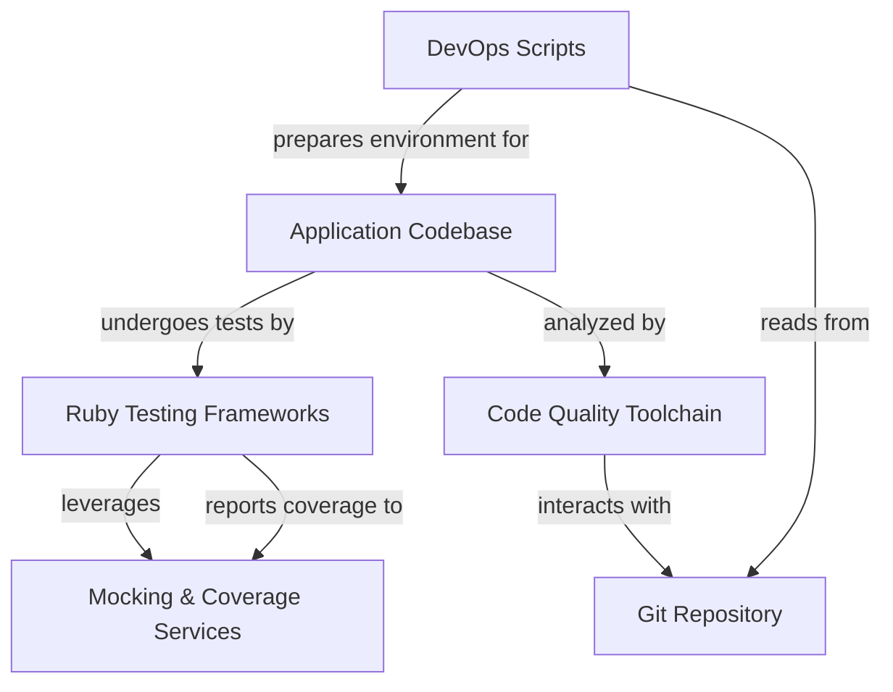
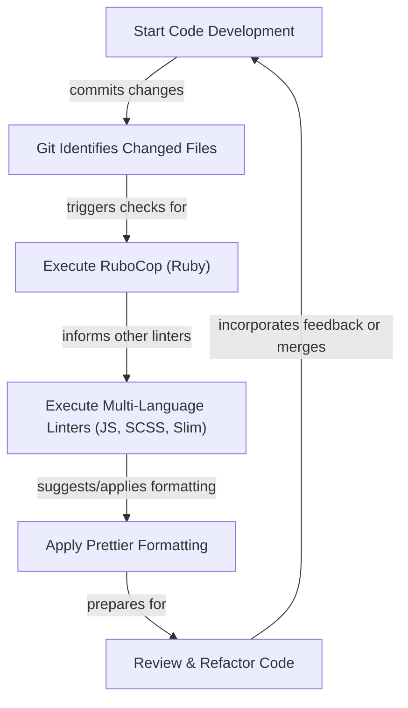
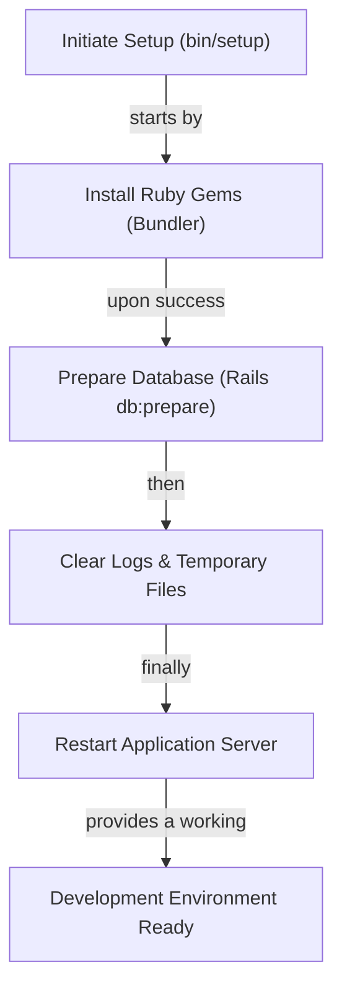
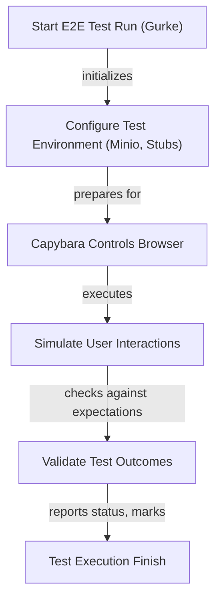

# Testing Frameworks, Code Quality Tools, and Development Environment Setup - Technical Documentation

*Generated on 9/19/2025 | Xikolo Knowledge Base*

---

## 📋 Executive Summary

This report details the comprehensive testing frameworks, code quality enforcement tools, and development environment setup for the Xikolo cluster 61_DEVOPS_Testing. The primary purpose is to provide a standardized overview of how code quality is maintained, applications are tested, and development environments are initialized and updated. Key components include RSpec and Gurke for testing, an array of linters (RuboCop, Slim-Lint, ESLint, Stylelint, Prettier) for code quality, and automated scripts (`bin/setup`, `scripts/check-gem-versions`, `scripts/rubocop-changed`) for environment management. The scope covers the entire lifecycle from development to testing, ensuring robust and maintainable software.

---

## 🏗️ Architecture Overview

The architecture for Xikolo cluster 61_DEVOPS_Testing is structured around a core application codebase, supported by a suite of testing frameworks, code quality tools, and essential development utilities. The design emphasizes automated quality checks and efficient development environment provisioning. Ruby applications leverage RSpec for unit/integration testing and Gurke/Capybara for end-to-end (E2E) scenarios, ensuring functional correctness across various layers. Static analysis, including RuboCop for Ruby, ESLint for JavaScript/TypeScript, Stylelint for SCSS, and Slim-Lint for templates, rigorously enforces coding standards. Prettier acts as an automated formatter, standardizing code style. Development operations are streamlined through scripts like `bin/setup` for environment initialization and `scripts/check-gem-versions` for dependency consistency. Testing dependencies like SimpleCov provide code coverage, while Stubbing Utilities and Minio facilitate isolated and realistic testing by mocking external services such as S3 storage. This integrated approach ensures a high standard of code quality and reliable application behavior.

### Architecture Diagrams

#### Main Architecture Overview

### 🔄 Component Interactions

Key interactions between components in this cluster:

- **RSpec:** Executes test suites for various application layers.
- **RSpec:** Utilizes factories for test data generation.
- **SimpleCov:** Analyzes code execution during test runs to determine coverage.
- **SimpleCov:** Filters specific directories (e.g., `bin/`, `db/`, `config/`, `spec/`, `services/`) from coverage reports.
- **RuboCop:** Analyzes Ruby code against a comprehensive set of rules defined in `.rubocop.yml`.
- **RuboCop:** Integrates with `rubocop-changed` script to check only modified files.
- **Slim-Lint:** Analyzes `.slim` template files.
- **Slim-Lint:** Leverages RuboCop for embedded Ruby code linting.
- **ESLint:** Analyzes `.js`, `.mjs`, `.cjs`, and `.ts` files.
- **Stylelint:** Analyzes SCSS files.
- **Prettier:** Formats code files automatically.
- **bin/setup:** Installs Ruby gems via Bundler.
- **bin/setup:** Prepares the database using `bin/rails db:prepare`.
- **scripts/check-gem-versions:** Parses `Gemfile.lock` files from the main app and `services/*`.
- **scripts/rubocop-changed:** Interacts with Git to identify changed files.
- **scripts/rubocop-changed:** Executes RuboCop on the identified files.
- **Gurke:** Orchestrates the execution of E2E tests defined in `integration/features`.
- **Gurke:** Drives a browser via Capybara to simulate user interactions.
- **Capybara:** Drives web browsers (e.g., Chrome, Firefox) to execute user scenarios.
- **Capybara:** Used by Gurke for E2E tests and by RSpec for feature tests.
- **Stubbing Utilities (xikolo-common/rspec/stub.rb):** Provides methods like `stub_user_request`, `Stub.service()`, `Stub.request()` to mock HTTP responses from microservices.
- **Stubbing Utilities (xikolo-common/rspec/stub.rb):** Used to stub external dependencies such as S3 calls.
- **Minio:** Automatically launched and configured by the E2E test setup.
- **Minio:** Serves as a local mock for S3 storage operations during E2E tests.

---

## ⚙️ Technical Workflows

### 1. Code Quality Enforcement Workflow
This workflow outlines the systematic process for maintaining high code quality across various programming languages and template files within the Xikolo cluster. It begins with a developer making changes to the codebase. Upon committing these changes, the `scripts/rubocop-changed` utility is leveraged to identify only the modified files, optimizing the subsequent static analysis. RuboCop, the primary linter for Ruby, then executes its comprehensive set of rules and plugins, including `rubocop-rails` and `rubocop-rspec`, on these Ruby files. Concurrently, or in sequence, other specialized linters target their respective file types: Slim-Lint for `.slim` templates (which also leverages RuboCop for embedded Ruby), ESLint for JavaScript/TypeScript, and Stylelint for SCSS. After linting identifies potential issues, Prettier steps in to automatically format code files, ensuring consistent style. Any remaining issues or refactoring suggestions are then reviewed by the developer, who iteratively refines the code before it is considered ready for integration.

### 2. Development Environment Setup Workflow
The development environment setup workflow is initiated by the `bin/setup` script, designed to provide an idempotent and consistent environment for all developers. The process commences with the installation of Ruby gem dependencies, managed efficiently by Bundler via `bundle install`. Following successful gem installation, the database is prepared, which typically involves running migrations and seeding initial data through `bin/rails db:prepare`. To maintain a clean and performant environment, the script then clears old logs and temporary files using `bin/rails log:clear tmp:clear`. As a final step, the Rails application server is restarted with `bin/rails restart` to ensure that all changes and configurations are applied and the application is ready for local development or testing. This standardized sequence guarantees that every developer's environment is identically configured and up-to-date, reducing 'it works on my machine' issues.

### 3. End-to-End Test Execution Workflow
This workflow details the execution of end-to-end tests, orchestrated primarily by Gurke. The process starts with Gurke initiating the E2E test suite. As part of the environment setup for these tests, Minio, a local S3-compatible object storage server, is automatically launched and configured. This provides a mock S3 service, crucial for testing features involving file storage without relying on external cloud providers. Simultaneously, or in conjunction, Capybara is engaged to drive a web browser, simulating real user interactions. To isolate microservice dependencies and ensure predictable test outcomes, custom Stubbing Utilities are employed within the test setup to mock HTTP responses from various services. With the environment prepared and mocks in place, Gurke proceeds to execute defined user scenarios, driving the browser via Capybara to interact with the application. The outcomes are validated against expected behaviors, and upon completion, the test execution finishes, providing a comprehensive report on the application's E2E functional integrity.

### Workflow Diagrams

#### Code Quality Enforcement Workflow

#### Development Environment Setup Workflow

#### End-to-End Test Execution Workflow

### 🔀 Process Workflows

Detailed workflow processes for this cluster:

- **Core testing frameworks, code quality tools, and development environment setup operations**
- **Data processing and validation workflows**
- **Component interaction and integration processes**

---

## 🔧 Implementation Details

### Technical Considerations
The Xikolo cluster leverages several key technical considerations to ensure robust testing and code quality. **RSpec** supports conditional test execution via the `BRAND` environment variable, enabling brand-specific testing within a multi-brand application. It also utilizes factories for test data generation and integrates with custom stubbing utilities for microservice isolation. **SimpleCov** is configured to provide detailed code coverage reports by filtering non-application directories (`bin/`, `db/`, `config/`, `spec/`, `services/`) and categorizing application code into logical groups like 'API', 'Business Logic', 'Controllers', and 'UI'. **RuboCop** enforces style and best practices for Ruby, targeting Rails 7.2 and Ruby 3.4, with new cops enabled. Its custom `bin/rubocop` script ensures consistent execution, and `scripts/rubocop-changed` allows for efficient incremental checks. **Slim-Lint** explicitly forbids embedded engines like `coffee`, `css`, `sass`, `scss`, and `less` within `.slim` templates to maintain separation of concerns. **ESLint** extends `pluginJs.configs.recommended` and `tseslint.configs.recommended`, defining `__BRAND__`, `__MODE__`, and `I18n` as `readonly` globals and warning against `no-console` usage. **Stylelint** is configured with `stylelint-config-recommended-scss`, `stylelint-config-idiomatic-order`, and `stylelint-config-two-dash-bem`, specifically adjusting rules for `ruby-sass` compiler limitations, requiring `number` notation for alpha values and `legacy` comma-separated syntax for `rgb` functions. **Prettier** defaults to `singleQuote: true` but includes overrides for SCSS, YAML, and YML files to use `singleQuote: false`.

### Dependencies and Integrations
The testing and quality ecosystem within Xikolo cluster 61_DEVOPS_Testing exhibits a tight web of dependencies and integrations. **RSpec** is integrated with **SimpleCov** for coverage analysis and relies on **Stubbing Utilities** (from `xikolo-common/rspec/stub.rb`) for mocking external microservice calls and S3 interactions. **RuboCop** heavily integrates with **`scripts/rubocop-changed`** for incremental analysis and uses a range of plugins including `rubocop-rails`, `rubocop-rspec`, `rubocop-capybara`, and `rubocop-factory_bot`. **Slim-Lint** explicitly leverages **RuboCop** for embedded Ruby code within `.slim` templates. **Gurke**, as the E2E test orchestrator, drives web browser interactions via **Capybara**. Both **Gurke** and **RSpec** feature tests utilize **Capybara**. **Minio** serves as a local mock for S3 storage and is automatically launched by the E2E test setup orchestrated by Gurke. The **`bin/setup`** script depends on **Bundler** for gem installation and **Rails** for database preparation (`db:prepare`) and server management. The **`scripts/check-gem-versions`** utility parses `Gemfile.lock` files from the main application and its `services/*`.

### Configuration Requirements
Configuration is decentralized across various tool-specific files. **RuboCop**'s rules are managed in `.rubocop.yml`, specifying Ruby and Rails versions and plugin configurations. **Slim-Lint** uses `.slim-lint.yml` to define linter rules and exclusions, noting `TODO` items for `javascript` embedded engines and instance variables in views. **ESLint** configuration is found in `eslint.config.mjs`, where plugin extensions, global variables (`__BRAND__`, `__MODE__`, `I18n`), and specific rules (`no-console`) are defined, alongside ignored legacy and vendor assets. **Stylelint** rules, extensions, and BEM conventions are set in `.stylelintrc.js`, including specific rule overrides for `ruby-sass` compatibility. **Prettier**'s formatting preferences are specified in `.prettierrc.yml`, primarily for `singleQuote` settings and overrides. **RSpec** test patterns and exclusions, including brand-specific tests, are configured via `.rspec`. **SimpleCov** uses `.simplecov` for its filtering and grouping logic. **Capybara** may require specific environment variables, such as `SNAP=1`, for certain browser setups as indicated in cluster data.

### 📚 Technical Sources & References

Key technical documentation and source references:

- RSpec: .rspec- RSpec: bin/rspec- SimpleCov: .simplecov- RuboCop: bin/rubocop- RuboCop: scripts/rubocop-changed- Slim-Lint: .slim-lint.yml- ESLint: eslint.config.mjs- Stylelint: .stylelintrc.js- Prettier: .prettierrc.yml- bin/setup: bin/setup- scripts/check-gem-versions: scripts/check-gem-versions- scripts/rubocop-changed: scripts/rubocop-changed- Gurke: RAG: docs/app/development/testing/end_to_end.md- Capybara: RAG: docs/app/development/testing/end_to_end.md- Capybara: RAG: docs/app/development/testing/index.md- Stubbing Utilities (xikolo-common/rspec/stub.rb): RAG: docs/app/development/testing/rspec.md- Minio: RAG: docs/app/development/testing/end_to_end.md- Configuration: config/application.rb, Gemfile, config/database.yml- Process Management: Procfile, Procfile.web- Build & Deploy: Rakefile, package.json

---

*This documentation is automatically generated from cluster analysis and should be validated against the actual codebase.*
