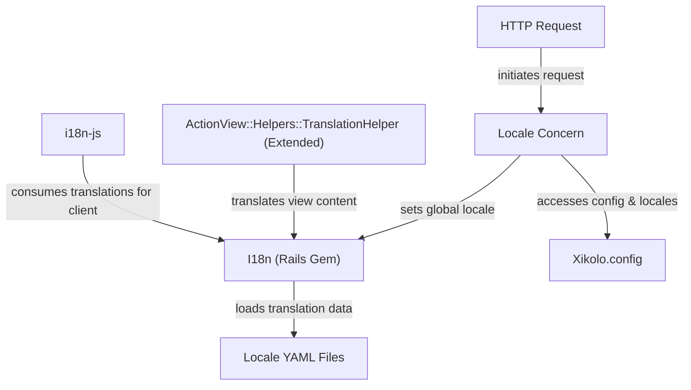
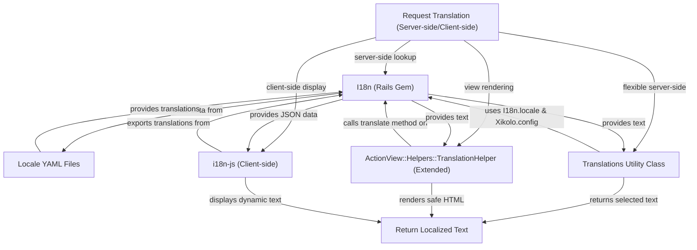

# Internationalization and Localization - Technical Documentation

*Generated on 9/19/2025 | Xikolo Knowledge Base*

---

## 📋 Executive Summary

This report details the internationalization (i18n) and localization (l10n) capabilities of the Xikolo application, focusing on cluster 62_DEVOPS_Internationalization. The system is engineered to deliver robust multi-language support, allowing content to adapt to user preferences and predefined system settings. It leverages the foundational Ruby on Rails `I18n` framework, extended by custom logic and utilities to manage seamless locale detection, translation management, and content delivery across both server-side and client-side application layers. Key components include a custom `Locale` concern, a `Translations` utility class, an extended `ActionView::Helpers::TranslationHelper`, and the `i18n-js` library for frontend localization.

---

## 🏗️ Architecture Overview

The internationalization architecture for Xikolo is built upon a layered approach, integrating standard Rails i18n features with custom components for enhanced flexibility and control. At its core, the system uses the `I18n (Rails Gem)` to manage translation data, which is sourced from `Locale YAML Files`. A crucial element, the `Locale` concern, dynamically determines the active locale for each request, interacting with both the `I18n` framework and `Xikolo.config` for global settings. For server-side content rendering, the `ActionView::Helpers::TranslationHelper (Extended)` customizes translation lookups, while the `Translations` utility class offers more granular control over text selection. Client-side localization is powered by `i18n-js`, which consumes backend translation data. This structure ensures a consistent multilingual experience across the entire application, from data storage to user interface display. The `Xikolo.config` object serves as a central repository for application-wide internationalization settings, influencing locale availability and default fallback mechanisms.

### Architecture Diagrams


#### Main Architecture Overview




### 🔄 Component Interactions

Key interactions between components in this cluster:

- **Locale:** Interacts with `I18n` to set the global locale. [Source: app/controllers/concerns/locale.rb]
- **Locale:** Accesses `Xikolo.config.locales` to get available and default locales. [Source: app/controllers/concerns/locale.rb]
- **Translations:** Initializes with a hash of localized strings and an optional locale preference.
- **Translations:** Interacts with `I18n.locale` and `Xikolo.config` to determine the best locale for text selection.
- **I18n:** Used by the `Locale` concern to set the active locale. [Source: app/controllers/concerns/locale.rb]
- **I18n:** Used by the `Translations` class to determine the current locale. [Source: app/lib/translations.rb]
- **Xikolo.config:** Accessed by the `Locale` concern to retrieve default and available locales for validation and fallback. [Source: app/controllers/concerns/locale.rb]
- **Xikolo.config:** Accessed by the `Translations` class to determine the application's default locale. [Source: app/lib/translations.rb]
- **Locale YAML Files:** Provide translation data to the `I18n` framework. [Source: RAG: config/locales/de.yml, RAG: config/locales/en.yml]
- **I18n (Rails Gem):** Configured by `config/initializers/i18n.rb` to load locale files.
- **I18n (Rails Gem):** Utilized by `Translations` class to determine the current locale for dynamic content selection.
- **ActionView::Helpers::TranslationHelper (Extended):** Overrides the default `translate` method to add custom logic.
- **ActionView::Helpers::TranslationHelper (Extended):** Interacts with `I18n` for actual translation lookup.
- **i18n-js:** Configured via `config/i18n.yml` to specify export paths and patterns.
- **i18n-js:** Listens for changes in locale files in development to generate translations on-the-fly.

---

## ⚙️ Technical Workflows

### 1. Locale Detection and Setting Workflow

The application employs a sophisticated mechanism, primarily managed by the `set_locale` method within the `Locale` concern, to determine and set the active locale for each incoming request. This process, executed as a `before_action` in application controllers, follows a strict order of precedence to ensure the most relevant locale is applied. First, the system checks for an explicit `locale` query parameter in the request. If present and valid, this locale is prioritized, persisted in the user's session, and, for authenticated users, updated in their preferred language setting via the `account` microservice. If no query parameter is found or valid, the system then checks the user's session cookie for a previously stored locale. Following this, for signed-in users, their `preferred_language` retrieved from the `account` service is considered. If still undetermined, the browser's preferred languages, indicated by the `HTTP_ACCEPT_LANGUAGE` header, are used to find a compatible locale from the application's available locales. As a final fallback, if all other methods fail, the application defaults to the globally configured locale specified in `Xikolo.config.locales['default']`. All detected locales undergo rigorous sanitization against a predefined list of `available` locales to ensure only supported languages are utilized throughout the application.

### 2. Translation Retrieval Process Workflow

The Xikolo application provides multiple mechanisms for retrieving localized strings, catering to different layers of the application stack. The primary server-side retrieval is handled by the `I18n (Rails Gem)`, which loads translation data from structured `Locale YAML Files` located in the `config/locales` directory. These files contain a comprehensive range of localized strings, from general UI elements to specific gem-related content. The `Translations` utility class offers an additional, flexible layer for server-side translation selection, prioritizing a provided locale preference, then the current `I18n.locale`, the default Xikolo locale, and finally falling back to English. For view-level rendering, the `ActionView::Helpers::TranslationHelper (Extended)` customizes the default `translate` method. This extension automatically HTML-escapes interpolation values for security and injects brand-specific information from `Xikolo.config` into translations. On the client-side, the `i18n-js` library ensures that translations are accessible and dynamically applied within the browser, providing a consistent localized experience. `i18n-js` is configured via `config/i18n.yml` to specify export paths and patterns, consuming translation data provided by the backend's `I18n` framework and even listening for changes in locale files during development to generate translations on-the-fly. This multi-faceted approach guarantees that localized content is available and correctly rendered across all application components.

### Workflow Diagrams


#### Locale Detection and Setting Workflow

```mermaid
graph TD
  start["Start: Incoming HTTP Request"]
  checkQueryParam["Check Query Parameter (params[":locale"])"]
  persistLocale["Persist Locale (Session, User Account)"]
  checkSession["Check Session Cookie (session[":locale"])"]
  checkUserPref["Check Signed-in User Preference"]
  checkBrowserPref["Check HTTP_ACCEPT_LANGUAGE"]
  fallbackDefault["Fallback: Xikolo.config Default Locale"]
  sanitizeLocale["Sanitize & Set I18n.locale"]
  final["Final: Locale Determined & Set"]

  start -->|"extracts locale"| checkQueryParam
  checkQueryParam -->|"if valid & present"| persistLocale
  persistLocale -->|"updates"| sanitizeLocale
  checkQueryParam -->|"if not present"| checkSession
  checkSession -->|"if found"| sanitizeLocale
  checkSession -->|"if not found"| checkUserPref
  checkUserPref -->|"if found"| sanitizeLocale
  checkUserPref -->|"if not found"| checkBrowserPref
  checkBrowserPref -->|"if match found"| sanitizeLocale
  checkBrowserPref -->|"if no match"| fallbackDefault
  fallbackDefault -->|"uses"| sanitizeLocale
  sanitizeLocale -->|"completes"| final
```

#### Translation Retrieval Process Workflow




### 🔀 Process Workflows

Detailed workflow processes for this cluster:

- **Core internationalization and localization operations**
- **Data processing and validation workflows**
- **Component interaction and integration processes**

---

## 🔧 Implementation Details

### Technical Considerations

The internationalization implementation within Xikolo presents several technical considerations, primarily identified as areas of technical debt. A significant point is the direct coupling of the `Locale` concern to the `account` microservice API (`Xikolo.api(:account)`) for updating user preferred languages. This direct interaction within a controller concern could be refactored into a dedicated service object, enhancing testability by decoupling the concern from microservice dependencies. Furthermore, the `Translations` utility class contains a hardcoded fallback order within its `best_locale` method. While functional, making this fallback order more configurable would offer greater flexibility in defining locale prioritization strategies. The `ActionView::Helpers::TranslationHelper (Extended)` employs `alias orig_translate translate` to override the default translation method. This approach, while effective, might be less robust than a decorator pattern, potentially leading to conflicts with future Ruby on Rails updates. Lastly, a `rubocop:disable Rails/OutputSafety` comment within the extended `TranslationHelper` points to a potential XSS vulnerability if raw translation strings from locale files are not thoroughly audited and sanitized. This necessitates careful review of all locale content to prevent malicious script injection.

### Dependencies and Integrations

The internationalization system relies on several key dependencies and integrations. The `Locale` concern critically depends on the `I18n` framework to set the global locale and `Xikolo.config` to access available and default locale settings. It also integrates with the user `session` for persistence and with the `account` microservice via `Xikolo.api(:account)` for user-specific language preferences. The `Translations` class is tightly integrated with `I18n.locale` and `Xikolo.config` to determine the most suitable locale for text selection. The core `I18n (Rails Gem)` loads its translation data from `Locale YAML Files` and is configured through `config/initializers/i18n.rb`. This gem also provides the underlying translation data consumed by `i18n-js` for frontend localization. The `ActionView::Helpers::TranslationHelper (Extended)` integrates with `I18n` for actual translation lookups, leverages `ERB::Util.html_escape` for security, and accesses `Xikolo.config` for branding information. The `i18n-js` library is configured via `config/i18n.yml`, consuming translation data from the `I18n` backend and integrating with the development environment to dynamically generate translations.

### Configuration Requirements

Specific configuration requirements for the internationalization system are evident from the cluster data. The `Xikolo.config` object is a central point for application-wide internationalization settings, implicitly defining the `default` and `available` locales that the `Locale` concern and `Translations` class utilize. While the direct configuration location for `Xikolo.config`'s `locales` entry is not explicitly detailed beyond its access, its values are critical for fallback and validation. The `i18n-js` library is configured via `config/i18n.yml`, where specifics such as export paths and patterns for JavaScript translation files are defined. Additionally, the `I18n (Rails Gem)` is configured in `config/initializers/i18n.rb`, where `I18n.enforce_available_locales = true` is set, ensuring only supported locales are used. This initializer also specifies additional load paths for locale files, including brand-specific locales. Beyond these, specific environment variables or external secrets for translation management are not specified in the cluster data.

### 📚 Technical Sources & References

Key technical documentation and source references:

- Locale: app/controllers/concerns/locale.rb- Locale: spec/controllers/concerns/locale_spec.rb- Translations: app/lib/translations.rb- I18n: app/controllers/concerns/locale.rb- I18n: app/lib/translations.rb- Xikolo.config: app/controllers/concerns/locale.rb- Xikolo.config: app/lib/translations.rb- Locale YAML Files: RAG: config/locales/de.yml- Locale YAML Files: RAG: config/locales/en.yml- I18n (Rails Gem): config/initializers/i18n.rb- I18n (Rails Gem): config/initializers/i18n_translate.rb- ActionView::Helpers::TranslationHelper (Extended): config/initializers/i18n_translate.rb- i18n-js: config/initializers/i18n.rb- i18n-js: RAG: config/i18n.yml- Configuration: config/application.rb, Gemfile, config/database.yml- Process Management: Procfile, Procfile.web- Build & Deploy: Rakefile, package.json

---

*This documentation is automatically generated from cluster analysis and should be validated against the actual codebase.*
